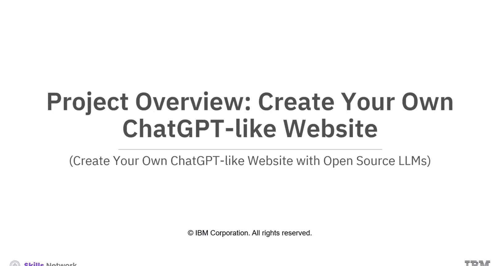
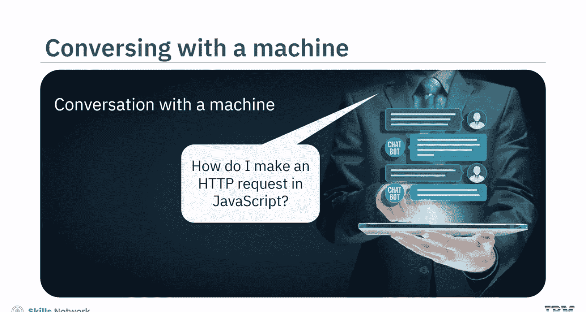
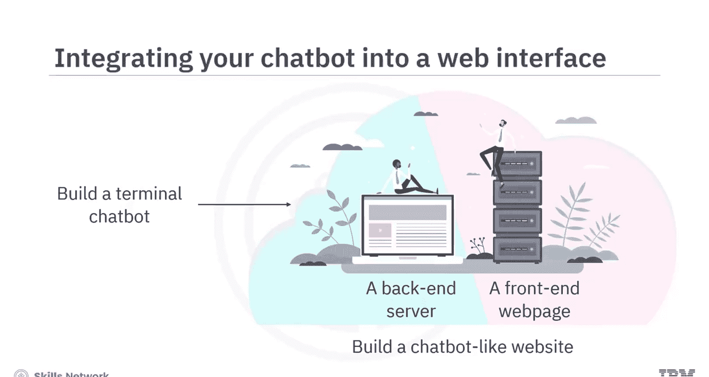
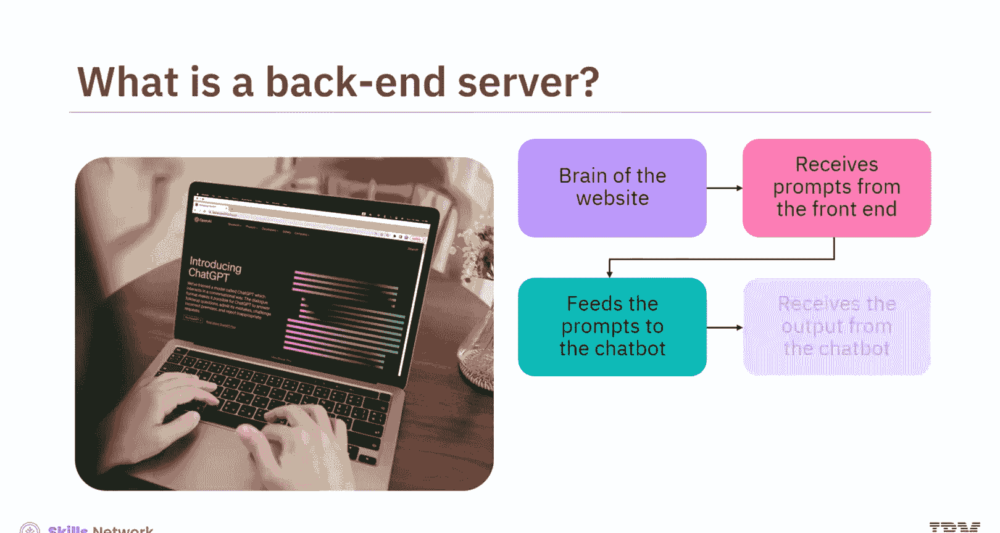
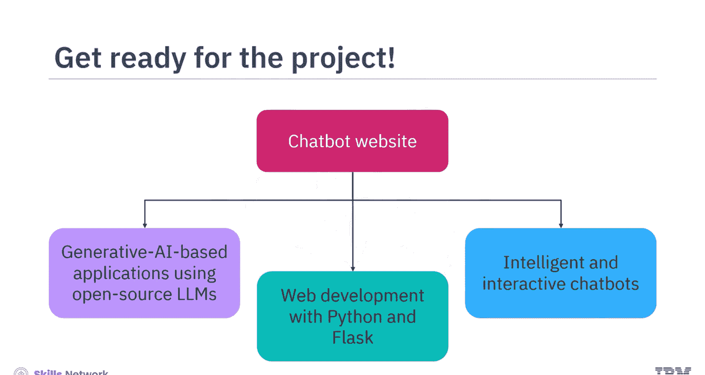

# 020：创建你自己的类ChatGPT网站.zh_en -BV1NAq6Y9E7z_p20-

Welcome to the overview video for the project， createate your own Cha GT like website with open sourceur LLMs。

With the advent of artificial intelligence or AI， it's now possible to hold an intelligent conversation with a machine。

You can extract information on any subject from a computer and save time and effort researching a query。

 such as how do I make an HTTP request in JavaScript？

How is this possible， this type of assistance is possible through a computer program or chat bot。

A chatbot is a computer program that simulates written or spoken human conversation。

With the integration of generative AI technology， such as natural language processing or NLP。

 chatbots can understand questions and respond based on their collected data。

The chatbot program takes text as input and delivers a corresponding text as output。

A special program called a transformformer acts as the brain of the chatbot。

The transformer comprises a large language model or LLM that helps the chatbot understand the input question and generate the humanlike response as the output。

 The LLM program goes through the data it has collected and creates a response based on machine learning。

 The transformer manages the technical processing of input and output data。

 and the LLM focuses on language comprehension and generation。 In this project。

 you will learn to create a simple chatbot with open source LLMs and integrate your chatbot into a web interface。

To build the chatbot， you must select an LLM based on the chatbot's purpose。 For example。

 consider using GPT 2 or GPT3 models for general purpose text generation。

BERT for sentimenttiment Ana and T5 for language translation。

Other important parameters for choosing an LLM include licensing， model size， training data。

 and performance and accuracy。In this project， you will work with Facebook's Splendorbod model。

 it is available with an open source license through the Huging Face website In the project you will also work with Huging faceaces Python Library Transformers。

This library will help you with useful features in building a chatbot。

 such as interacting with the LLM and optimizing the input into a format the LLM understands。

The small building blocks called tokens。You should be familiar with Python and Flask when working on this project。

Also， basic knowledge of HTML， CSS， and JavaScript is recommended， but not essential。

The project provides step by step instructions on working with code and the activities required to build the chatbot using AI tools。

By the end of this project， you will accomplish the following objectives。

 identify the main components of a chat bot， Deter the considerations for selecting an LLM for your application。

Describe how a transformer works。 fetcht an open source model and initialize a tokenizer and program your chatbot in Python。

 After building a terminal chatbot， you will integrate it into a web interface。

To build a chatbot like website， you need to create a backend server that hosts your chatbot and a front end web page that communicates with your backend server。

In a website， the back end server is like the brain of the application in a chatbot application。

 the back end server will receive the prompt from the front end interface and feed them to the chatbot。

The server will then receive the output from the chatbot and display it on the front end interface。

 You will be hosting the back end server using Flask。

 Flask is a Python framework for building web applications。

 It provides tools and functionalities to handle incoming requests。

 process data and generate responses， making powering your website or application easy。

 By the end of this project， you will have the skills to create your AI powered chatbot website。

You will have a solid foundation in building generative AI based applications using open source LLMs。

 you will use your web development skills with Python and Flask to create an intelligent and interactive chatbot。

Get ready for the project。

。