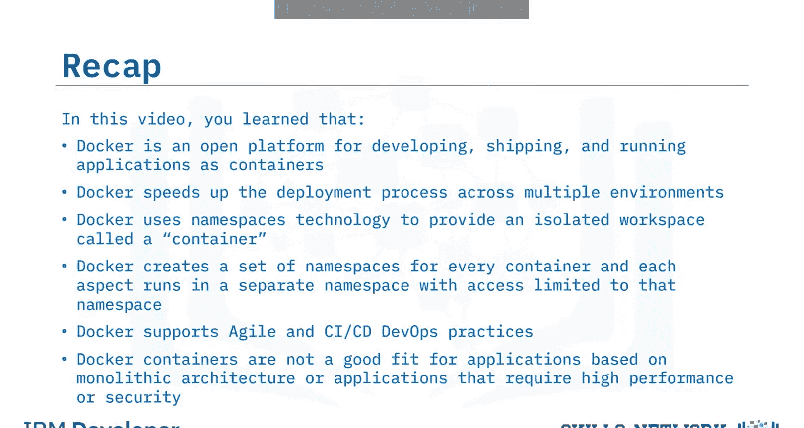

# 022：IBM《生成式人工智能工程｜Falsk、生成式AI应用、数据分析、机器学习、Keras、架构和数据、NLP基础、transformer、微调、高级微调、RAG》 p22 7_Docker简介.zh_en -BV1NAq6Y9E7z_p22-

Welcome to Inuction to Docker After watching this video， you will be able to define what Docker is。

 describe the Docker process and underlying technology， list the benefits of Docker containers。

 and identify the challenges of Docker containers。Available since 2013。

 the official Docker definition， paraphrased， states that Docker is an open platform for developing。

 shipping and running applications as containers。Docker became popular with developers because of its simple architecture。

 massive scalability， and portability on multiple platforms， environments， and locations。

Docker isolates applications from infrastructure， including the hardware， the operating system。

 and the container runtime。Docker is written in the Go programming language Docker uses Linux kernel features to deliver its functionality Docker also uses namespaces to provide an isolated workspace called the container and Docker creates a set of namespaces for every container and each aspect runs in a separate namespace with access limited to that namespace。

Docker methodologyology has inspired additional innovations。

 including complementary tools such as Docker CLI， Docker Compose， and Prometheus。

 and various plugins， including storage plugins， orchestration technologies using Docker Swarm or Kubernetes。

 and development methodologies， using microservices and serverless。

Docker offers the following benefits Docker's consistent and isolated environments result in stable application deployments deployments occur in seconds because Docker images are small and reusable they significantly speed up the development process and Docker automation capabilities help eliminate errors。

 simplifying the maintenance cycle Docker supports agile and CICD DevOs practices Docker's easy versioning speeds up testing。

 rollbacks and redeployments Docker helps segment applications for easy refresh。

 cleanup and repair and developers collaborate to resolve issues faster and scale containers when needed。

 and Docker images are platform independent so they are highly portable。

Docker is not a good fit for applications with these qualities require high performance or security are based on monolithic architecture。

 use rich GuI features or perform standard desktop or limited functions In this video you learned that Docker is an open platform for developing shipping and running applications as containers Docker speeds up the deployment process across multiple environments。

 Docker uses namespaces technology to provide an isolated workspace called the container Docker creates a set of namespaces for every container and each aspect runs in a separate namespace with access limited to that namespace。

Dcker supports Agile and CICD DevOps practices， and lastly。

 Docker containers are not a good fit for applications based on monolithic architecture or applications that require high performance or security。

。

