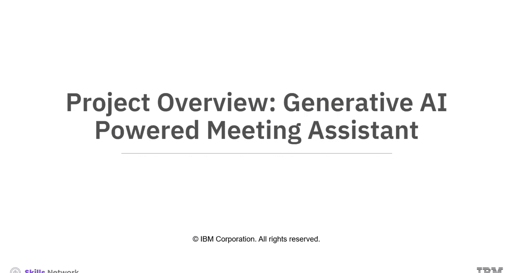
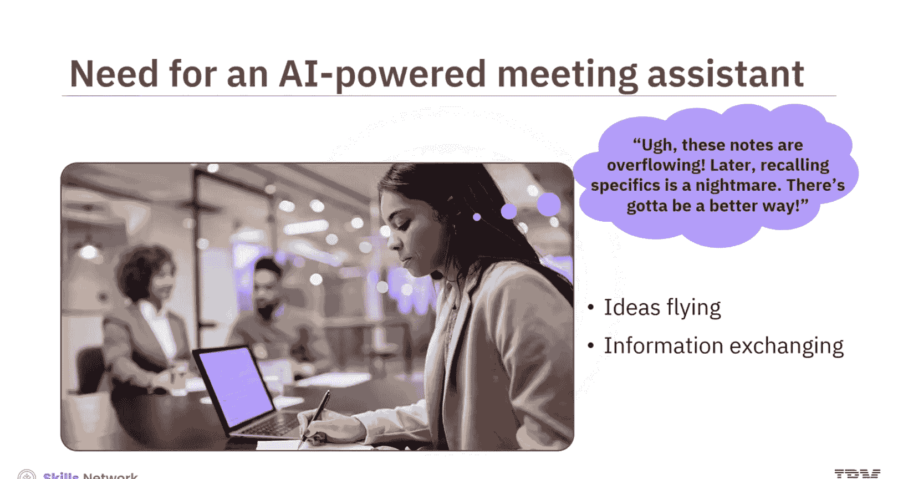
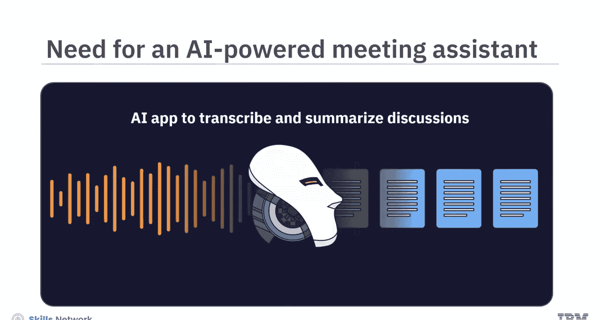
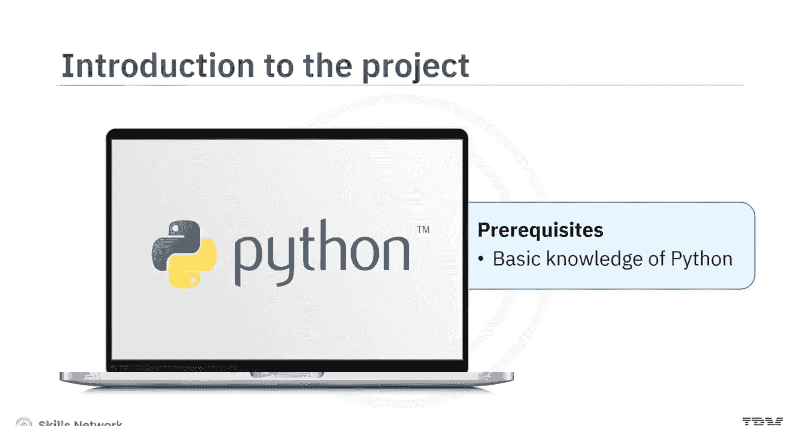
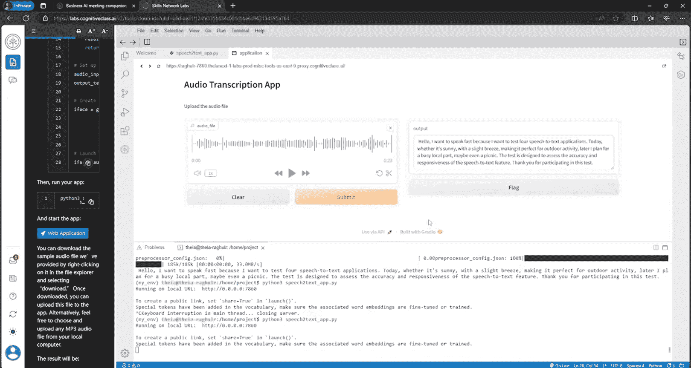
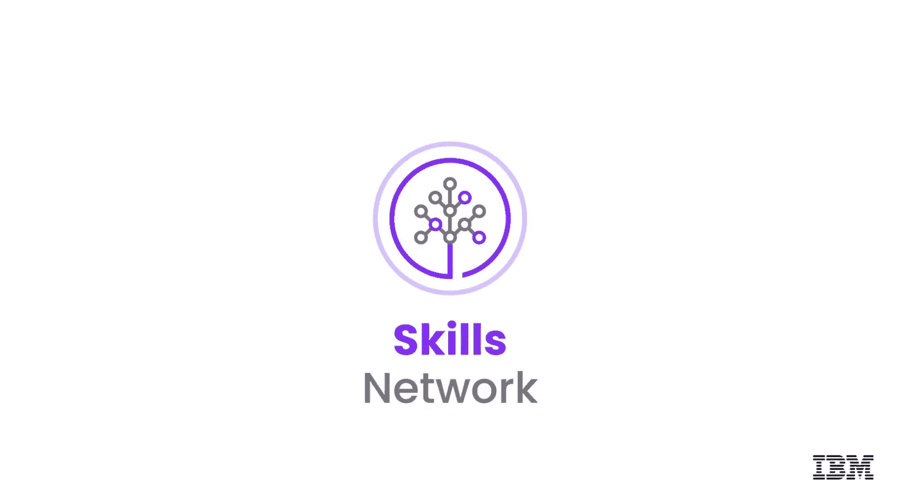

# 023：生成式AI驱动的会议助手.zh_en -BV1NAq6Y9E7z_p23-

Welcome to the overview video of the project， generative AI Powered Me Assistant。😡。

Imagine you're in a brainstorming meeting， Ideas flying fast and furious and nuggets of information are being exchanged You jot down notes。

 but can you capture everything later， recalling key decisions or specific action items becomes frustrating This is where an innovative generative AIbased app that can transcribe and summarize a meeting's discussions would be helpful Imagine an app that can transcribe the meeting discussions accurately and then provide a concise summary。

 highlighting the key points and decisions made This is the power of combining automatic speech recognition or ASR and generative AIbased large language models or LLMs。

😡。

You can use ASR technology to convert spoken language into readable text。

 then you can utilize an LLM to comprehend and summarize the text efficiently。😡。

An LLM can also refine the speech to text output by correcting minor errors。

 ensuring a coherent and accurate result。This project will guide you through building such an app。

 you'll utilize an ASR tool called Open AI Whisper for Spch to T conversion and leverage Lama 2 LLM's capabilities to summarize and extract key points Lama2 is a robust open source language model by Meta。

😡，The project includes step by step instructions on building and deploying the app in a serverless environment。

First， you will implement Open AIWhis to transcribe audio to text using a sample audio file。Next。

 you build an intuitive and user friendly interface for the app using Huging F Radio further you will integrate the Lama 2 LLM hosted by IBM Watson X to summarize the transcribed audio effectively。

😡，IBM Watson X provides various generative AI models。

 including Lama2 you will learn to create a Python script to generate text using the model and some key parameters influencing the model's output Finally you will learn to deploy the application online using IBM code engine。

 a serverless platform for running applications in the cloud for the project you'll utilize Python to code different activities so you should have a basic knowledge of the programming language。

Let's view the demo of the app you'll develop in this project this app output will be displayed in Gdio's app output text box the app interface displays the title audioio transcription app。

😡。

You can upload the recorded audio file using the click to upload icon。

 click Submit the summary and key points of the content and the audio file are displayed as the output。

😡。

By the end of this project， you will accomplish the following objectives。

Explain how LLMs can help generate， refine and summarize text。

Implement automatic speech recognition technology for speech to text conversion。

 design a user friendly interface for an app， deploy an application online using a cloud platform for hosting applications。

By working on this project， you will lay a solid foundation for using LLMs for text generation and summarization tasks。

The project provides an opportunity to demonstrate your Python programming skills to build and deploy an app。

😡，Leveraging the capabilities of AI speech to text conversion and generative AI LLMs。

Get ready to apply and upgrade your skills。

