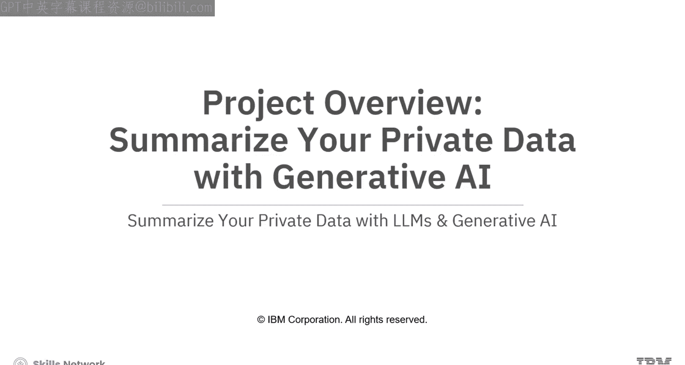
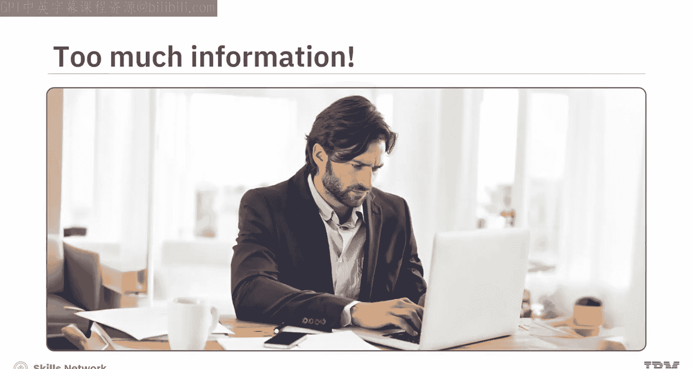
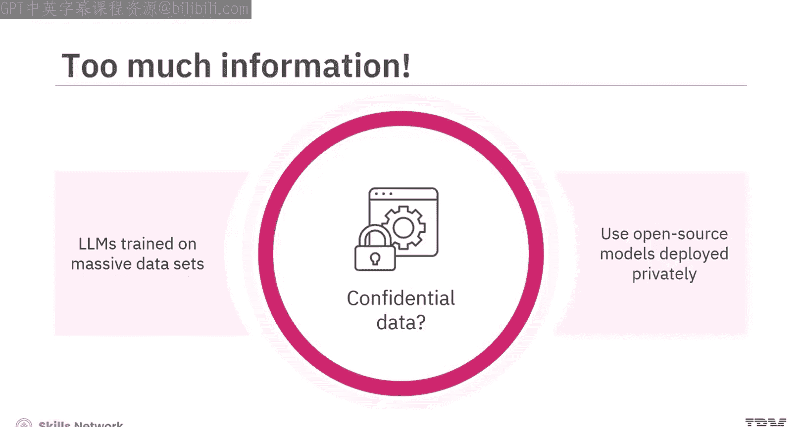
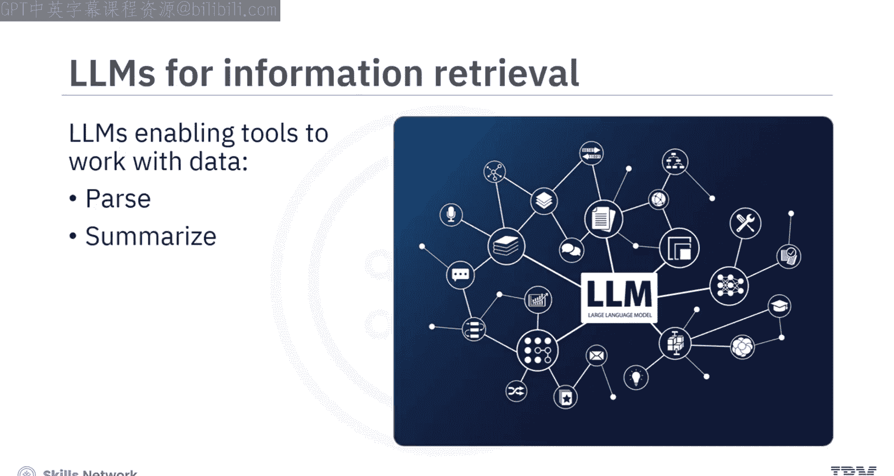
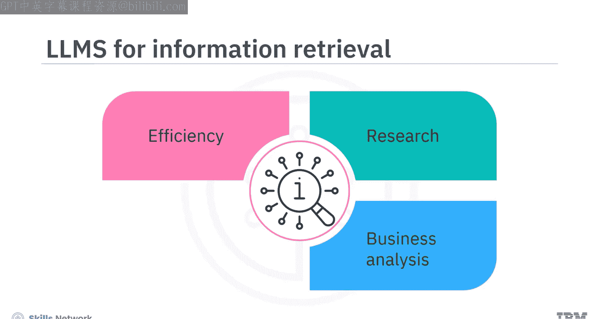
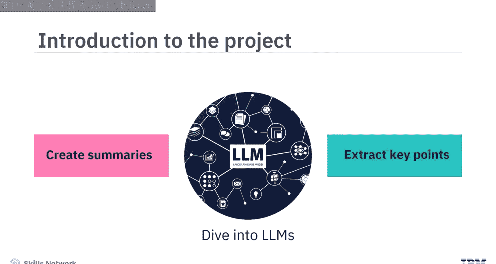
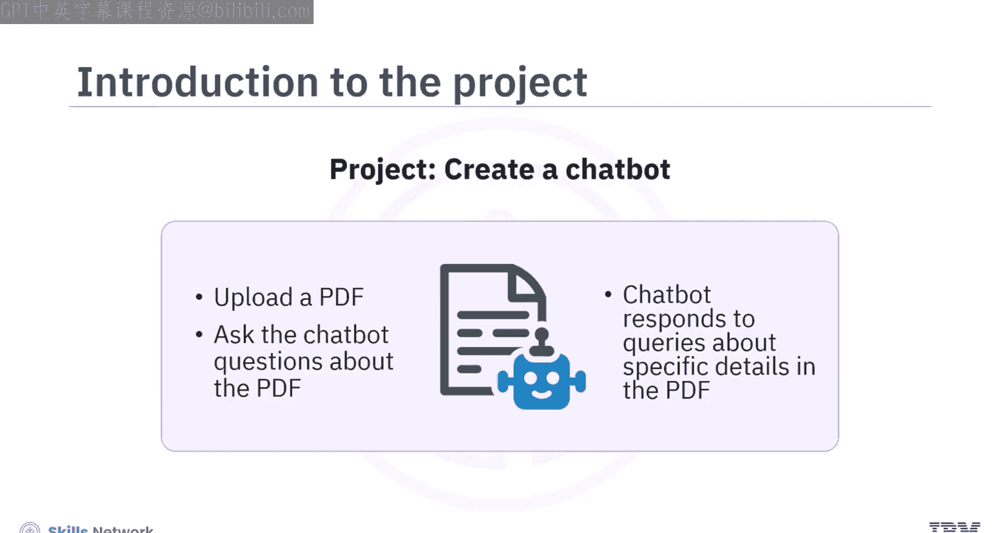
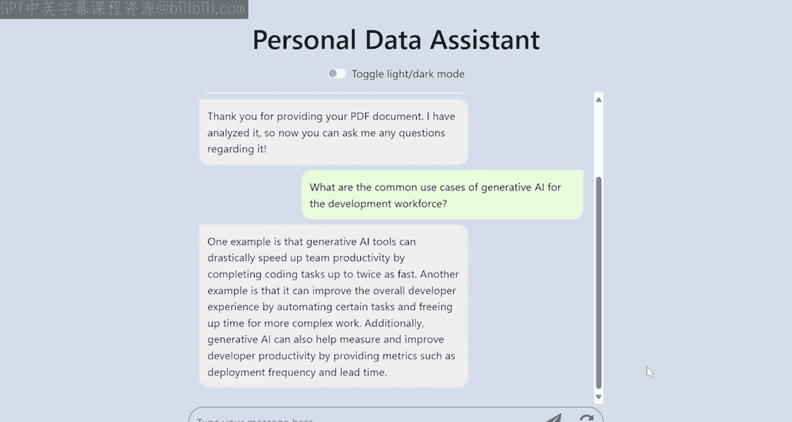
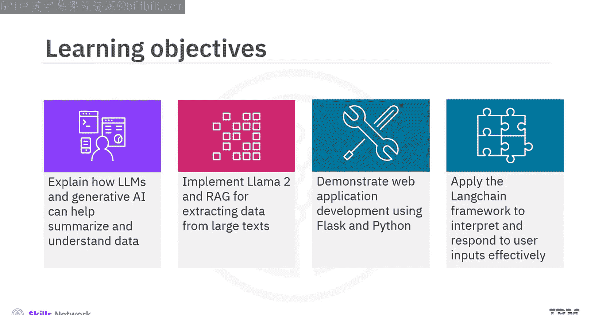
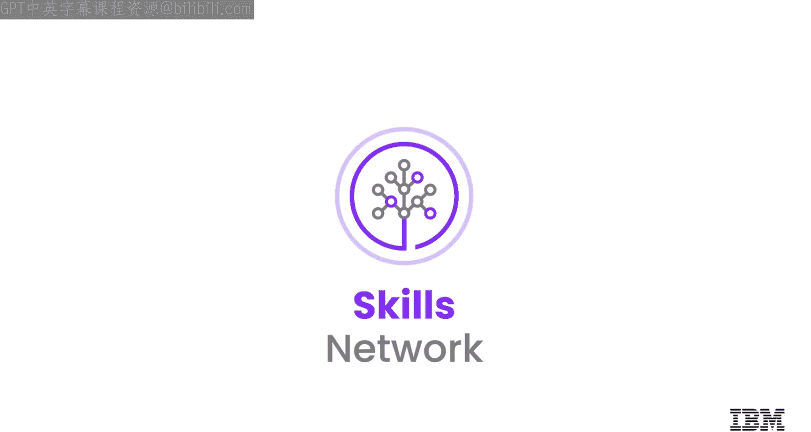

# 025：使用生成式AI和RAG总结你的私人数据.zh_en -BV1NAq6Y9E7z_p25-

Welcome to the overview video for the project。 summarizemarize your private data with LLMs and generative AI。

 Do you ever feel overwhelmed by the vast amount of information you encounter daily documents。

 emails， reports。

In today's digital age， we're constantly bombarded with data。

 making it difficult to find the specific details we need。

 extracttracting insights from the overwhelming volume of data is like searching for a needle in a haystack。

This is where generative AI in large language models or LLMs come in。

LLMs are trained on massive data sets， however， when you have sensitive or confidential data you don't want to share with the public model。

 you can use open source models deployed privately。

With the advancements in generative AI models like LLMs。

 we can create and leverage tools to efficiently parse， summarize。

 and comprehend vast amounts of data。

By understanding and harnessing the capabilities of LLMs。

 you can transform the landscape of information retrieval， This goes beyond mere efficiency。

 it opens new frontiers for research， business analysis。

 and even day to day decision making processes。

This project dives into LLMs， providing you with the skills to use LLMs for creating concise summaries and extracting key points from even lengthy documents。

In the project， you will create a chatbot that allows you to upload a PDF file subsequently you can post questions to the chatbot regarding the PDFs contents。

😡，This chatbot will not only engage with users through text。

 but also understand and respond to their queries about the specific details in the PDF。

Let's check out a demo of the chatbot you'll develop in this project。😡。

The chat bot will be accessed as a personal data assistant interface。

Here you'll see an initial message from the chatbot and an option to upload file。

 Let's upload a PDF document for analysis for this demo。

 we'll be uploading a PDF that includes an IBM blog titled9 WaysDevelop for Productivity is boosted by generative AI。

 Once uploaded， ask the chatbot Any questions about the P's content。 For example。

 What are common Use Cas of generative AI for the development workforce。😡。

The chat bot will analyze the content of the PDF and provide answers based on its understanding。

To build the chat bot in the project， you will work on a Lama 2 LLM Lama 2 is a family of open access LLMs released by Meta。

It processes natural language， understands user inputs， and generates text based responses。

In the project， the use of Lama 2 is supported by the retrieval augmentation generation or RAG technique。

Rag will enable Lama2 to access and leverage information from external sources or the internet。

 this combination will make the chatbot smarter at giving more accurate and relevant answers。

In the project， you will implement the flask and Lng chain frameworks Flask is a lightweight web application framework in Python that is used to develop the back end of the chatbot。

 handling HTTP requests and serving responses。😡，The Lang chain framework can integrate LLMs into applications。

 which can be used here to facilitate the interaction between the FlaskG and Lama 2 for processing user queries。

To work on this project， you should be familiar with Python。

 Also it's recommended but not essential to have basic knowledge of HTML， CSS， and JavaScript。

The project provides step by step instructions on how to work with the code and different activities required to build the chatbot By the end of this project。

 you'll be able to attain the following objectives。

 Ex how LLMs and generative AI can help to summarize and understand data。

 implement Lama 2 and RaG for extracting data from large texts。

 De web application development using flask and Python and apply the Langchang framework to interpret and respond to user inputs effectively。

😡。

This project will dive deep into building a powerful chatbot application。

 You'll learn about chatbots， web development with flask and Python。

 and harness the power of Langcha to understand and respond to diverse user inputs。 By the end。

 you'll have a fully functional chatbot that showcases your newfound expertise。😡。

