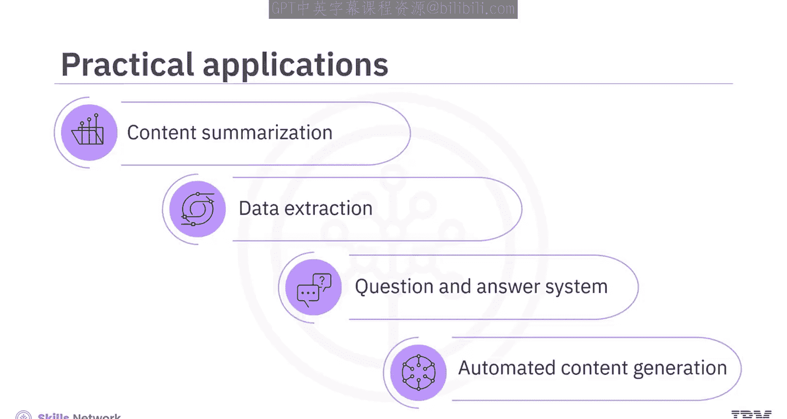
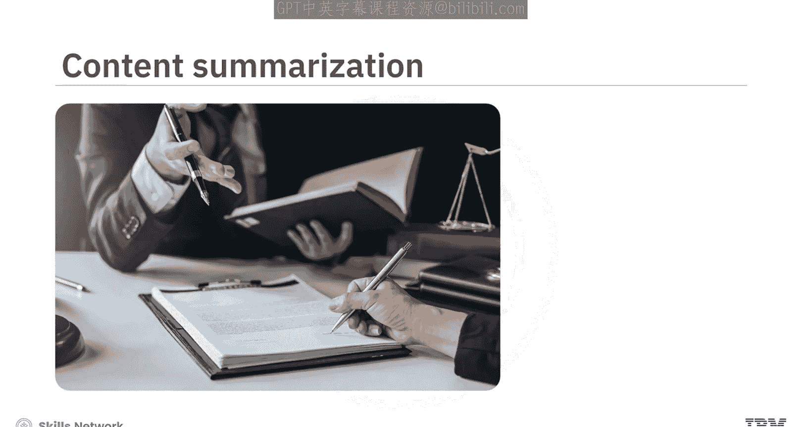
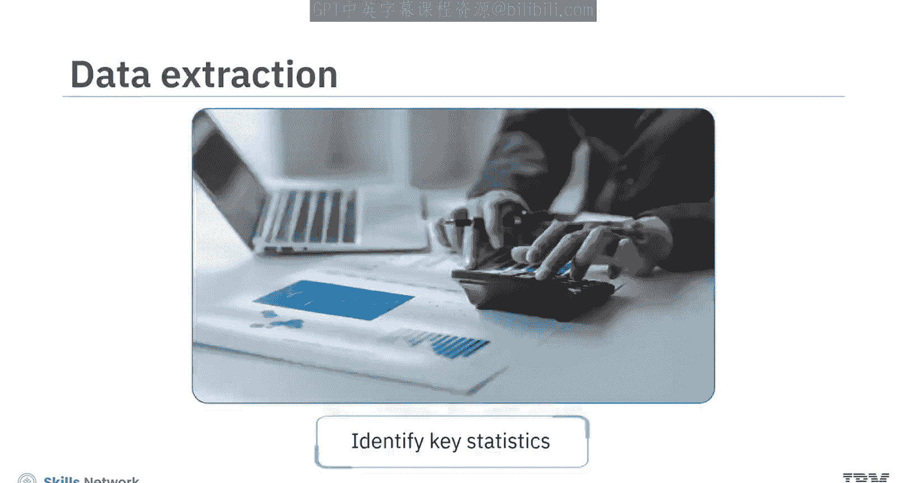
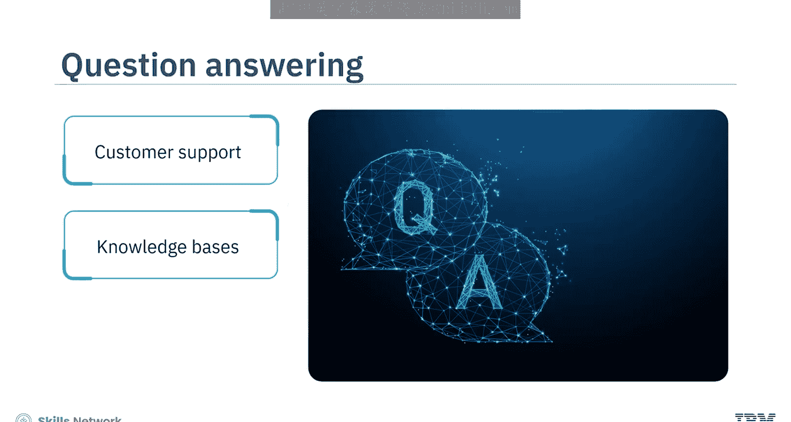
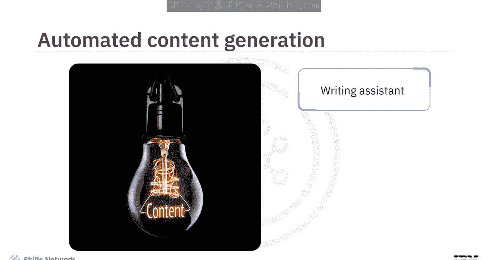
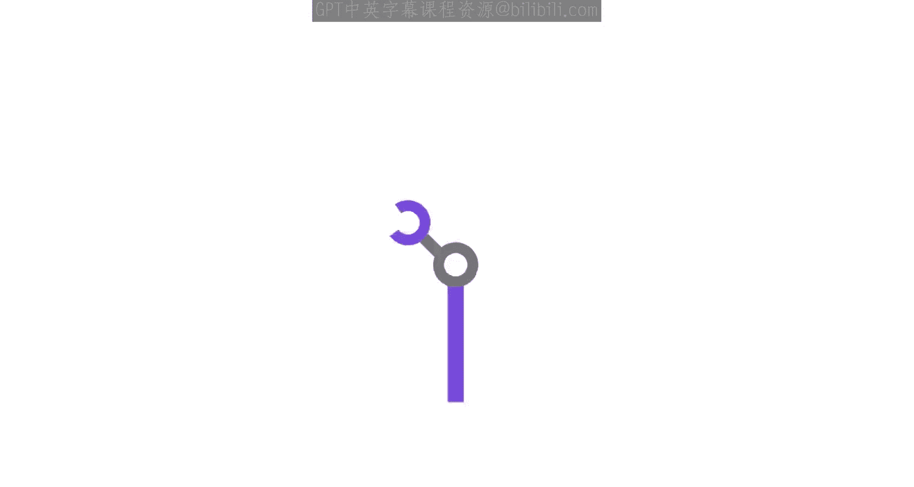

# 026：IBM《生成式人工智能工程｜Falsk、生成式AI应用、数据分析、机器学习、Keras、架构和数据、NLP基础、transformer、微调、高级微调、RAG》 p26 11_LangChain简介.zh_en -BV1NAq6Y9E7z_p26-

嗯。Welcome to this introduction to Langchain After watching this video you'll be able to describe Langchain's purpose。

 discuss its benefits， devise practical uses for Langchain。

 explain how Langchain works with other data types The Langchain open source Python framework streamlines the development of large language model LLM applications Langchain provides developers with components and interfaces to assist in integrating LLMs into their AI applications The framework is used to pinpoint relevant information and text such as a research paper or legal document It also provides methods for responding to complex prompt by retrieving data and generating a coherent summary。

It chains together the retrieval， extraction， processing and generation operations from the large amounts of text and multiple sources。

 hence the word chain as part of its name AI developers prefer this framework because of several key benefits。

 including its modularity， extensibility and decomposition capabilities。

 It also easily integrates with vector databases Let's discuss each of these LangChain's design allows application developers to piece together different components like building blocks。

 This modularity also encourages component reuse producing development time and effort LangCha's extensible design allows developers to readily add new features。

 adapt to existing components， integrate with external systems and make only minimal changes to their code bases。

Langchain mimics the human problemso process by breaking down complex queries or tasks into smaller manageable steps This decomposition capability enables it to make accurate inferences from context。

 resulting in relevant precise responses Langchain integrates with vector databases for efficient semantic searches and information retrieval when used in conjunction with vector databases it provides applications quick access to relevant information within extensive data sets AI applications can leverage the Lang chain framework for a number of practical uses such as content sumization data extraction。

 sophisticated question and answer systems and automated content generation let's explore a specific example of each With its ability to summarize articles reports and documents。

 users can stay better informed by deciphering the meaning of complex legal documents It can extract key statistics from reports simplifying the process of turning text into action insights。

Question and answer systems with L chain can transform customer support and knowledge based services these systems can provide contextually relevant answers to a chain of clarifying responses based on the entire conversation。

Langchain can assist with a generation of written materials。

 the framework opens possibilities for automating routine writing tasks such as drafting emails。

 brainstorming or technical documentation， while primarily designed for text-based applications。

 Langchain can work with other data types such as images。

 audio and video by leveraging external libraries and models like speech to textex。

 its integration with vector databases enables the use of embeddings generated from these data types to capture semantic meaning and perform similarity searches。

 making it a valuable tool for various AI tasks。

In this video you learned that LangChain is a Python framework for pinpointing relevant information and text and providing methods for responding to complex prompts Ben include modularity。

 extensibility， decomposition capabilities and easy integration with vector databases。

 several practical applications include deciphering complex legal documents。

 extracting key statistics from reports， customer support， and automating routine writing tasks。

 LangChain can be used with other data types by using external libraries and models。

