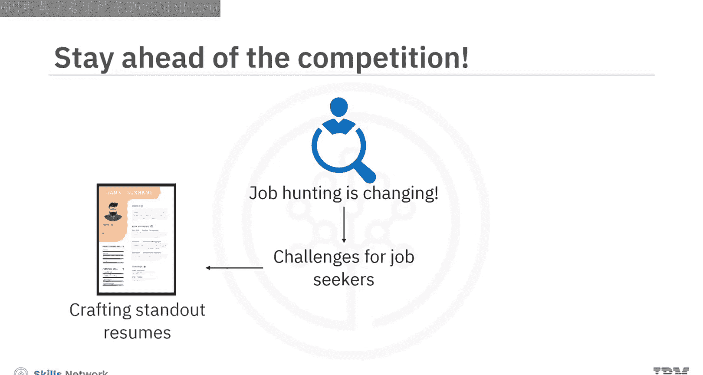
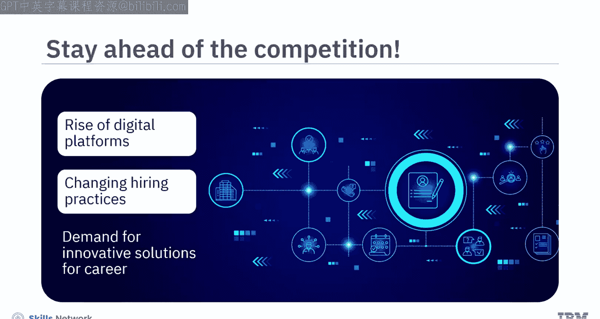
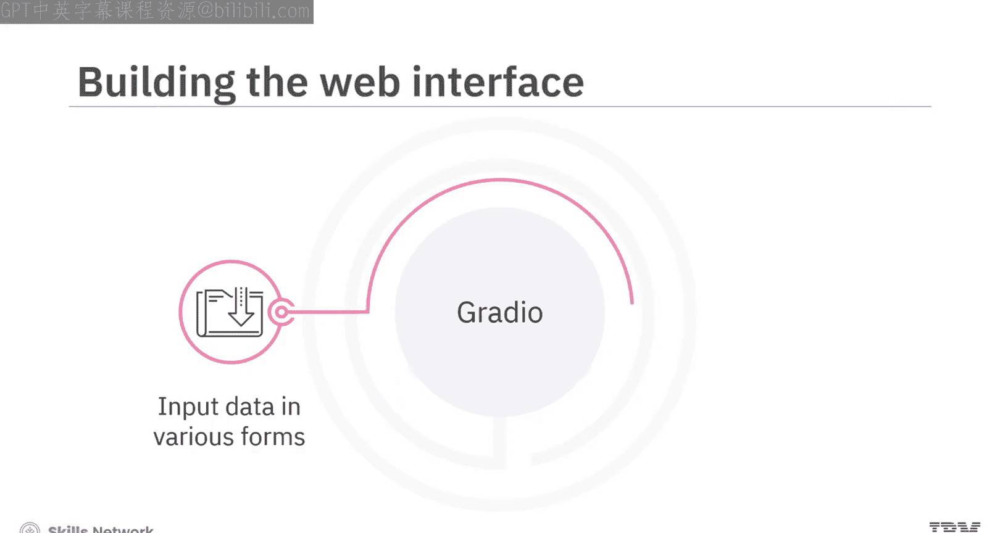
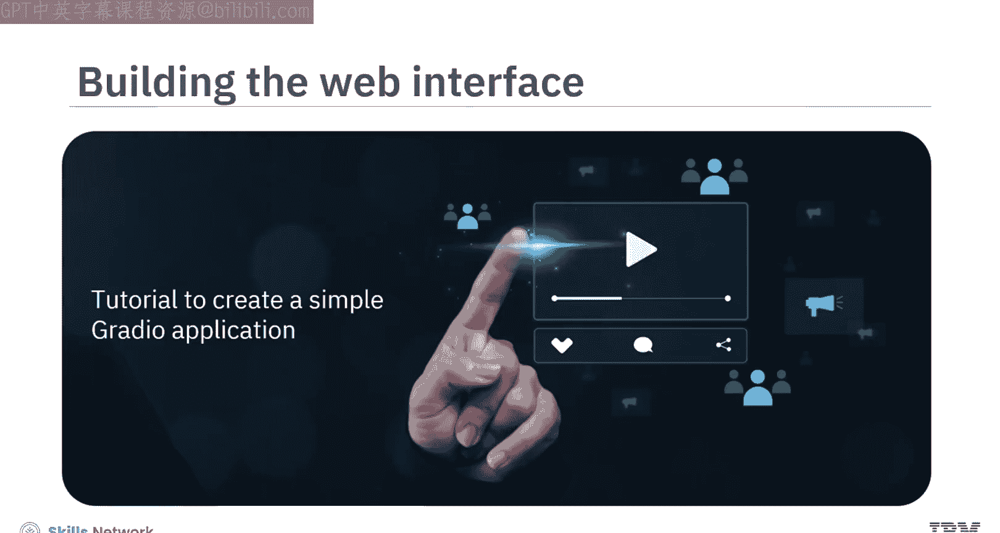
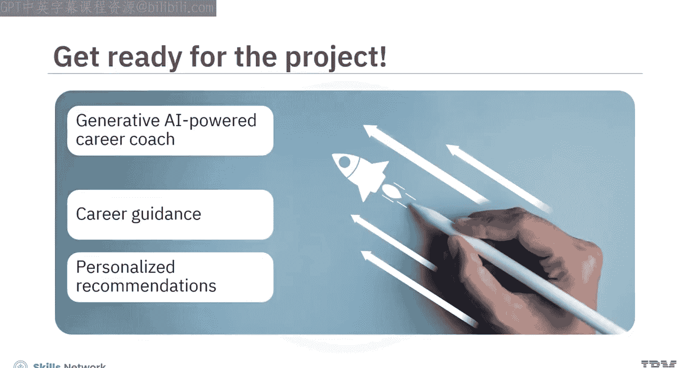

# 029：IBM《生成式人工智能工程｜Falsk、生成式AI应用、数据分析、机器学习、Keras、架构和数据、NLP基础、transformer、微调、高级微调、RAG》 p29 14_项目构建AI职业教练简介.zh_en -BV1NAq6Y9E7z_p29-

嗯。

Welcome to the overview video for the project， your personalized jobb application coach based on LLM。

Job hunting is changing in today's competitive job market。

 traditional job hunting methods are not enough。Job seekers often face numerous challenges from crafting standout resumes to effectively communicating their value to potential employers。

With the rise of digital platforms and changing hiring practices。

 there is a growing demand for innovative solutions for crafting effective resumes and guiding career growth。

In this project you will build an AI career coach that provides three essential apps First。

 you develop a resume polisher that uses AI to analyze and improve resumes based on job descriptions Next you create a personalized cover letter generator that drafts customized cover letters。

 enhancing job application processes。Finally， you will build a personalized career advisor that provides career improvement recommendations。

Let's check out a demo of the resume Polisher tool which sharpens the resume content based on your instructions for optimal results。

 we suggest polishing your resume section by section。

The resume polisher is displayed in the interface designed using radio in the position name field。

 enter the role or position you want， Sa data analyst in the resume content field。

 enter the content you wish to modify and in the polish instruction field。

 enter any instruction or improvement areas you may want to suggest。Click Subit。After a few seconds。

 the revised content is displayed。Next， let's check the cover letter generator。

 It will assist you in crafting cover letters that showcase your skills and experiences and customizes them to fit the job and company you're applying to in the generated interface。

 enter the company name and position。 Next， enter the job description。 and finally。

 enter the content of your resume。 Click Subit you will have the cover letter generated in a few seconds。

Finally， check the Care Advor tool which provides advice about your career based on the job and your resume the tool interface includes several fields。

 first enter the position for which you wish to apply。

 enter the job description for the position or role then enter the content of your resume click Subm After a few seconds the career coach will provide enhancement areas or other recommendations。

The applications in this project are built by leveraging the Lama 27BCha largege language model or LLM developed by Me This model has been integrated into IBM's Watsonx。

AI platform。The project equips you with the knowledge to incorporate Lllms from Watsonex。

aiI into your applications using the provided APIs you will build a webinar face of the applications in the project using radioio。

With radio， you can quickly design web interfaces， enabling users to input data in diverse forms such as text。

 images， or audio， and instantly view the output generated by a model The project provides a tutorial to familiarize you with radio and how to create a simple radio application。

To work on this project， you should be familiar with the basics of Python， however。

 do not worry about writing complex scripts to build these applications。

The project includes step by step instructions and the required Python scripts。

By the end of this module， you will be able to attain the following objectives。

 build AI powered applications with Python programming。

 leverage open source LLMs integrated into AI platforms such as IBM Watson X。

 and utilize radio to build a web interface for an application。

This project delves into building a generative AI powered career coach。

The project aims to support career guidance using AI to offer personalized recommendations tailored to individual aspirations and goals。

Let's get started。

。