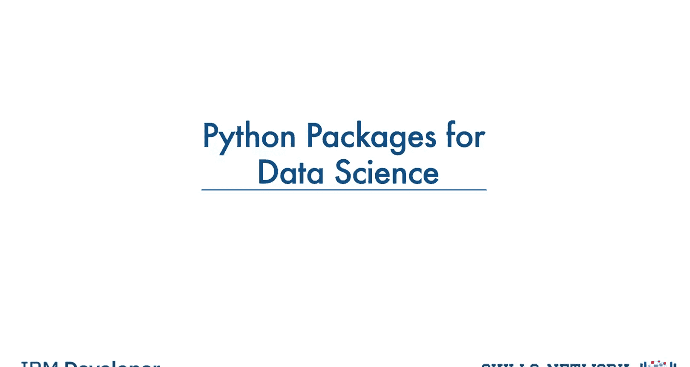
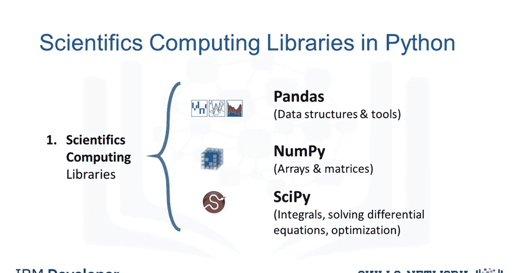
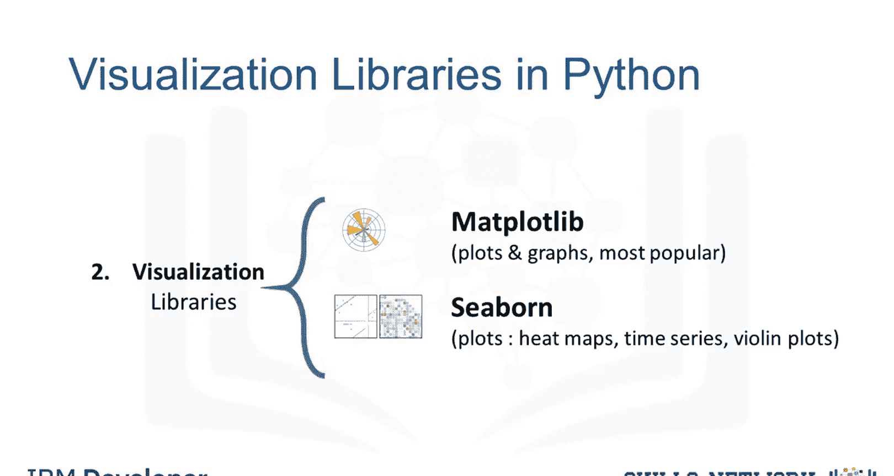
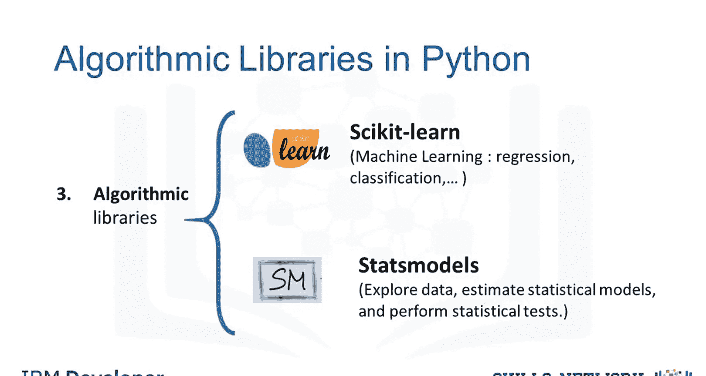

# 032：IBM《生成式人工智能工程｜Falsk、生成式AI应用、数据分析、机器学习、Keras、架构和数据、NLP基础、transformer、微调、高级微调、RAG》 p32 2_数据科学的Python包.zh_en -BV1NAq6Y9E7z_p32-

In order to do data analysis in Python， we should first tell you a little bit about the main packages relevant to analysis in Python。

A Python library is a collection of functions and methods that allow you to perform lots of actions without writing any code。

The libraries usually contain built in modules， providing different functionalities。

 which you can use directly。 and there are extensive libraries offering a broad range of facilities。

 We have divided the Python data analysis libraries into three groups。

 The first group is called scientific computing libraries。

 Padas offers data structure and tools for effective data manipulation and analysis。

 It provides facts， access to structured data。 The primary instrument of pandas as a two dimensional table consisting of column and row labels。

 which are called a data f。It is designed to provide easy indexing functionality。

The Nmi Library uses arrays for its inputs and outputs。 It can be extended to objects for matrices。

 and with minor coding changes， developers can perform fast array processing。

Si Pi includes functions for some advanced math problems as listed on this slide。

 as well as data visualization。

Using data visualization methods is the best way to communicate with others。

 showing the meaningful results of analysis。 These libraries enable you to create graphs。

 charts and maps。 The map plot Lib package is the most well known library for data visualization。

 It is great for making graphs and plots。 The graphs are also highly customizable。😊。

Another high level visualization library is Seaborn。 It is based on Matteplot Lib。

It's very easy to generate various plots such as heat maps， time series and violin plots。

With machine learning algorithms， were able to develop a model using our data set and obtain predictions。

 The algorithmic libraries tackle some machine learning tasks from basic to complex。 Here。

 we introduce two packages。 The Psi Ki Learn library， contains tools statistical modeling。

 including regression， classification， clustering and so on。 This library is built on numppy。

 Pi Pi and mappl Li。😊，Stat's models is also a Python module that allows users to explore data。

 estimate statistical models， and perform statistical tests。

