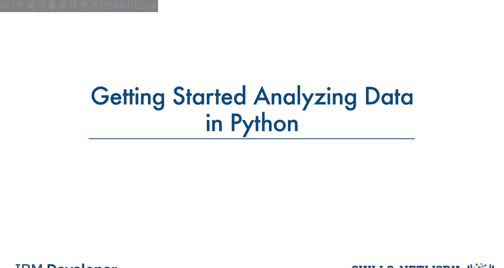
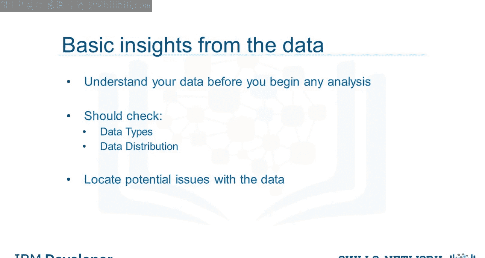
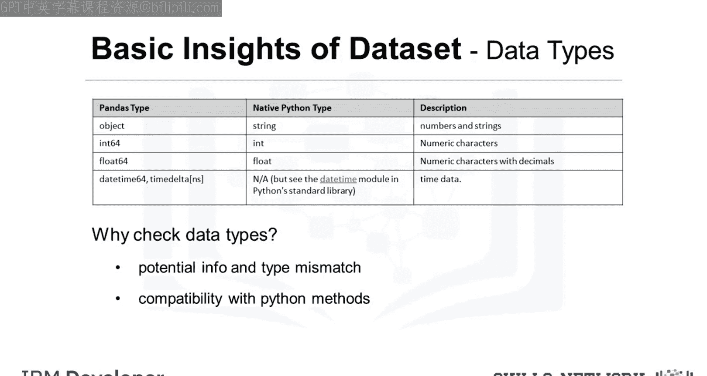
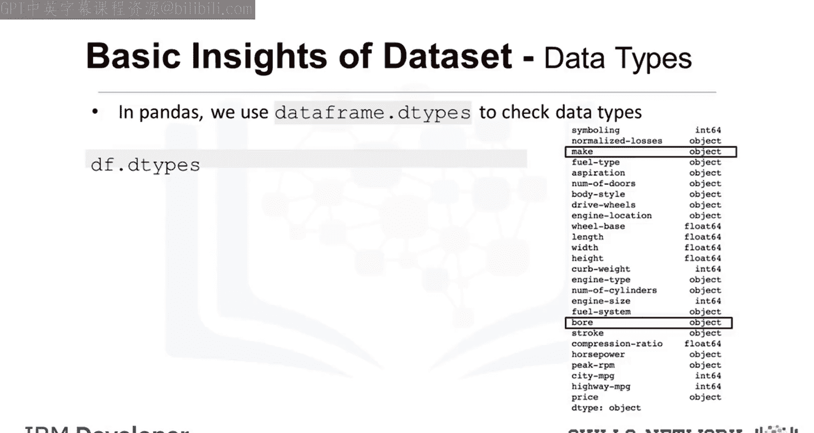
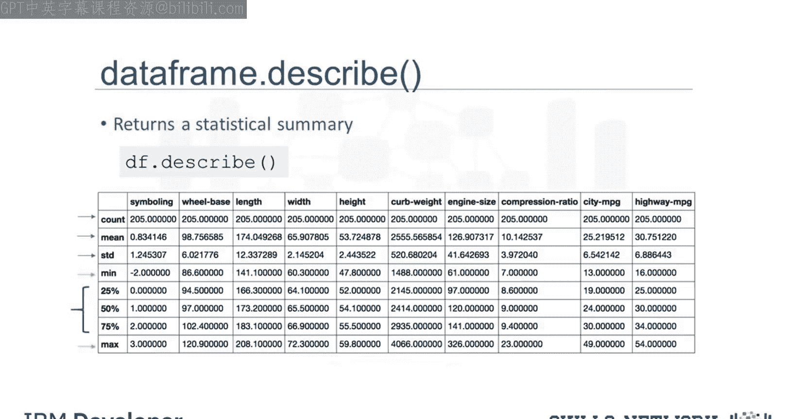
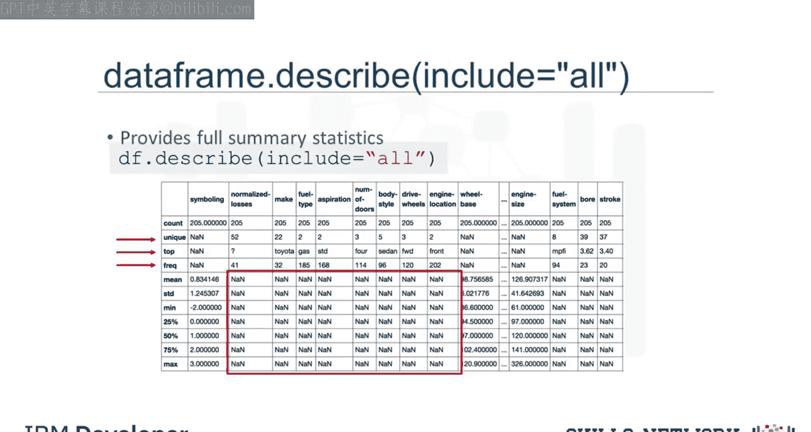
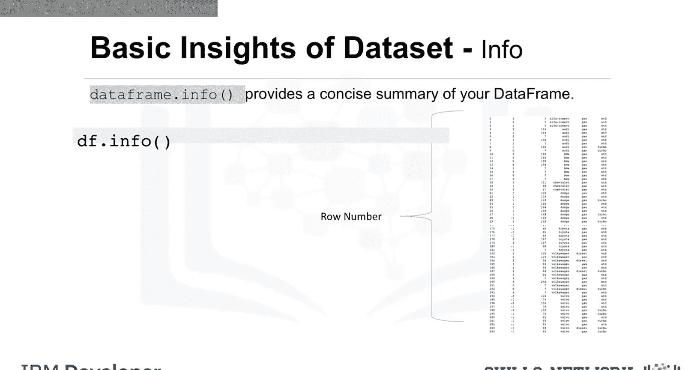

# 034：IBM《生成式人工智能工程｜Falsk、生成式AI应用、数据分析、机器学习、Keras、架构和数据、NLP基础、transformer、微调、高级微调、RAG》 p34 4_开始在Python中分析数据.zh_en -BV1NAq6Y9E7z_p34-

In this video， we introduce some simple panda's methods that all data scientists and analysts should know when using Python pandas and data。

At this point， we assume that the data has been loaded。 It's time for us to explore the data set。

Pas has several built in methods that can be used to understand the data type of features or to look at the distribution of data within the data set。

Using these methods gives an overview of the data set and also point out potential issues such as the wrong data type of features。

 which may need to be resolved later on。

Data has a variety of types。 The main types stored in pandas。 Objects are object， Fat。

 int and date time。 The data typed names are somewhat different from those in native Python。

This table shows the differences and similarities between them。Some are very similar。

 such as the numeric data types， int and float。 The object panda's type functions similar to string in Python。

 save for the change in name， While the date time pandas type is a very useful type for handling time series data。

There are two reasons to check data types in a data set。

Pandas automatically assigns types based on the encoding it to text from the original data table。

 For a number of reasons， this assignment may be incorrect。 For example。

 it should be awkward if the car price column， which we should expect to contain continuous numeric numbers is assigned the data type of object。

 It would be more natural for it to have the float type。

 Jerry may need to manually change the data type to float。

The second reason is that it allows an experienced data scientist to see which Python functions can be applied to a specific column。

 For example， some math functions can only be applied to numerical data。

If these functions are applied to non numerical data， an error may result。

When the D type method is applied to the data set， the data type of each column is returned in a series。

 A good data scientist's intuition tells us that most of the data types make sense。The make of cars。

 for example， are names。 So this information should be of type object。

 The last one on the list could be an issue。 As bohr is at a dimension dimension of an engine。

 we should expect a numerical data type to be used。 Instead。

 the object type is used In later sections， Jerry will have to correct these type mismatches。

Now we would like to check the statistical summary of each column to learn about the distribution of data in each column。

The statistical metrics can tell the data scientist if there are mathematical issues that may exist。

 such as extreme outliers and large deviations。 The data scientists may have to address these issues later。

 to get the quick statistics。 We use the described method。

 It returns the number of terms in the column as count average column value as mean column standard deviation as STD。

 the maximum minimum values， as well as the boundary of each of the quartiles。By default。

 the data frame dot described function skips rows and columns that do not contain numbers。

It is possible to make the describe method work for object type columns as well。

To enable a summary of all the columns， we could add an argument include equals all inside the De function bracket。

Now， the outcome shows the summary of all the 26 columns， including object typed attributes。

 we see that for the object type columns， a different set of statistics is evaluated。

 like unique top and frequency。Unique is the number of distinct objects in the column。

 Top is the most frequently occurring object， and freak is the number of times the top object appears in the column。

Some values in the table are shown here as N A N， which stands for not a number。

 This is because that particular statistical metric cannot be calculated for that specific column data type。

Another method you can use to check your data set is the data frame dot info function。

 This function shows the top 30 rows and bottom 30 rows of the data frame。

