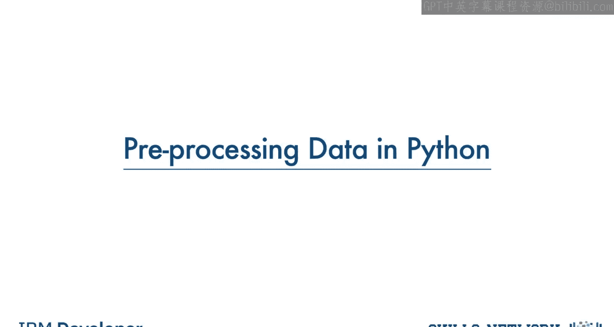
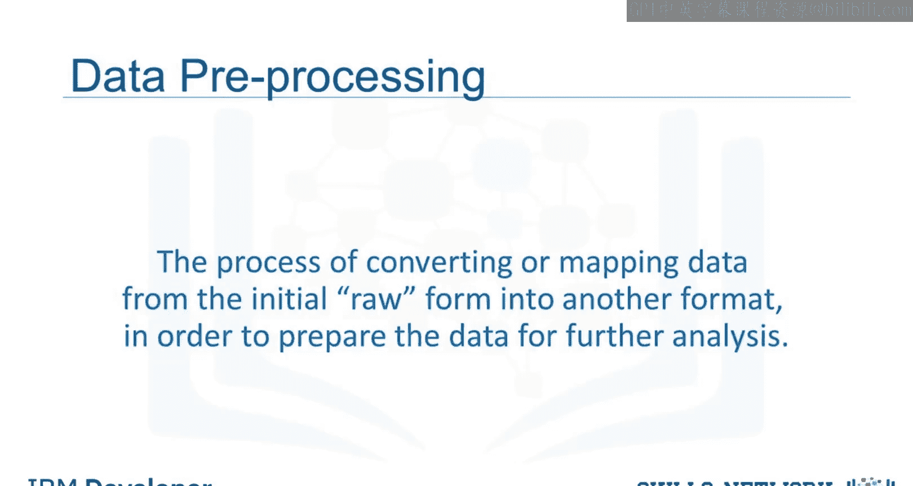
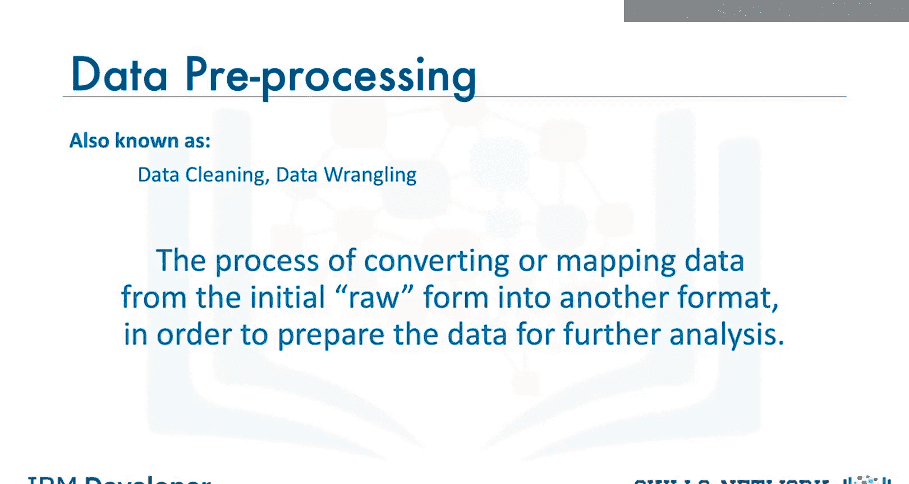
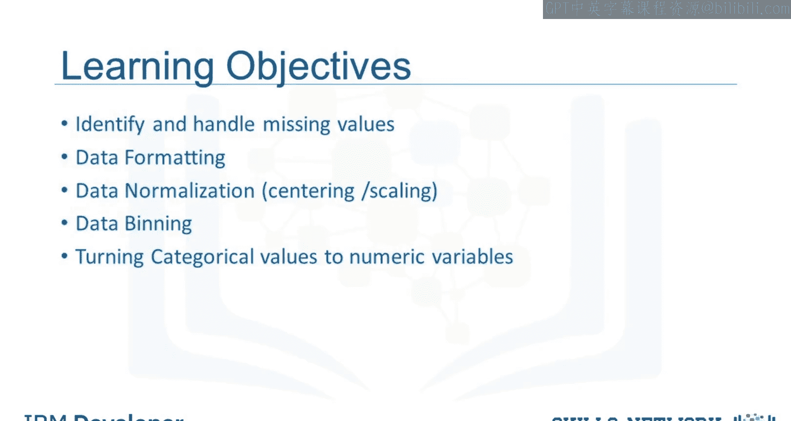
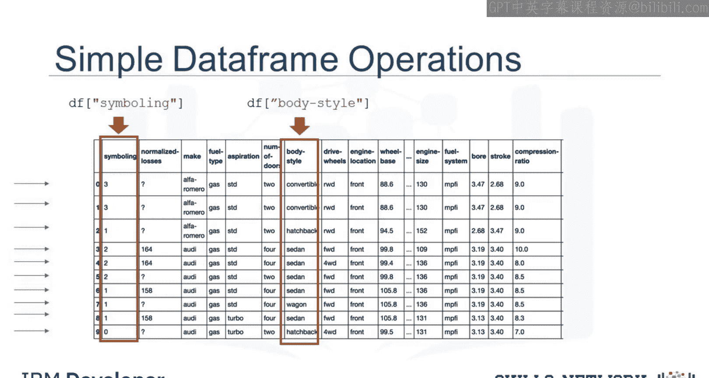
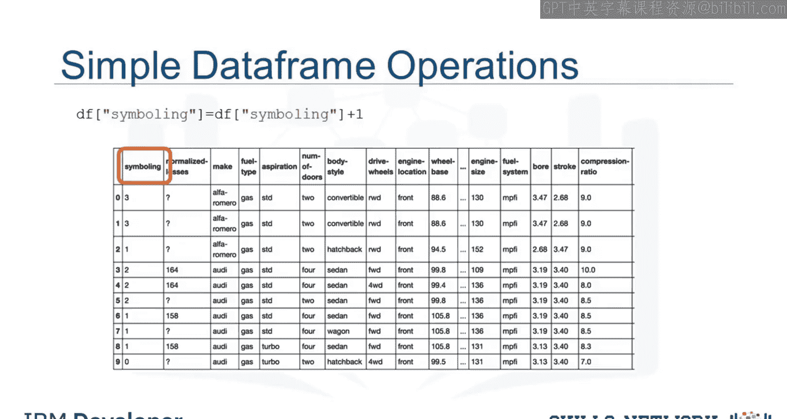

# 036：IBM《生成式人工智能工程｜Falsk、生成式AI应用、数据分析、机器学习、Keras、架构和数据、NLP基础、transformer、微调、高级微调、RAG》 p36 6_在Python中预处理数据.zh_en -BV1NAq6Y9E7z_p36-

In this video， we'll be going through some data pre processing techniques。

 If you're unfamiliar with the term， data pre processing is a necessary step in data analysis。

 It is the process of converting or mapping data from one raw form into another format to make it ready for further analysis。

 Data prepro is often called data cleaning or data wrangling。 and there are likely other terms。

 Here are the topics that we'll be covering in this module。 First。

 we'll show you how to identify and handle missing values。

 A missing value condition occurs whenever a data entry is left empty。 Then well cover data formats。

 Data from different sources， maybe in various formats in different units or in various conventions。

 We will introduce some methods in Python pandas that can standardize the values into the same format or unit or convention。

 After that， will cover data normalization。 Different columns of numerical data may have very different ranges and direct comparison is often not。

Meaningful。Normalization is a way to bring all data into a similar range for more useful comparison。

 specifically we'll focus on the techniques of centering and scaling。

 and then we'll introduce data binning。 Bning creates bigger categories from a set of numerical values。

 It is particularly useful for comparison between groups of data。 And lastly。

 we'll talk about categorical variables and show you how to convert categorical values into numeric variables to make statistical modeling easier In Python。

 We usually perform operations along columns。 Each row of the column represents a sample。 I。e。

 a different used car in the database。😊。

You access a column by specifying the name of the column。 For example。

 you can access symboling and body style。 Each of these columns is a panda series。

There are many ways to manipulate data frames in Python。 For example。

 you can add a value to each entry of a column to add one to each symboling entry。 Use this command。

 This changes each value of the data frame column by adding one to the current value。

