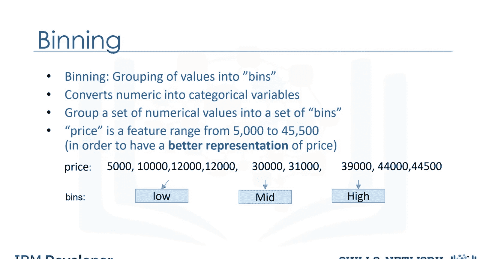
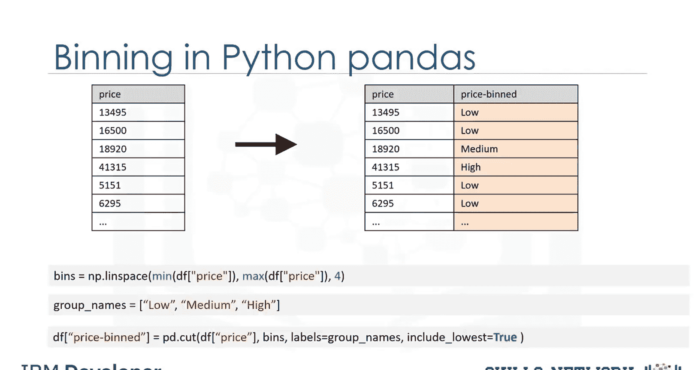
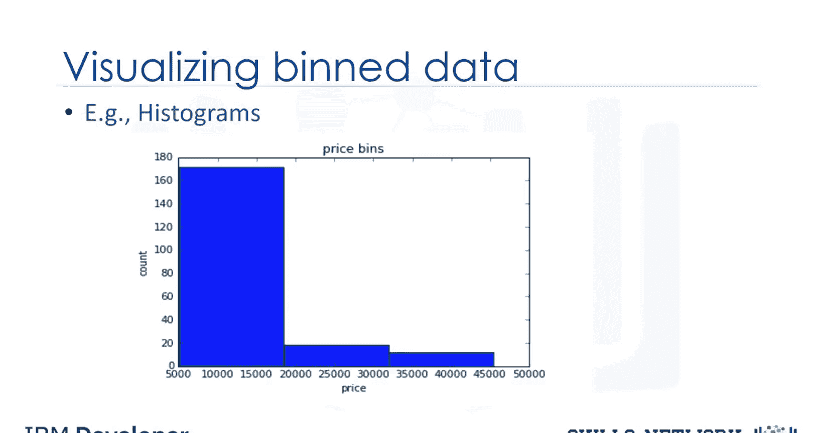

# 040：IBM《生成式人工智能工程｜Falsk、生成式AI应用、数据分析、机器学习、Keras、架构和数据、NLP基础、transformer、微调、高级微调、RAG》 p40 10_在Python中分箱.zh_en -BV1NAq6Y9E7z_p40-

In this video， we'll be talking about binning as a method of data pre processing。

Binning is when you group values together into bins。 For example， you can bin age into 0 to 5。

6 to 10，11 to 15 and so on。 Sometimes binning can improve accuracy of the predictive models。

 In addition， sometimes we use data binning to group a set of numerical values into a smaller number of bins to have a better understanding of the data distribution。

As example， price， here is an attribute range from 5000 to 45500。Using binning。

 we categorize the price into three bins， low price， medium price， and high prices。

In the actual car data set， price is a numerical variable ranging from 5188 to 45400。

 It has 201 unique values。 We can categorize them into three bins。 low。

 medium and high price cars In Python， we can easily implement the binning。

 We would like three bins of equal bin width。 So we need four numbers as dividers that are equal distance apart。

 First， we use the numpy function L space to return the array bins that contains four equally spaced numbers over the specified interval of the price。

😊，We create a list group underscore names that contains the different bin names。

 We use the pandas function cut to segment and sort the data values into bins。

You can then use histograms to visualize the distribution of the data after they've been divided into bins。

 This is the histogram that we plotted based on the bining that we applied in the price feature from the plot。

 It is clear that most cars have a low price， and only very few cars have high price。

