# 049：IBM《生成式人工智能工程｜Falsk、生成式AI应用、数据分析、机器学习、Keras、架构和数据、NLP基础、transformer、微调、高级微调、RAG》 p49 19_线性回归和多元线性回归.zh_en -BV1NAq6Y9E7z_p49-

In this video， we'll be talking about simple linear regression and multiple linear regression。

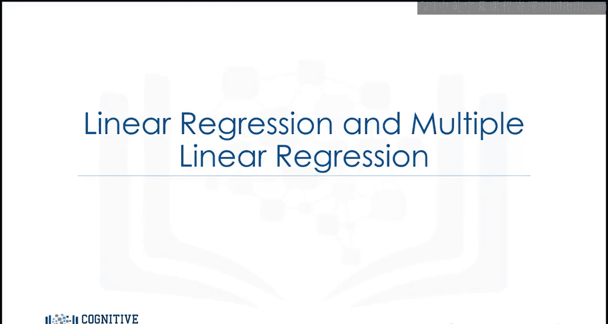

Linear regression will refer to one independent variable to make a prediction。

 Multi linear regression will refer to multiple independent variables to make a prediction。

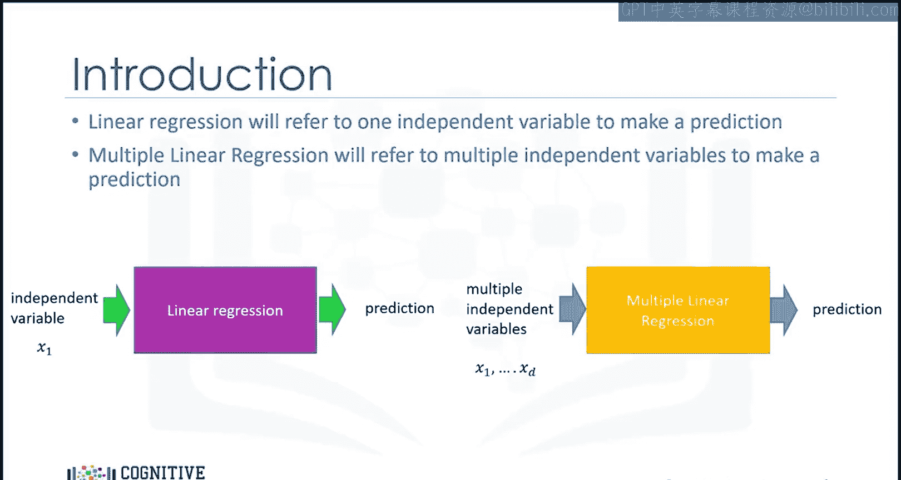

Simple linear regression or S， L R is a method to help us understand the relationship between two variables。

 The predictor， independent variable X and the target， dependent variable Y。

 We would like to come up with a linear relationship between the variables shown here。

The parameter B0 is the intercept。The parameter B1 is the slope。When we fit or train the model。

 we will come up with these parameters。This step requires lots of math。

 so we will not focus on this part。 Let's clarify the prediction step。

It's hard to figure out how much a car costs， But the highway miles per gallon is in the owner's manual。

If we assume there is a linear relationship between these variables。

We can use this relationship to formulate a model to determine the price of the car。

If the highway miles per gallon is 20， we can input this value into the model。

To obtain a prediction of $22000。

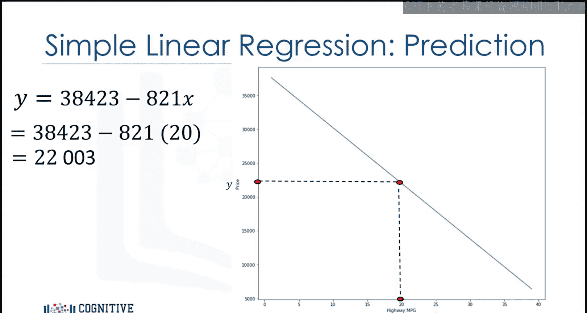

In order to determine the line， we take data points from our data set marked in red here。

We then use these trading points to fit our model。The results of the trading points are the parameters。

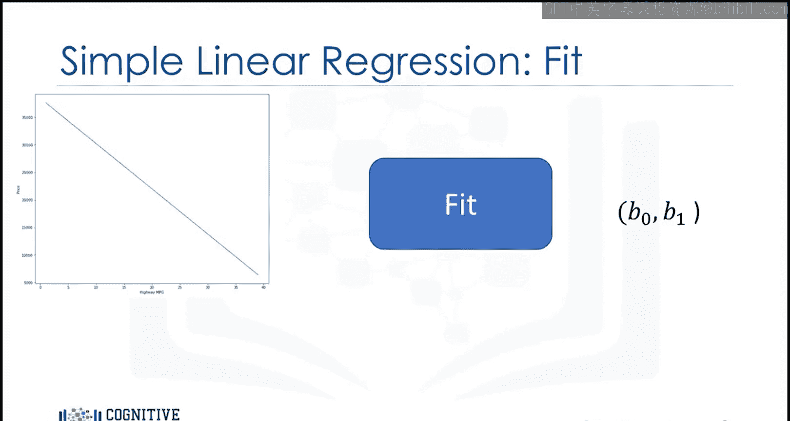

We usually store the data points in two data frame or nupy arrays。

The value we would like to predict is called the target that we store in the array Y。

 We store the dependent variable in the data frame， or array X。

Each sample corresponds to a different row in each data frame， or array。In many cases。

 many factors influence how much people pay for a car。 For example。

 make or how old the car is in this model， This uncertainty is taken into account by assuming a small random value is added to the point on the line。

This is called noise。The figure on the left shows the distribution of the noise。

 The vertical axis shows the value added， and the horizontal axis illustrates the probability that the value will be added。

Usually， a small positive value is added。Or a small， negative value。Sometimes large values are added。

But for the most part， the values added are near 0。

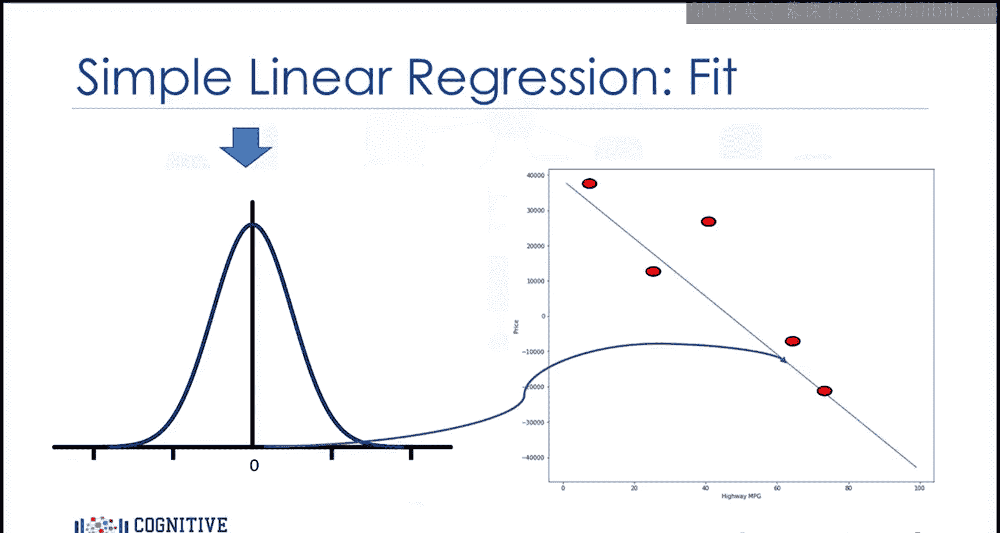

We can summarize the process like this。 We have a set of training points。

 We use these trading points to fit or train the model， and get parameters。

We then use these parameters in the model。 We now have a model。

 We use the hat on the Y to denote the model is an estimate。

We can use this model to predict values that we haven't seen。For example。

 we have no car with 20 highway miles per gallon。We can use our model to make a prediction for the price of this car。

 But don't forget， our model is not always correct。

We can see this by comparing the predicted value to the actual value。

We have a sample for 10 highway miles per gallon。But the predicted value does not match the actual value。

If the linear assumption is correct， this error is due to the noise， but there can be other reasons。

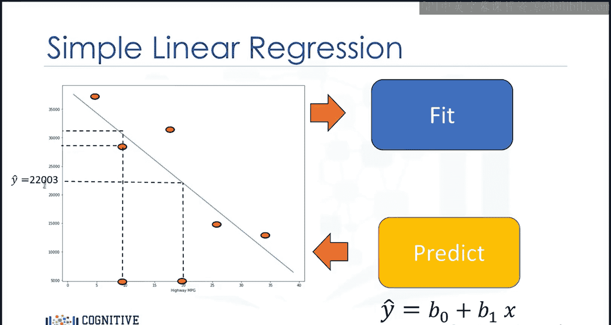

To fit the model in Python， first， we import linear model from Psi kit learn。

Then create a linear regression object using the constructor。

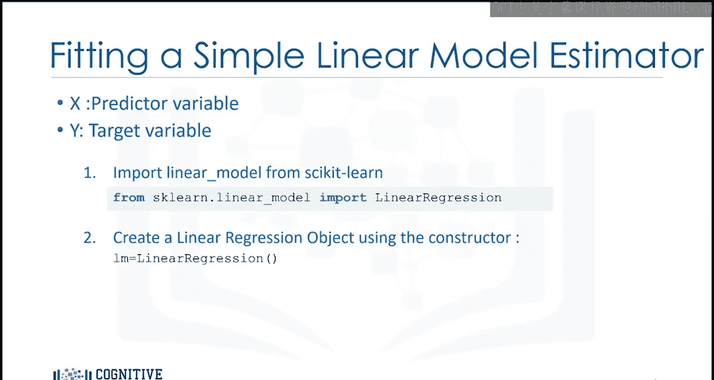

We define the predictor variable， and target variable。

Then use the method fit to fit the model and find the parameters B 0 and B 1。

The input are the features and the targets， we can obtain a prediction using the method predict。

The output is an array。 The array has the same number of samples as the input X。

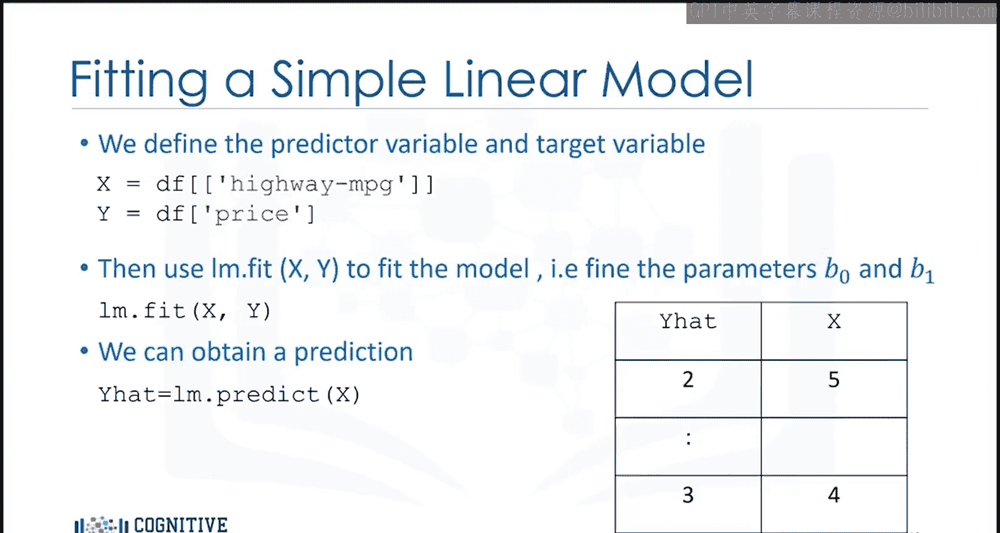

The intercept B0 is an attribute of the object LM。The slope B1 is also an attribute of the object L M。

The relationship between price and highway miles per gallon is given by this equation in bold price equals 38423。

 31-821。 73 times highway miles per gallon。Like the equation we discussed before。

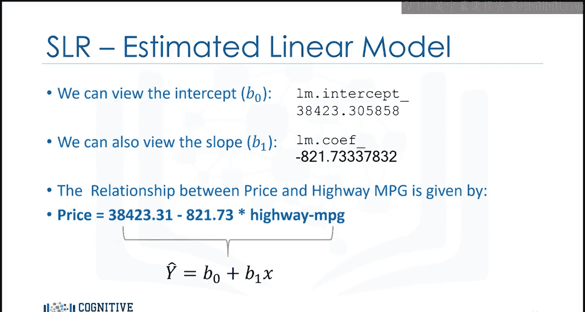

Multiple linear regression is used to explain the relationship between one continuous target Y variable and two or more predictor x variables。

If we have， for example， four predictor variables， then B 0 intercept X equals 0， B1。

 the coefficient or parameter of x 1。B2， the coefficient of parameter x 2， and so on。

If there are only two variables， then we can visualize the values。 consider the following function。

 The variables， X 1 and X 2 can be visualized on a 2 D plane。 Let's do an example， on the next slide。

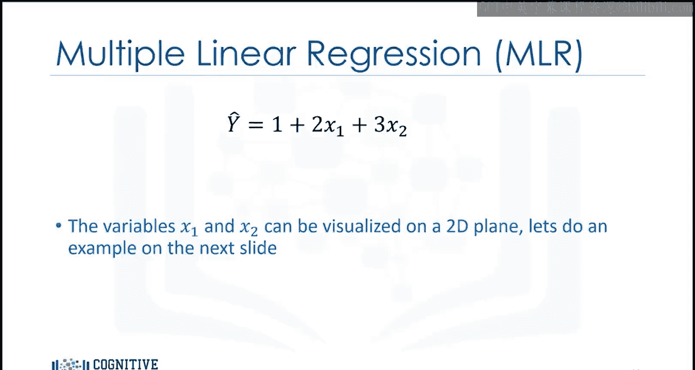

The table contains different values of the predictor variables， X 1 and X 2。

 The position of each point is placed on the 2 D plane， color coatd accordingly。

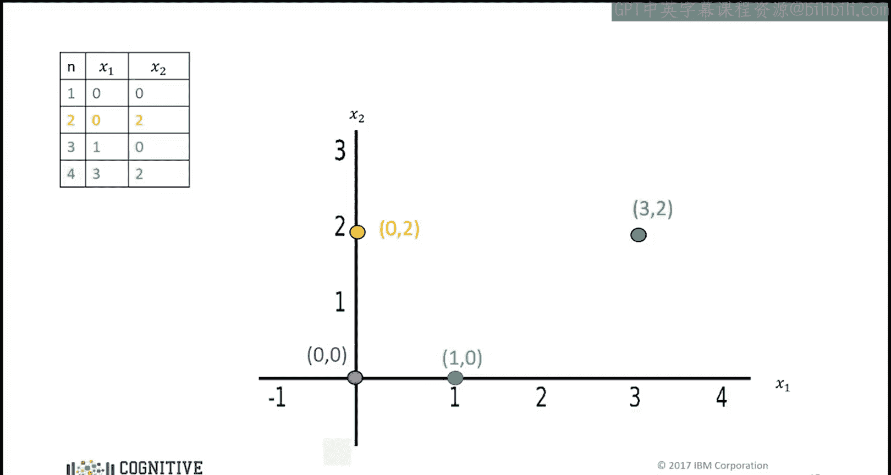

Each value of the predictor variables， x1 and x2 will be mapped to a new value Y Y hat。

The new values of Y Y hat are mapped in the vertical direction。

 with height proportional to the value that Y hat takes。

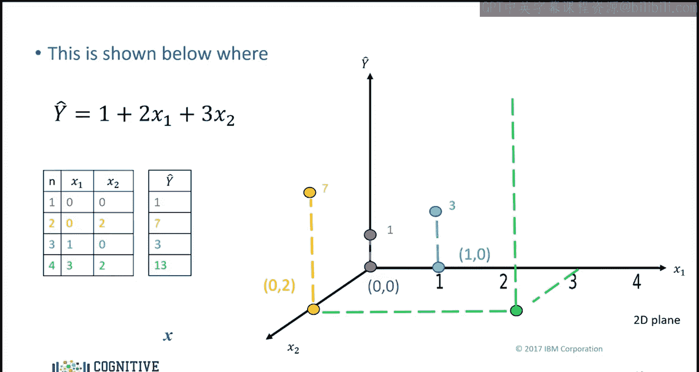

We can fit the multiple linear regression as follows。

 We can extract the four predictor variables and store them in the variable Z。

 Then train the model as before using the method train with the features or dependent variables and the targets。

 Col。We can also obtain a prediction using the method predict。In this case。

 the input is an array or data frame with four columns。

 The number of rows corresponds to the number of samples。

The output is an array with the same number of elements as number of samples。

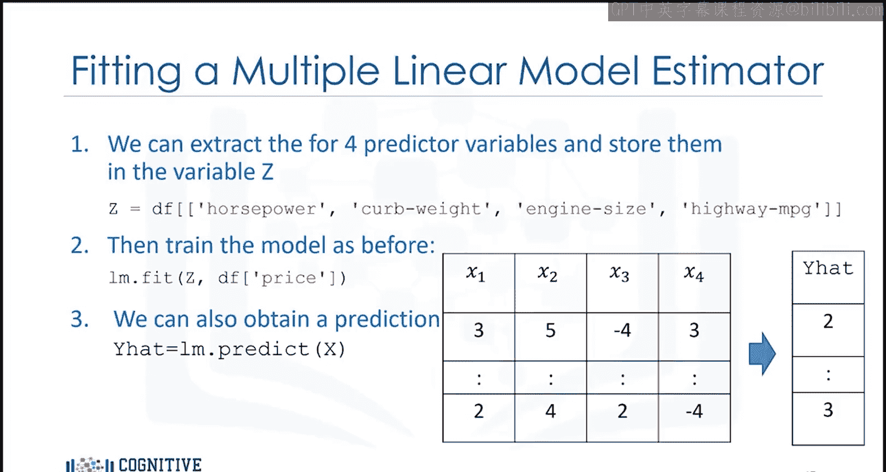

The intercept is an attribute of the object， and the coefficients are also attributes。

 It is helpful to visualize the equation， replacing the dependent variable names with actual names。

 This is identical to the form we discussed earlier。

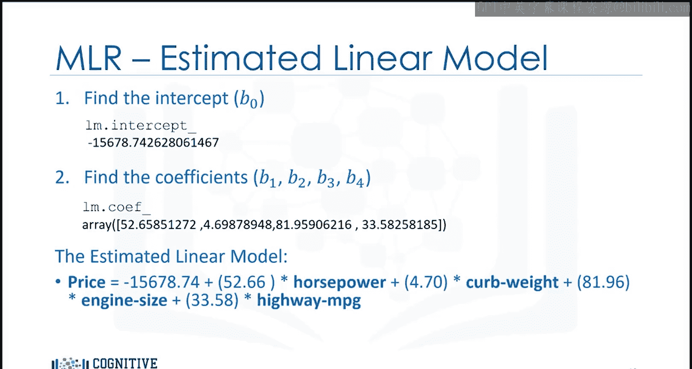