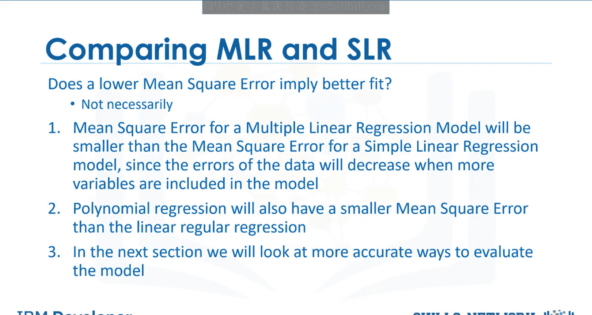

# 053：IBM《生成式人工智能工程｜Falsk、生成式AI应用、数据分析、机器学习、Keras、架构和数据、NLP基础、transformer、微调、高级微调、RAG》 p53 23_预测和决策.zh_en -BV1NAq6Y9E7z_p53-

。In this video， our final topic will be on prediction and decision making。

 How can we determine if our model is correct。The first thing you should do is make sure your model results make sense。

 You should always use visualization， numerical measures for evaluation and comparing between different models。

Let's look at an example of prediction。 If you recall， we train the model using the fit method。Now。

 we want to find out what the price would be for a car that has a highway miles per gallon of 30。

Plugging this value into the predict method gives us a resulting price of $13771。30。

This seems to make sense。 For example， the value is not negative， extremely high or extremely low。

 We can look at the coefficients by examining the co F underscore attribute。

If you recall the expression for the simple linear model that predicts price from highway miles per gallon。

 this value corresponds to the multiple of the highway miles per gallon feature。 As such。

 an increase of one unit in highway miles per gallon。

 The value of the car decreases approximately $821。 This value also seems reasonable。

Sometimes your model will produce values that don't make sense。 For example。

 if we plot the model out for highway miles per gallon in the ranges of 0 to 100。

 we get negative values for the price。 This could be because the values in that range are not realistic。

 The linear assumption is incorrect， or we don't have data for cars in that range。 In this case。

 it is unlikely that a car will have fuel mileage in that range。 So our model seems valid。

To generate a sequence of values in a specified range， import numppy。

 then use the nupy a range function to generate the sequence。

 The sequence starts at one and increments by one till we reach 100。

 The first parameter is the starting point of the sequence。

 The second parameter is the end point plus one of the sequence。

 The final parameter is the step size between elements in the sequence。 In this case， it's one。

 So we increment the sequence  one step at a time。 from one to 2 and so on。

We can use the output to predict new values。 The output is a numpy array。

 Many of the values are negative。Using a regression plot to visualize your data is the first method you should try。

 See the labs for examples of how to plot polynomial regression。For this example。

 the effect of the independent variable is evident In this case。

 The data trends down as the dependent variable increases。

 The plot also shows some nonlinear behavior。Examining the residual plot， we see in this case。

 the residuals have a curvature suggesting nonlinear behavior。

A distribution plot is a good method for multiple linear regression。 For example。

 we see the predicted values for prices in the range from 30000 to 50000 are inaccurate。

This suggests a nonlinear model may be more suitable， or we need more data in this range。

The mean square error is perhaps the most intuitive numerical measure for determining if a model is good or not。

 Let's see how different measures of mean square error impact the model。

The figure shows an example of a mean square error of 3495。

This example has a mean square error of 3652。The final plot has a mean square error of 12870。

 As the square error increases， the targets get further from the predicted points。As we discussed。

 R squared is another popular method to evaluate your model。

 It tells you how well your line fits into the model。 R squared values range from 0 to 1。

 R squared tells us what percent of the variability in the dependent variable is accounted for by the regression on the independent variable。

😊，And R squared of 1 means that all movements to another dependent variable are completely explained by movements in the independent variables。

In this plot， we see the target points in red and the predicted line in blue。 an R squared of 0。9986。

 The model appears to be a good fit。 That means that more than 99 per cent of the variability of the predicted variable is explained by the independent variables。

 This model has an R squared of 0。9226。 There still is a strong linear relationship。

 model is still a good fit。 and r squared of 0，8，0，6 Os the data。

 we can visually see that the values are scattered around the line。 They are still close to the line。

 and we can say that 80 per of the variability of the predicted variable is explained by the independent variables。

😊，And an R squared 0。61 means that approximately 61 per cent of the observed variation can be explained by the independent variables。

An acceptable value for R squared depends on what field you are studying and what your use case is。

Falcon Miller， 1992， suggests that an acceptable r squared value should be at least 0。1。

Does a lower mean square error imply better fit， Not necessarily。 M S E for an M。

 L R model will be smaller than the ME for an SLR model。

 Since the errors of the data will decrease when more variables are included in the model。

 Polynomial regression will also have a smaller M S E than regular regression in the next section。

 we will look at more accurate ways to evaluate the model。

