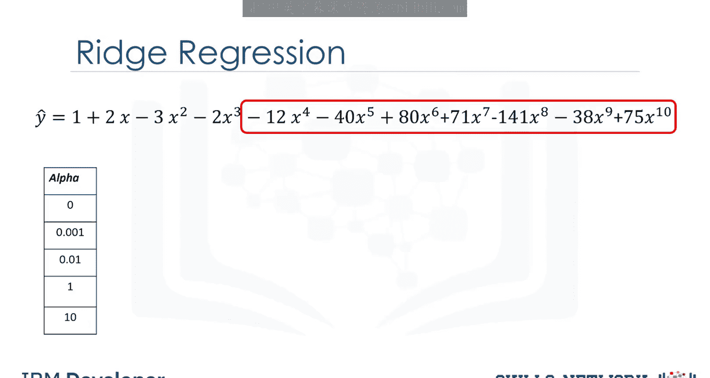
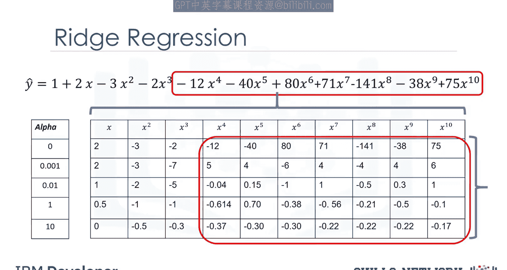
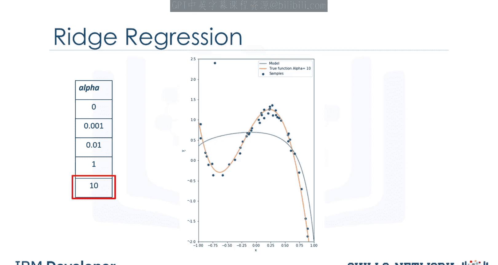
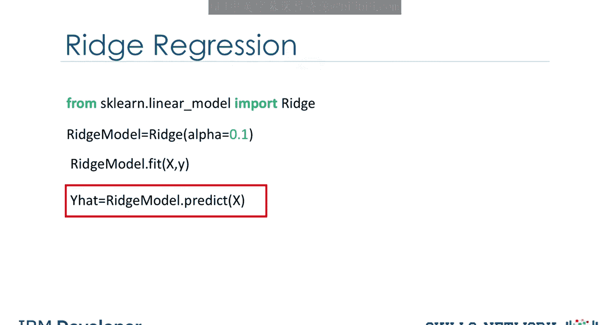
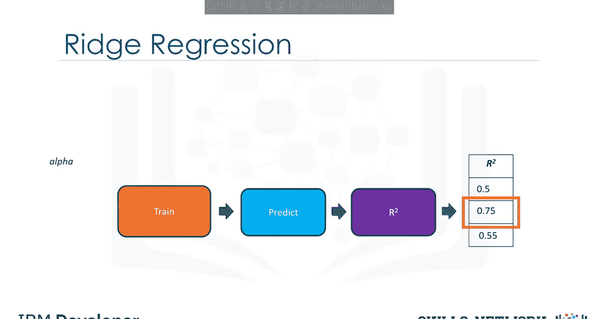
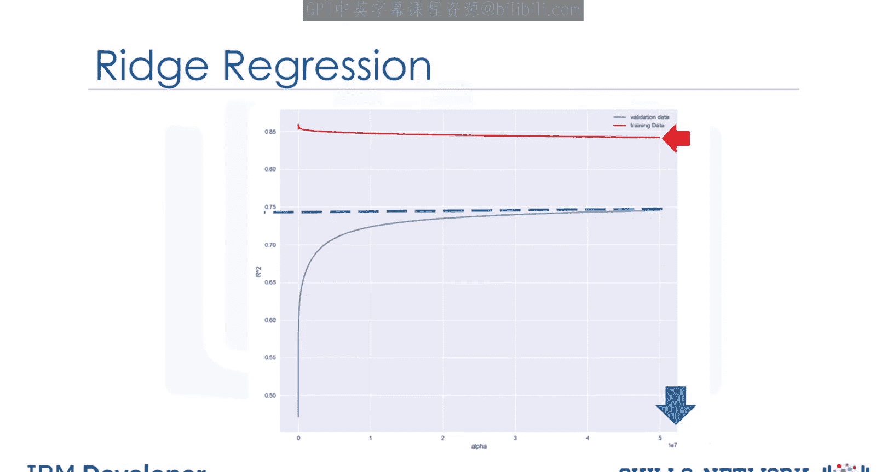

# 056：IBM《生成式人工智能工程｜Falsk、生成式AI应用、数据分析、机器学习、Keras、架构和数据、NLP基础、transformer、微调、高级微调、RAG》 p56 26_岭回归.zh_en -BV1NAq6Y9E7z_p56-

In this video， we'll discuss Rige regression。Rich regression prevents overfitting。 In this video。

 we will focus on polynomial regression for visualization。

 but overfitting is also a big problem when you have multiple independent variables or features。

 Consider the following fourth order。 polynomial in orange。

 The blue points are generated from this function。😊。

We can use a 10th order polynomial to fit the data。

 The estimated function in blue does a good job at approximating the true function。 In many cases。

 real data has outliers。 For example， this point shown here does not appear to come from the function in orange。

 If we use a 10th order polynomial function to fit the data。

 The estimated function in blue is incorrect。 and is not a good estimate of the actual function in orange。

 If we examine the expression for the estimated function。

 we see the estimated polynomial coefficients have a very large magnitude。

 This is especially evident for the higher order。 polynomials。

 Rich regression controls the magnitude of these polynomial coefficients。

 By introducing the parameter alpha。😊，Alpha is a parameter we select before fitting or training the model。

Each row in the following table represents an increasing value of alpha。

Let's see how different values of alpha change the model。

 This table represents the polynomial coefficients for different values of alpha。

 The column corresponds to the different polynomial coefficients。

 and the rows correspond to the different values of alpha。

 As alpha increases the parameters get smaller。 This is most evident for the higher order。

 polynomial features。 but alpha must be selected carefully。If alpha is too large。

 the coefficients will approach 0 and underfi the data。 If alpha is 0。

 the overfitting is evident for alpha equal to 0。001。 the overfitting begins to subside。

For alpha equal to 0。01， the estimated function tracks the actual function。 When alpha equals 1。

 we see the first signs of underfitting。The estimated function does not have enough flexibility At alpha equals to 10。

 We see extreme underfitting。 It does not even track the two points。

In order to select alpha， we use cross validation to make a prediction using ridge regression。

 Im ridge from S K， learn linear models。 createate a ridge object using the constructor。

 The parameter alpha is one of the arguments of the constructor。We train the model。

 using the fit method。To make a prediction， we use the prediction method in order to determine the parameter alpha。

 we use some data for training。 We use a second set called validation data。

 This is similar to test data。 but it is used to select parameters， like alpha。

 We start with a small value of alpha。 We train the model。

 Make a prediction using the validation data。 Then calculate the R squared and store the values。

Repeat the value for a larger value of alpha。We train the model again。

 make a prediction using the validation data， then calculate the R squared and store the values of R squared。

 We repeat the process for a different alpha value， training the model， and making a prediction。

We select the value of alpha that maximizes the r squared。

Note that we can use other metrics to select the value of alpha like mean squared error。

 The overfitting problem is even worse if we have lots of features。

 The following plot shows the different values of R squared on the vertical axis。

The horizontal axis represents different values for alpha。

We use several features from our used car data set and a second order polynomial function。

The training data is in red， and validation data is in blue。We see as the value for alpha increases。

 the value of r squared increases and converges at approximately 0。75。In this case。

 we select the maximum value of alpha because running the experiment for higher values of alpha have little impact。

Conversely， as alpha increases， the r squared on the test data decreases。

This is because the term alpha prevents overfitting。This may improve the results in the unseen data。

 but the model has worse performance on the test data。 See the lab on how to generate this plot。

