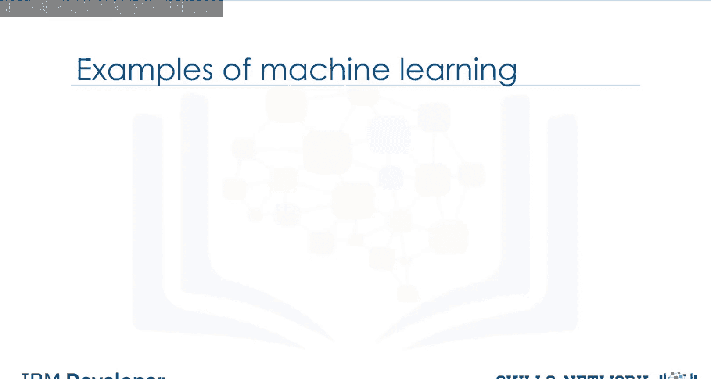
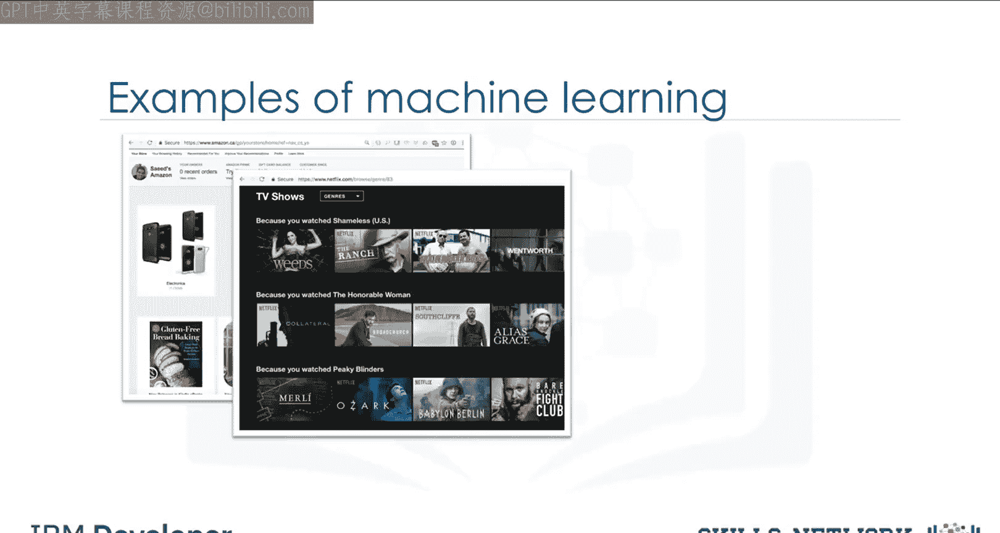
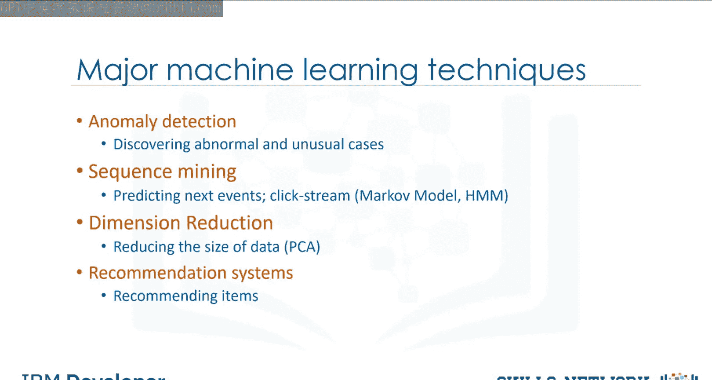
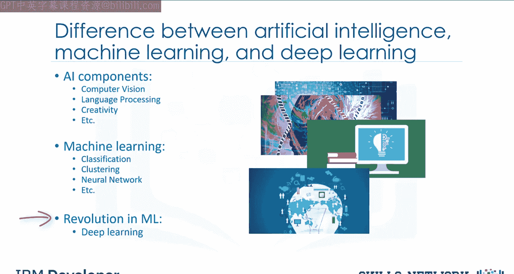

# 060：IBM《生成式人工智能工程｜Falsk、生成式AI应用、数据分析、机器学习、Keras、架构和数据、NLP基础、transformer、微调、高级微调、RAG》 p60 2_机器学习简介.zh_en -BV1NAq6Y9E7z_p60-

Hello and welcome In this video， I will give you a high level introduction to machine learning。

 So let's get started。😊，This is a human cell sample extracted from a patient。

 and this cell has characteristics。 For example， its clump thickness is 6。

 Its uniformity of cell size is one。 Its marginal adhesion is one and so on。

One of the interesting questions we can ask at this point is， is this a benign or malignant cell。

In contrast with a benign tumor， a malignant tumor is a tumor that may invade its surrounding tissue or spread around the body。

 and diagnosing it early might be the key to a patient's survival。

One could easily presume that only a doctor with years of experience could diagnose that tumor and say if the patient is developing cancer or not。

 right？Well， imagine that you've obtained a dataset set containing characteristics of thousands of human cell samples extracted from patients who are believed to be at risk of developing cancer。

Analysis of the original data showed that many of the characteristics differed significantly between benign and malignant samples。

You can use the values of these cell characteristics in samples from other patients to give an early indication of whether a new sample might be benign or malignant。

You should clean your data， select a proper algorithm for building a prediction model。

 and train your model to understand patterns of benign or malignant cells within the data。

Once the model has been trained by going through data iteratively。

 it can be used to predict your new or unknown cell with rather high accuracy。

 This is machine learning。It is the way that a machine learning model can do a doctor's task or at least help that doctor make the process faster。

Now， let me give a formal definition of machine learning。

Machine learning is the subfield of computer science that gives computers the ability to learn without being explicitly programmed。

Let me explain what I mean when I say without being explicitly programmed。

Assume that you have a data set of images of animals such as cats and dogs。

 and you want to have software or an application that can recognize and differentiate them。

The first thing that you have to do here is interpret the images as a set of feature sets。

For example， does the image show the animal's eyes。 If so， what is their size， Does it have ears。

 What about a tail， How many legs， Does it have wings。Prior to machine learning。

 each image would be transformed to a vector of features， then traditionally。

 we had to write down some rules or methods in order to get computers to be intelligent and detect the animals。

But it was a failure。 Why？ Well， as you can guess， it needed a lot of rules。

 highly dependent on the current data set and not generalized enough to detect out of sample cases。

This is when machine learning entered the scene。Using machine learning allows us to build a model that looks at all the feature sets and their corresponding type of animals。

 and it learns the pattern of each animal。It is a model built by machine learning algorithms。

 it detects without explicitly being programmed to do so。In essence。

 machine learning follows the same process that a four year old child uses to learn。

 understand and differentiate animals。So machine learning algorithms inspired by the human learning process iteratively learn from data and allow computers to find hidden insights。

These models help us in a variety of tasks， such as object recognition， summarization。

 recommendation， and so on。Machine learning impacts society in a very influential way。

 Here are some real life examples。

First， how do you think Netflix and Amazon recommend videos， movies， and TV shows to its users？

They use machine learning to produce suggestions that you might enjoy。

This is similar to how your friends might recommend a television show to you based on their knowledge of the types of shows you like to watch。

How do you think banks make a decision when approving a loan application。

 They use machine learning to predict the probability of default for each applicant and then approve or refuse the loan application based on that probability。

Telecommunication companies use their customers' demographic data to segment them or predict if they will unsubscribe from their company the next month。

There are many other applications of machine learning that we see every day in our daily life。

 such as chatbots， logging into our phones， or even computer games using face recognition。

Each of these use different machine learning techniques and algorithms。

 so let's quickly examine a few of the more popular techniques。

The regression estimation technique is used for predicting a continuous value。 For example。

 predicting things like the price of a house based on its characteristics or to estimate the CO2 emission from a car's engine。

A classification technique is used for predicting the class or category of a case。 For example。

 if a cell is benign or malignant or whether or not a customer will churn。

Cluuttering groups of similar cases， for example， can find similar patients or can be used for customer segmentation in the banking field。

Association technique is used for finding items or events that often cooc， for example。

 grocery items that are usually bought together by a particular customer。

Anomaly detection is used to discover abnormal and unusual cases， for example。

 it is used for credit card fraud detection。Sequence mining is used for predicting the next event。

 for instance， the click streamam and websites。Dimenssion reduction is used to reduce the size of data。

And finally， recommendation systems。 This associates people's preferences with others who have similar tastes and recommends new items to them。

 such as books or movies。😊，We will cover some of these techniques in the next videos。

By this point， I'm quite sure this question has crossed your mind。

What is the difference between these buzzwords that we keep hearing these days。

 such as artificial intelligence or AI， machine learning and deep learning。Well。

 let me explain what is different between them。In brief。

 AI tries to make computers intelligent in order to mimic the cognitive functions of humans。

 so artificial intelligence is a general field with a broad scope， including computer vision。

 language processing， creativity and summarization。

Machine learning is the branch of AI that covers the statistical part of artificial intelligence；

 it teaches the computer to solve problems by looking at hundreds or thousands of examples。

 learning from them， and then using that experience to solve the same problem in new situations。

And deep learning is a very special field of machine learning。

 where computers can actually learn and make intelligent decisions on their own。😊。

Deep learning involves a deeper level of automation in comparison with most machine learning algorithms。

Now that we've completed the introduction to machine learning。

 subsequent videos will focus on reviewing two main components。First。

 you'll be learning about the purpose of machine learning and where it can be applied in the real world。

 and second， you'll get a general overview of machine learning topics such as supervised versus unsupervised learning。

 model evaluation and various machine learning algorithms。

So now that you have a sense of what's in store on this journey。

 let's continue our exploration of machine learning。

Thanks for watching。