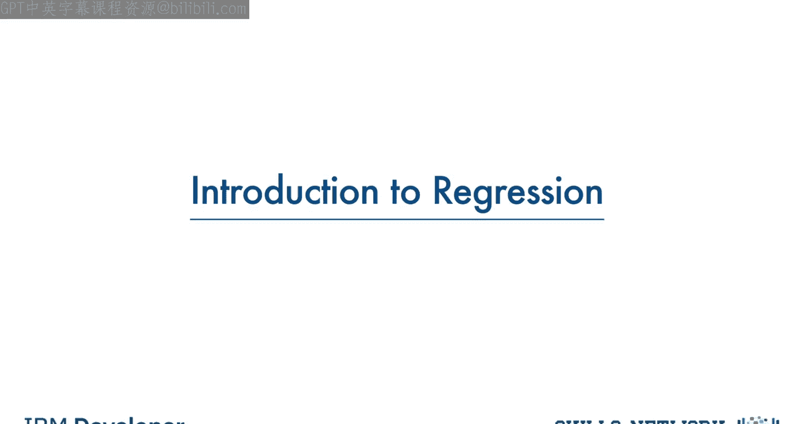
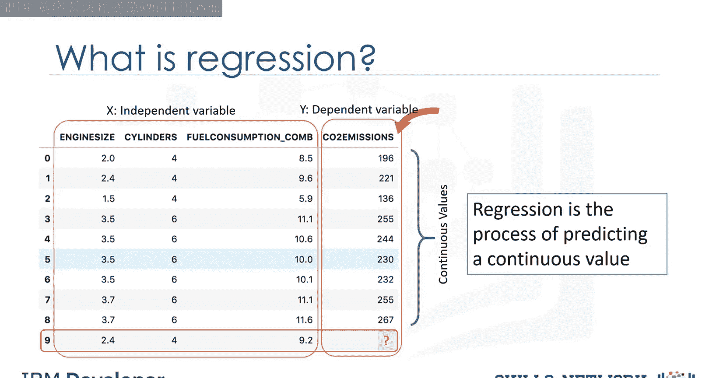
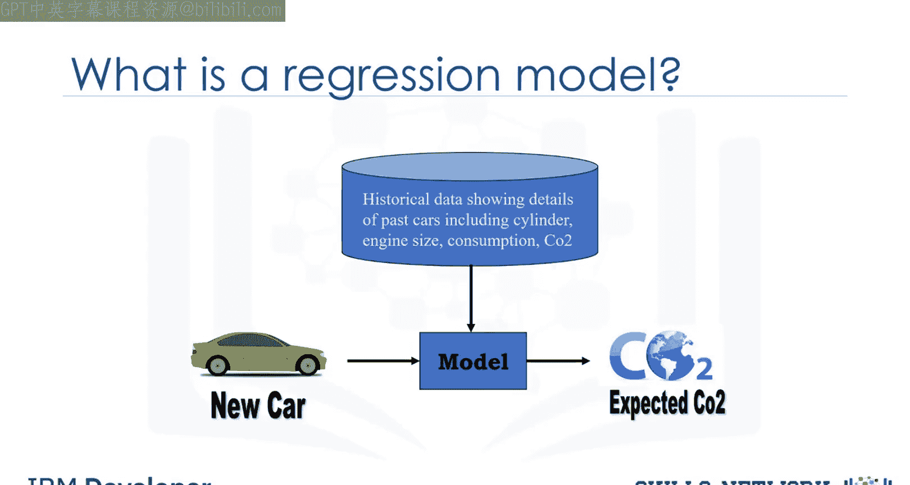
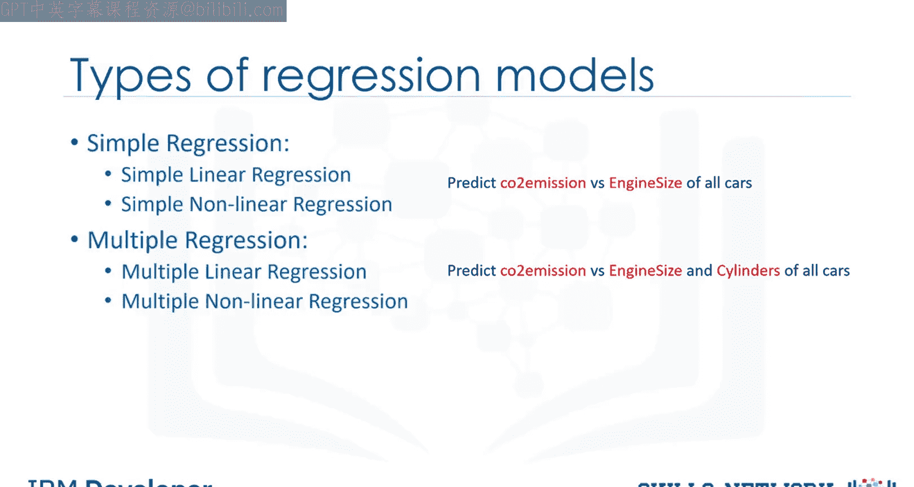
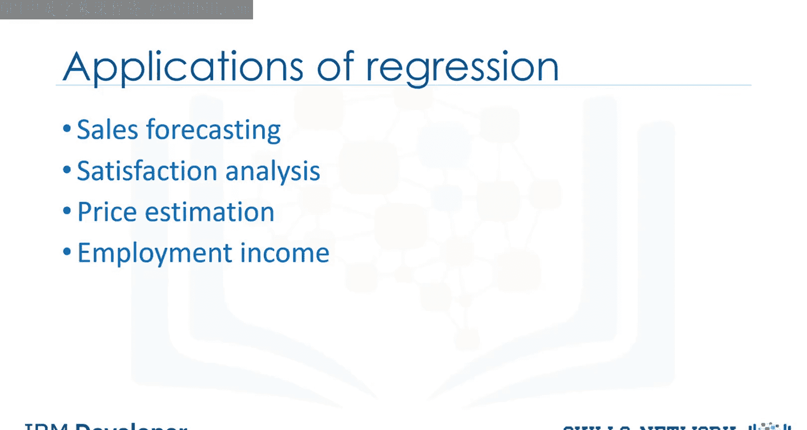
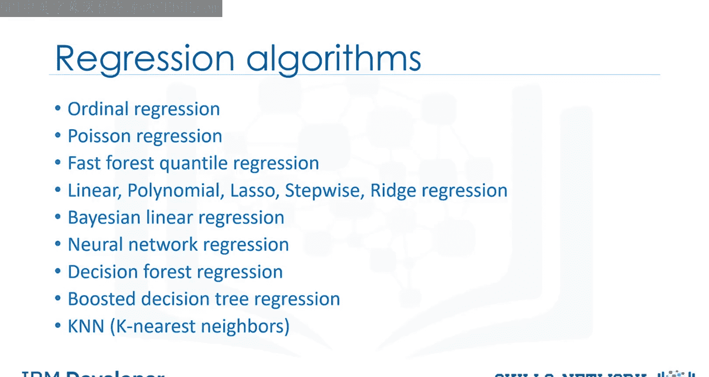

# 063：IBM《生成式人工智能工程｜Falsk、生成式AI应用、数据分析、机器学习、Keras、架构和数据、NLP基础、transformer、微调、高级微调、RAG》 p63 5_回归简介.zh_en -BV1NAq6Y9E7z_p63-

Hello and welcome In this video， we'll be giving a brief introduction to regression。

 so let's get started。

Look at this data set， it's related to CO2 emissions from different cars， it includes engine size。

 number of cylinders， fuel consumption， and CO2 emission from various automobile models。

The question is， given this data set， can we predict the CO2 emission of a car using other fields such as engine size or cylinders？

Let's assume we have some historical data from different cars and assume that a car such as in row 9 has not been manufactured yet。

 but we're interested in estimating its approximate CO2 emission after production， Is it possible。

We can use regression methods to predict a continuous value such as CO2 emission using some other variables。

Indeed， regression is the process of predicting a continuous value。In regression。

 there are two types of variables， a dependent variable， and one or more independent variables。

The dependent variable can be seen as the state， target or final goal we study and try to predict。

 and the independent variables also known as explanatory variables can be seen as the causes of those states。

The independent variables are shown conventionally by x， and the dependent variable is notated by y。

A regression model relates y or the dependent variable to a function of X， I。e。

 the independent variables。The key point in the regression is that our dependent value should be continuous and could not be a discrete value。

However， the independent variable or variables can be measured on either a categorical or continuous measurement scale。

So what we want to do here is to use the historical data of some cars using one or more of their features。

 and from that data， make a model。 We use regression to build such a regression estimation model。

Then the model is used to predict the expected CO2 emission for a new or unknown car。

Basically， there are two types of regression models， simple regression and multiple regression。

Simple regression is when one independent variable is used to estimate a dependent variable。

 It can be either linear or non linear。 For example。

 predicting CO2 emission using the variable of engine size。

Lineniarity of regression is based on the nature of relationship between independent and dependent variables。

 When more than one independent variable is present。

 the process is called multiple linear regression。 For example。

 predicting CO2 emission using engine size and the number of cylinders in any given car。 Again。

 depending on the relation between dependent and independent variables。

 it can be either linear or non linear regression。

Let's examine some sample applications of regression。Essentially。

 we use regression when we want to estimate a continuous value。For instance。

 one of the applications of regression analysis could be in the area of sales forecasting。

You can try to predict a salesperson's total yearly sales from independent variables such as age。

 education， and years of experience。It can also be used in the field of psychology， for example。

 to determine individual satisfaction based on demographic and psychological factors。

We can use regression analysis to predict the price of a house in an area based on its size。

 number of bedrooms， and so on。We can even use it to predict employment income for independent variables such as hours of work。

 education， occupation， sex， age， years of experience， and so on。Indeed。

 you can find many examples of the usefulness of regression analysis in these and many other fields or domains such as finance。

 healthcare care， retail and more。

We have many regression algorithms。 Each of them has its own importance and a specific condition to which their application is best suited。

 And while we've covered just a few of them in this course。

 it gives you enough base knowledge for you to explore different regression techniques。

Thanks for watching。