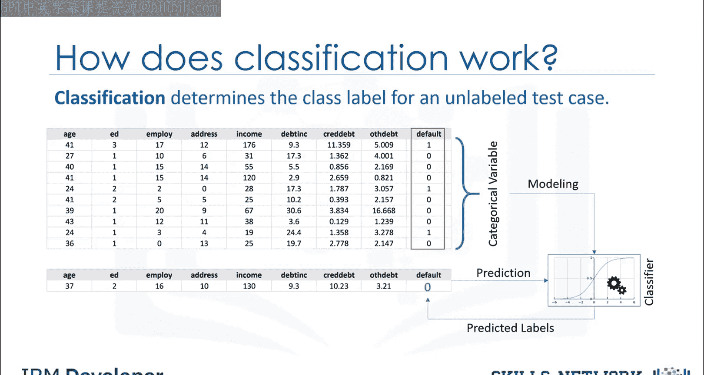
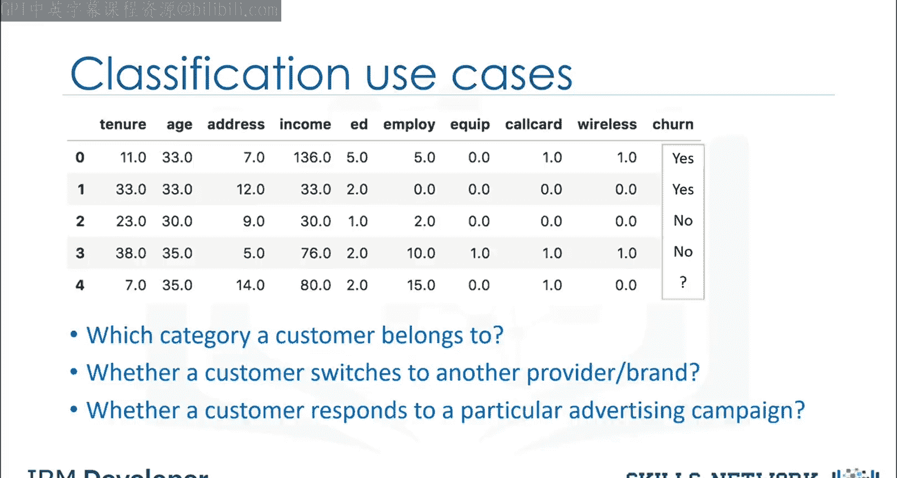
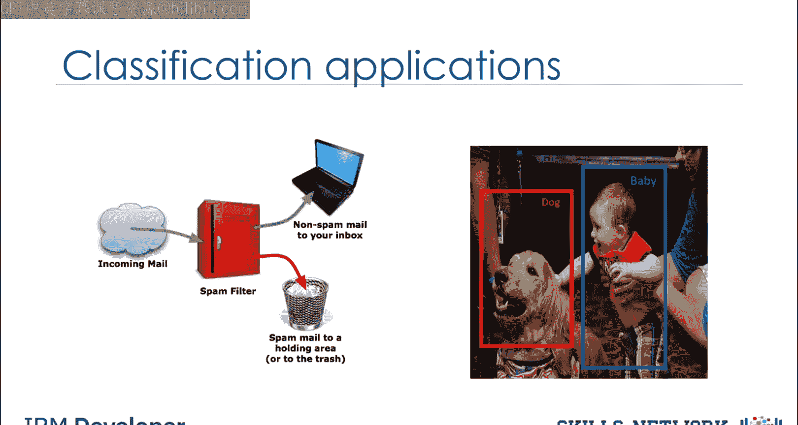
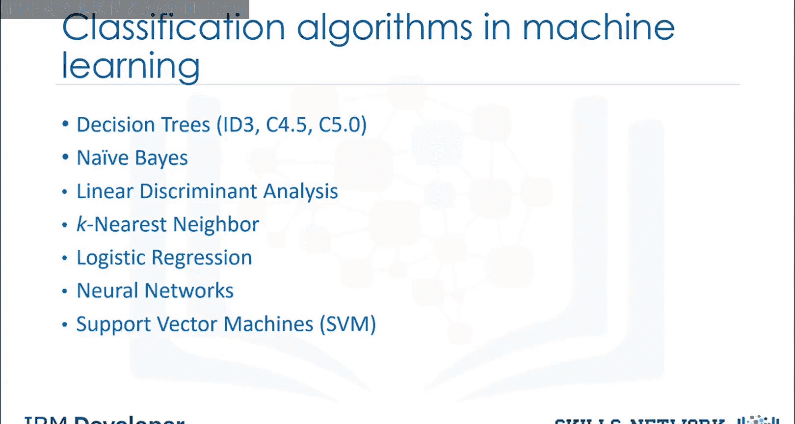

# 068：IBM《生成式人工智能工程｜Falsk、生成式AI应用、数据分析、机器学习、Keras、架构和数据、NLP基础、transformer、微调、高级微调、RAG》 p68 10_分类简介.zh_en -BV1NAq6Y9E7z_p68-

Hello， in this video， we'll give you an introduction to classification， so let's get started。

In machine learning， classification is a supervised learning approach。

 which can be thought of as a means of categorizing or classifying some unknown items into a discrete set of classes。

Classification attempts to learn the relationship between a set of feature variables and a target variable of interest。

The target attribute in classification is a categorical variable， with discrete values。

So how does classification and classifiers work？Given a set of training data points。

 along with the target labels， classification determines the class label for an unlabeled test case。

 Let's explain this with an example。 A good sample of classification is the loan default prediction。

 Suppose a bank is concerned about the potential for loans not to be repaid。

If previous loan default data can be used to predict which customers are likely to have problems repaying loans。

 these bad risk customers can either have their loan application declined or offered alternative products。

The goal of a loan default predictor is to use existing loan default data。

 which is information about the customers， such as age， income， education， et cetera。

 to build a classifier Pass a new customer or potential future defaulter to the model and then label it i。

e the data points as defaulter or not defaulter or， for example， zero or one。

 This is how a classifier predicts an unlabeled test case。

 Please notice that this specific example was about a binary classifier with two values。

 We can also build classifier models for both binary class and multi class classification。

For example， imagine that you've collected data about a set of patients。

 all of whom suffered from the same illness。 during their course of treatment。

 each patient responded to one of three medications。

 You can use this labeled data set with a classification algorithm to build a classification model。

 Then you can use it to find out which drug might be appropriate for a future patient with the same illness。

 As you can see， it is a sample of multi class classification。

Classification has different business use cases as well， for example。

 to predict the category to which a customer belongs。For churn detection。

 where we predict whether a customer switches to another provider or brand。

 or to predict whether or not a customer responds to a particular advertising campaign。

Data classification has several applications in a wide variety of industries。Essentially。

 many problems can be expressed as associations between feature and target variables。

 especially when label data is available。This provides a broad range of applicability for classification。

 For example， classification can be used for email filtering， speech recognition。

 handwriting recognition， biometric identification， document classification， and much more。

Here we have the types of classification algorithms in machine learning。 They include decision trees。

 naive bays， Line discrimininate analysis， Ca nearest neighbor， logistic regression。

 neural networks and support vector machines。There are many types of classification algorithms。

 We will only cover a few in this course。

Thanks for watching。