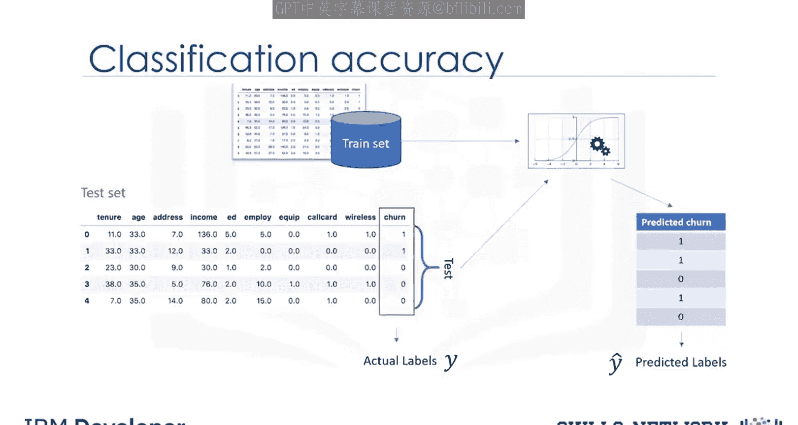
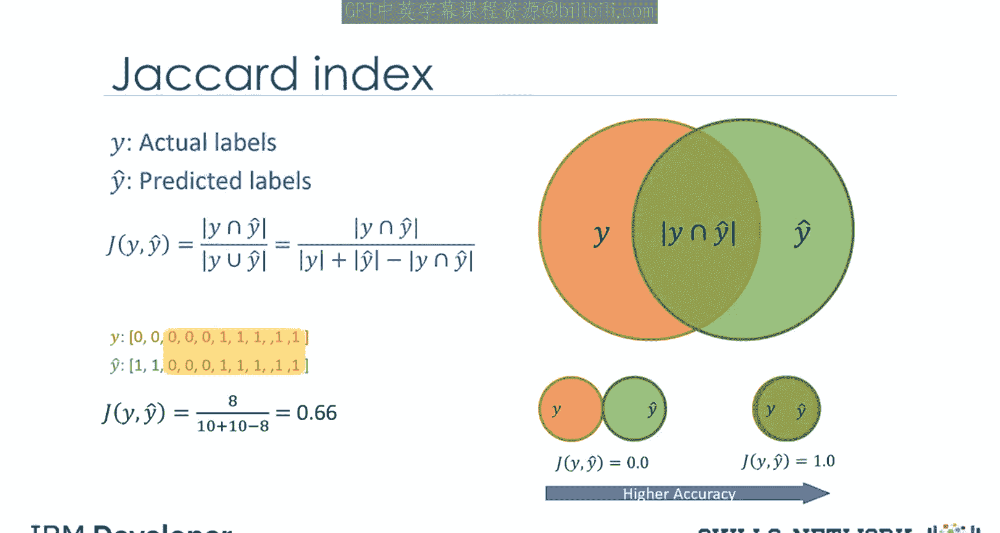
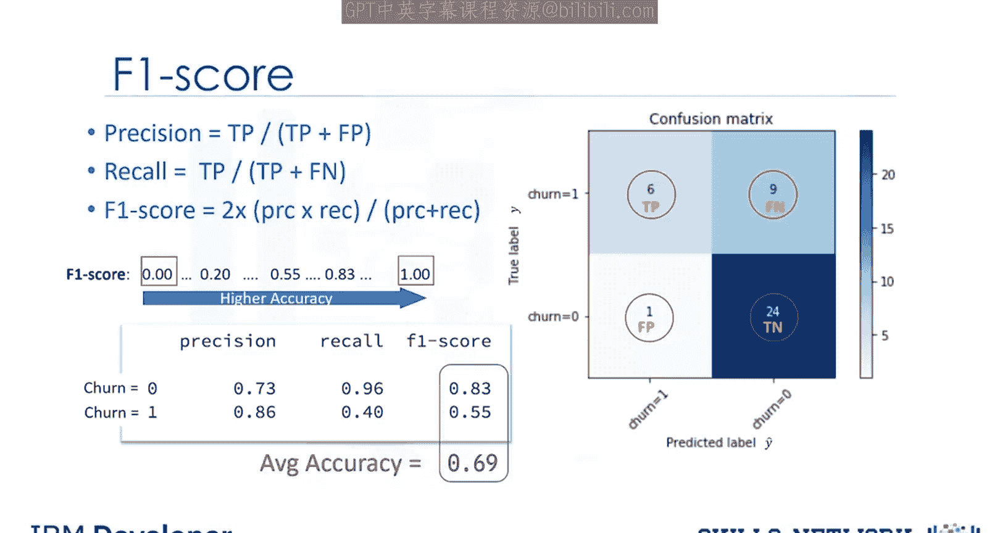
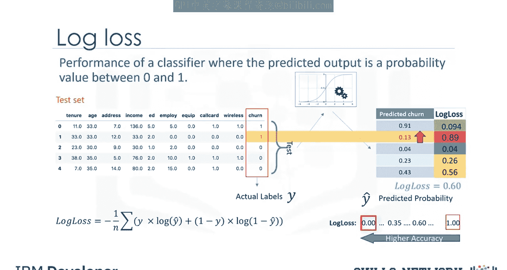

# 070：IBM《生成式人工智能工程｜Falsk、生成式AI应用、数据分析、机器学习、Keras、架构和数据、NLP基础、transformer、微调、高级微调、RAG》 p70 12_分类中的评估指标.zh_en -BV1NAq6Y9E7z_p70-

Hello and welcome in this video we'll be covering evaluation metrics for classifiers。

So let's get started。Evaluation metrics explain the performance of a model。

 Let's talk more about the model evaluation metrics that are used for classification。

Imagine that we have an historical data set， which shows the customer churn for a telecommunication company。

 We have trained the model， and now we want to calculate its accuracy using the test set。

 We pass the test set to our model and we find the predicted labels。 Now， the question is。

 how accurate is this model。 Basically， we compare the actual values in the test set with the values predicted by the model to calculate the accuracy of the model。

 Evalation metrics provide a key role in the development of a model as they provide insight to areas that might require improvement。

There are different model evaluation metrics， but we just talk about three of them here。

 specifically Jaard indexdex， F1 score and log loss。

Let's first look at one of the simplest accuracy measurements， the Jaard index。

 also known as the Jaard similarity coefficient。Let's say Y shows the true labels of the churn data set and Y hat shows the predicted values by our classifier。

 Then we can define Jaard as the size of the intersection divided by the size of the union of two label sets。

For example， for a test set of size 10 with eight correct predictions or eight intersections。

 the accuracy by the Jaard indexex would be 0。66。If the entire set of predicted labels for a sample strictly matches with the true set of labels。

 then the subset accuracy is 1。0。 otherwise， it is 0。0。

Another way of looking at accuracy of classifiers is to look at a confusion matrix。For example。

 let's assume that our test set has only 40 rows。 This matrix shows the corrected and wrong predictions in comparison with the actual labels。

Each confusion matrix row shows the actual true labels in the test set。

 and the columns show the predicted labels by classifier。 Let's look at the first row。

 The first row is for customers whose actual churn value in the test set is one。

 as you can calculate out of 40 customers。 The churn value of 15 of them is one。 And out of these 15。

 the classifier correctly predicted 6 of them as one and 9 of them as 0。😊。

This means that for six customers， the actual churn value was one in the test set。

 and the classifier also correctly predicted those as one。 However。

 while the actual label of 9 customers was one， The classifier predicted those as 0。

 which is not very good。 We can consider this as an error of the model for the first row。

 what about the customers with a churn value 0， Let's look at the second row。

It looks like there were 25 customers whose churn value was 0。

The classifier correctly predicted 24 of them as 0， and one of them wrongly predicted as one。

 So it has done a good job in predicting the customers with a churn value of 0。

 A good thing about the confusion matrix is that it shows the model's ability to correctly predict or separate the classes。

 In the specific case of a binary classifier， such as this example。

 we can interpret these numbers as the count of true positives， false negatives。

 true negatives and false positives。😊，Based on the count of each section。

 we can calculate the precision and recall of each label。

Precision is a measure of the accuracy provided that a class label has been predicted。

 It is defined by precision equals true positive， divided by true positive plus false positive。

And recall is the true positive rate。 It is defined as recall equals true positive divided by true positive plus false negative。

 so we can calculate the precision and recall of each class。😊。

Now we're in the position to calculate the F1 scores for each label based on the precision and recall of that label。

The F1 score is the harmonic average of the precision and recall。

 where an F1 score reaches its best value at1， which represents perfect precision and recall。

 and its worst at 0。 It is a good way to show that a classifier has a good value for both recall and precision。

 It is defined using the F1 score equation。For example。

 the F1 score for class 0 Ie churn equals 0 is 0。83 and the F1 score for class 1 I。

e churn equals 1 is 0。55。And finally， we can tell the average accuracy for this classifier is the average of the F1 score for both labels。

 which is 0。69 in our case。 Please notice that both Jaard and F1 score can be used for multi class classifiers as well。

 which is out of scope for this course。😊。

Now， let's look at another accuracy metric for classifiers。

 Sometimes the output of a classifier is the probability of a class label instead of the label。

 For example， in logistic regression， the output can be the probability of customer churn， i。e。 yes。

 or equals to1。 This probability is a value between 0 and1。Logarithmic loss， also known as log loss。

 measures the performance of a classifier where the predicted output is a probability value between0 and1。

 So for example， predicting a probability of 0。13 when the actual label is 1 would be bad and would result in a high log loss。

 we can calculate the log loss for each row using the log loss equation which measures how far each prediction is from the actual label。

 then we calculate the average log loss across all rows of the test set。

It is obvious that ideal classifiers have progressively smaller values of log laws。

 so the classifier with the lower log loss has better accuracy。 Thanks for watching。

