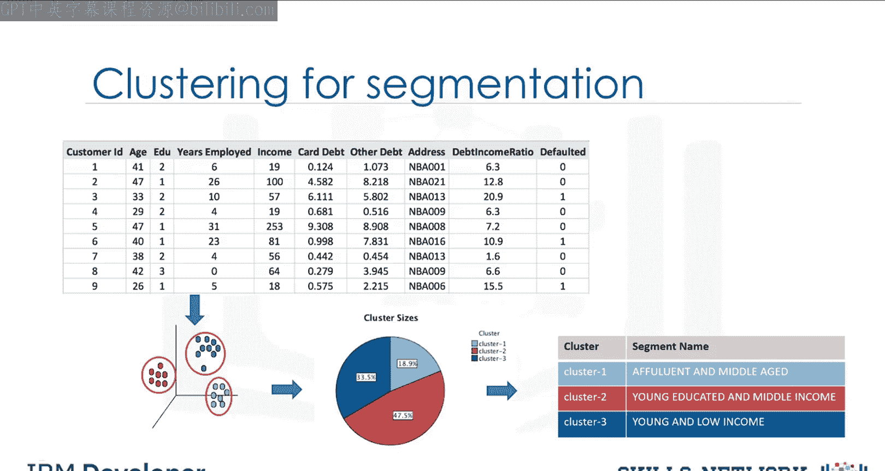
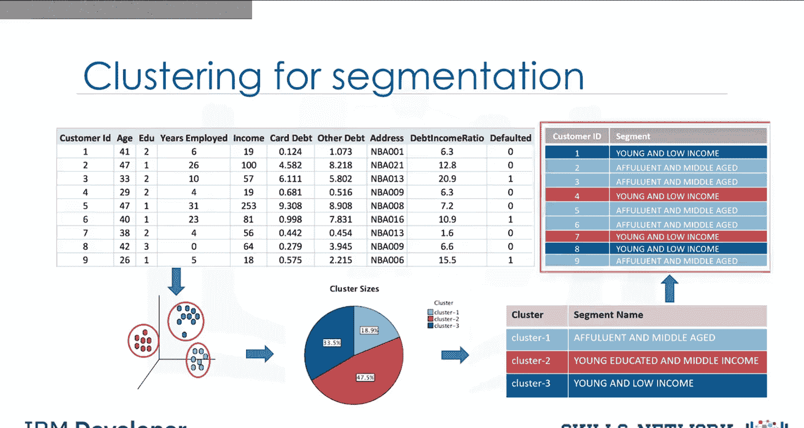
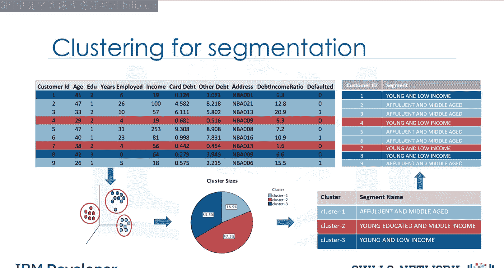
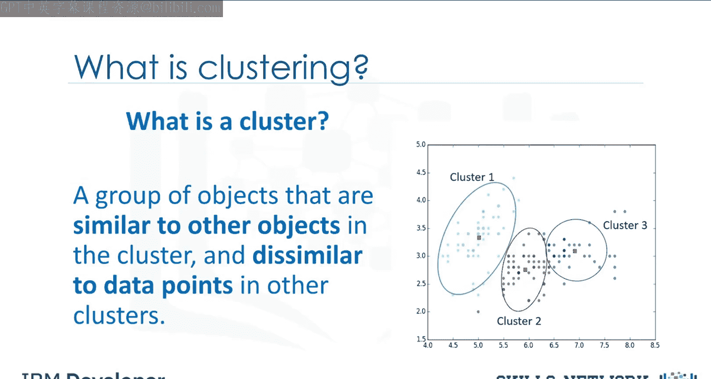
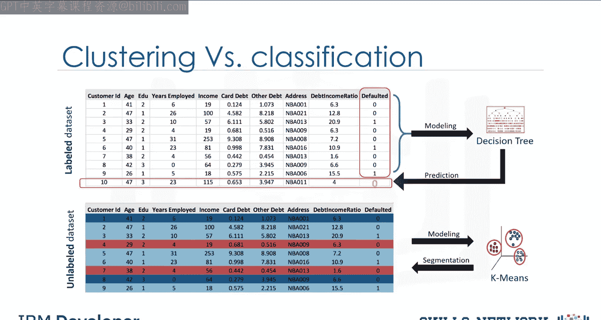
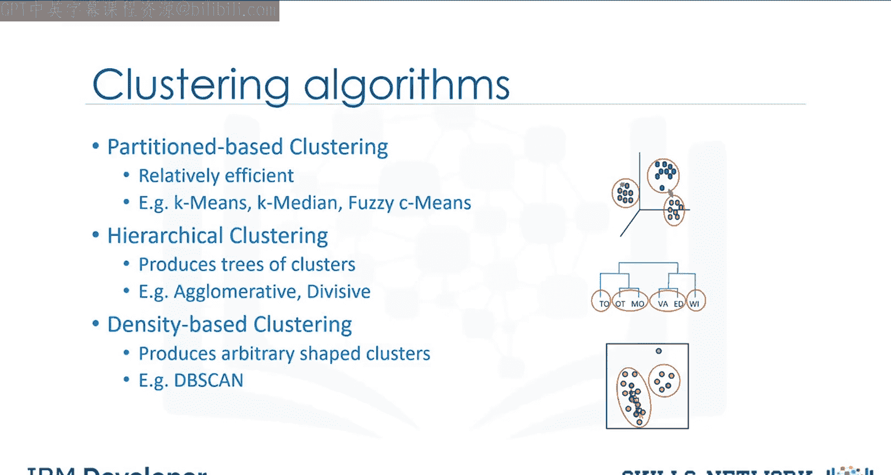

# 077：IBM《生成式人工智能工程｜Falsk、生成式AI应用、数据分析、机器学习、Keras、架构和数据、NLP基础、transformer、微调、高级微调、RAG》 p77 19_聚类简介.zh_en -BV1NAq6Y9E7z_p77-

Hello and welcome In this video， we'll give you a high level introduction to clustering。

 its applications and different types of clustering algorithms。 Let's get started。😊。

Imagine that you have a customer data set and you need to apply customer segmentation on this historical data。

Customer segmentation is the practice of partitioning a customer based into groups of individuals that have similar characteristics。

It is a significant strategy as it allows a business to target specific groups of customers so as to more effectively allocate marketing resources。

For example， one group might contain customers who are high profit and low risk。

 that is more likely to purchase products or subscribe for a service。

 knowing this information allows a business to devote more time and attention to retaining these customers。

Another group might include customers from non nonprofit organizations， and so on。

A general segmentation process is not usually feasible for large volumes of varied data。 Therefore。

 you need an analytical approach to deriving segments and groups from large data sets。

Customers can be grouped based on several factors， including age， gender， interest， spending habits。

 and so on。The important requirement is to use the available data to understand and identify how customers are similar to each other。

Let's learn how to divide a set of customers into categories based on characteristics they share。

One of the most adopted approaches that can be used for customer segmentation is clustering。

Clustering can group data only unsupervised based on the similarity of customers to each other。

It will partition your customers into mutually exclusive groups， for example， into three clusters。

The customers in each cluster are similar to each other demographically。 Now。

 we can create a profile for each group considering the common characteristics of each cluster。

 For example， the first group is made up of affluent and middle aged customers。

 The second is made up of young， educated and middle income customers。

And the third group includes young and low income customers。

Finally， we can assign each individual in our data set to one of these groups or segments of customers。

Now imagine that you cross join this segmented data set with the data set of the product or services that customers purchase from your company。

This information would really help to understand and predict the differences in individual customers' preferences and their buying behaviors across various products。

Indeed， having this information would allow your company to develop highly personalized experiences for each segment。

Customer segmentation is one of the popular usess of clustering cluster analysis also has many other applications in different domains。

So let's first define clustering and then we'll look at other applications。

Clustering means finding clusters in a data set unsupervised， so what is a cluster？

A cluster is a group of data points or objects in a data set that are similar to other objects in the group and dissimilar to data points in other clusters Now the question is what is different between clustering and classification Let's look at our customer data set again。

 classification algorithms predict categorical class labels。

This means assigning instances to predefined classes such as defaulted or nondeulted， For example。

 if an analyst wants to analyze customer data in order to know which customers might default on their payments。

 she uses a labeled data set as training data and uses classification approaches such as a decision tree support vector machines or SVM or logistic regression to predict the default value for a new or a known customer。

Generally speaking， classification is a supervised learning where each training data instance belongs to a particular class。

In clustering， however， the data is unlabeled and the process is unsupervised。For example。

 we can use a clustering algorithm， such as K means to group similar customers。

 as mentioned and assign them to a cluster based on whether they share similar attributes such as age。

 education and so on。 While I'll be giving you some examples in different industries。

 I'd like you to think about more samples of clustering。

In the retail industry， clustering is used to find associations among customers based on their demographic characteristics and use that information to identify buying patterns of various customer groups。

 Also， it can be used in recommendation systems to find a group of similar items or similar users and use it for collaborative filtering to recommend things like books or movies to customers。

In banking， analysts find clusters of normal transactions to find the patterns of fraudulent credit card usage。

 also， they use clustering to identify clusters of customers， for instance。

 to find loyal customers versus churn customers。In the insurance industry。

 clustering is used for fraud detection in claims analysis or to evaluate the insurance risk of certain customers based on their segments。

In publication media， clustering is used to autocateorize news based on its content or to tag news。

 then cluster it so as to recommend similar news articles to readers。In medicine。

 it can be used to characterize patient behavior based on their similar characteristics。

 so as to identify successful medical therapies for different illnesses。Or in biology。

 clustering is used to group genes with similar expression patterns or to cluster genetic markers to identify family ties。

If you look around， you can find many other applications of clustering。

 but generally clustering can be used for one of the following purposes， Exploratory data analysis。

 summary generation or reducing the scale， outlier detection。

 especially to be used for fraud detection or noise removal， finding duplicates in data sets。

 or as a pre processing step for either prediction， other data mining tasks。

 or as part of a complex system。Let's briefly look at different clustering algorithms and their characteristics。

Partition based clustering is a group of clustering algorithms that produces fear like clusters。

 such as K means， K median， or fuzzy C means。These algorithms are relatively efficient and are used for medium and large size databases。

Hiererarchical clustering algorithms produce trees of clusters。

 such as a glloorative and divisive algorithms。 This group of algorithms are very intuitive and are generally good for use with small size data sets。

Density based clustering algorithms produce arbitrary shape clusters。

 They are especially good when dealing with spatial clusters or when there is noise in your dataset set。

 For example， the D B scan algorithm。This concludes our video， thanks for watching。

