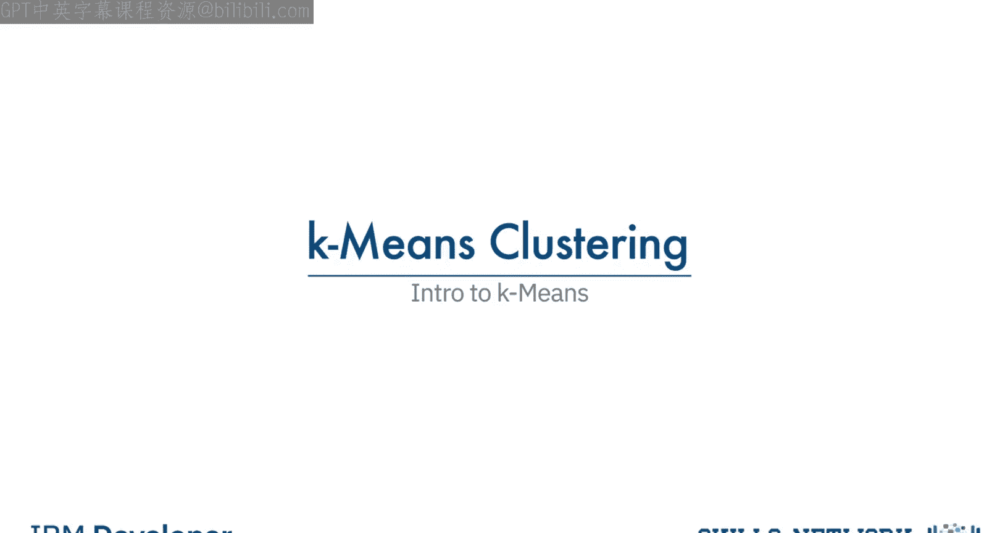
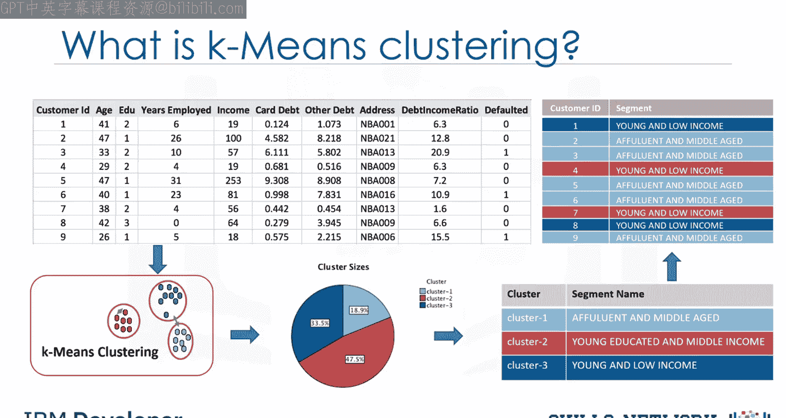
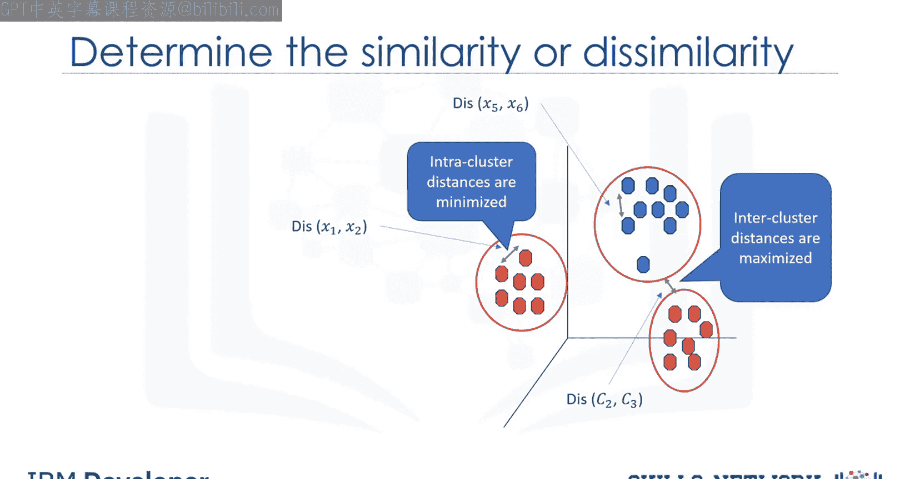
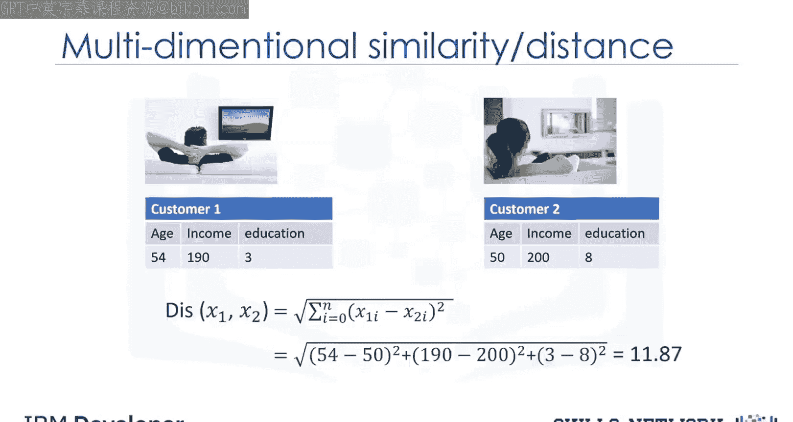
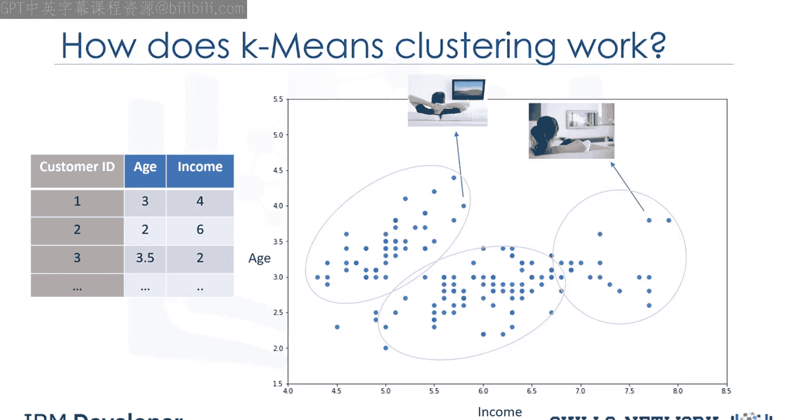
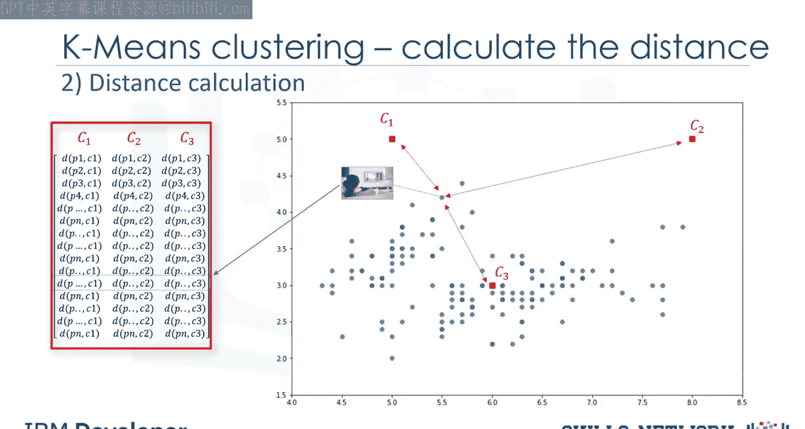
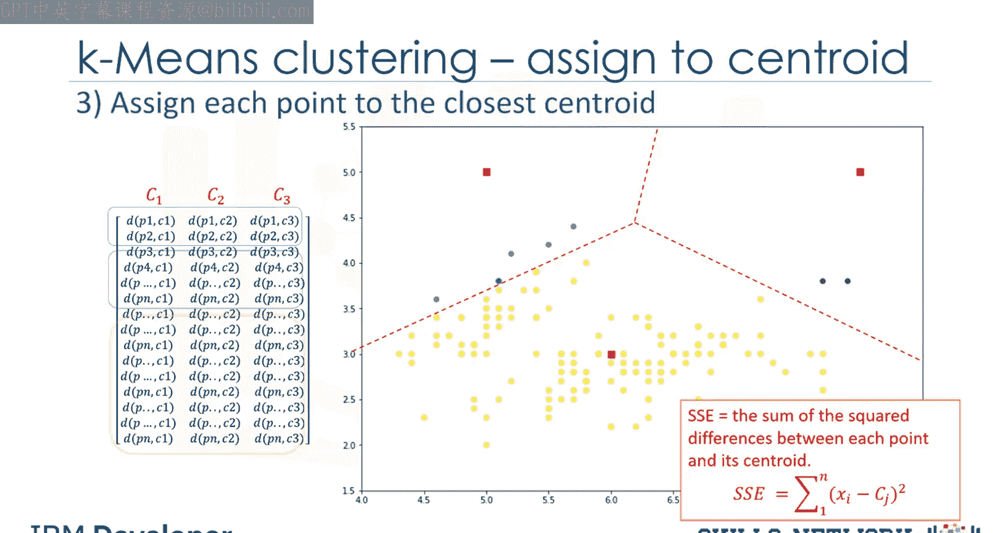
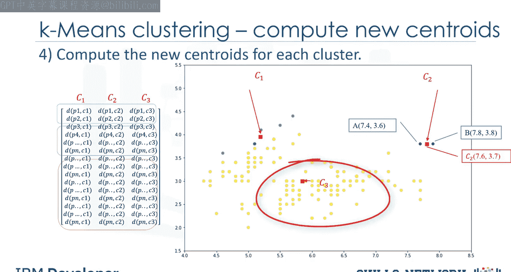
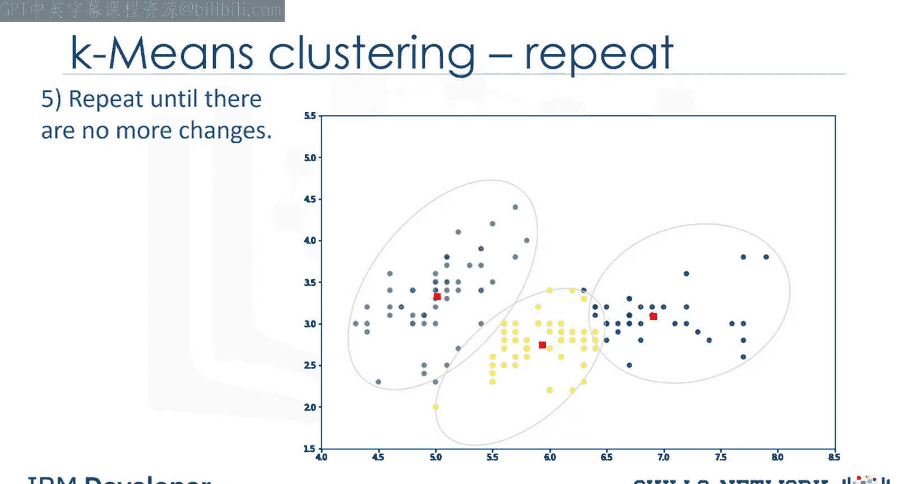

# 078：IBM《生成式人工智能工程｜Falsk、生成式AI应用、数据分析、机器学习、Keras、架构和数据、NLP基础、transformer、微调、高级微调、RAG》 p78 20_K均值简介.zh_en -BV1NAq6Y9E7z_p78-

Hello and welcome In this video we'll be covering K means clustering， so let's get started。

Imagine that you have a customer data set and you need to apply customer segmentation on this historical data。

Customer segmentation is the practice of partitioning a customer base into groups of individuals that have similar characteristics。

One of the algorithms that can be used for customer segmentation is K means clustering。

K means can group data only unsupervised based on the similarity of customers to each other。

Let's define this technique， more formally。

There are various types of clustering algorithms such as partitioning。

 hierarchical or density base clustering。K means is a type of partitioning clustering。 That is。

 it divides the data into K non overlapping subsets or clusters without any cluster。

 internal structure or labels。 This means it's an unsupervised algorithm。

Objects within a cluster are very similar， and objects across different clusters are very different or dissimilar。

As you can see， for using K means we have to find similar samples， for example， similar customers。

Now we face a couple of key questions first， how can we find the similarity of samples in clustering and then how do we measure how similar two customers are with regard to their demographics？

Though the objective of K means is to form clusters in such a way that similar samples go into a cluster and dissimilar samples fall into different clusters。

 it can be shown that instead of a similarity metric， we can use dissimilarity metrics。

 In other words， conventionally， the distance of samples from each other is used to shape the clusters。

So we can say K means tries to minimize the intrac distances and maximize the interc distances Now。

 the question is， how can we calculate the dissimilarity or distance of two cases such as two customers？

Assume that we have two customers。 We'll call them customer 1 and2。

 Let's also assume that we have only one feature for each of these two customers。

 and that feature is age。 We can easily use a specific type of Menkowski distance to calculate the distance of these two customers。

 Indeed， it is the Euclidean distance。What about if we have more than one feature， for example。

 age and income？For example， if we have income and age for each customer。

 we can still use the same formula， but this time in a two dimensional space。Also。

 we can use the same distance matrix for multidimensional vectors。Of course。

 we have to normalize our feature set to get the accurate dissimilarity measure。

There are other dissimilar measures as well that can be used for this purpose。

 but it is highly dependent on data type， and also the domain that clustering is done for it。

For example， you may use Euclidean distance， cosine similarity， average distance， and so on。

Indeed the similarity measure highly controls how the clusters are formed。

 so it is recommended to understand the domain knowledge of your data and data type of features and then choose the meaningful distance measurement。

Now， let's see how K means clustering works。For the sake of simplicity。

 let's assume that our data has only two features， the age and income of customers。

 this means it's a two dimensional space。We can show the distribution of customers using a scatter plot。

 the Y axis indicates age and the X axis shows income of customers。

We try to cluster the customer data into distinct groups or clusters based on these two dimensions。

In the first step， we should determine the number of clusters。

The key concept of the K means algorithm is that it randomly picks a center point for each cluster。

It means we must initialize K， which represents number of clusters。Essentially。

 determining the number of clusters in a data set or K is a hard problem in K means that we will discuss later。

For now， let's put K equals 3 here for our sample data set。

 it is like we have three representative points for our clusters。

These three data points are called centroids of clusters and should be of same feature size of our customer features set。

There are two approaches to choose these centroids。One。

 we can randomly choose three observations out of the data and use these observations as the initial means。

Or two， we can create three random points as centroids of the clusters。

 which is our choice that is shown in the plot with red color。After the initialization step。

 which was defining the centroid of each cluster， we have to assign each customer to the closest center。

For this purpose， we have to calculate the distance of each data point， or in our case。

 each customer from the centroid points。As mentioned before。

 depending on the nature of the data and the purpose for which clustering is being used。

Different measures of distance may be used to place items into clusters。Therefore。

 you will form a matrix where each row represents the distance of a customer from each centroid。

 it is called the distance matrix。

The main objective of K means clustering is to minimize the distance of data points from the centroid of its cluster and maximize the distance from other cluster centroids。

So in this step， we have to find the closest centroid to each data point。

We can use the distance matrix to find the nearest centroid to data points。

Finding the closest centroids for each data point， we assign each data point to that cluster；

 in other words， all the customers will fall to a cluster based on their distance from centroids。

We can easily say that it does not result in good clusters because the centros were chosen randomly from the first。

Indeed， the model would have a high error。Here error is the total distance of each point from its centroid。

It can be shown as within cluster sum of squares error。Intuitively， we try to reduce this error。

 It means we should shape clusters in such a way that the total distance of all members of a cluster from its centroid be minimized。

Now， the question is， how can we turn it into better clusters with less error？

Okay， we move centroids。In the next step， each cluster center will be updated to be the mean for data points in its cluster。

 Indeed， each centroid moves according to their cluster members。 In other words。

 the centroid of each of the three clusters becomes the new mean。For example。

 if point A coordination is 7。4 and 3。6， and point B features are 7。8 and 3。8。

 the new centroid of this cluster with 2 points， would be the average of them， which is 7。6 and 3。7。

Now we have new centroids。As you can guess， once again。

 we will have to calculate the distance of all points from the newcentroids。

The points are relued and the centroids move again。

This continues until the centroroids no longer move。Please note that whenever a centroid moves。

 each point's distance to the centroid needs to be measured again。

Yes， K means is an iterative algorithm， and we have to repeat steps2 to4 until the algorithm converges。

In each iteration， it will move the centroids， calculate the distances from new centroids。

 and assign data points to the nearest centroid； It results in the clusters with minimum error or the most dense clusters。

However， as it is a heuristic algorithm， there is no guarantee that it will converge to the global optimum。

 and the result may depend on the initial clusters。

It means this algorithm is guaranteed to converge to a result。

 but the result may be a local optimum I。e。 not necessarily the best possible outcome。

To solve this problem， it is common to run the whole process multiple times with different starting conditions。

 This means with randomized starting centroids， it may give a better outcome。

 And as the algorithm is usually very fast， it wouldn't be any problem to run it multiple times。

Thanks for watching this video。

