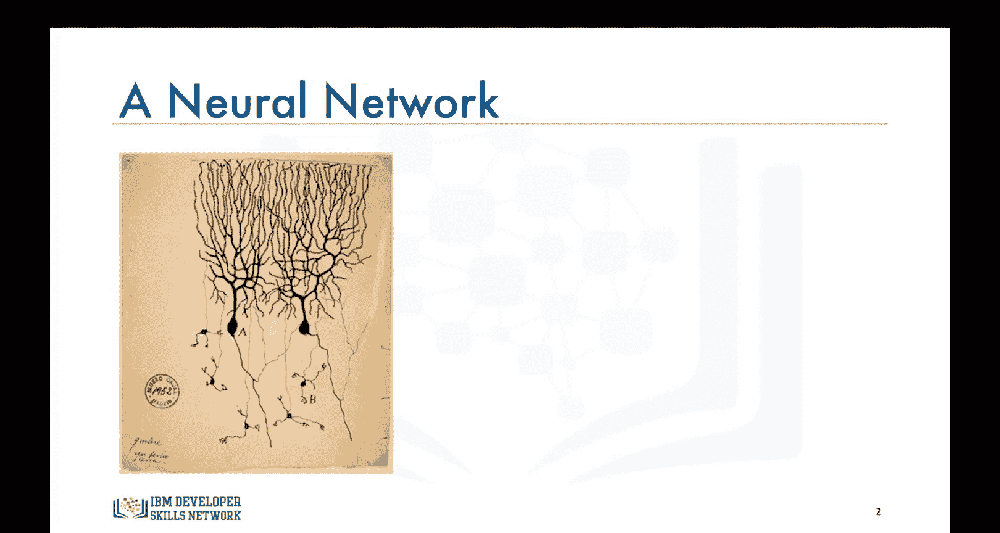
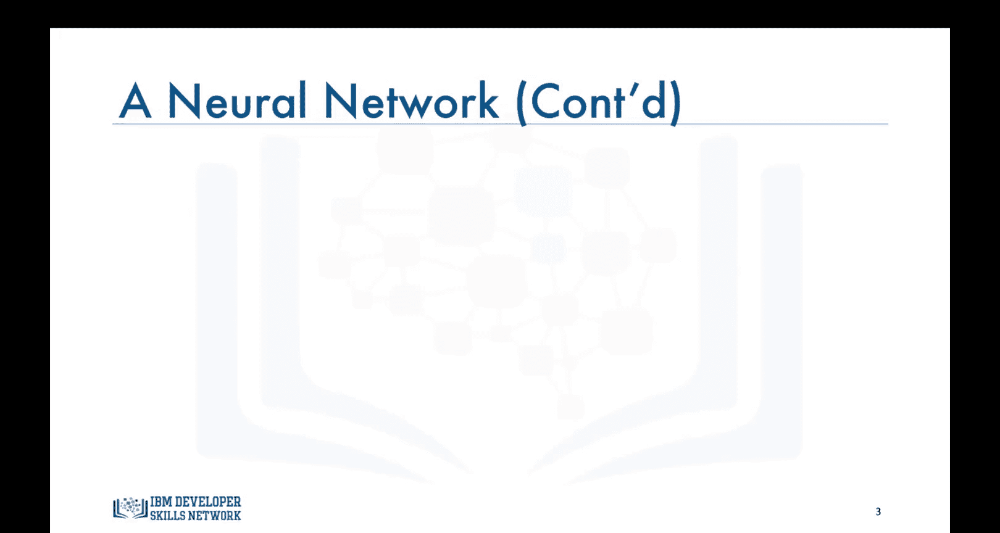
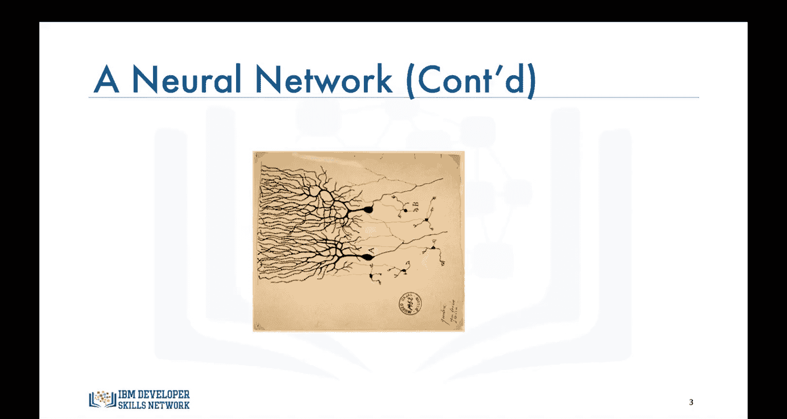
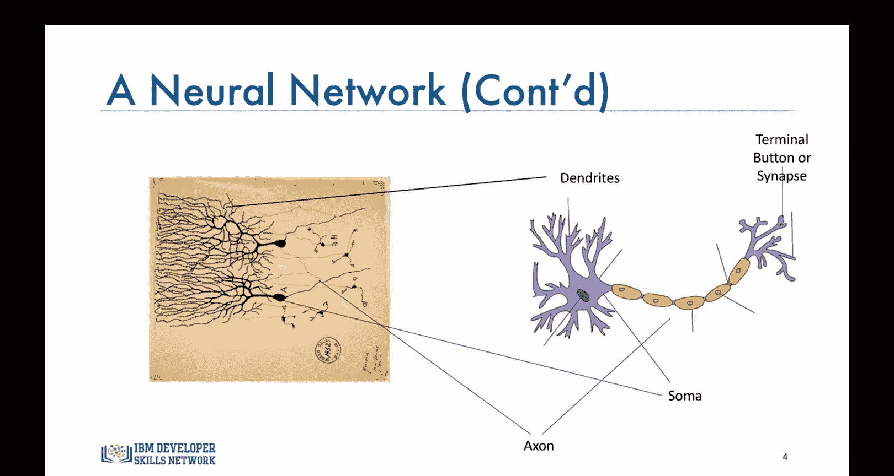
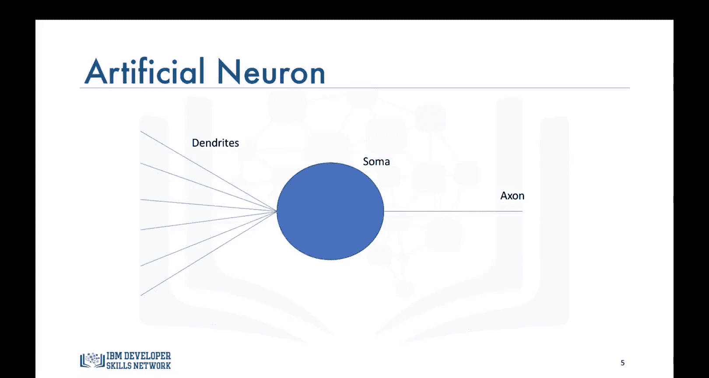
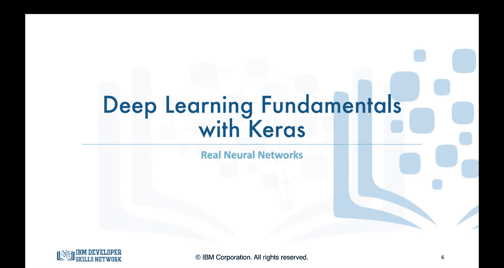

# 082：IBM《生成式人工智能工程｜Falsk、生成式AI应用、数据分析、机器学习、Keras、架构和数据、NLP基础、transformer、微调、高级微调、RAG》 p82 2_神经元和神经网络.zh_en -BV1NAq6Y9E7z_p82-

All the algorithms that are used in deep learning are largely inspired by the way neurons and neural networks function and process data in the brain。

This image is one of the very first pictures of a neuron。

 This was drawn by Santiago Ramon I Caal back in 1899。

 based on what he saw after replacing a pigeon's brain under the microscope。

He is now known as the father of modern neuroscience。 But based on his drawing， the neurons。

 one of them labeled a have big bodies in the middle and long arms that stretch out and branch off to connect with other neurons。

This other image here is that of a neural network and has a bunch or thousands of neurons in what looks like a brain tissue。

 it gives you a sense of how tightly they are packed together and how many of them are in a small brain tissue。

Going back to the drawing of neurons by Armononic Caad， let's rotate it 90 degrees to the left。

I bet this way it is starting to look a little familiar since it slightly resembles drawings of artificial neural networks that you must have seen。

Here is a cartoon to drawing of the neuron。The main body of the neuron is called the soma。

 which contains the nucleus of the neuron。The big network of arms sticking out of the body is called the dendrites。

 and then the long arm that sticks out of the soma in the other direction is called the axon。

The whiskers at the end of the axon are called the terminal buttons or synapses。

So the dendrites receive electrical impulses which carry information or data from sensors or terminal buttons of other adjoining neurons。

The dendrites then carry the impulses or data to the soma in the nucleus。

 electrical impulses or the data are processed by combining them together。

 and then they are passed on to the axon。The axon then carries that process information to the terminal button or synapse。

 and the output of this neuron becomes the input to thousands of other neurons。

Learning in the brain occurs by repeatedly activating certain neural connections over others。

 and this reinforces those connections。This makes them more likely to produce a desired outcome。

 given a specified input。Once the desired outcome occurs。

 the neural connections causing that outcome become strengthened。

An artificial neuron behaves in the same way as a biological neuron， so it consists of a soma。

Dentrites and an axon to pass on the output of this neuron to other neurons。

The end of the axon can branch off to connect to many other neurons， but for simplicity。

 we're just showing one branch here。The learning process also very much resembles the way learning occurs in the brain。

 as you will see in the next couple of videos。

Now that we understand the different parts of an artificial neuron。

 let's learn how we formulate the way artificial neural networks process information。

