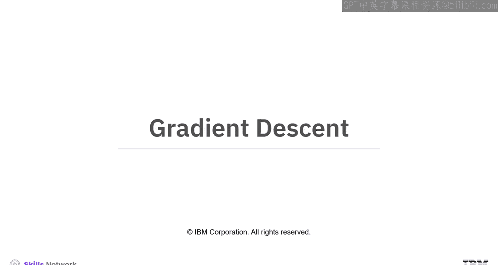
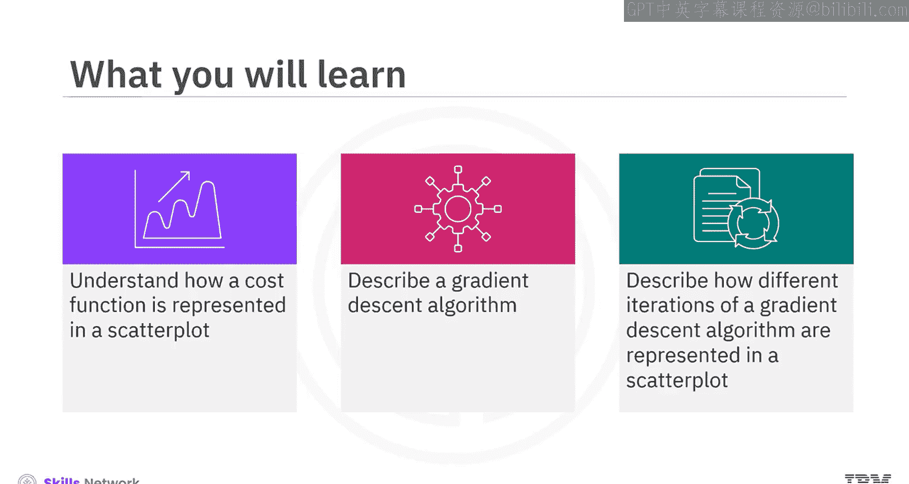
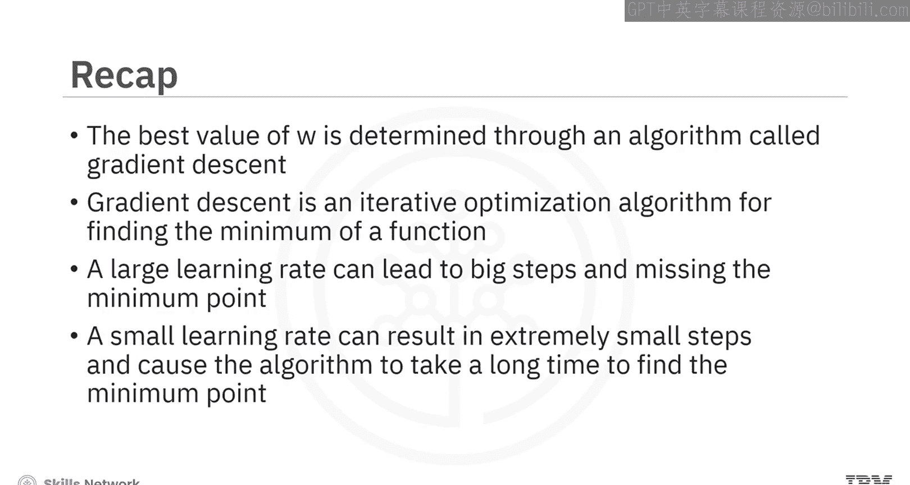

# 084：IBM《生成式人工智能工程｜Falsk、生成式AI应用、数据分析、机器学习、Keras、架构和数据、NLP基础、transformer、微调、高级微调、RAG》 p84 4_梯度下降.zh_en -BV1NAq6Y9E7z_p84-

Welcome to gradient descent。 After watching this video。

 you'll be able to understand how a cost function is represented in a scatter plot。

 De a gradient descent algorithm and describe how different iterations of a gradient descent algorithm are represented in a scatter plot。

 before looking at how neural networks learn and optimize their weights and biases。

 Let's learn about gradient descent。 It's okay。 if you already know about gradient descent。

 But we want to ensure everyone taking this courses on the same page。 Let's say we have some data。

 as shown in this scatter plot for simplicity， we've generated data where the value of z is twice the value of x。

 Now， say we want to find the value of W that would generate a line that best fits this data。

 to do that， we define a cost or a loss function。😊。

One common cost or loss function is the one shown here as J。

 where we take the difference between the z values and the product of w and X's。

 We square that and sum the squared difference across all values of Z and X。

 The best value of W is the value that results in the minimum value of this cost or loss function。

 Let's take a look at what this cost function looks like。

 What makes this cost or loss function attractive is that it's a parabola with one global minimum or one unique solution。

For the given data， the value of w that makes this cost function minimum is w equals 2。

 meaning z equals 2 x， which would result in a line that fits the points perfectly。

This is a very simplified example， as in real world data sets。

 the target variable Z would depend on more than one variable。

 and we can't simply plot a cost function and visually determine the best value of the weights。

 So how do we determine the best value of W the best value of W or W's in the event you have many weights to optimize is determined through an algorithm called gradient descent gradient descent as an iterative optimization algorithm for finding the minimum of a function to find the minimum of a function using gradient descent we take steps proportional to the negative of the function's gradient at the current point What does that mean We started a random initial value of w。

 Let's call it w0 and say it's equal to 0。2。😡，From here， we start taking steps towards the green dot。

 which is W equals 2 to determine in which direction to move。

 we compute the gradient of the loss function at the current value of w， which is 0。2。

 The gradient is given by the slope of the tangent at W equals 0。2。

 and then the magnitude of the step is controlled by a parameter called the learning rate。

The larger the learning rate， the bigger the step we take and the smaller the learning rate。

 the smaller the step we take。 Then we take the step。

 and we move to W1 W1 is computed as W0 minus the learning rate times the gradient at W 0 This represents the first iteration of the algorithm。

 at W1， we repeat the same process of computing the gradient at W1。

 and using the same learning rate to control the magnitude of the step towards the minimum。

 We reform this step repeatedly until we hit the minimum or a value of the cost function that is very close to the minimum within a small predefined threshold。

 Now， when choosing the learning rate， we must be careful because a large learning rate can lead to big steps and eventually missing the minimum On the other hand。

 a small learning rate can result in extremely small steps and therefore causes the algorithm to take a long time to find the minimum point。

 Now， let's see how each iteration with a learning rate of 0。4。

 affect how the resulting line fits the data on the left。 We initialize W to 0。

 which means z equals 0。 It's a horizontal line。Therefore， the cost is high， and the line。

 as you can see， is a bad fit。 W moves closer to2 after the first iteration。

 because the slope is very steep at W equals 0。 The new value of W results in a big drop in the loss function。

 The resulting line fits better than the initial one。 but there's still room for improvement。

After the second iteration， W continues moving toward W equals 2。

 because the slope is not as steep as before。 The step is not as big。

 but the cost function still drops in value。 The resulting line is moving closer to the ideal best fit line。

The same observation is noted with the third iteration。

And with the fourth iteration after four iterations。

 you can see how we're almost there at W equals 2。 and the resulting line almost fits the scatter plot perfectly。

 with each iteration， the weight is updated in a way that's proportional to the negative of the gradient of the function at the current point。

 Therefore， if you initialize the weight to a value that is to the right of the minimum。

 then the positive gradient will result in W moving to the left towards the minimum。

 In this video you learned that the best value of w or Ws in the event that you have many weights to optimize is determined through an algorithm called gradient descent。

 gradient descent is an iterative optimization algorithm for finding the minimum of a function。

 when choosing the learning rate for your computation。

 you must be careful because a large learning rate can lead to big steps。

 which can lead to missing the minimum point。 And a small learning rate can result in extremely small steps and therefore causing the algorithm to take a long time to find the minimum point。

😊。

