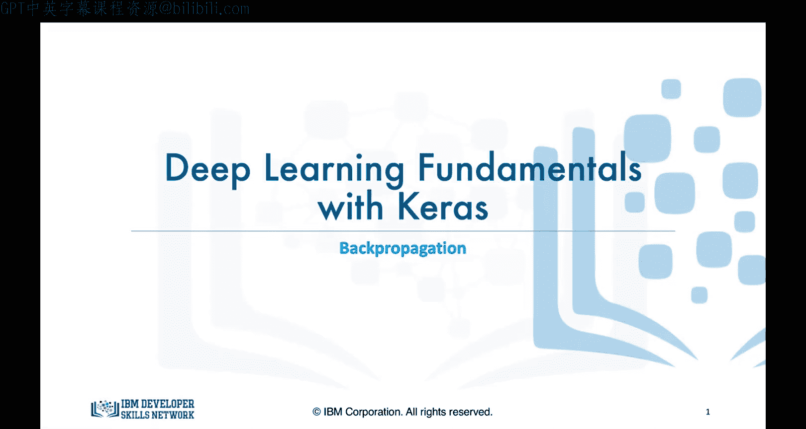
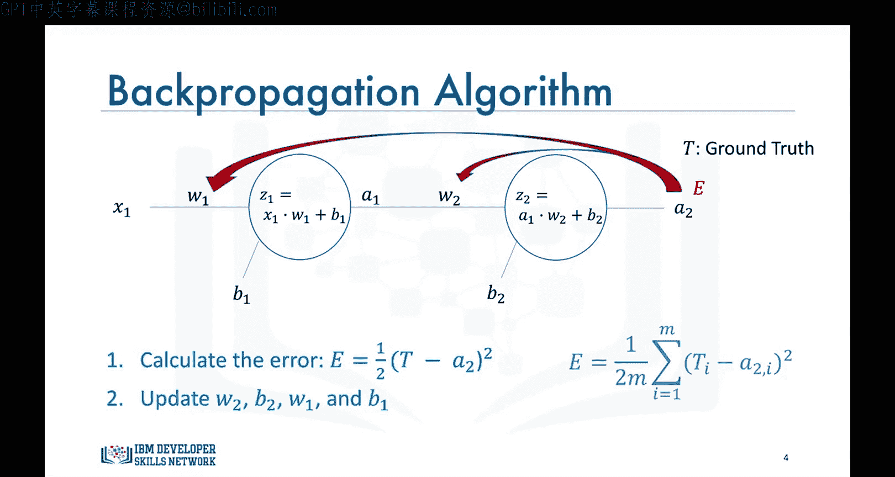
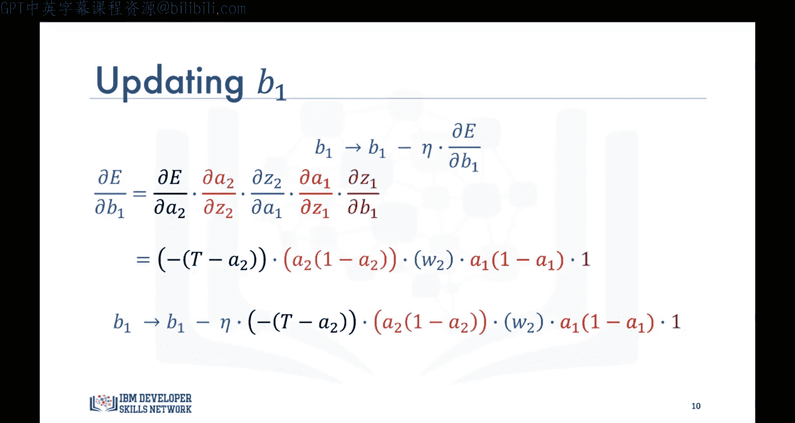
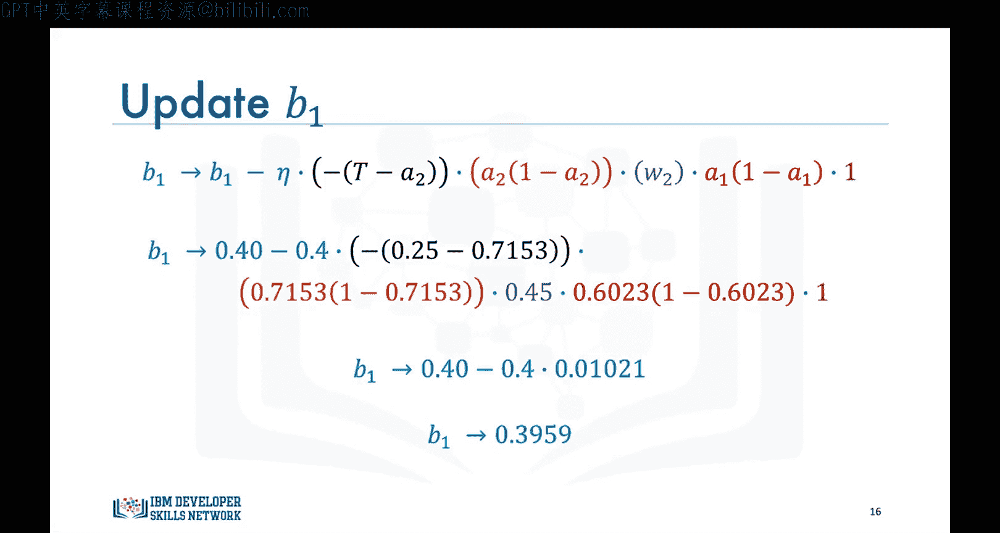
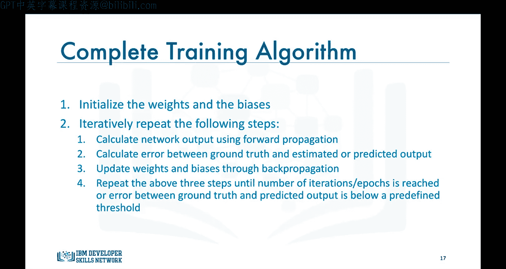
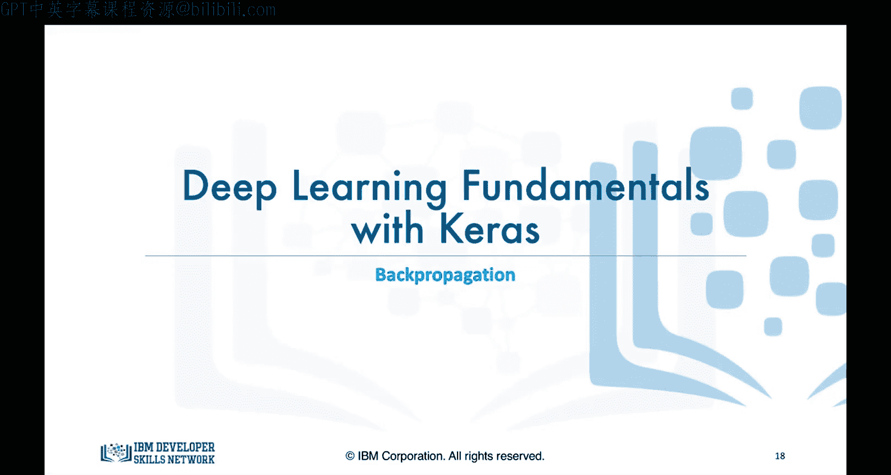

# 085：IBM《生成式人工智能工程｜Falsk、生成式AI应用、数据分析、机器学习、Keras、架构和数据、NLP基础、transformer、微调、高级微调、RAG》 p85 5_反向传播.zh_en -BV1NAq6Y9E7z_p85-

In the previous videos， when discussing how neural networks make predictions using forward propagation。

 we assumed that the network had optimized weights and biases。

But how do neural networks train and optimize their weights and biases for a given problem and data set？

Training is done in a supervised learning setting where each data point has a corresponding label or ground truth。

And training is needed when the predicted value by the neural network obviously does not match the ground truth for a given input。

The training process starts by calculating the error E between the predicted values and the ground truth labels。

This error now represents the cost or the loss function that we discussed in the gradient descent video。

Therefore， the next step would be to propagate this error back into the network and use it to perform gradient descent on the different weights and biases in the network to optimize them using the same equations that we saw in the gradient descent video。

So for our simple network with only two neurons， and that takes one input。

 we calculate the squared error between the ground truth T。And the predicted value A2。

This represents our cost or loss function。Of course。

 normally you don't train your network using one data point。

 but thousands and thousands of data points。Therefore。

 the error is computed as the mean squared error calculated as follows。

Then we use the error to update W2， B2， W1 and B1 by propagating the error back into the network。

For updating W2， we know from our gradient Descent video that we need to use this equation to do that。

But since the error is not explicitly a function of W2。

 then we will need to use the chain rule to establish the derivative of the error with respect to W2。

So we know that E is a function of a2。And we know that a2 is a function of Z2 and Z2 is a function of W2。

Therefore， we can take the derivative of E with respect to a2。

And take the derivative of A2 with respect to Z2 and take the derivative of Z2 with respect to W2。

Then the derivative of the error with respect to W2 would be simply the product of these individual derivatives like so。

The derivative of E with respect to A2 is minus t minus a2。

And the derivative of a2 with respect to Z2 is a2 times 1 minus A2。

And the derivative of Z2 with respect to W2 is just the input A1。Therefore。

 W2 is updated as per the following equation。I'm assuming that you're familiar with differentiation。

 so I'm going to skip showing you how to find the derivatives。But below the video。

 you will find a document that I prepared showing you in details how to find each of the derivatives shown here。

Updating B2 is exactly the same。 the only difference is the derivativebut of Z 2 with respect to B2 is1 and not the input A1。

Similarly， we use this expression to update W1， but the error is not explicitly related to W1。

 So we again use the chain rule to establish the derivative of the error with respect to W1。

We know that E is a function of A2 and we know that A2 is a function of Z2。

 and Z2 is a function of A1 and A1 is a function of Z1 and Z1 is a function of W1。Therefore。

 we can take the derivative of E with respect to A2。And take the derivative of A2 with respect to Z2。

And take the derivative of Z2 with respect to A1。And take the derivative of a1 with respect to Z1。

 and then finally take the derivative of Z1 with respect to W1。

 Then the derivative of the error with respect to W1 would simply be the product of these individual derivatives like so。

The derivative of E with respect to A2 is minus t minus a2。

The derivative of a2 with respect to Z2 is a2 times 1 minus a2。

 and the derivative of Z2 with respect to a1 is W2。

And the derivative of a1 with respect to Z1 is a1 times 1 minus a1。

And the derivative of Z1 with respect to W1 is the input X1。Therefore。

 W1 is updated as per the followinglong equation。Using the same approach。

 we figure out the expression to update B1。

Now let's apply back propagation to our example from the forward propagation video。

 recall that we have a network of two neurons with the initial values of the weights and the biases as shown。

We apply forward propagation and we calculate the value of Z1， which we found to be 0。415。

And the value of a1， which we found to be 0。6023。The value of Z2， which we found to be 0。9210。

 and the value of a2， which we found to be 0。7153。This is the predicted value by the network for an input of 0。

1。Now let's assume that the ground truth is 0。25。We first compute the error between the ground truth and the predicted value。

Next， we will start updating the weights and biases for either a predefined number of iterations or epochs like 1000。

 for example。Or until the error is within a predefined threshold of 0。001， for example。

Using a learning rate of 0。4， let's see how the weights and the biases change after the first iteration。

We already know the expression to update W2。So we simply plug in the values of T。

 A2 and A1 to calculate the gradient。The gradient of the error with respect to W2 is 0。05706。

 and therefore W2 gets updated to 0。4 to7。We repeat the same thing for B2。

 we plug in the values of T and A2 to calculate the gradient。

The gradient of the error with respect to B2 is 0。0948。And therefore， B2 gets updated to 0。612。

Similarly， for W1， we plug in the values of T A2 and W2， A1 and x1 to calculate the gradient。

The gradient of the error with respect to W1 is 0。001021， and therefore W1 gets updated to 0。1496。

As for B1， the gradient of the error with respect to B1 is 0。010 to 1。

 and therefore B1 gets updated to 0。3959。This completes the first iteration or epoC of the training process。

With the updated weights and biases， we do another round of forward propagation。

 calculate the predicted value， and compare it to the ground truth。

Calculate the error and do another round of back propagation。

Therefore， to summarize the training algorithm。First。

 we initialize the weights and biases to random values。

Then we iteratively repeat the following steps， number one。

 calculate the network output using forward propagation number two。

 calculate the error between the ground truth and the estimated or predicted output of the network。

Number three， update the weights and the biases through back propagation。

 repeat the above three steps until the number of iterations or epochs is reached。

 or the error between the ground truth and the predicted output is below a predefined threshold。

In the next video， we will continue our discussion of the back propagation algorithm and point out a serious shortcoming of the sigmoid function when used as the activation function in the hidden layers of deep networks。

