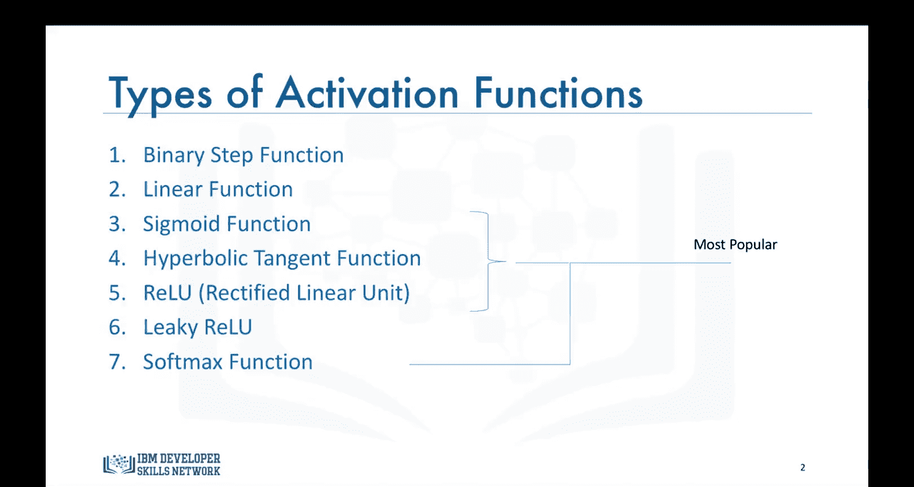
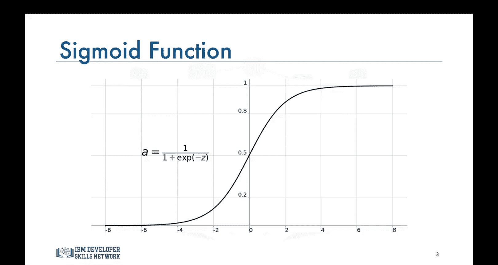
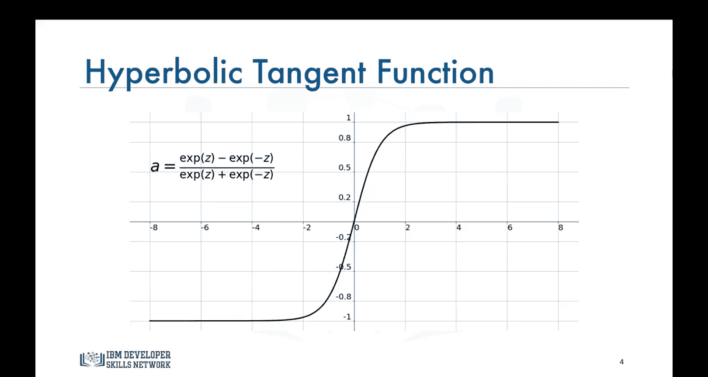
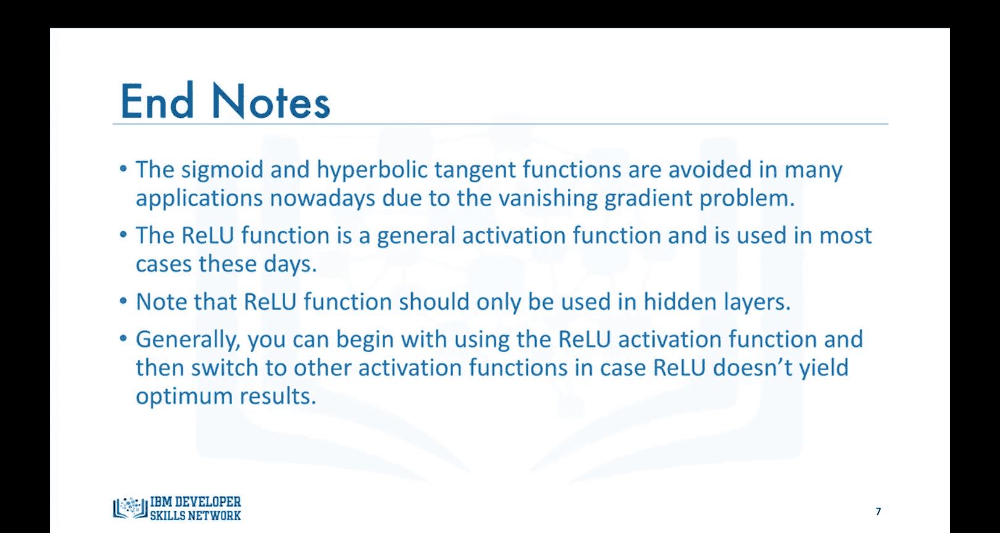

# 087：IBM《生成式人工智能工程｜Falsk、生成式AI应用、数据分析、机器学习、Keras、架构和数据、NLP基础、transformer、微调、高级微调、RAG》 p87 7_激活函数.zh_en -BV1NAq6Y9E7z_p87-

As we discussed earlier， activation functions play a major role in the learning process of a neural network。

So far， we have used only the sigmoid function as the activation function in our networks。

But we still have the sigmoid function has its shortcomings since it can lead to the vanished ingredient problem for the earlier layers。

In this video， we will discuss other activation functions。

Ones that are more efficient to use and are more applicable to deep learning applications。

There are seven types of activation functions that you can use when building a neural network。

There is the binary step function。The linear or identity function。There is our old friend。

 the sigmoid or Lo function。There's a hyperbolic tangent or 10 h function。

D rectified linear unit relove function。The leaky relu function and the soft max function。

In this video， we will discuss the popular ones， which are the sigmoid， the hyperbolic， tangent。

 relu， and the soft max functions。

This is the sigmoid function。And Z equals 0， a is equal to 0。5。

And when Z is a very large positive number， a is close to1。

And when that is a very large negative number， a is close to 0。

Sigmoid functions used to be widely used as activation functions in the hidden layers of a neural network。

However， as you can see， the function is pretty flat beyond the positive 3 and negative 3 region。

This means that once the function falls in that region， the gradients become very small。

This results in the vanishing gradient problem that we discussed。And as the gradients approach zero。

 the network doesn't really learn。Another problem with the sigmoid function is that the values only range from zero to1。

This means that the sigmoid function is not symmetric around the origin and the values received are all positive。

 well， not all the times would we desire the values going to the next neuron be all of the same sign。

This can be addressed by scaling the sigmoid function。

And this brings us to the next activation function， the hyperbolic tang function。

This is the hyperbolic tangent or 10h function， it's very similar to the sigmoid function。

 it's actually just a scaled version of the sigmoid function。But unlike the sigmoid function。

 it's symmetric over the origin， it ranges from negative  one to positive  one。However。

 although it overcomes the lack of symmetry of the sigmoid function。

 it also leads to the vanished ingredient problem in very deep neural networks。

The rectified linear unit or relo function is the most widely used activation function when designing networks today。

In addition to it being nonlinear， the main advantage of using theululu function over the other activation functions is that it does not activate all the neurons at the same time。

According to the plot here， if the input is negative。

 it will be converted to zero and the neuron does not get activated。This means that at a time。

 only a few neurons are activated， making the network sparse and very efficient。Also。

 the rulu function was one of the main advancements in the field of deep learning that led to overcoming the vanishing gradient problem。

One last activation function that we will discuss here is the soft Macax function。

The softm function is also a type of a sigmoid function。

 but is' handy when we're trying to handle classification problems。

The selfmax function is ideally used in the output layer of the classifier where we're actually trying to get the probabilities to define the class of each input。

So if a network with three neurons in the output layer outputs 1。6。0。55 and 0。

98 Then with a soft max activation function， the outputs get converted to 0。51， 0。18 and 0。31。

This way， it is easier for us to classify a given data point and determine to which category it belongs。

In conclusion， the sigmoid and the1 inh functions are avoided in many applications nowadays。

 since they can lead to the vanishing gradienting problem。

The real low function is the function that's widely used nowadays。

And it's important to note that it's only used in the hidden layers。Finally， when building a model。

 you can begin with using the Rulu function and then you can switch to other activation functions if the Rulu function does not yield a good performance。

And this concludes this video and activation functions， I'll see you in the next video。

