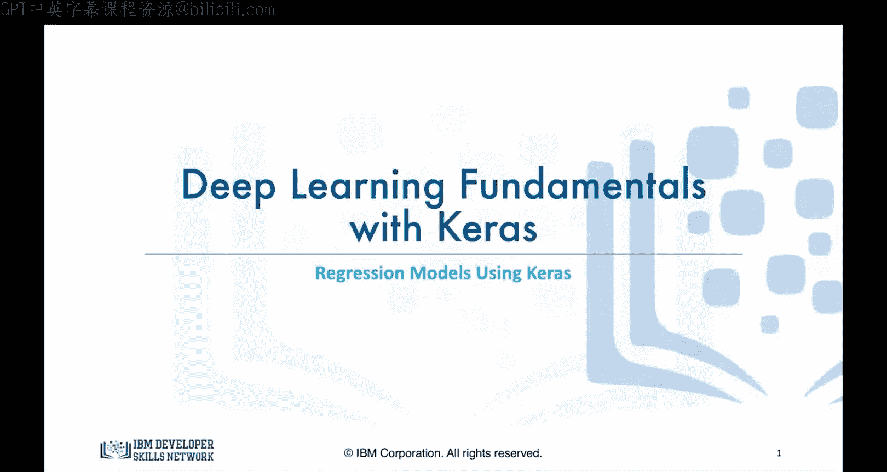
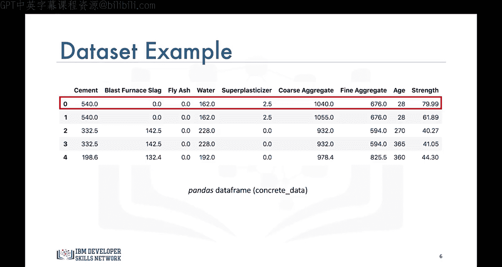
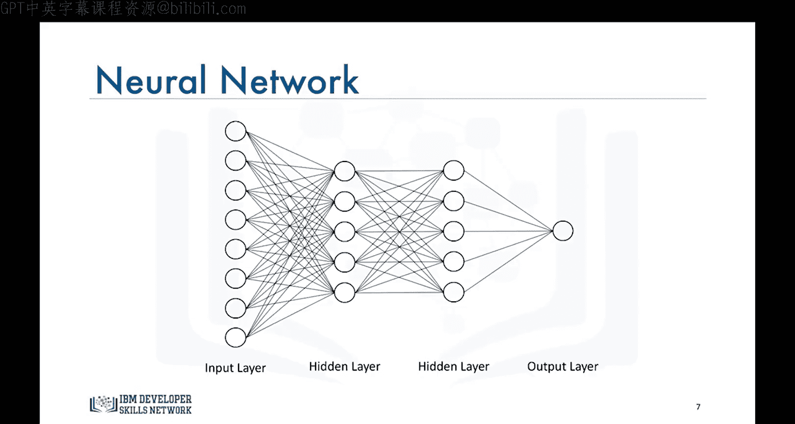
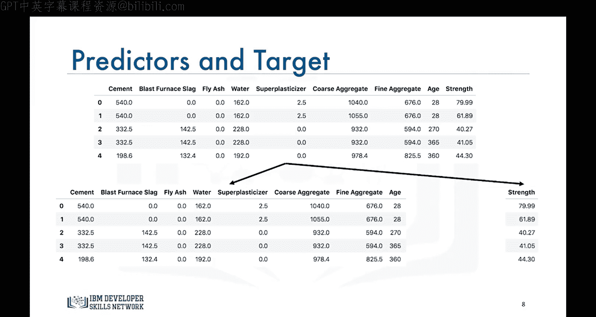
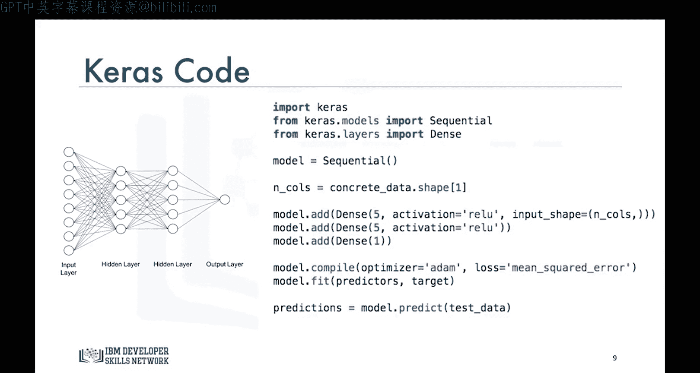
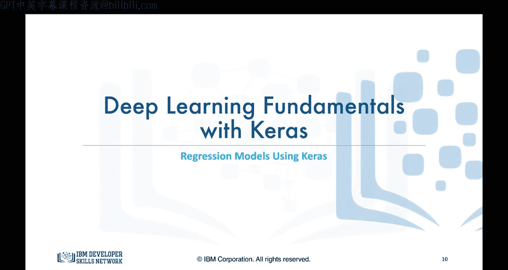

# 089：IBM《生成式人工智能工程｜Falsk、生成式AI应用、数据分析、机器学习、Keras、架构和数据、NLP基础、transformer、微调、高级微调、RAG》 p89 9_使用Keras的回归模型.zh_en -BV1NAq6Y9E7z_p89-

In this video， we will start learning how to use the Ke Library to build deep learning models。

 we will start with building models for regression problems。

Let's take a look at a regression example。Here is a data set of the compressive strength of different samples of concrete based on the volumes of the different materials that were used to make them。

So the first concrete sample has 5，40 cubic meter of cement，0 cubic meter of blast furnace slag。

0 cubic meter of fly ash，162 cubic meter of water，2。5 cubic meter of superplasticizer。

1040 cubic meter， of course， aggregate and 6，76 cubic meter of fine aggregate。 Such a concrete mix。

 which is 28 days old， has a compressive strength of 79。99 meappacals。

The data is an appendus data frame and named concrete data。

So let's say we would like to use the K library to quickly build a deep neural network to model this data set。

 and so we can automatically determine the compressive strength of a given concrete sample based on its ingredients。

So let's say that the deep neural network that we would like to create takes all the eight features as input。

Fes them into a hidden layer of five nodes， which is connected to another hidden layer of five nodes。

 which is then connected to the output layer with one node that is supposed to output the compressive strength of a given concrete sample。

Note that usually you would go with a much larger number of neurons in each hidden layer like 50 or even 100。

 but we're just using a small network for simplicity。

Notice how all the nodes in one layer are connected to all the other nodes in the next layer。

 Such a network is called a dense network。

Before we begin using the CA library， let's prepare our data and have it in the right format。

 The only thing we would need to do is to split the data frame into two data frames。

 one that has the predictors columns and another one that has the target column。

We will also name them predictors and target。

Now， prepare to see the magic of Kes and how building such a network and training it and using it to predict new samples can be achieved with only few lines of code。

The first thing you will need to do is import CAis and the sequential model from Kis dot models。

Because our network consists of a linear stack of layers。

 then the sequential model is what you would want to use。

 This is the case most of the time unless youre building something out of the ordinary。

There are two models in the Keis library。 One of them is the sequential model。

 and the other one is the model class used with the functional API。 So to create your model。

 you simply call the sequential constructor。 Now building your layers is pretty straightforward as well for that。

 we would need to import the dense type of layers from Keis dot layers。

 Then we use the add method to add each dense layer。

 We specify the number of neurons in each layer and the activation function that we want to use As per our discussion in the video and activation functions。

 Relo is one of the recommended activation functions for hidden layers So we will use that。

And for the first hidden layer， we need to pass in the input shape parameter。

 which is the number of columns or predictors in our data set。

Then we repeat the same thing for the other hidden layer， of course。

 without the input shape parameter and we create our output layer with one node。 Now， for training。

 we need to define our optimizer and the error metric in the previous module。

 we use gradient descent as our minim or optimization algorithm and the mean squared error as our loss measure between the predicted value and the ground truth。

 So we will stick with that and use the mean squared error as our loss measure As for the minimization algorithm。

 There are actually other more efficient algorithms than the gradient descent for deep learning applications。

One of them is Adam。One of the main advantages of the addom optimizer is that you don't need to specify the learning rate that we saw in the gradient and descent video。

 So this saves us the task of optimizing the learning rate for our model。

 Then we use the fit method to train our model。 Once training is complete。

 we can start making predictions using the predict method Below the video。

 you will find a document with links to different sections in the Cur library that you can refer to to learn more about optimizers。

 models and other methods that you can use in the Cur library。😊。

But this code snippet here is typically all you need to know to build a regression model in Caris。

 In the next video， we will learn how to build a classification model using the Keis library。😊。

