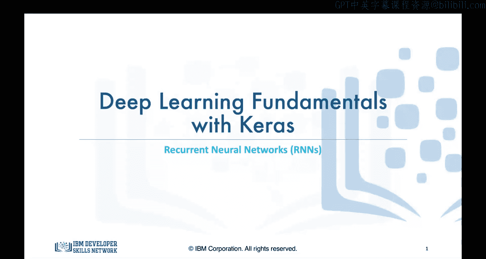
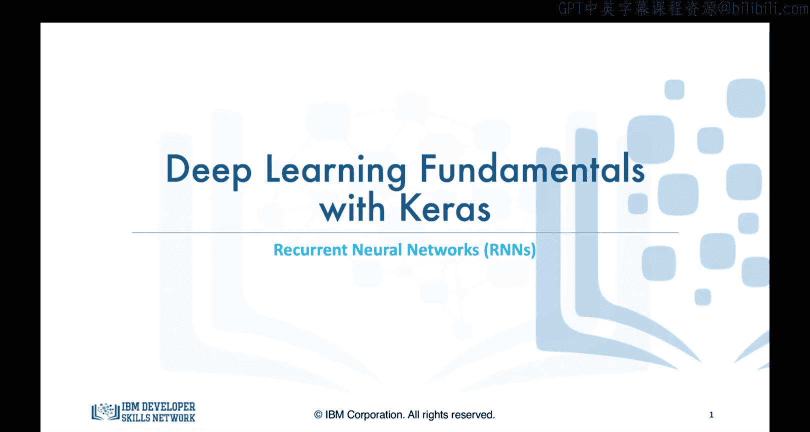
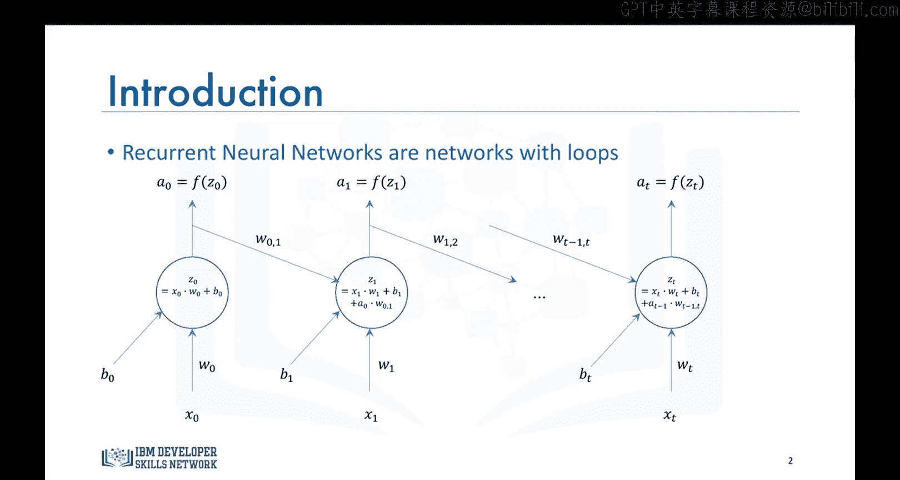
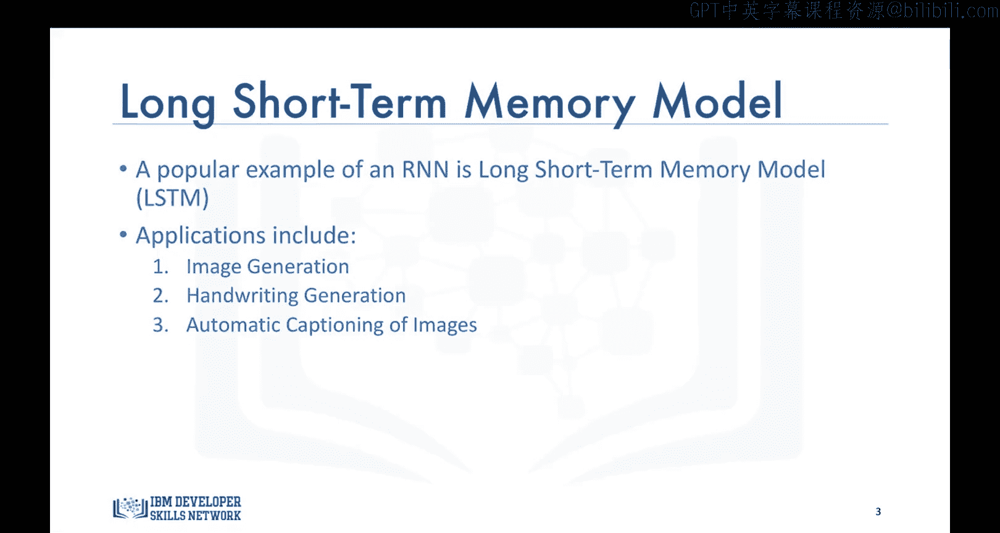
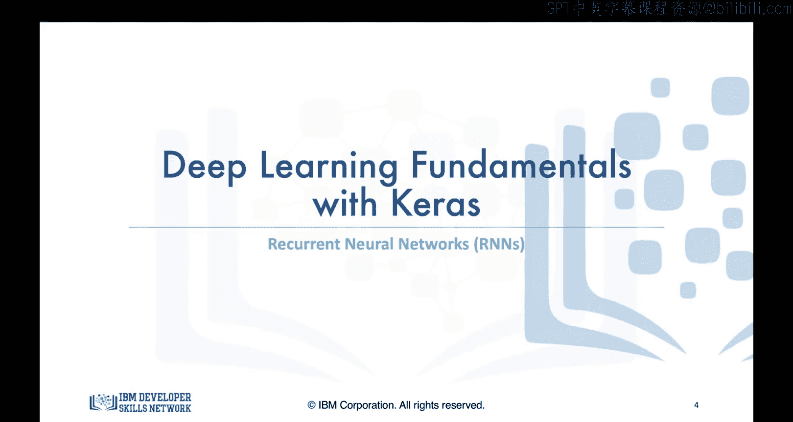

# 093：IBM《生成式人工智能工程｜Falsk、生成式AI应用、数据分析、机器学习、Keras、架构和数据、NLP基础、transformer、微调、高级微调、RAG》 p93 13_循环神经网络.zh_en -BV1NAq6Y9E7z_p93-

In the previous video， we learned about convolutional neural networks。

 which are supervised deep learning models that have revolutionized the field of computer vision。

 especially object detection in images。 In this video。

 we will learn about another supervised deep learning model， which is their current neural network。

So far， we have seen neural networks and deep learning models that see data points as independent instances。

 However， let's say you want to build a model that can analyze scenes in a movie。 Well。

 you can't assume that scenes in a movie are independent and therefore traditional deep learning models are not suitable for this application。

Recurrent neural networks overcome this issue。 Recurrent neural networks or RNNs for short。

 are networks with loops that don't just take a new input at a time。

 but also taken as input the output from the previous data point that was fed into the network。

Accordingly， this is how the architecture of a recurrent neural network would look like。

 essentially we can start with a normal neural network。At time t equals0。

 the network takes an input x0 and outputs a0， then at time t equals 1， in addition to the input X1。

 the network also takes a0 as input weighted with weight W01 and so on and so forth。As a result。

 recurrent neural networks are very good at modeling patterns in sequences of data such as text。

 genomes， handwriting， and stock markets。These algorithms take time and sequence into account。

 which means that they have an temporal dimension。

A very popular type of a currentren neural network is the long shortter memory model or the LSTM model for short。

 it has been successfully used for many applications including image generation where a model trained on many images is used to generate new novel images。

Another application is handwriting Gene， which I described in the welcome video of this course Also LSTM models have been successfully used to build algorithms that can automatically describe images as well as streams of videos。

I think this is a good overview of recurrent neural networks。

 given that this is just an introductory course， I will leave it here。

 This concludes this video on recurrent neural networks。 I will see you in the next video。

 We will switch to unsupervised deep learning models and talk about auto encoders。

