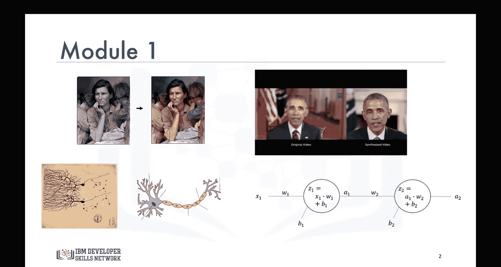
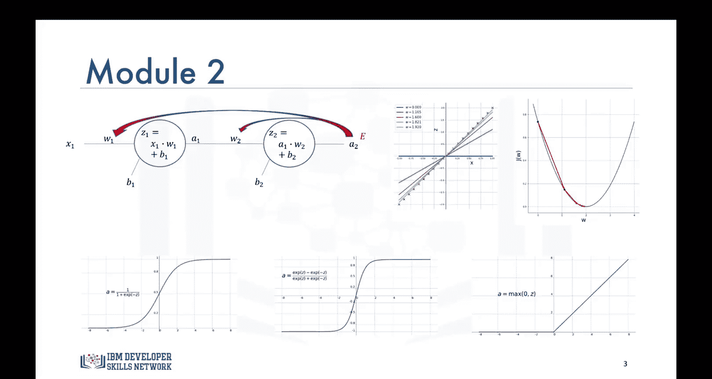
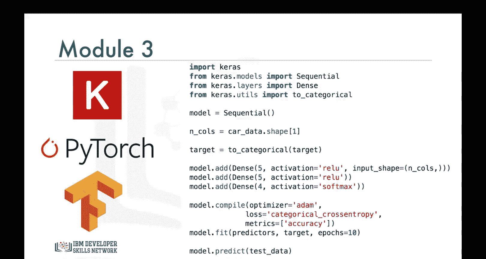
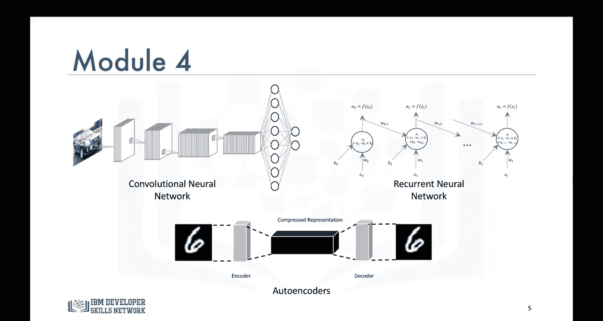
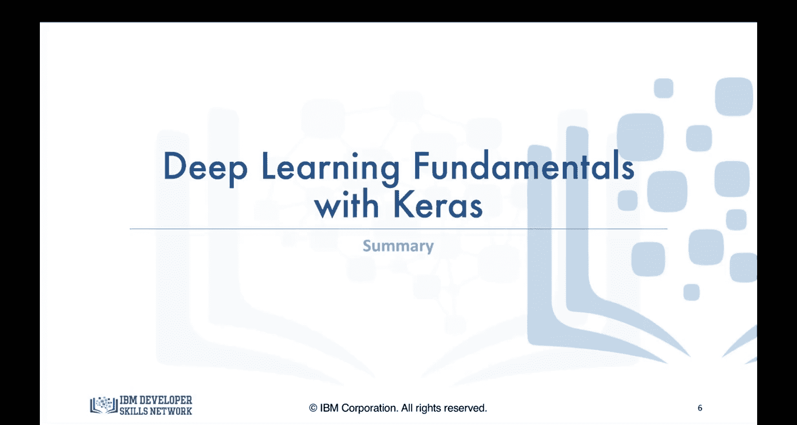

# 095：IBM《生成式人工智能工程｜Falsk、生成式AI应用、数据分析、机器学习、Keras、架构和数据、NLP基础、transformer、微调、高级微调、RAG》 p95 15_总结.zh_en -BV1NAq6Y9E7z_p95-

Congratulations on completing this course。Let's quickly recap what we covered in this course。

In module1， we went over a number of exciting and motivating applications of deep learning。

We also briefly covered neurons and neural networks in the brain to appreciate how they inspire artificial neural networks。

And then we learned how neural networks make predictions through the forward propagation process。

In module2， we learned how an artificial neural network learns through gradient descent and back propagation。

 we also learned about the vanishing gradient problem and which activation functions are best to overcome this problem。

In module 3， we learned about the Keris Library and how to use it to build models for regression and classification problems。

In module 4， we learned about supervised and unsupervised deep neural networks。

 and we used the Keis Library to build a convolutional neural network。

Finally， I really enjoyed putting this course together。

 and so I really hope that you enjoyed it and learned a lot from it。😡。

It was difficult for me at some point because I had to leave out a lot of details。

In order to keep it simple。The point of this course was not to teach you everything。

 but to teach you enough to be ready for more advanced courses on deep learning and to even start learning independently。

 if you wish。 And I think that you are there now。 Thank you for taking this course。

 And I wish you the best of luck。

