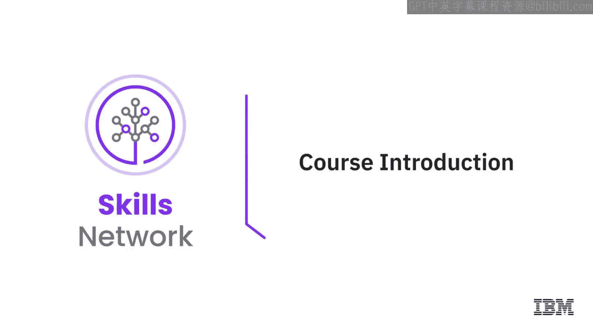
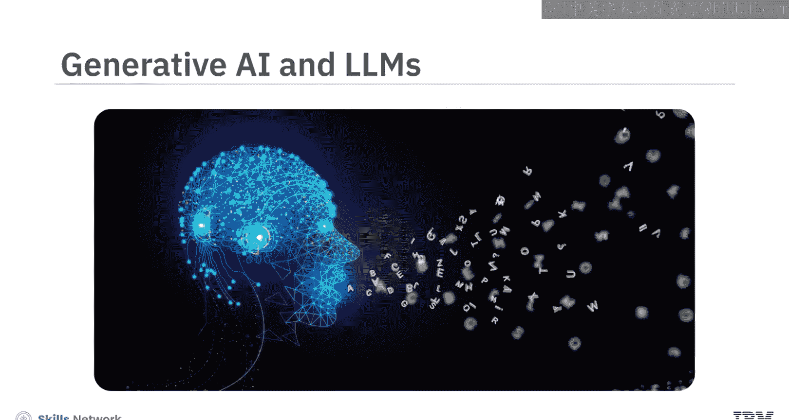
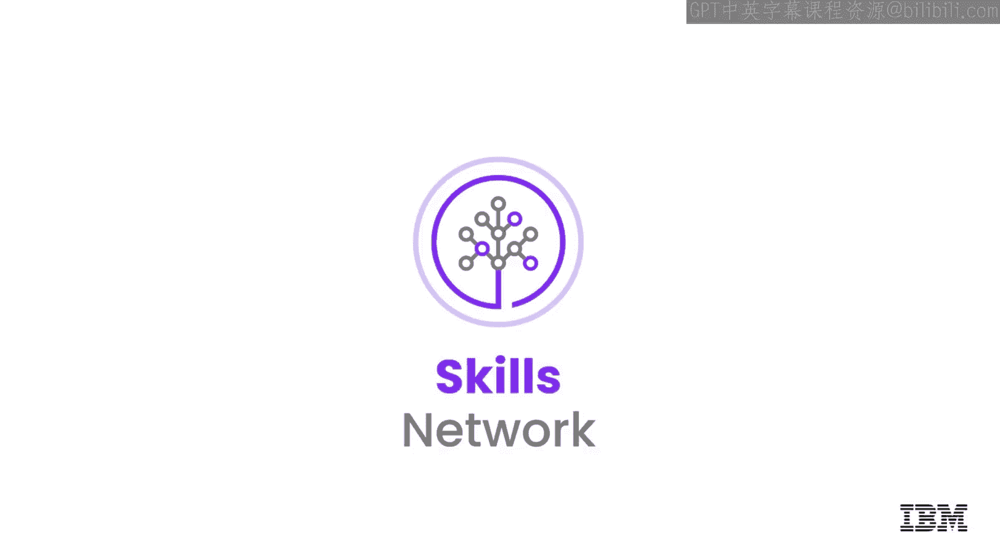

# 097：IBM《生成式人工智能工程｜Falsk、生成式AI应用、数据分析、机器学习、Keras、架构和数据、NLP基础、transformer、微调、高级微调、RAG》 p97 1_课程介绍.zh_en -BV1NAq6Y9E7z_p97-

Welcome to this course on generative AI and large language models where LLMs This course is the first in a specialization program with six courses that will give you the knowledge and skills to build natural language processing or NLP based applications using LLMs。

 generative AI has changed our lives in multiple ways It completes code Auto crafts music。

 designs games and helps in drug discovery just a few of the endless possibilities There has been a huge leap in the capability of generative AI systems to understand natural language This has helped in generating contextually relevant conversations summarizing documents performing language translation and so on。

There is a tremendous opportunity to get into lucrative careers in AI engineering with a specific focus on language modeling。

 get ready to develop innovative AI applications where humans and machines interact with each other effortlessly in natural language。

 build expertise in this rapidly evolving field and be the preferred choice of employers。

This course is suitable for existing and aspiring data scientists， machine learning engineers。

 deep learning engineers， and AI engineers when taking this course you have an advantage if you have a basic knowledge of Python and Pytororch and an awareness of machine learning and neural networks though not strictly required。

When you complete this course， you'll be able to describe how to use LLMs to develop generative AI applications that can understand and generate human language。

 you'll be able to explain how text is pre-processed and loaded for effective training and analysis by LLMs In addition you'll learn to use generative AI libraries and tools for implementing applications that use LLMs。

In module1， you'll learn about the significance and evolution of generative AI。

 you'll learn the differences in the training approach and fine tuning of generative AI architectures and models such as transformers and generative adversarial networks organANs。

 you'll also learn about LLMs， in addition you'll learn about the key features and significance of libraries and tools such as Pytorch and Huging face。

 get handson with lab exercises， you'll use Huging face in a Jupiter environment to explore generative AI libraries。

In moduleule 2 you'll learn the data preparation steps essential to converting data into a format LLM's understand as part of this you'll learn about tokenization and data loaders。

 you'll implement tokenization and create an NLP data loader as part of lab exercises in this module you'll also recap what you learn through a course glossary and cheat sheet。

This course is the right mix of content to facilitate learning Videos are short and focused on the main topic Reads provide detailed content primarily in text format。

 The labs provided the technical environment detailed instructions and code snippets that you can use to complete hands-on exercises You can self- assesss your learning through ungraded practice quizzes The graded quizzes allow you to apply what you learned and assess your knowledge You also get access to a glossary and a cheat sheet with quick reference content such as code syntax。

To get the most from your course， watch all videos， complete the lab to practice your new skills。

 attempt all quizzes， let's get started on this exciting journey。

