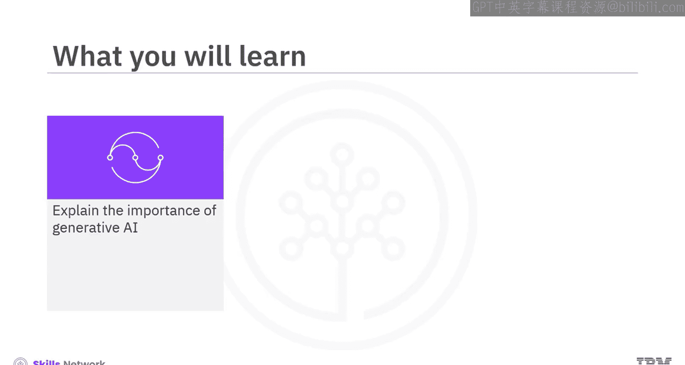
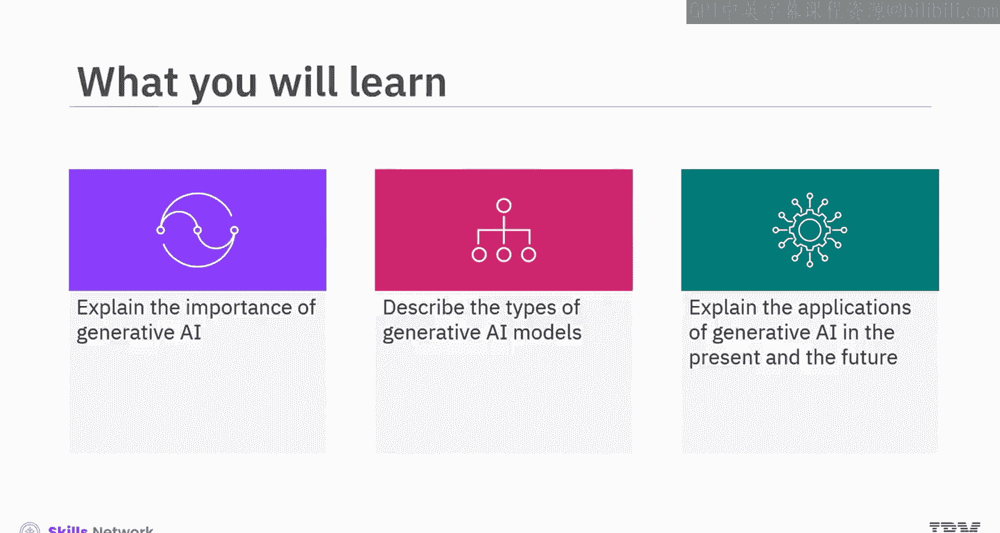
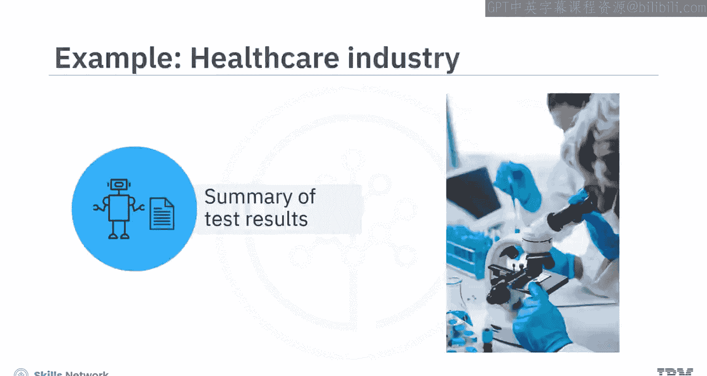
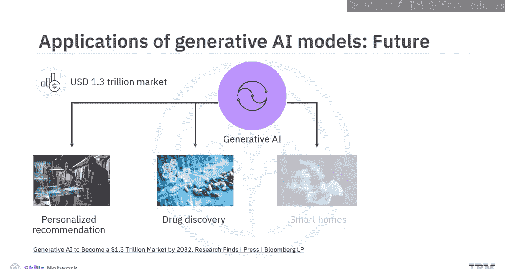
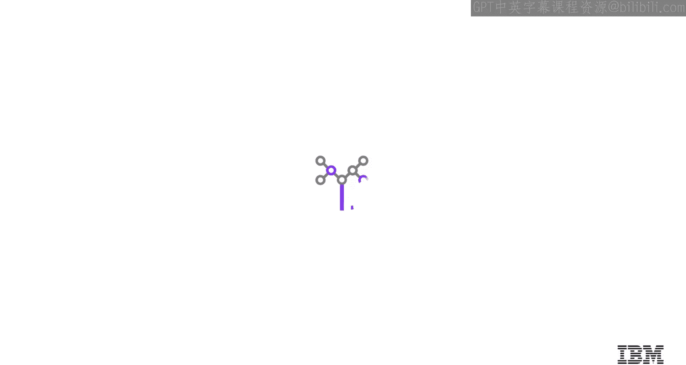

# 098：IBM《生成式人工智能工程｜Falsk、生成式AI应用、数据分析、机器学习、Keras、架构和数据、NLP基础、transformer、微调、高级微调、RAG》 p98 2_生成式AI的重要性.zh_en -BV1NAq6Y9E7z_p98-

Welcome to significance of generative AI After watching this video。

 you'll be able to explain the importance of generative AI and various domains。

 You'll learn about the types of generative AI models。

 You'll be able to explain the applications of generative AI in the present and the future。

 Imagine you're a technology professional working in the healthcare industry。

 your team wants you to enhance the patient experience by implementing generative AI for tasks such as summarizing the various test results of a patient in an easy to understand language。

 Do you think this is possible using generative AI， Let's understand more。😊。

Generative AI refers to deep learning models that can generate high quality text。

 images and other content based on the data they were trained on。

 These models are developed and trained to understand patterns and structures within existing data and apply the understanding to produce new and relevant data。

 generative AI is like an artist who examines various paintings。

 understands the patterns and produces original art inspired by what they learned。

Generative AI includes many types of models that are used across a wide range of fields。

 You will use the various types to generate different types of content， such as text。

 image and audio。 generative AI models are also used for generating 3 dimensional or 3D objects and music。

 Let's first look at using generative AI models for text generation。

 These models understand the context within text data and the relationship between words and phrases。

 They understand the pattern and then generate contextually relevant text。 For example。

 when we start writing a story， these models will intelligently predict and generate the next part of the narrative。

 Or when we input a sentence in English。 The models can generate a translated text in another language preserving the tone of the context。

 An example of a generative AI model for text generation is generative pretrain transformer or G。

Another type of generative AI model pertains to image generation。

These models work primarily in two ways。 One is generating images from text input。 For example。

 the model will generate an image for the prompt， a robot playing a piano。

 An example of this type of generative AI model is data analysis learning with language model for generation and exploration。

 Ply known as Dolly。 The second way of generating images involves inputs such as seed images or random inputs generated by the model itself。

 For example， if you provide an image of the sky as input。

 the model can generate various artistic renditions of the sky。

 You use these models for image to image translations。

 such as creating realistic images from sketches and deep fake creations such as bringing famous actors back to life and films。

Examples of this type of generative AI models are generative adversarial network or G and diffusion model。

 Another type of generative AI model generates audio content。

 You can use these models to generate natural sounding speech。 and for text to speech synthesis。

 For example， you could generate an audio conversation that sounds real。

 An example of this type of generative AI model is wavenet。

 generative AI models and systems are used by many industries for application such as content creation。

 You can automate the creation of articles， blog posts。

 marketing materials and other written content with contextual relevance and clarity。

 You can also create visuals and videos for entertainment and advertising。

 You can condense long documents and articles， helping readers quickly absorb the information。

 You can use generative AI to make language translation sound more natural。

 This improves the accessibility of your content。 Another application of generative AI is in chatbots and virtual assistance。

 You can make chatbots and virtual assistances chat just like humans。😊。

And make them more effective at providing customer support。

Generative AI systems built on one or more AI models help you analyze large data sets。

 especially in natural language processing tasks。 You can use them to uncover insights and suggest creative solutions for complex problems。

 Let's now look at some industry specific applications。

 The health care industry is using generative AI to analyze medical images and create patient reports using medical information。

 F industry uses generative AI to make predictions and forecasts from massive financial data sets。

 The gaming industry is using generative AI to make games more exciting with interactive elements and dynamic story liness。

 In the I industry， generative AI can create artificial data to train models and make them more accurate for data science and machine learning。

 According to Bloomberg intelligence。 generative AI is expected to become a 1。

3 trillion dollars market by 2032。 This will expand its applications in various domains。

 Some examples are enhancing personalized recommendations。

 contributing to medical breakthroughs through drug discovery。😊。

And integrating generative AI into smart homes and autonomous vehicles。

 Let's now recap what you learned In this video， you learned about the significance of generative AI。

 generative AI refers to deep learning models that can generate various types of content。

 such as text， images， audio 3D objects and music based on the data they were trained on。

 These models understand the relationship between words and phrases and generate contextually relevant text。

 An example of a generative AI model for text generation is GT。

 These models can generate images from text input and seed images。

 Exles of generative AI models for image generation are Dolly and G。

 You can use these models to generate natural sounding speech and text to speech synthesis。

 An example of this type of generative AI model is wavenet。

 generative AI has specific applications and industries such as healthcare care， finance。

 gaming and I T。

