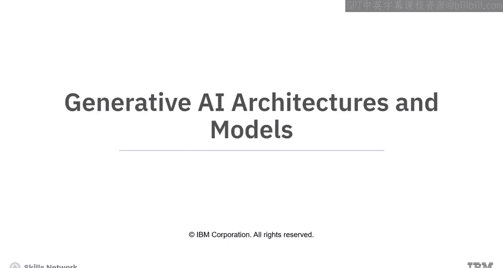
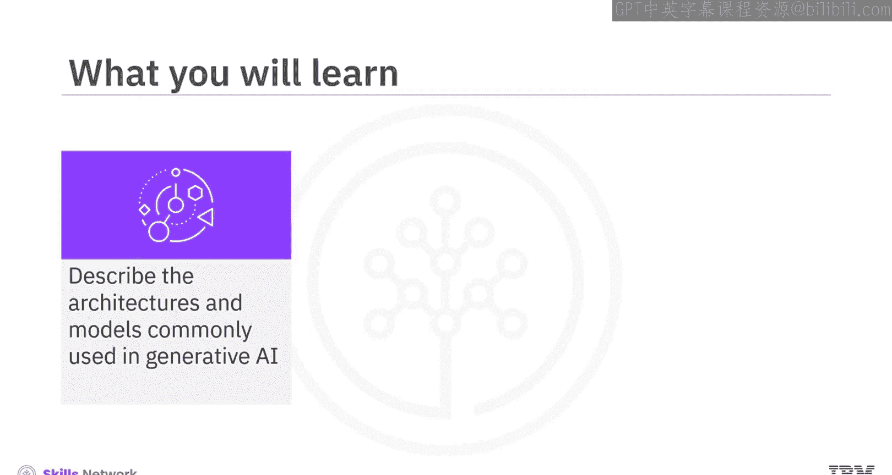
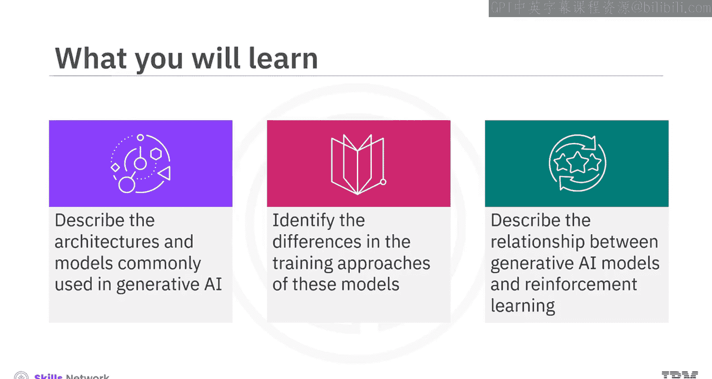
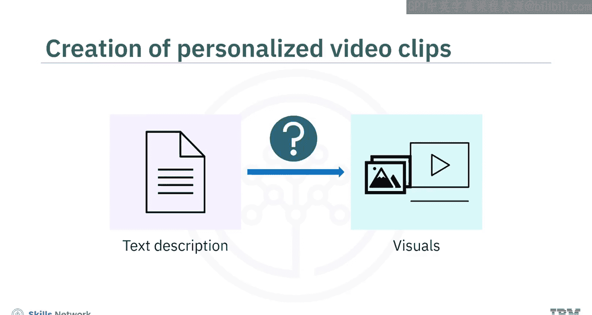
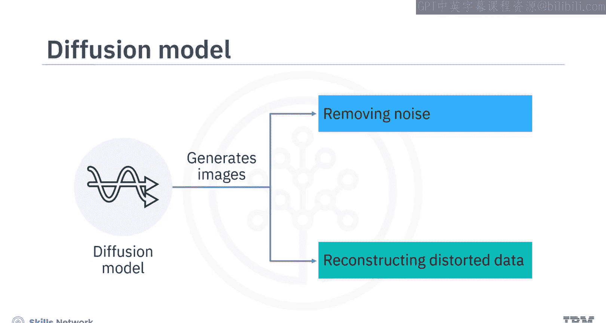
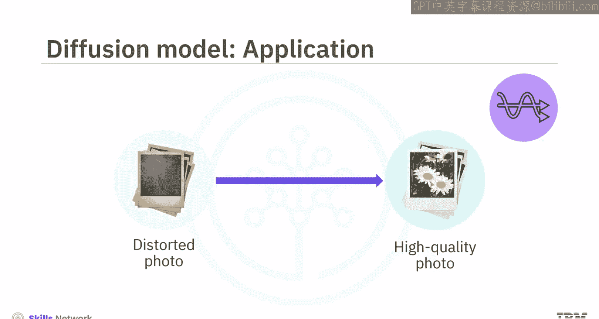
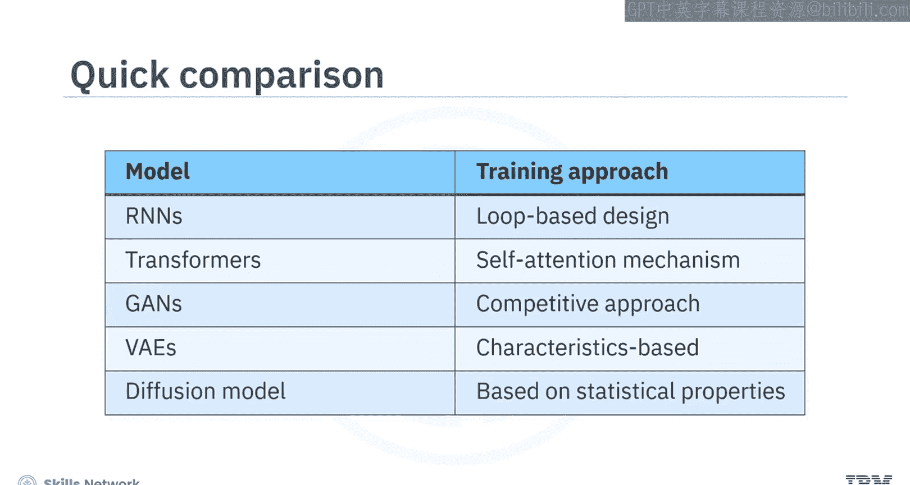
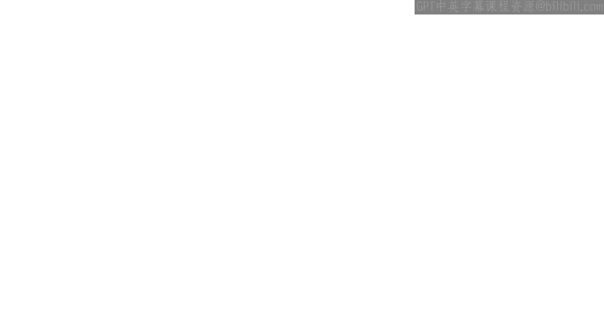

# 099：IBM《生成式人工智能工程｜Falsk、生成式AI应用、数据分析、机器学习、Keras、架构和数据、NLP基础、transformer、微调、高级微调、RAG》 p99 3_生成式AI架构和模型.zh_en -BV1NAq6Y9E7z_p99-

Welcome to generative AI architectures and models。 After watching this video。

 you'll be able to describe the architectures and models commonly used in generative AI。

 You'll identify the differences in the training approaches of these models and describe the relationship between generative AI models and reinforcement learning。

😊。

Imagine you're an AI engineer tasked with automating the creation of personalized video clips for an online platform Use provide text descriptions of the content they want in the videos and the system must generate visuals that match the descriptions accurately which generative AI architecture or model can help you implement this feature。

Let's learn about the architectures and models commonly used in generative AI。

 These include recurrent neural networks or R N Ns， Transformers。

 generative adversarial networks or GNs， Vaal auto encoders or Vas and diffusion models。

 R N Ns are artificial neural networks that use sequential or time series data。

 You use them to solve data related problems with a natural order or time based dependencies。

Rn Ns differ from regular neural networks due to loops built into their structure。

 This loop based design enables R N Ns to remember previous inputs and influence the current input and output。

 This design is crucial for tasks that deal with sequences such as language modeling。

You should fine tune generative AI architectures and models to make them generate more accurate and contextually relevant content。

 fine tuning is adjusting a pretrain model to improve performance for a specific task or data set in R and N fine tuning adjustments to the weights and structure of the recurrent neural network might be necessary to align it with specific tasks or data sets。

 You can use R&Ns in natural language processing or NLP， language translation。

 speech recognition and image captioning。Transformers are deep learning models that can translate text and speech in near real time。

 They take data such as words or numbers and pass it through different layers。

 Information flows in one direction， starting at the input layer。

 going through hidden layers and reaching the output layer。

 The Transformer employs feedback mechanisms to improve accuracy。

 Transformers are designed with a self attention mechanism that enables the model to focus on the most important parts of the information is looking at。

 making its understanding and decision making more efficient。

 The selective focus on different parts of the input sequence allows the model to concentrate on specific segments concurrently。

 enabling parallelization for efficient training。In transformer fine tuning。

 the pretrain transformer model remains largely intact。

 and fine tuning typically involves training only the final output layers for the specific task。

 The Transer self attention mechanisms and other layers usually remain fixed。

 A generative pretrain transformer or GT is an example of a generative model that demonstrates exceptional text generation capabilities within the transformer architecture。

 GT is a generative model trained to predict and generate text sequences based on the patterns learned from its training data。

 even though it doesn't explicitly model the underlying data distribution like some generative models。

 It capacity to produce text that mirrors its training data distribution and its versatility in fine tuning confirms its role as a generative model。

Let's learn about Gan Now。 Gan is a generative AI model consisting of two submods。

 A generator and a discriminator。 The generator creates fake samples and sends them to the discriminator。

 The discriminator checks their authenticity by comparing them with real sample from a domain set。

 It then assigns a probability score to each sample。

 indicating how likely the sample is to be authentic。

 This adversarial process continues like a friendly competition with the generator striving to make things look real and the discriminator learning to distinguish between real and fake。

 Both entities improving their respective outputs。 You'll find Gan specifically useful for image and video generation。

The next model VAE operates on an encoder decoder framework。

 The encoder network first compresses input data into a simplified abstract space that captures essential characteristics。

 The decoder network then uses this condensed information to recreate the original data。

V AEs focus on learning the underlying patterns within the input data。

 making it possible to create new data samples that share similar characteristics。

 VEs represent data using probability distributions in the latent space。

 They can produce a range of possible outputs for a given input。

 reflecting the inherent uncertainty in real world data。

You'll find them useful in applications related to art and creative design。

 The last model is the diffusion model。 A probabilistic generative model。

 A diffusion model is trained to generate images by learning how to remove noise or reconstruct examples from its training data that have been distorted beyond recognition。

 Depend on the prompt of diffusion model can generate highly creative images based on the statistical properties of its training data。

 You can use a diffusion model to generate high quality images from noisy or low quality inputs like restoring an old distorted photograph。

 In summary， the training approaches differ among the architectures and models。

 R NNs use a loop based design。 Transformers utilizes selfatten mechanism。

 GNs employ competitive training approach。 VaEes adopt characteristics based approach and diffusion models depend on statistical properties。

 Generative AI models are closely tied to reinforcement learning。

 Traditional reinforcement learning focuses on how agents like AI systems or robots interact。

 with their environment to maximize rewards。 Generative AI models employ reinforcement learning techniques。

Duringring training to fine tune and optimize their performance for specific tasks。

 Let's now recap what you learned In this video， you learned about generative AI architectures and models。

 generative AI architectures and models include R NNs， Transformers， GNs， VaEs and diffusion models。

 R NNs use sequential or time series data and a loop based design for training。

 Transformers utilize the selfatten mechanism to focus on the most important parts of the information。

 GNs consist of a generator and a discriminator， which work in a competitive mode。

 VaEs operate on an encoder decor framework and create samples based on similar characteristics。

 diffusion models generate creative images by learning to remove noise and reconstruct distorted examples。

 relying on statistical properties。

