# 101：IBM《生成式人工智能工程｜Falsk、生成式AI应用、数据分析、机器学习、Keras、架构和数据、NLP基础、transformer、微调、高级微调、RAG》 p101 5_分词.zh_en -BV1NAq6Y9E7z_p101-

Welcome to tokenization After watching this video， you'll be able to describe the tokenization process。

 you'll also be able to explain tokenization methods in the use of tokenizers。

 Imagine you're developing an AI model for sentiment analysis on user feedback。

 The model must identify and extract keywords such as good and bad to determine sentiment This process requires breaking down user provided text into meaningful parts。

The process of breaking a sentence into smaller pieces or tokens is called tokenization。

 The tokens help the model understand the text better for a sentence like IBM taught me tokenization。

 tokens can be IBM taught me and tokenization。 Different AI models might use different types of tokens。

 The program that breaks down text into individual tokens is called a tokenizer。

 Tokens generate tokens primarily through three tokenization methods。

 Word based character based and subword based。In word based tokenization。

 the text is divided into individual words。 Each word considered a token。

 An advantage of word based tokenization is that it preserves the semantic meaning。

 A disadvantage is that treating each word as a token significantly increases the model's overall vocabulary。

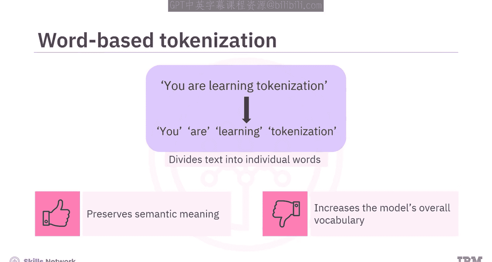

Different tokenizers behave differently。 N LT K and Spacey tokenizers split sentences effectively。

 but may treat similar words like unicorn and unicorns as different。

 leading to issues during natural language processing or NLP tasks。

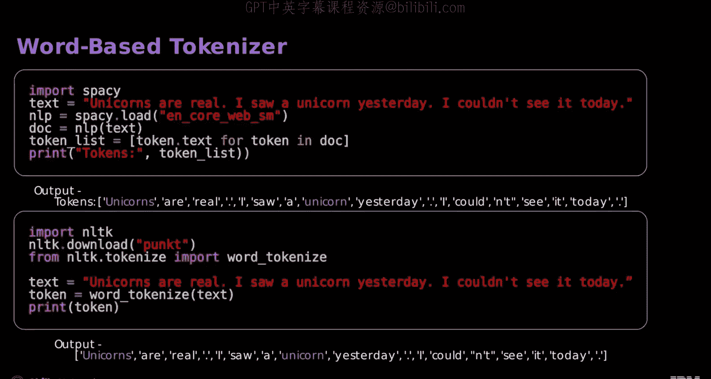

The next type of tokenization is character based tokenization。

 which involves splitting text into individual characters。

 An advantage is that the vocabularies are small。 However。

 single characters may not convey the same information as entire words。

 Each character as a unique token increases input dimensionality and computational needs。

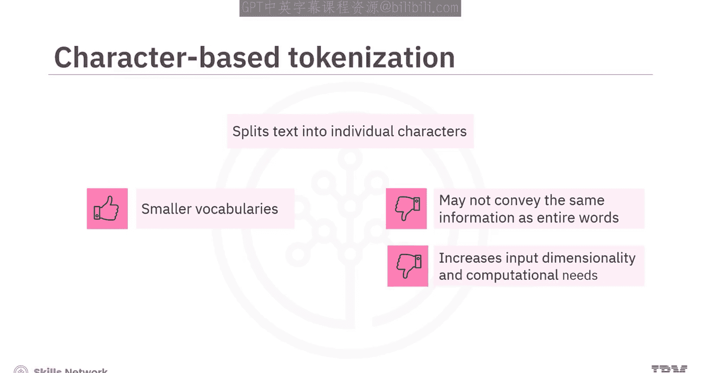

Here's an example of a character based tokenizer。 The input text is this is a sentence。

 After tokenization， you get the characters， THIS S and so on。

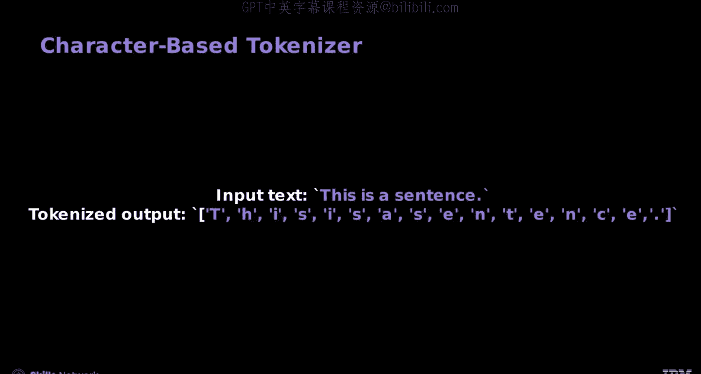

In subword based tokenization， frequently used words can remain unsplit。

 while infrequent words are broken down into meaningful sub wordss。

 It combines the advantages of word based and character based tokenization。

 There are various algorithms for implementing subword based tokenization。

 You'll learn about the word piece unigram and sentence piece algorithms。

 Word piece evaluates the benefits and drawbacks of splitting and merging two symbols to ensure its decisions are valuable。

 The unigram algorithm breaks text into smaller pieces。

 It begins with a large list of possibilities and gradually narrows down based on how frequently they appear in the text。

 It's an iterative process， gradually narrowing down possibilities。 Se piece segments。

 text into manageable parts and assigns unique Is。

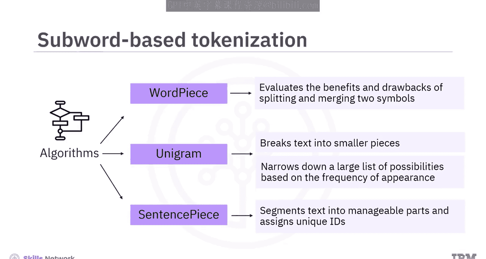

Here's an example of a tokenizer utilizing the word piece algorithm。

 The code snippet utilizes the Transers's library to import pretrained bidirectional encoder representations or Bt tokenizer。

 The hash hash symbol before a word indicates that the word should be attached to the previous word without a space。

 Let's look at an example of a tokenizer utilizing unigram and sentence piece algorithms。

 The code snippet uses the transformerss library to import the Excelel net tokenizer。

 The tokens are prefixed with an underscore to indicate they are new words preceded by a space in the original text。

 The tokenization appears without a prefixed because it directly follows the preceding word token without a space in the original text。

 Let's now understand how tokenization and indexing are done in pytorrch。 In pytorrch。

 you can use the torch text library to tokenize text from a data set into individual words or subwords。

 Use the build vocab from iterator function to create a vocabulary from these tokens that the model can understand。

 This function assigns each token in the vocabulary。

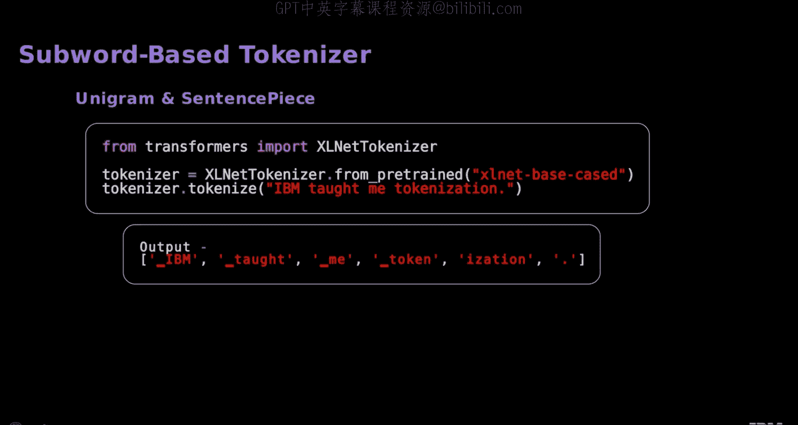

A unique index represented by an integer。 The model then uses these indices to map words in the vocabulary。

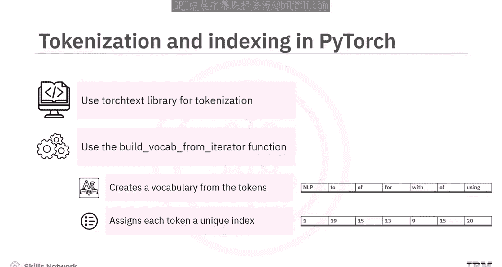

Let's look at an example of using torch text to tokenize sentences。

 A synthetic data set has been created to demonstrate how torch text uses the get tokenizer function to tokenize sentences。

 The tokenizer is applied to the text to get the tokens as a list。

The code defines a function called yield tokens that takes a data iterator as input inside this function。

 It processes each text from the data iterator using a tokenizer and yields the tokenized output individually。

 Then it creates an iterator called my iterator by applying the yield tokens function to a data set。

 The next my iterator statement fetches the next set of tokens from the data set。

 allowingow you to work with the tokenized data。The build vocab from iterator function will convert the tokens to indices。

 Sometimes you will have an unknown token。 U N K that you use as a special token for words that might not be in your vocabulary。

 The line vocab set default indexes of vocab U N K sets U N K as the default word。

 If a word is not found in the vocabulary。 Finally。

 vocab get S T O I gives you a dictionary that maps words to their corresponding numerical indices in the vocabulary。

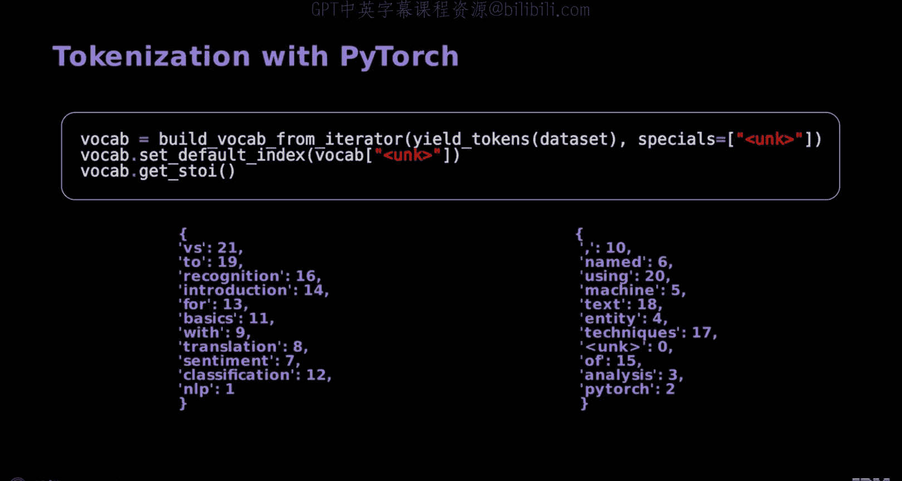

You can apply the vocab function to the token directly or to a list of tokens；

 the result is a list of indices。Consider an example of applying the vocab function to the tokens directly。

 The function get tokenized sentence and indices takes an iterator as input and applies the vocab function to the token directly。

 The next tokenized sentence is extracted from the iterator。

 A list of token indices is created using the vocab dictionary for each token in the tokenized sentence。

 The code returns both the tokenized sentence and its corresponding token indices。

 This process is repeated。 Finally， the print command prints the tokenized sentence and its corresponding token indices。

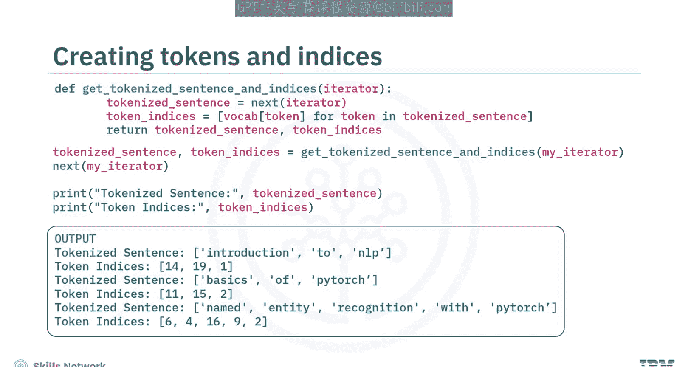

In many applications， you'll have to add special tokens。Using Spacey， you can tokenize each sentence。

 you can add the special tokens by appending BOS at the beginning and EOS at the end of the tokenized sentence。

 using a loop that iterates over the sentences in the input data。Subsequently。

 you can pad the tokenized lines with pad tokens。To ensure that all sentences have the same length。

 matching the length of the longest sentence among the input sentences。

Let's now recap what you learn In this video， you learned about tokenization。

 Tokenization breaks a sentence into smaller pieces or tokens。

 Tokenizers such as NLT K and Space E generate tokens。

 Word based tokenization preserves the semantic meaning。

 though it increases the models' overall vocabulary。

 Charer based tokenization has smaller vocabularies。

 but may not convey the same information as entire words。

 Subword based tokenization allows frequently used words to stay unsplit while breaking down infrequent words into meaningful sub words。

 You can implement subword based tokenization using the word piece。

 Uniigram and sentence piece algorithms。 You can add special tokens such as B at the beginning and Eos at the end of a tokenized sentence。

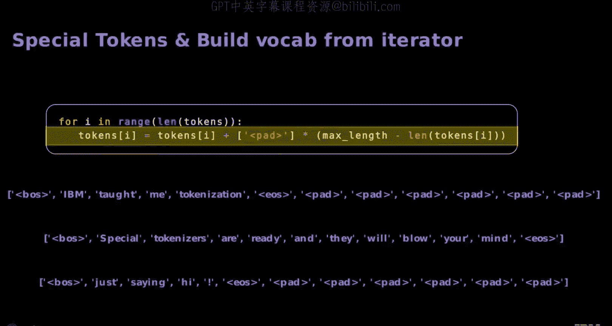

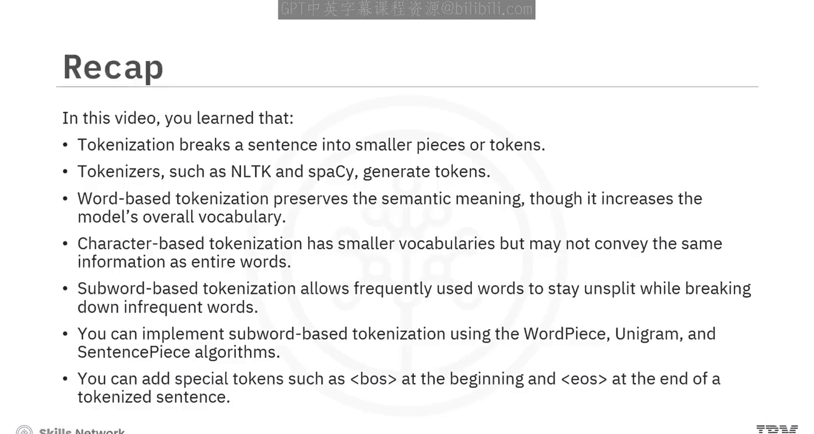