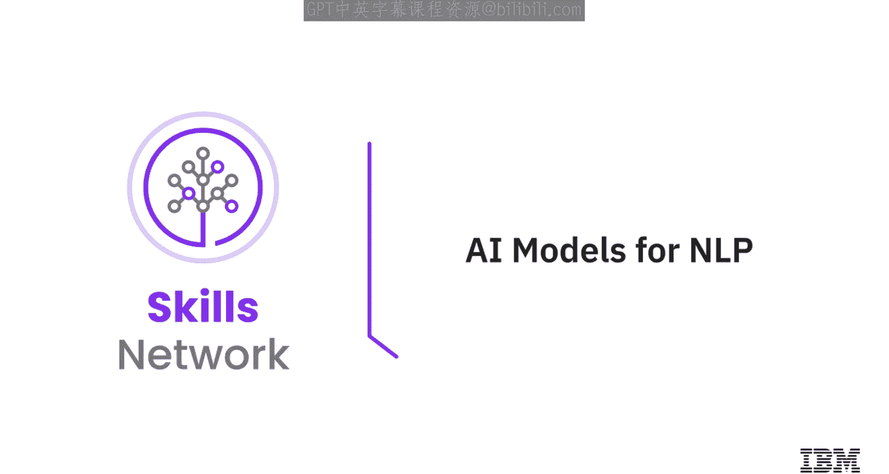
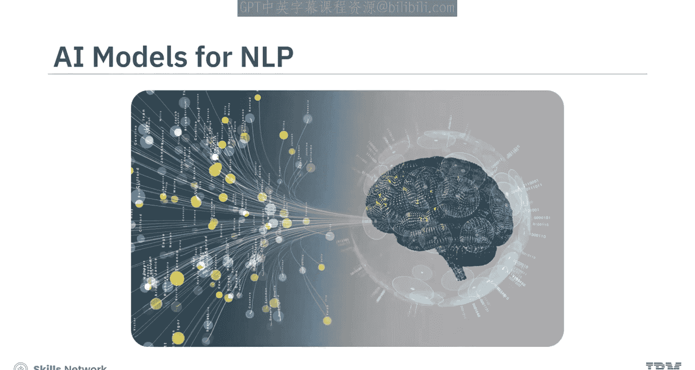
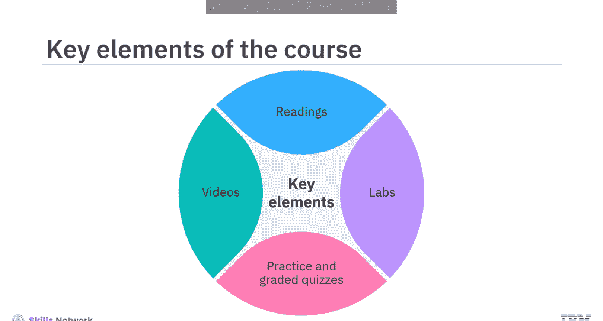
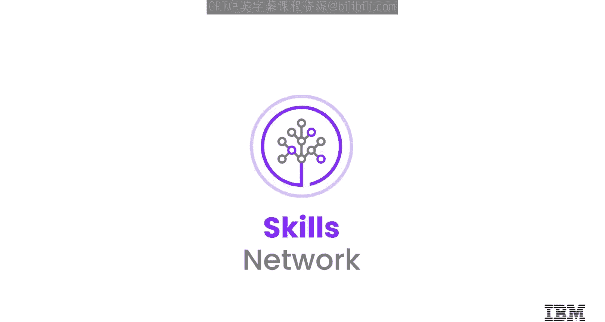

# 103：IBM《生成式人工智能工程｜Falsk、生成式AI应用、数据分析、机器学习、Keras、架构和数据、NLP基础、transformer、微调、高级微调、RAG》 p103 0_课程介绍.zh_en -BV1NAq6Y9E7z_p103-

Welcome to this course on AI Model for Natural languagenguage processing or NLP Here you will learn about the various aspects of NLP and AI model development。

This course is suitable for existing and aspiring data scientists， machine learning engineers。

 deep learning engineers and AI engineers， a basic knowledge of Python and Pytorrch and an awareness of machine learning and neural networks would be an advantage。

 though not strictly required。After completing this course。

 you will be able to describe the fundamentals of language understanding。

 including converting words to features and document categorization prediction。

 You will also be able to explain the NLP models and techniques， including Ngram。

 word to Vec and sequence to sequence。 In addition， you will use pitorch to build。

 train and implement the NLP models。In module 1， you will learn how to use one hot encoding。

 bag of words， embedding and embedding bags to convert words to features。

 You will also learn how neural networks are used for document categorization prediction。

 training and optimization。 The module will give you insights into the applications of Ngramm language models。

 Get hands on with lab exercises。 You will use pytorch in the Jupiter environment to build and train a simple language model with a neural network。

 In module 2， you will learn the types and features of word toveec embedding models。

You will also get to know about the purpose of using sequence to sequence models in NLP and sequence transformation tasks。

 In addition， this module will take you through the process of evaluating the quality of the generated text in hands on lab exercises you will develop and integrate pre traineded embedding models。

The course has the right mix of content to facilitate learning。

 Videos are short and focused on the main topic。 Readings provide detailed content primarily in text format。

 The labs provide the technical environment， detailed instructions。

 and code snippets that you can use to complete hands on exercises。

The practice and graded quizzes will help you apply what you learned and assess your knowledge。

To get the most from your course， watch all videos， complete the labs to practice your new skills。

 attemptemp all quizzes， Let's get started on this exciting journey。

