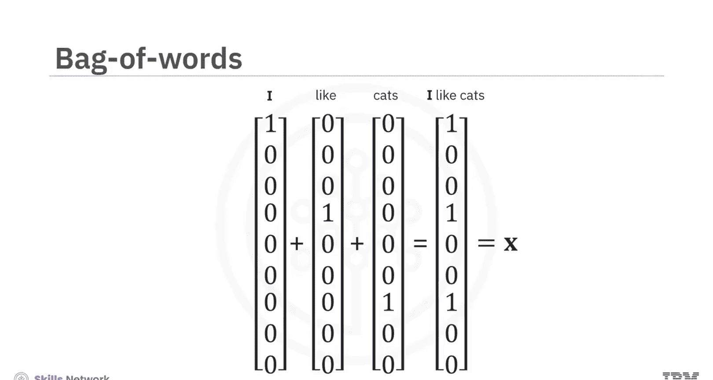
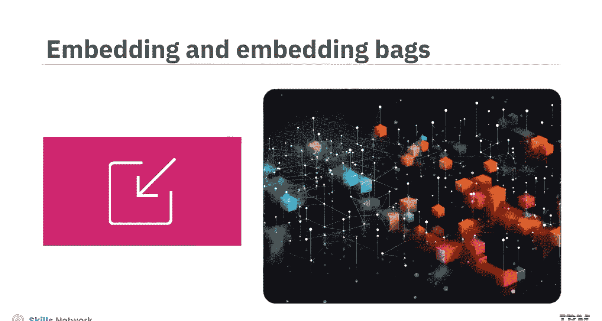
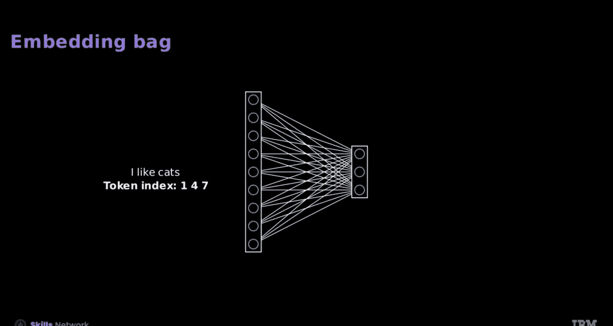

# 104：IBM《生成式人工智能工程｜Falsk、生成式AI应用、数据分析、机器学习、Keras、架构和数据、NLP基础、transformer、微调、高级微调、RAG》 p104 1_将单词转换为特征.zh_en -BV1NAq6Y9E7z_p104-

Welcome to converting Word to features After watching this video。

 you'll be able to describe one hot en coding and bag of words you'll also be able to explain embeddings and embedding bags and describe how to use embedding an embedding bag and Pytororch。

Consider your developing a natural language processing or NLP application to classify email You can categorize emails in various ways based on the presence of specific words。

 the frequency of words or the contextual meaning of words in the email to implement this functionality it's essential to convert words to numerical features so that machine learning models can process the text。

 let's explore the details。Consider the following sample sentences， I like cats， I hate dogs。

 I'm impartial to hippos， sets of sentences， documents or sequences are often termed a corpus or data set。

 Let's use a neural network to identify the subject， cat dog or hippo。

 the input needs to be translated into numbers the neural network can understand。

One hot encoding is a method used to convert categorical data into feature vectors that a neural network can understand。

 consider a table with the first column representing the token index and the second column representing the token。

 The third column represents the one hot encoded vector。

 The dimension of the vector corresponds to the number of words in the vocabulary。

 and the token index represents the element of each vector。

The token I is represented with all elements set to0。

 except for the one corresponding to I This will be the feature X for the word I。

The token like is represented in a similar way。 you can observe a pattern；

 This will be the feature X for the word like。The token cats is represented in a similar way and so on。

You can represent each token in a document as a vector。

 how do you use these vectors to depict the entire document or sequence？

The bag of words representation portrays a document as the aggregate or average of one hot encoded vectors。

 for I like cats， you combine the one hot vectors。 You add the one hot vectors for I like and cats。

The X vector is the bag of words vector for eye like cats。

Let's look at embedding and embedding bags。

Consider a neural network used to classify the previous sentences about cats dogs or hippos。

 you input the bag of words vector and select the output value with the highest association for cats。

 you'll understand how the embedding and embedding bag layers can effectively replace this initial linear layer。

Let's look at the hidden layer， when we input the one hot vector for the wordca which has zeros everywhere except the seventh position。

 the activation in the hidden layer corresponds to the parameters of the seventh neuron。

Instead of using a one hot encoded vector， you can substitute it with token index in this instance 7。

 the output mirrors the one hot vector， the layer that accepts this index is called the embedding layer and its output is the embedding vector。

The embedding weights here combined to form an embedding matrix。

The number of columns is the embedding dimension。Each row represents a word。

Embbedding vectors generally have a lower dimensionality compared to one hot and coatd vectors。

Reducing the dimensionality simplifies the computational requirements for the model。

When you feed a bag of words vector to a neural network's hidden layer。

 the output is just the sum of the embeddings。It also helps to view embedding as a row in the embedding matrix。

 labeling them with the word they represent。This process entails summing up all the vectors from bag of words and multiplying the result with the embedding matrix。

Instead of doing this， you can use an embedding bag layer。

The input is simply the indexes for each token and the output is the sum of word embeddings。

Let's now look at how to use embeddings and embedding bag and Pytorrch first you need the tokens。

 initialize the tokenizer， iterator from the data set and vocabulary。

The input underscore IDS function tokenizes and generates the indexes for each data sample。

 these indexes are stored in the list， index where each element in the list is the indexes for the different documents。

You can initiate the embedding layer and specify the dimension size of the embeddings next determine the count of unique tokens present in the vocabulary Now create the embedding layer embeds using the NN do embedding Conor。

You apply the embedding object。 The input is the index for the phrase I like cats to retrieve the embedding。

 What you'll see is a p toward tensor representation。

 Each row in this tensor aligns with the respective embedding for the words I like in cats。

You can retrieve the embedding for the last data sample， I'm impartial to hippos using its index。

 The result is a pi toward tensor， Each row corresponds to the embedding for each tensor word。

Initializing the embedding bag layer is almost the same as the embedding layer。

Let's output the embedding bag for the first document using its index you can access the embedding for eyelike cats。

 The outcome is a piyor tensor representing the sum of average of all embeddings For one sample。

 the offset parameters is always zero。Let's explore the offset parameter and NLP data sets are often represented as one dimensional tensors。

 however， when working with embedding bags and other applications。

 it's crucial to identify the position of each document。

 Let's dive into this with our sample data set。 You combine the tensors of individual documents using the cat function with the index setting。

 The offset parameter captures the starting position of every document。

You can count the tokens in each sample， this step helps in pinpointing the initial position。

 using the cumulative sum method you can accumulate the length。

 thereby determining the starting position of each sequence。You use the embedding bag function。

 along with the offset parameter， as with the index tensor。

 The result is the embedding bag for each individual document。

 you have the average of its words embeddings。 Let's now recap what you learn。

In this video you learned about one hot encoing， bag of words embedding and embedding bags One hot codinging converts categorical data into feature vectors。

 The bag of words representation portrays a document as the aggregate or average of one hot en coded vectors When you feed a bag of words vector to a neural networks's hidden layer the output is the sum of the embeddings the embedding and embedding bag classes are used to implement embedding and embedding bags and pytorrch。

