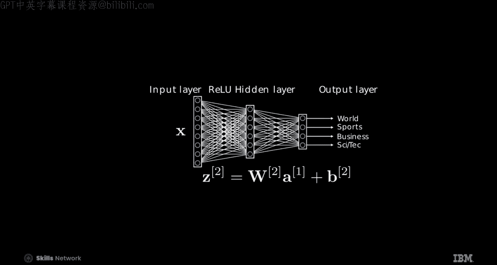
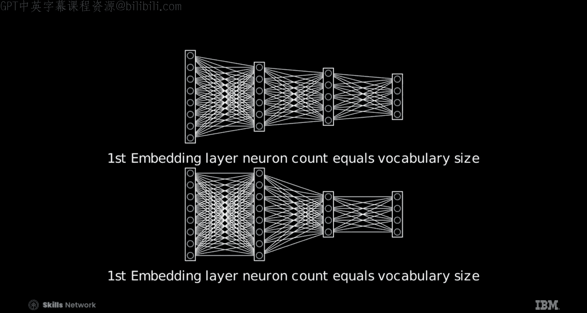

# 105：IBM《生成式人工智能工程｜Falsk、生成式AI应用、数据分析、机器学习、Keras、架构和数据、NLP基础、transformer、微调、高级微调、RAG》 p105 2_使用TorchText进行文档分类预测.zh_en -BV1NAq6Y9E7z_p105-

Welcome to documentcu categorization Prediction with Torch Text。

A document classifier seamlessly categorizes articles by analyzing the text content， as demonstrated。

 you simply feed in the raw text and the system efficiently outputs the document's classification。

 whether it's science and technology。Sports。Business or any other class After watching this video。

 you'll be able to explain what neural networks are and describe basic neural network hyperparameters。

You'll also create a neural network in pitorrch。 First。

 let's do a quick recap of neural networks where you'll mainly concentrate on understanding the inputs and outputs。

 A neural network is a mathematical function consisting of a sequence of matrix multiplications with a variety of other functions。

 It begins with an input layer。 for instance， consider a bag of words vector。 in this layer。

 you'll perform matrix multiplication， occasionally adding a bias， This constitutes the hidden layer。

 If the input employs a bag of words， This layer is known as the embedding layer and its output is referred to as the logics。

 subsequently apply an activation function to each logic。

 a process known as activation where each element is called a neuron。

 Sometimes an activation function or bias addition is not applied to embedding layers。

The operation is then repeated， another matrix multiplication is performed and once again each resulting element is termed a neuron。

Through this iterative process， the input data is transformed step by step。

 enabling the network to learn classification The parameters that the network adjusts during training are known as learnable parameters in the article ESPN's value football coverage input an embedding vector into the network for each category。

 the neural network outputs of vector of logics where each logict is a score reflecting the article's likelihood of fitting a particular news category as shown here。

 the associated table links vector elements to categories World is first followed by sports。

 business and science and technology to determine the class of an article you're going to input the logics from the output layer into the Argmax function the AGmax function identifies the index of the highest logicit value corresponding to the most likely class here。

 the Argmax function selects index1， which has the highest logic value of7。

This indicates that the network classifies the article as belonging to the category associated with index 1。

 This corresponds to the article class of sports。 This graph illustrates the architecture of a neural network。

 Each circle represents an starting from the left， each neuron in the first box corresponds to an element in the input vector or input layer。

 and the connecting lines represent the weight matrix。

 The neurons at each subsequent level signify the components of the hidden and output layers。

 After processing through an activation function。 obtain the hidden layer values denoted as Z。

 The final layer connections embody the weights leading to the output with each neuron reflecting one of the four output classes。

 World sports business and science and technology。 After that use arcmax to find the class with the highest score。

 Now， let's learn about the neural network hyper parameters。

 These are externally set configurations of a neural network。

 The architecture can vary in the number of hidden layers。 For example。

 the network depicted at the top as a single hidden layer。

 while the one at the bottom features two hidden layers with each feeding into the subsequent one。

Don't forget that the input layer is just the input vector So your focus will usually be on architectures with one hidden layer。

 You could adjust a number of neurons in each layer。 for instance。

 in the network depicted above the second hidden layer consists of five neurons。

 whereas the bottom network contains four Furthermore。

 if the first hidden layer functions as an embedding layer then the number of neurons corresponds to the vocabulary size The number of neurons in the output layer always equals the number of classes。

 both number layers and neurons can be selected via the empirical validation data Now let's create a neural network and pytorrch you will use the ag news data set using torch text the output consists of text representing news articles along with their corresponding labels indicating their categories。

 you'll display the label in the news text in a table Then use a python dictionary to assign the appropriate category headlines to the labels the news categories are displayed business for the first two sentences and science and technology for the last sentence Let's build the standard text processing pipeline you should tweak your functions of that label numbering begins。

0。Now you'll set up a batch function for embedding bags and add code to append the labels for each sample to a batch next you'll create a data loader with a batch size of three。

Let's explore the sample here you have three labels for each sample next to the token indices。

 which form the basis for your bag of words model， finally observe the relative positions of these indices which are essential for constructing the bag of words model。

 the model's architecture features two primary layers defined in the constructor。

The first is the embedding bag layer， followed by the fully connected layer。

 The initialization of weights is also done During the forward pass。

 you'll input text and offset it into the embedding bag without applying the activation。

 which then feeds into the fully connected layer for the final output。 Now。

 create an instance of the text classification model with specified vocabulary size vocab size。

 embedding dimension M size and the number of output classes nu class。 Now。

 make a prediction using the text indices in the offsets and assign it predicted label。 First up。

 you're looking at the logicit values in pytorrch， each row represents a different sample。

 columns corresponds to the logicit values for each class。

 Unlike the earlier row vector example It's organized by columns here。

 you'll then apply the arc max function across each row。

 This identifies the maximum value in each row。 The position of this maximum value indicates the predicted class for sample 0。

1 and 2。 The prediction function works on real text that starts by taking in tokenized text。

 It processes the text through the pipeline。😊，The model predicts the category。

 The label with the highest output value is then returned as the predicted category。

 When you apply the function， the article gets classified under sports。

 Try this in the lab might yield the different results since the model hasn't been trained yet。

 Let's now recap what you learned in this video you learn that a document classifiers seamlessly categorizes articles by analyzing the text content。

 A neural network is a mathematical function consisting of a sequence of matrix multiplications。

 with a variety of other functions。 The argmax function identifies the index of the highest logicit value corresponding to the most likely class。

 hyperparameter or externally set configurations of a neural network。

 The prediction function works on real text that starts by taking in tokenized text。

 It processes the text through the pipeline and the model predicts the category。

