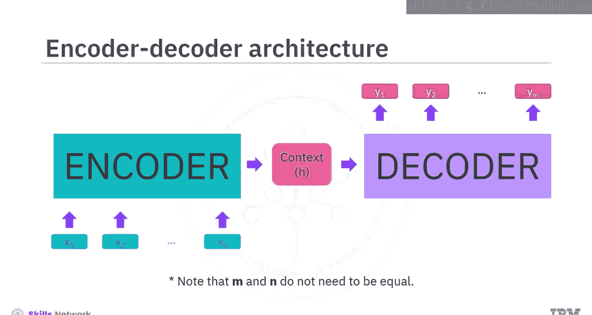
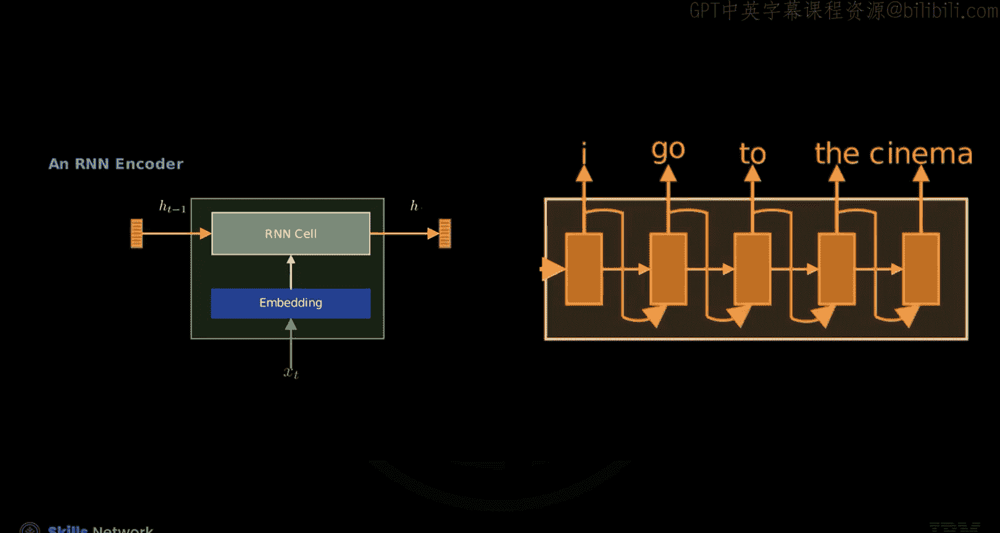
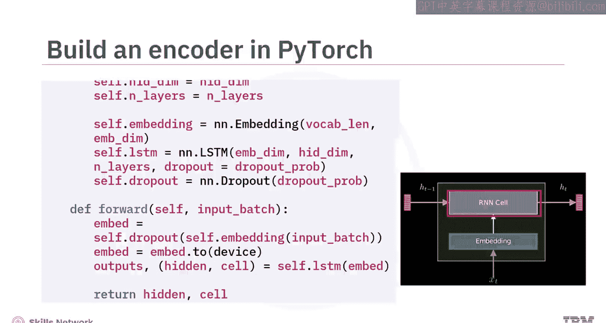
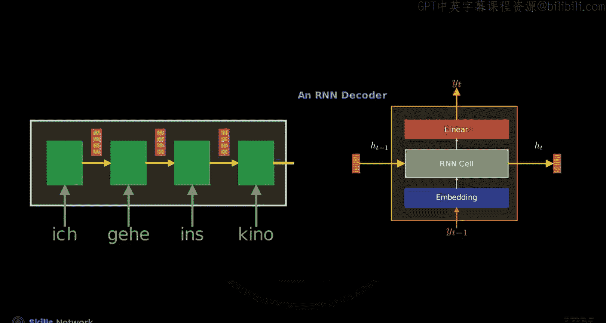

# 114：IBM《生成式人工智能工程｜Falsk、生成式AI应用、数据分析、机器学习、Keras、架构和数据、NLP基础、transformer、微调、高级微调、RAG》 p114 11_编码器-解码器RNN模型的翻译.zh_en -BV1NAq6Y9E7z_p114-

Welcome to Encor decoder R and N models Translation After watching this video。

 you will be able to implement an encoder decoder R andN model。

 Let's learn about the encoder decoder architecture as you know。

 R and Ns can be used to create sequence to sequence models that receive sequence X as input and generate sequence Y as output note that X and y do not necessarily need to be of the same length for this purpose。

 Enr decor architectures are introduced。

A popular example of a sequence to sequence model is a translation model。

 Let's check an actual example to see how encoder decoder R and Ns generate translation。

 The encoder decoder sequence to sequence model works together to transform an input sequence into an output sequence Encoder is a series of R and Ns that process the input sequence individually。

 Pass their hidden states to their next R and N。 The last hidden state context is passed to the decoder module。

 The decoder module similarly， is a series of R and Ns that autoregressively generates the translation as one token at a time。

 Each generated token goes back into the next R and N。

 along with the hidden state to generate the next token of the output sequence until the end token is generated as R and Ns become more complex。

 you can abstract away the finer details here， an R and N is represented with an R and N cell。

 The key distinction here is that the output from the previous state。

Is recycled as input for the next state for the encoder。

 the interest lies only in the hidden state and to not use the output。

 This is because only the decoder will generate the output text。

 The encoder is only responsible for encoding the input sequence。

 Now that you have an understanding of the overall architecture lets delve into the internals of the encoder units。

 The encoder consists of multiple encoder units。 Each responsible for processing input tokens at the heart of each unit is an embedding layer which transforms the input token into an embedded vector。

 These vectors then traverse through the R and N cell to produce the hidden state。

 which is subsequently handed over to the R and N cell of the next encoder unit to build an encoder in pitorrch Def a class inheriting from torch do N N do module similar to a standard neural network。

 The embedding vectors serve as input to a long short term memory or LSTM layer characterized by N layers。

 That is the number of。

Current layers and hidden dim。 That is the size of the hidden and cell states。

 Incorpo dropout as an optimization technique to enhance performance in the LSTM layer。

 input embeddings are transformed into hidden states and cell states。

 with hidden dim specifying the number of neurons。 during the forward method execution。

 The embedding layer processes the input and the LSTM layer outputs the hidden and cell states。

 only these states are retained。 The output vector is discarded since it's not required by the encodeder。

 Remember， unlike gated recurrent units or Gs， which have only hidden states。

 LSTMs maintain an additional cell state for each layer。

 The decoder is also composed of many decoder units within which the predicted token is generated。

 Each unit has an embedding layer， where em vectors are created These vectors then pass through the R and N cell to output the updated hidden state。

 which will be passed to the R and N cell of the subsequent decoder unit。

Next， a linear layer maps the R and N output to the output dimension to generate the next token。

 As you can see， the decoder works a bit differently from the encoder in the way that it receives its previously generated token and generates the next token autoregressively to build the decoder in pytorch。

 create a decoder class， which is a subclass of N N module。

 serving as the base class for neural network modules in the constructor in it method。

 the decoder's parameters and layers are initialized。

 The parameters for the decoder are defined as follows。

 outputput dim is the number of possible output values。 or the target vocabulary length。

M dim is the dimensionality of the embedding layer Hid dim is the dimensionality of the hidden state in the LSTM。

N layers is the number of layers in the LSTM Dropout is the dropout probability。

 The decoder includes an embedding layer that maps the output values to dense vectors of size M dim。

 an LSTM layer that takes the embedded input and produces hidden states of size hidden dim。 Next。

 a linear layer maps the LSTM output to the output dimension， output dim。 Finally。

 a soft max activation function is applied to the output。

 generating a probability distribution over the output values。

 to construct the sequence to sequence model Def the sequence to sequence class。

 inheriting from N N module with the encoder decoder， device and target vocabulary。

Targ vocab as inputs， the forward method accepting source and target sequences and teacher forcing ratio manages the model's forward pass。

Teacher forcing is a training technique used in sequence to sequence models that involves using the true or correct output sequence from the training data as input to the decoder。

 instead of using the previously generated output from the model itself， it boosts model training。

Iitialize batch size， Tg L and tar vocab size。 create output tensor to hold the decoder's predictions at each step。

 extracttract hidden and cell states from the encoder of using the encoder SRC。

 and set them as initial states for the decoder。 Start the decoder with the first target sequence token for each target sequence time step。

 Pass the input and prior states to the decoder， saving the output tensor and outputs。

 decide whether you need to apply teacher forcing at each step。

 using the true target token Tg T or the predicted one output arc max 1。

 depending on the teacher forcing ratio。Then return the output's tensor。

 which includes predictions for each time step， completing the sequence to sequence model construction。

 Let's now recap what you learned In this video， you learned that R and Ns can be used to create sequence to sequence models that receive one sequences input and generate another sequences output。

 The encoder decoder architectureures are introduced so that the sequences do not necessarily require to be of the same length。

 The encoder decoder sequence to sequence model works together to transform an input sequence into an output sequence。

 Encor is a series of R N Ns that process the input sequence individually。

 Pass their hidden states to their next R N N。 The last hidden state Con is passed to the decoder module。

 The decoder module， Similarlyly is a series of R and Ns that auto regressively generates the translation as one token at a time。

The embedding layer transforms the input token into an embedded vector。

 which traverses through the RNN cell to produce the hidden state。

