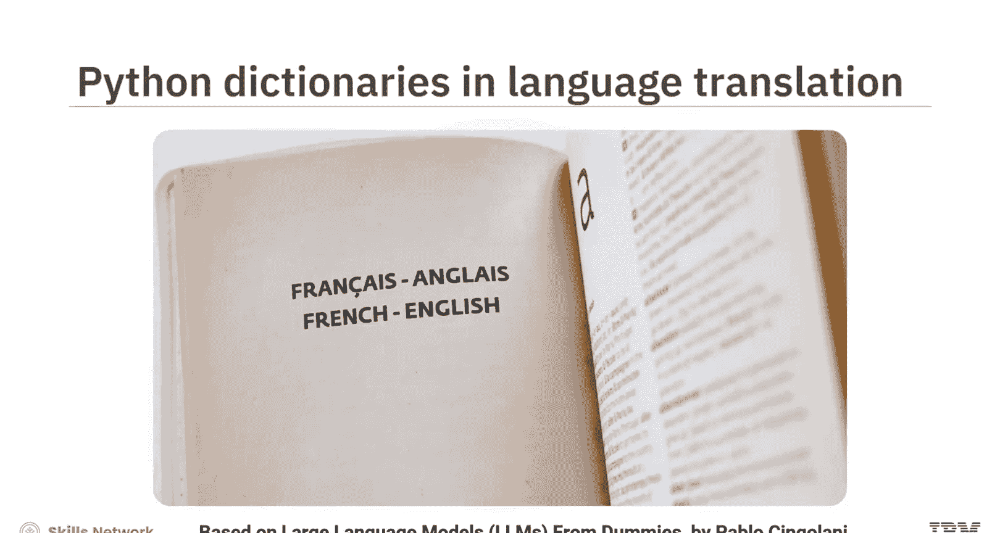
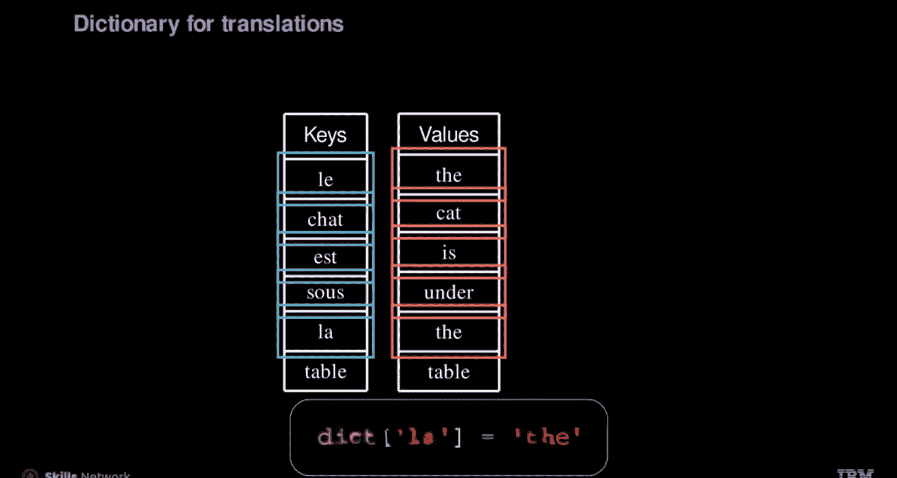
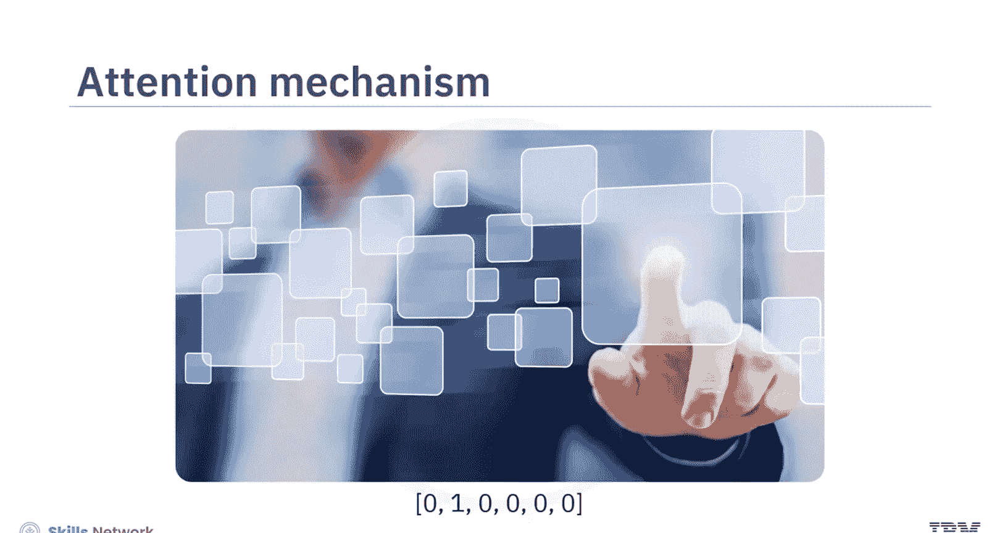
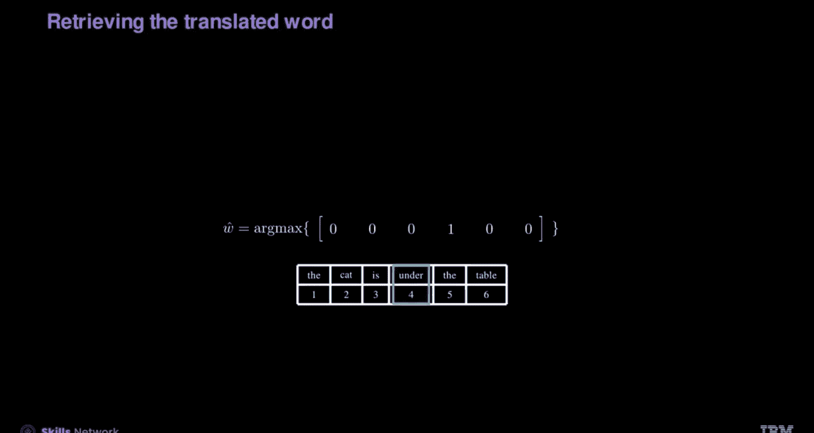
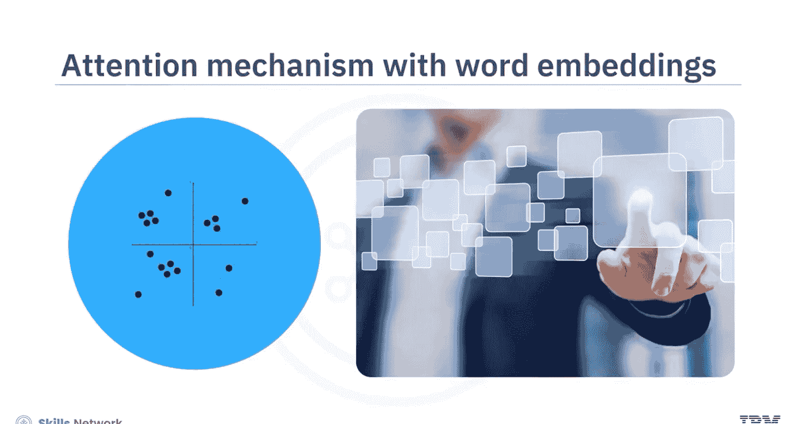
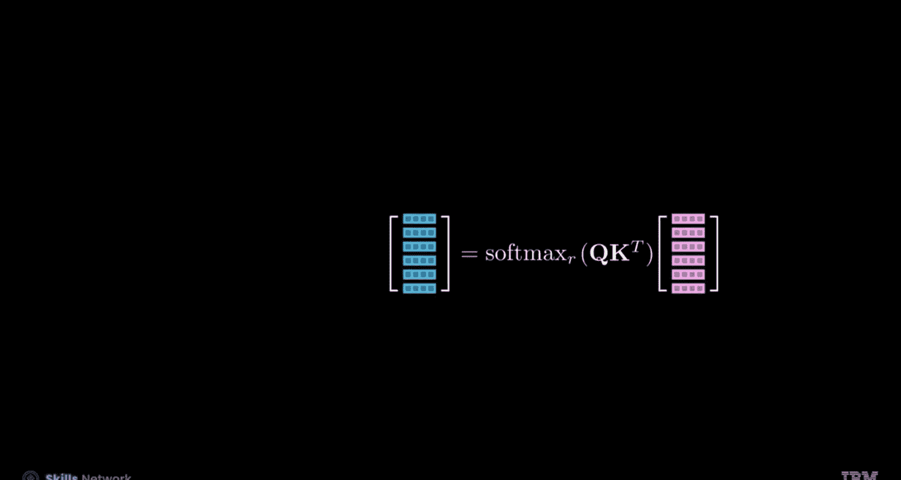
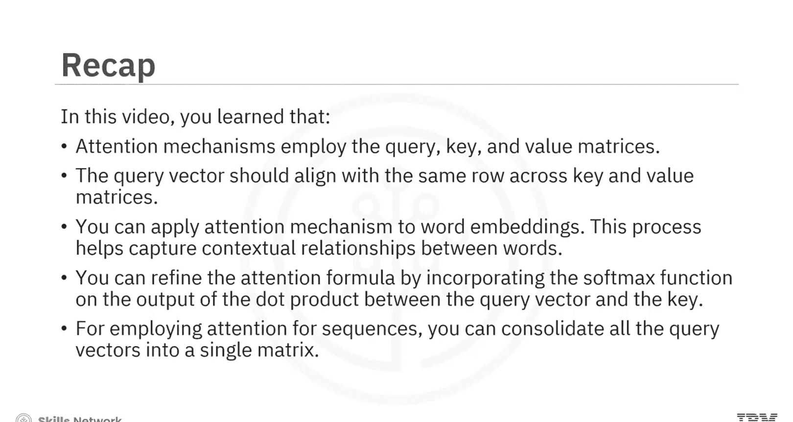

# 118：IBM《生成式人工智能工程｜Falsk、生成式AI应用、数据分析、机器学习、Keras、架构和数据、NLP基础、transformer、微调、高级微调、RAG》 p118 2_注意力机制.zh_en -BV1NAq6Y9E7z_p118-

Welcome to attentionten Mechan After watching this video。

 you'll be able to explain how attention mechanism works in language translation。

 describe how to apply attention mechanism to word embeddings。

 describe how to apply attention mechanism to sequences。

Imagine conversing with your colleagues in a crowded hall。

 how do you communicate despite the noise around you。

 you pay more attention to your colleagues conversations than background discussions， Similarlyly。

 generative AI models use attention mechanisms to focus on the most relevant parts of the input data and their relationships。

Let's start exploring attention mechanisms by drawing parallels with how Python dictionaries help in translation。

 Python dictionaries help with tasks such as translation by pairing keys with their corresponding values。

 When you query the dictionary you input the key。 In return。

 the dictionary provides the value that corresponds to that key。 In this instance。

 the keys represent French words。 and the values are the English translations to translate a French word to English query the dictionary with the French term。

 The dictionary returns the English translation。 You can think of the dictionary is having two columns。

 The left column contains the keys， which are words in French。

 whereas the right column contains the corresponding English translations。

 Each row represents a distinct word pairing。 Notice that every key is matched with its value。

 At the bottom， you can see the actual query input into the dictionary。 Shah is rendered as cat。

Sue， as under， and both La and Lu point to the。

The attention mechanism uses a comparable structure， but instead of strings。

 you'll employ one hot end vectors。 Each French word in the dictionary is represented as a one hot encoded vector called keys。

 These individual keys are assembled into a matrix K Each row corresponding to the one hot encoded word。

 like a Python dictionary， the query vectors are identical to the key vectors represented with Q instead of k。

The English words are also represented by one hot end vectors called values。

 These individual values are then assembled into a matrix called V。

 Each row containing the one hot end word。 The key matrix K and the value matrix V must be arranged in such a way that the query vector for the word intended for translation aligns with the same row across both matrices。

 You can see that the row for Shah aligns with cat A with is and Se with under。The English article。

 though is represented twice within the value matrix V。 Next， you'll transpose the key matrix K。

 converting the rows to columns。 This is a shortcut for performing a series of dot products。

 Let's examine the attention mechanism formula for translation。

 It's the product of the query vector for the word。 The transpose of K and the V matrix。

 The result will be a vector。 Let's refer to it as H representing the value vector corresponding to the translated word。

 First， you insert the one hot and coded French query word you intend to translate Sue。

 Then you multiply the query vector by the transpoposed key matrix。 The key matrix is transposed。

 So each column corresponds to the queries for the labeled words。  Similarlyly。

 the value rows are labeled with the corresponding word that they represent the attention formula involves computing the dot product across the key vectors that form the columns of matrix K。

 Due to their orthogonality。 All values in the resultant row vector are 0。

 except for the position where the query vector perfectly matches a key vector。

Multiplying this nonzero element by the value matrix isolates the corresponding translated word vector。

 You can now have the word vector for the translated word in this case under to retrieve the translated word from the translated vector。

 you can apply the equation omega hat equals arg max subscript I of H v transpose where H is the output of the attention mechanism and V is the value matrix When multiplying H with v transpose。

 you perform a dot product with every value as each element is orthogonal。

 except for the word with the same value。 you get a vector of zeros except for the one that is the same This column has the same index as the word index of the translated word and the value matrix under in this case。

 with a few adjustments， you can apply the attention mechanism to word embeddings。

 This process helps capture contextual relationships between words and thus enables the translation of words。

 the model has not encountered before you substitute the keys and values with word embeddings。

 aligning the rows。

With their respective translation。You will then apply the attention formula to the word embedding for Ctas。

 a word absent from the key matrix。This word translates to below。

 let's see the product of the query matrix with the key matrix。

 you perform a dot product with each term in the key matrix When you examine the output you'll see that the maximum value corresponds to the column for Su。

 which means below。This correlation makes sense as the words share similar embedding values。

 remember you require a one hot and coded vector to select the precise word from the value matrix。

You can refine the attention formula by incorporating the soft max function on the resultant output of the dot product between the query vector and the key Let's see what happens in the soft Max operation。

 you can refer to this resultant vector as alpha in simple terms you perform the matrix product on the query and the key and then apply the soft max function on the resultant vector Z。

The softmax function accentuates the largest value by scaling it close to1 while diminishing the smaller values closer to0。

 The function helps amplify the largest value relative to the rest。

 When you apply the softm function to the resultant vector Z。

 It transforms the column with the largest alpha into a form that resembles a binary vector。

 you can now use the attention mechanism to translate the word cta S。 consider the output labeled H。

 Given that this embedding closely resembles that of su。

 you identify the column with the highest value。 I the softmax function simplifies this into a oneho vector。

 multiply this one hot vector with the value matrix to retrieve the word embedding for the translated word under。

 This describes a search method that identifies the most similar vector using an approach akin to one hot encoding。

 because the resulting vector H corresponds to the intended word Per the dot product with H will yield the highest value at the index of the target word。

 Let's now look at attention for sequences。 You can。

ate all the query vectors into a single matrix denoted as Q to process every vector concurrently within a single matrix product operation。

 The input values are treated as a sequence of embeddings depicted in pink。

 The process yields a set of refined embeddings tailored for specific tasks illustrated in blue。

 It's important to note that the actual translation method in transformers slightly differs。

 In addition， positional encodings can be added。 However， for simple data problems。

 these positional encodings may not be necessary。 Let's now recap what you learned。

 And in this video， you learned that attention mechanisms employ the query， key and value matrices。

The query vector should align with the same row across key and value matrices。

 You can apply attention mechanism to word embeddings。

 This process helps capture contextual relationships between words。

 You can refine the attention formula by incorporating the softm function on the output of the dot product between the query vector and the key for employing attention for sequences。

 you can consolidate all the query vectors into a single matrix。

