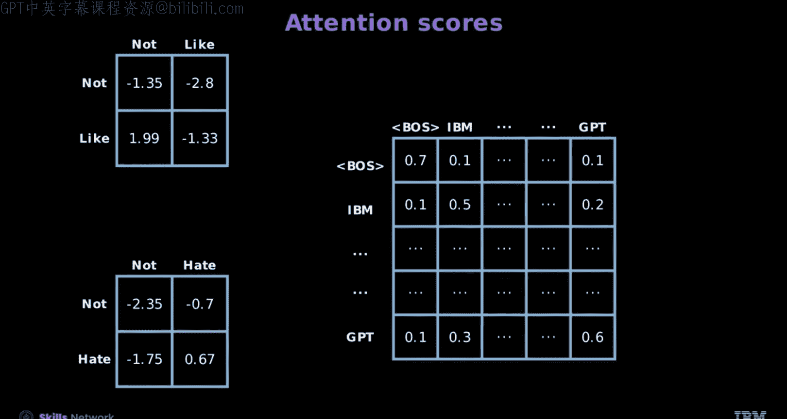
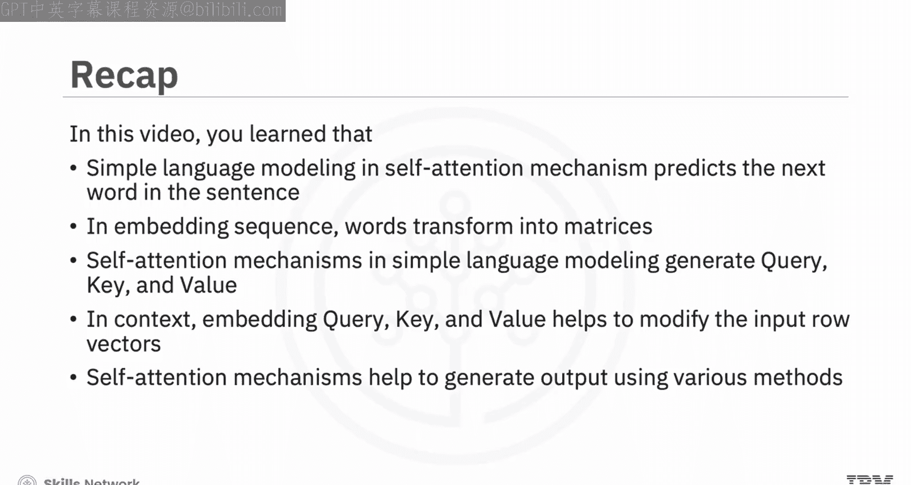

# 119：IBM《生成式人工智能工程｜Falsk、生成式AI应用、数据分析、机器学习、Keras、架构和数据、NLP基础、transformer、微调、高级微调、RAG》 p119 3_自注意力机制.zh_en -BV1NAq6Y9E7z_p119-

Welcome to the self attentionten mechanism。 After watching this video。

 you'll be able to describe simple language modeling sequence and context embedding in the self attentionten mechanism。

 You'll also be able to explain how self attentionten mechanism help in simple language modeling to predict the token。

 This self attentionten mechanism is the heart of the language transformer。

 Each word in sequence attends every other word and parallel to generate embeddings。

 Let's begin by understanding simple language modeling in the self attention mechanism。

 The simple language modeling in the self attentionten mechanism predicts the next word in the sentence。

 An important aspect of understanding natural language。 For example， in the table。

 the sequence of words is presented on the left side and the prediction of words for the simple language modeling is on the right。

 Now， when you insert the word not like the simple language modeling will predict the word hate。

 Similarlyly， the input word do like would predict the word like。

 It means that when the context of the word changes， the meaning of the preceding words also changes。

😊。

The words transform into matrices of the embedding sequence where each embedded word represents a column vector within the sequence matrix。

 For example， x represents the matrix and the subscript。

 not like represents the word sequence with each column corresponding to a word embedding。

 It means the matrix X， not like contains the embedding for not and like。 Therefore。

 each sequence is converted into a matrix Re and represents as a sample sequence in the data set。

 Consider n sample sequences denoted as Xn。 It means that each sequence can have a different length。

 It should be noted that libraries like pytorch may arrange these vectors differently。

 Selfatten mechanisms in simple language modeling involved generating three key components。 Que， Q。

 key， K and value V。 This process begins with the input word embeddings combined with learnable parameters。

 You can derive a query matrix by multiplying the input sequence matrix by learnable parameters known as query projection weights and biases。

 Here， a row vector of1。With the same length as the number of tokens is also used。 Similarlyly。

 you can derive the key matrix by multiplying the input sequence matrix with a different set of learnable parameters。

 key projection weights and biases。 You can apply the same process to obtain the value matrix。

 where the input is again multiplied by its corresponding set of learnable parameters known as value projection weights and biases。

 However， a bias term is not always included。 and sequential embeddings are usually added before these operations。

 They are omitted in this simplified explanation for clarity。

 The self attentionten mechanism employs the query key and value constructs to refine the input word embeddings。

 In this context， the square root of D represents the dimension of the embeddings。

 The resulting matrix denoted as H prime features columns that embody enhanced embeddings and are termed contextual embeddings。

 Further， the number of these embeddings aligns with the length of the input sequence。

 ensuring a one to one correspondence between the original and enhanced representations。

 you can apply an additional。LaTo the context embeddings where you will get output is H。

 a refined version of H prime using additional learnable parameters。 Therefore。

 H is a more nuanced representation of the initial embeddings。

 Self attentionten mechanisms are instrumental in generating sequence outputs。 For example。

 reducing the context embedding mechanism to an averaging operation helps to simplify the process。

 In this simplified framework， the contextual embedding serves as inputs to a neural network。

 where the initial layer output is denoted as Z superscript 1。

Let's consider a previous example of a self-atten mechanism used for translation。

 where the output of the self-attention mechanism is the embedded word you wish to translate in this process。

 a dot product is computed between the embedding and a list of embeddings through matrix multiplication the AGMax function assists in obtaining the index of the translated words token。

When using selfatten， the dot product is replaced by a neural network where Z1 represents the average embedding。

 serving as an input parameter for the neural network。

 This network generates a series of logicits denoted as Z2。 Moreover。

 the input dimension of the neural network aligns with the embedding space and its output dimension matches the vocabulary size。

 However， during training， the neural network employs the softmax function to compute the probability distribution across all potential words。

 This process helps to train the network and the learnable parameters of the attention mechanism In Pytorch logicts are used directly during training。

 and the arcmax function is used to determine the sequence's subsequent token or word index。

Now let's predict the token for not like using the self attention mechanism。

 where the expected outcome is hate， the self attention mechanism generates the query key and value matrices through multiplications with the learnable parameters and the bias。

In this example， the input X is multiplied by the projections to obtain QK and V。

 This process consists of a series of matrix multiplications。

 these operations can be parallelzized and processed via a graphic processing unit or GPU。

 allowing more data to be processed efficiently。This is one reason why the self attention mechanism outperforms other sequential models like recurrent neural networks or R andNs。

 Additionally， you can obtain the attention scores by multiplying the query in key matrices。

 then apply the soft max function of these scores to normalize them。 Next。

 multiply the normalized scores with the value matrix V to derive the H prime。

 which enhances the contextual embeddings by being multiplied with output projection parameters。

 Further， take an average of these embeddings and passed through the final layer that maps to the vocabulary。

 Ac the activations corresponding to each word。 Finally。

 apply the argm function to these activations。 and the index obtained reveals the logistic value associated with hate。

 Further， diving into the attention mechanism， you can observe that each sequence is arranged with the input tokens positioned above。

 followed by the normalized attention and the corresponding values beneath These values act as modified word embeddings。

 For example， looking at the first two samples on the left。

 you can find the first column consistently represents the value。For the token。

 not a pattern that holds true for each token。 Meanwhile。

 the normalized attention underscores the unique relational dynamics between the pairs。

 highlighting the intricate interplay within the sequence。 In this example。

 the attention scores derived from the dot product development and keys and queries plays a critical role in the self attention mechanism。

 shedding light on the model's focal points。 The attention scores are illustrated for three phrases。

 not like， not hate and an arbitrary sequence elucidating the relationships between tokens within the sequence。

 You've reached the end of this video。 Let's recap。 In this video。

 you've learned that simple language modeling in the self attention mechanism predicts the next word in the sentence。

 An important aspect of understanding natural language。

 The words transform into matrices in the embedding sequence where each embedded word represents a column vector within the sequence matrix。

You also learn that the selfat mechanisms and language modeling generate query key and value using the input word embeddings and learnable parameters。

 The selfatten mechanisms use the query key and value and context embedding to modify the input row vectors Finally you learn that the selfat mechanisms help generate output using various methods。

