# 121：IBM《生成式人工智能工程｜Falsk、生成式AI应用、数据分析、机器学习、Keras、架构和数据、NLP基础、transformer、微调、高级微调、RAG》 p121 5_用于分类的Transformer编码器.zh_en -BV1NAq6Y9E7z_p121-

Welcome to Transformers for Classification Encoder。After watching this video。

 you'll be able to explain how transformer based models are used for text classification。

 you'll be able to describe how you can create the text pipeline， create the model。

 and train the model。

Using a traditional neural network for document analysis can result in the loss of contextual relationships between words。

However， by integrating transformer attention layers。

 the entire sequence of words can be processed collectively。

 This approach allows the network to classify the document while retaining contextual information。

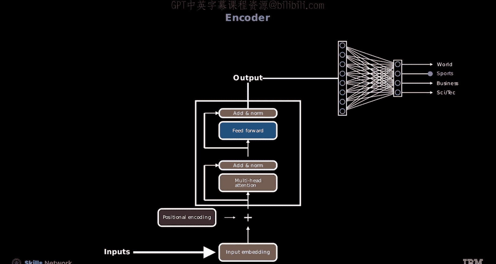

Let's look at how transformers are utilized for document classification。

The iterator is created from the training split of the AG News data set using Torch text。

 the output consists of text representing news articles。

 along with their corresponding labels indicating their categories。

You can assign the appropriate non numerical category headlines to the labels。

 business for the first two sentences， and science and technology for the last sentence。

For the AG New data set， you create iterators for both training and test splits。

 employ PyTorch data loader and allocate 95% of the training set for training。

 with 5% reserved for validation。You set up a tokenizer for English text。

 generate tokens from a data set， and construct a vocabulary。

You can then design a custom collate function to handle the unique requirements of the dataset set for sequence classification。

 The primary distinction from the previous classification tasks is that the output now consists of a sequence index。

 Additionally， to accommodate sequences of varying lengths。

 you apply zero padding to standardize the results。You can create a data loader for the training。

 validation， and testing sets。When you examine the samples， you can see that the labels are integers。

 and their count matches the batch size。 The variable sequence is a tensor holding indexed sequences and transformer based models unlike traditional neural networks。

 the tensor's first dimension represents the sequence， and the second dimension represents the batch。

Let's now learn about the steps for creating the model in pytorch。

 you will delve into the encoder's constructor used for classification tasks and unpack the associated parameters。

 The focus will be on the aspects pertinent to the transformer architecture and the sequential processing of input layers。

 The embedding layer is instantiated via NN dot embedding This layer maps tokens from the vocabulary sized vocab size into the dense vectors of a specified dimension。

 embedding underscore dim to observe the encoder in action， you can invoke the forward function。

 Let's explore how the function process each layer of the input through the variable X。

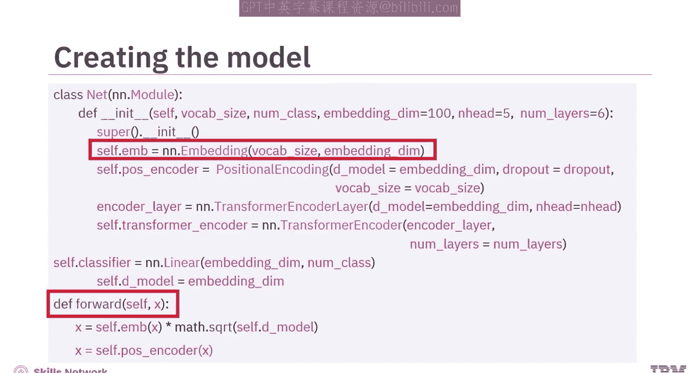

The text I like football is tokenized and indexed as 0，3，173，41。

 These indices are inputs to an embedding layer that converts each token into its corresponding high dimensional representation。

Specifically， the embedding layer maps each index to a unique vector in an embedding space。

Where the first dimension corresponds to the sequence length， which is the number of tokens。

 and the second dimension represents the embedding size。

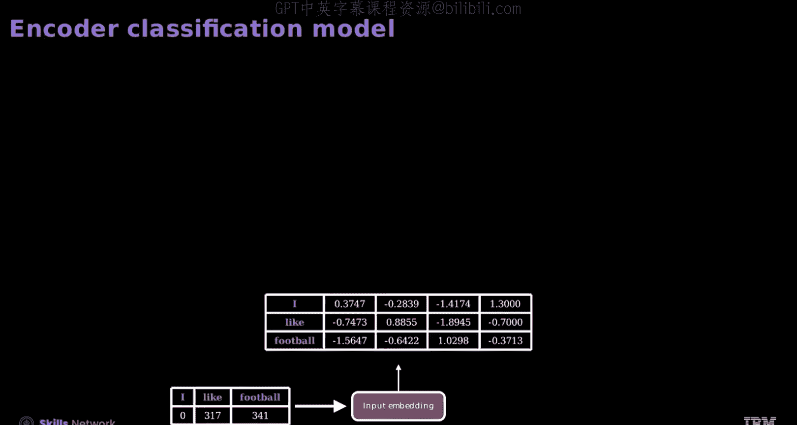

The positional encoding module， POSOS underscore encoder， embed sequence order into word embeddings。

 it's applied to the embeddings X to add this temporal context。

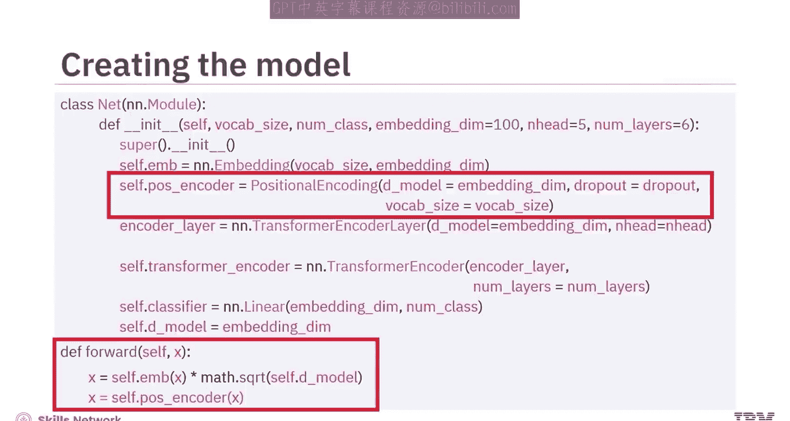

These tensor values have the same dimensions as the input embeddings because they are eventually added together by combining these two。

 the model comprehends both the semantic and their positions in the sequence。

 The encoder consists of multiple layers。 N N dot transformer encoder layer。

 each configured with parameters。 These layers are then stacked on top of each other using N N dot transformer encoder。

 with the specified number of layers， nu layers and the number of heads， N heads。

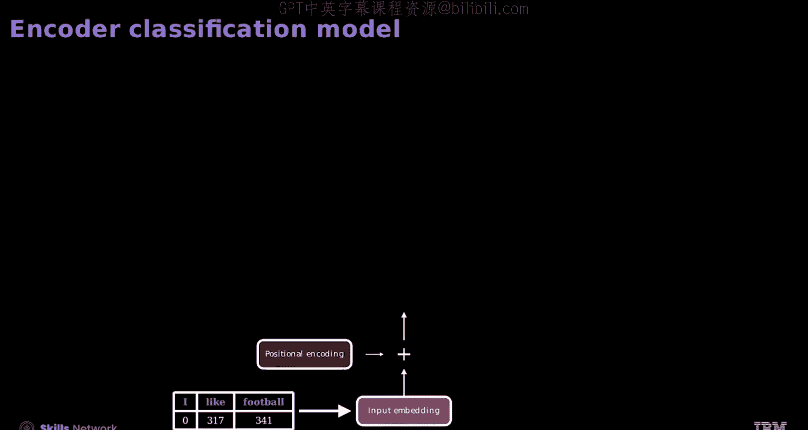

After adding positional encodings， you apply the transformer encoder layers to the enhanced embeddings。

 allowing the model to capture the sequence's context。

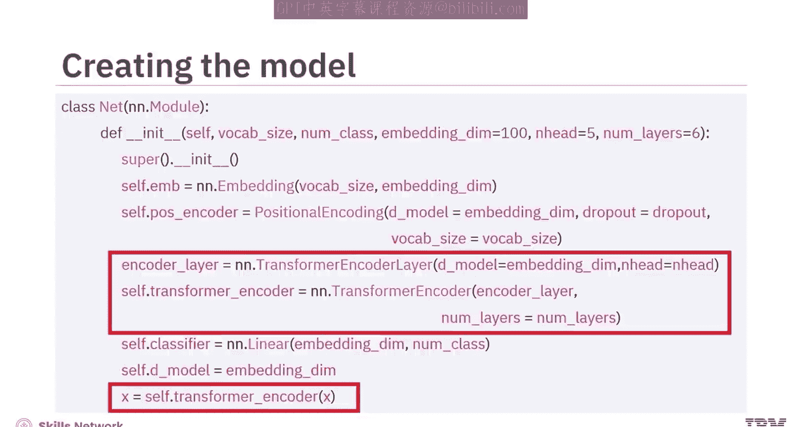

The encoder generates the same number of embeddings with the same dimensions。

 These tokens now contain context information。 You can then calculate the mean along dimension 0 and reduce the dimension size。

 However， you can use the mean to classify the tasks。

 The model features a linear layer and n dot linear， which acts as the classifier。

 It's set up with an input size equal to the embedding dimension and an output size that matches the number of classes。

 You can then aggregate the embeddings from the encoder's output。

 typically by taking the mean before applying this linear layer。

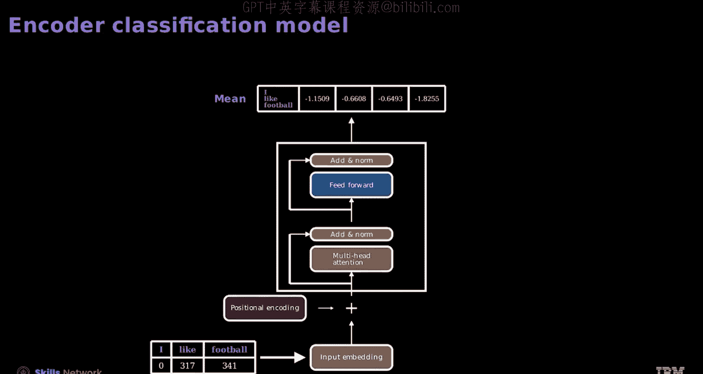

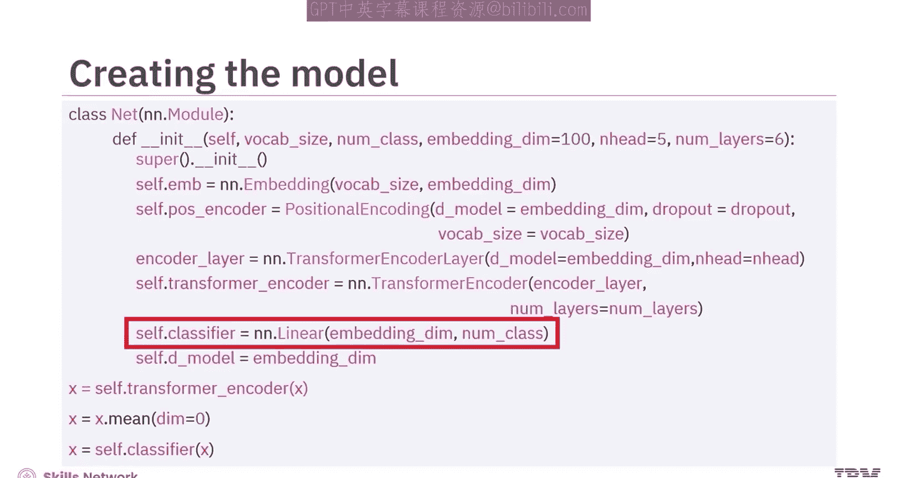

The classifier layer predicts the label to which the input text belongs。

 determining the categorical classification of the given sequence。

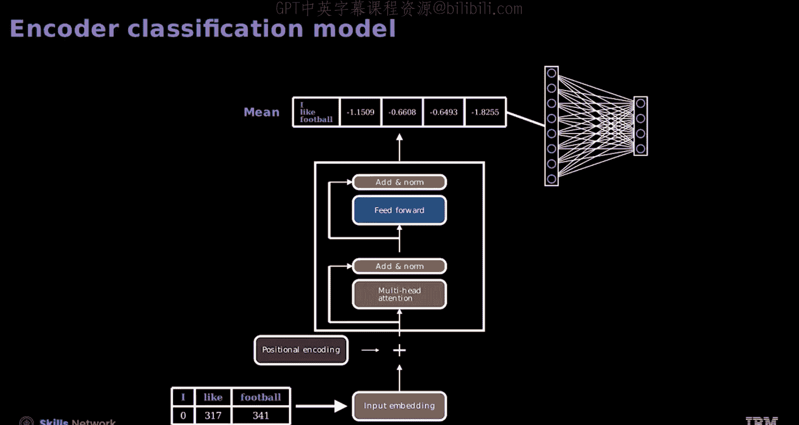

Now， let's look at the forward method to create a model in the model's forward method。

 the input X is used as an input to the embedding layer and scaled by the square root of the model dimension to stabilize gradients。

 Pre x for subsequent layers。 The dimensions are a little different from a neural network。

 Let's take a closer look。

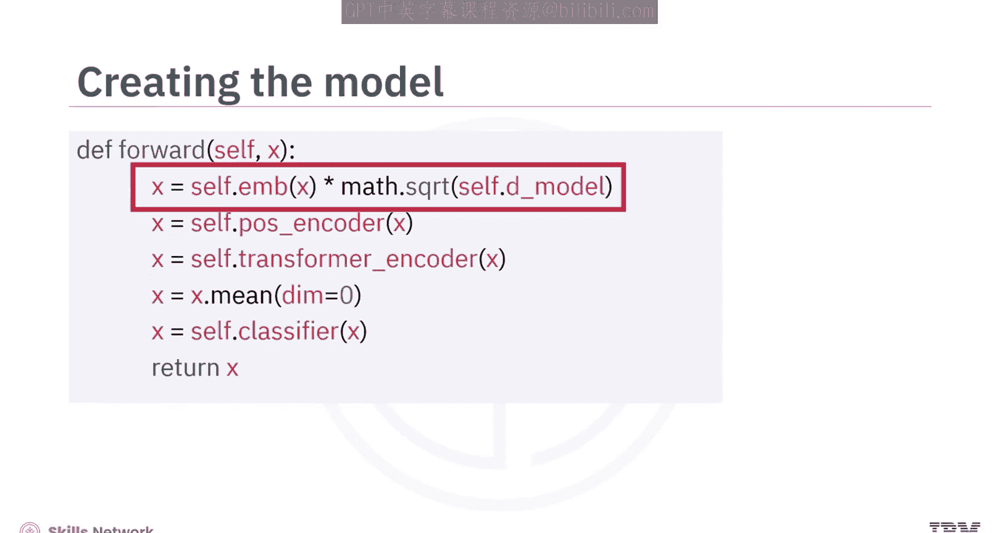

The input tensor x represents a sequence length 67 of tokens organized in batches of 64 samples。

 This is used as an input to the embedding layer。 The output of the embedding layer is 67 by 64。

 The final dimension is the embedding dimension of 100。

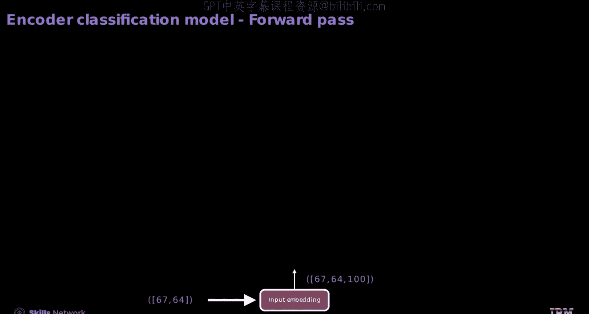

The input Tensor X undergoes positional encoding through the self dot POOS underscore encoder of X operation。

The positional encoding does not change the dimension。

The input tensor X undergoes transformation through the transformer encoder of X operation。

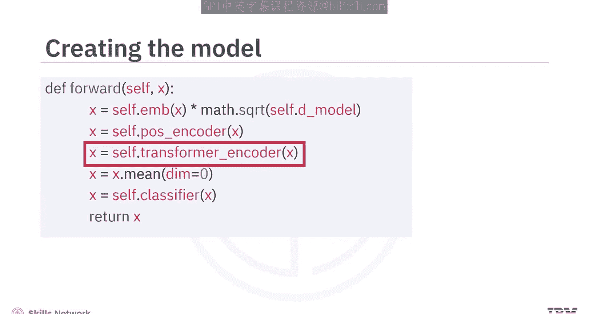

The output dimension of the tensor produced by the transformer encoder is the same as that of the input it receives。

 The number of endings is equal to the number of sequence tokens。

 These are called contextual embeddings， which have more information about the context。

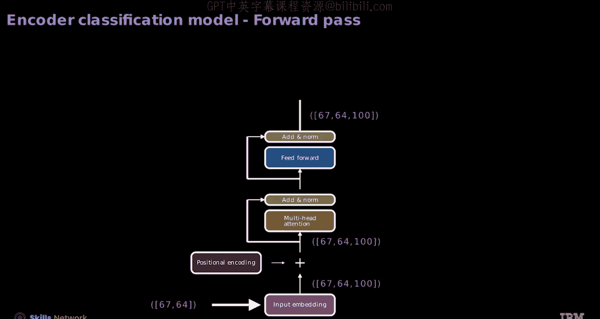

The tensor x is averaged along dimension0， with x dot mean of dim equal to0 to compile the sequence's information into a single embedding。

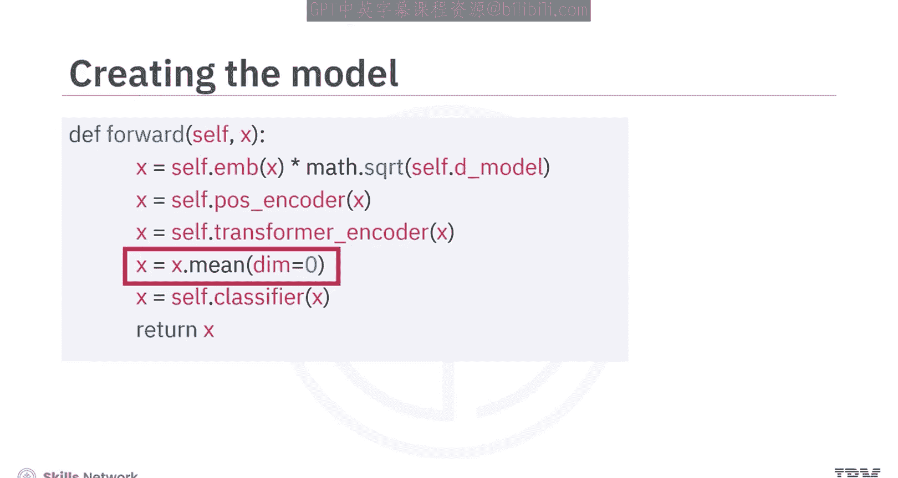

For the batch of 64， you can condense it into a single 100 dimensional vector。

 akin to having a data set with 64 instances each with 100 features。

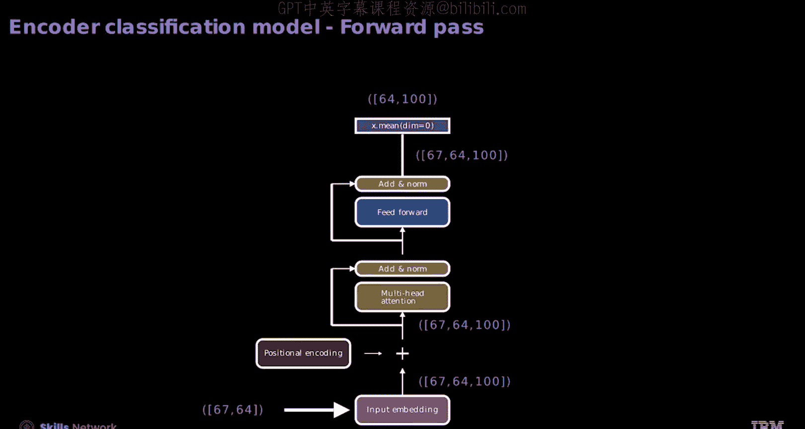

The Tensor X is processed by a linear classifier within the forward method。

 representing the model's prediction for the given input sequence。

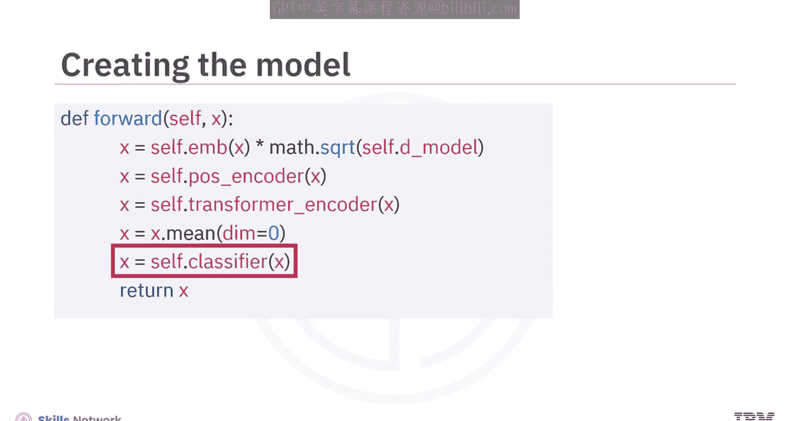

The Classifier model outputs 64 label predictions for each sample in the batch size。

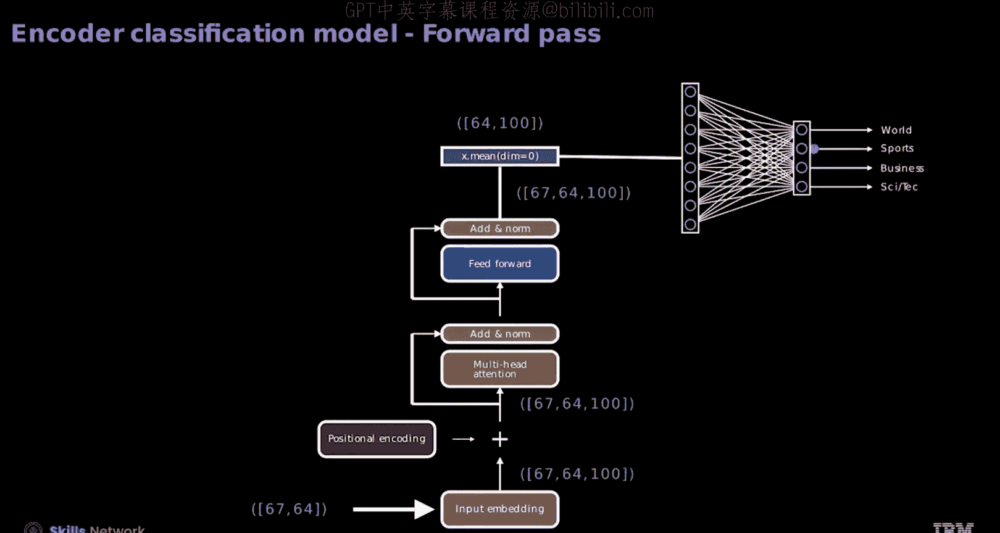

Create a model。Let's now look at training the model。

 the model's learning configuration includes a learning rate of 0。

1 for stochastic gradient descent and cross entropy loss for multiclass classification。

 SGD is the chosen optimizer with a step scheduler that decreases the learning rate by a factor of 0。

1 after each epoC for tracking progress， cumulative loss list and accuracy epoC are initialized to record cumulative losses and epoC Acacies respectively。

Additionally， accuracy old is used to retain the accuracy from the previous iteration。

The training process for the model is the same as a standard classification problem。

 despite the transformer's typical use for sequence to sequence tasks。

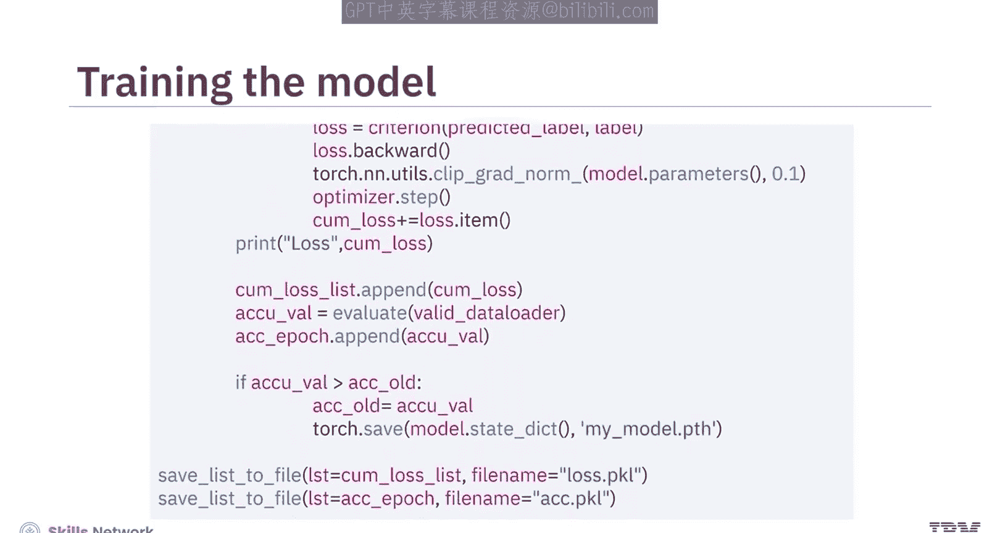

The plot displays the loss and accuracy of the model trained over 10 epochs。

 you will see that when the training loss decreases。

 the validation accuracy increases for larger data sets。

 transformers typically perform better than neural networks。

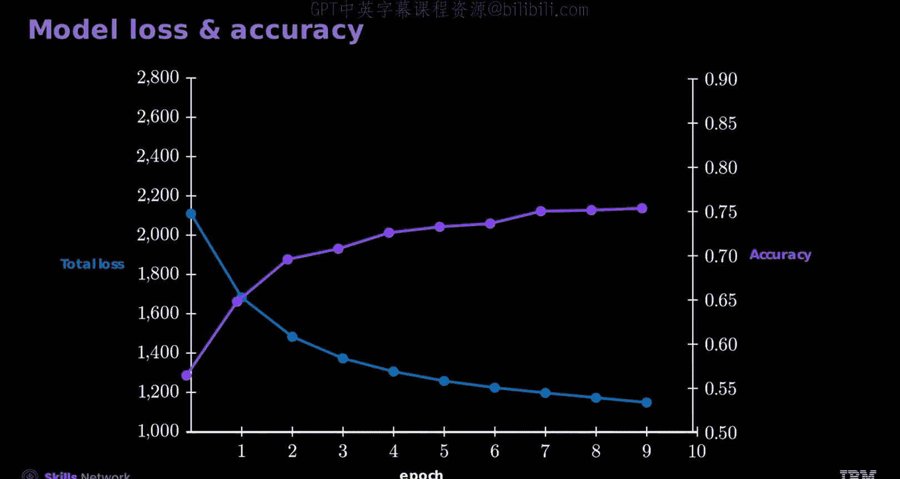

Let's now recap what you learned in this video you learned that you could retain context while classifying text by integrating transformer attention layers to create the text pipeline。

 create iterators， allocate training set， generate tokens and constructive vocabulary。

 design a custom collate function， apply padding， and create a data loader， to create the model。

 instantiate the embedding layer， add positional encoding， and apply the transformer encoder layers。

 use the classifier layer to predict the label to which the input text belongs， to train the model。

 use the same process as a standard classification problem。

