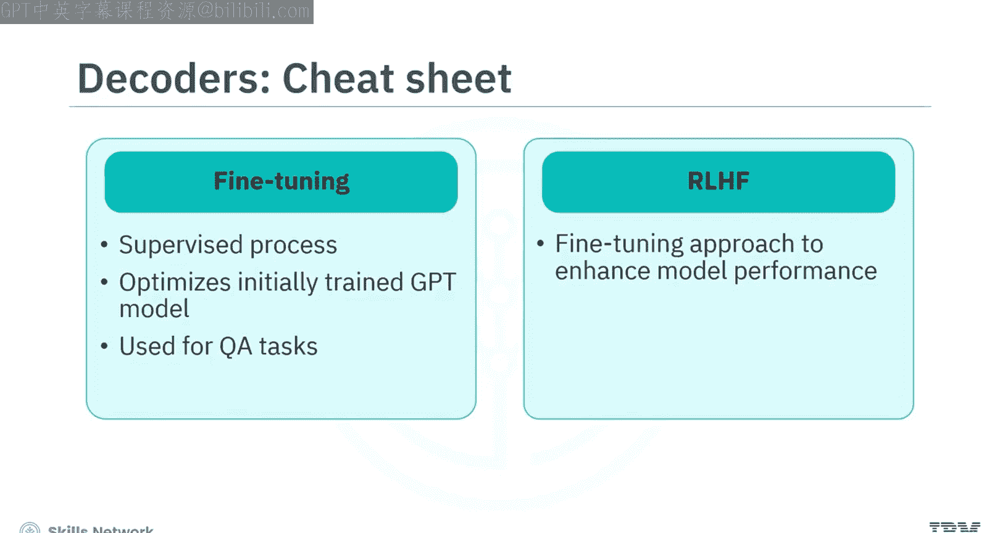
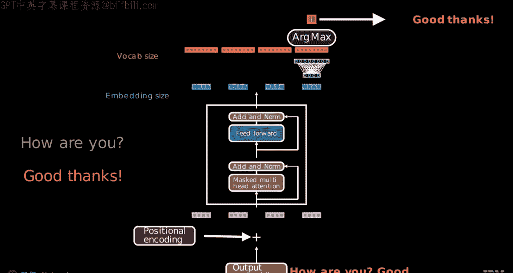

# 122：IBM《生成式人工智能工程｜Falsk、生成式AI应用、数据分析、机器学习、Keras、架构和数据、NLP基础、transformer、微调、高级微调、RAG》 p122 6_使用解码器和GPT类模型进行语言建模.zh_en -BV1NAq6Y9E7z_p122-

Welcome to Laage Modeling with the decoders and GT like Models video After watching this video。

 you'll be able to explain what decoders are and describe the use of decoder models for text generation。

Transformers initially developed for language translation tasks， comprise two principal components。

 an encoder and a decoder。 These architectures have evolved with the decoder playing a pivotal role in text generation。

 serving as the foundation for sophisticated models such as GT， Laama and granite。

This cheat sheet will help you summarize how decoder models work。

Generative pretraining or GPT is self superupvised and involves training a decoder to predict the subsequent token or word in a sequence given a set of words。

 Autoregressive models facilitate sequence generation by anticipating each new token such as words based on the sequences preceding tokens adhering to the methodology outlined above。

Fine tuning is a supervised process that optimizes the initially trained G model for specific tasks like QA classification。

 reinforcement learning from human feedback or RLHF represents a fine tuning approach that enhances model performance on specific tasks。

 proving particularly effective in chatbot development。

 a notable distinction in text generation is the decoder's operation without the encoder's input。

 Dirging from its role in translation where it relies on cross attention with the encoder。

 This unique operation in text generation involves predicting the subsequent word based on the preceding sequence of tokens。

GPT is based on the decoder model。 A decoder functions auto aggressivelyively when it forecasts future words based on previously encountered words。

 This is illustrated by the process where the model predicts the word IBM。

 starting with the beginning of sentence token， B O S。

This predicted word IBM is then appended to the initial B O S token。 Consequently。

 the model now processes the input sequence B O S IBM。

 leading it to predict the subsequent word taught。 Such a method is intricately designed to mimic human like text prediction。

 sequentially predicting each new word in a chain， given the context of the preceding words。

 The principal distinction between encodederrs and decoders in transformer architectures lies in the use of masked self attention for decoders。

Decoder's leverage and attention mechanism， which at its core。

 involves matrix multiplication during training the entire sequences fed into the model。

 Maing is a critical technique that ensures the model only attends to previous tokens in the sequence when making predictions。

 Faacilitating auto regressive generation。 It is important to note that masking is employed during inference or prediction as well。

 Act as an intermediary step to preserve the autoregressive property。

 You can subsequently use an encoder as a decoder for text generation。 If you add a mask。

 You'll focus on masking when you learn to train the decoders。 Now。

 let's transition to the auto regressive process of generating translation using the model。

 Let's explore how decoder model， such as G generate text by predicting the next token in a sequence。

 Take a question answering scenario where the model responds with good thanks to the prompt。

 How are you。Here's an overview of the generation process。 The process begins with the prompt。

 How are you in some models， the B O S token is added。

 This prompt is tokenized into individual tokens and converted to word embedding vectors shown in gray in a standard neural network。

 typicallyy the text embeddings or the context vector are fed into the network one at a time as shown here。

 Then you would apply the arg max function to the resulting values to determine the token index of the subsequent word。

 While it's possible to increase the context of vector size to enhance the model's capacity。

 this approach is not feasible if the input size as variable， Moreover。

 increasing the context vector size indiscriminately can lead to overfitting in decoders word embeddings and positional encodings are applied to these word embeddings。

 which are illustrated in pink。 Next， the decoder produces a sequence of transform embeddings or tokens termed contextual embeddings depicted in blue。

 contextual embeddings aptly describe how the transformer processes the input word embeddings by。

Counting for the context in which each word occurs within the sequence。

 Unlike static word embeddings， which remain constant for a word irrespective of its context。

 these contextual embeddings change based on the surrounding words and the flow of information within the transformer。

 These contextual embeddings can be likened to logicits from a hidden layer and are subsequently passed through a final linear layer to predict a sequence of logicts shown in red。

While the process is laid out sequentially here for ease of understanding， in reality。

 it occurs simultaneously， and the outputs are decoded much like a neural network operates。 Finally。

 an argmax operation is applied to the last token to select the index with the highest score from the logics。

 In this instance， good is chosen as the next token。

 The selected token good is appended to the previous input sequence。 How are you。

 The updated input sequence becomes， how are you， Good， The word embeddings for good are calculated。

 The updated input sequence is fed into the model again。

 The new vectors go through the layers similarly， and the model generates the next token based on the updated context。

 In this case， the model generates thanks as the next token。

 The model keeps generating tokens based on the updated input sequence until the specific condition is met。

 For example， the generation process may continue until an end of sequence token。

 such as E is reached or the maximum number of output tokens are generated。

 Let's now recap what you learned in this。😊。

You learned that decoder plays a pivotal role in text generation。

 serving as the foundation for sophisticated models， such as G， Lama and granite。

 A decoder functions autoregressively when it forecasts future words based on previously encountered words the principal distinction between encodeders and decoders and transformer architectures lies in the use of masked selfattention for decoders decoder's leverage and attention mechanism。

 which at its core involves matrix multiplication， masking ensures the model only attends to previous tokens in the sequence when making predictions。

 facilitating autoregressive generation。 for generating translation using the decoder model。 First。

 word embeddings and positional encodings are applied to the word embeddings。 Next。

 the decoder produces a sequence of transformed embeddings or tokens termed contextual embeddings。

 These contextual embeddings can be likened to logics from a hidden layer and are subsequently passed through a final linear layer to predict a sequence of logics Finally。

 in a max。is applied to the last token to select the index with the highest score from the logics。

