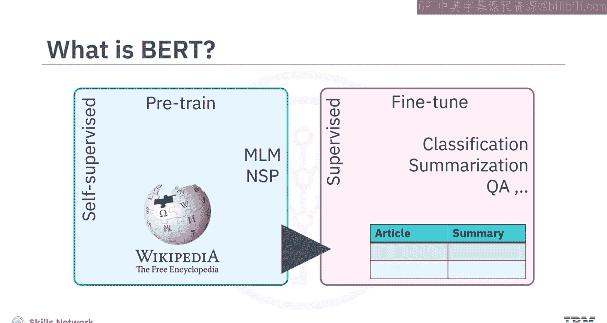
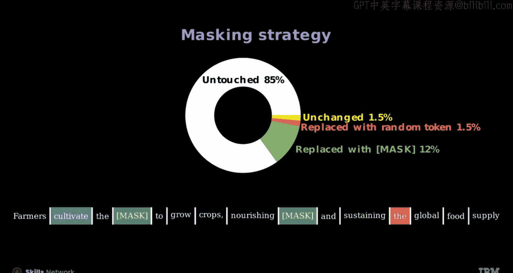
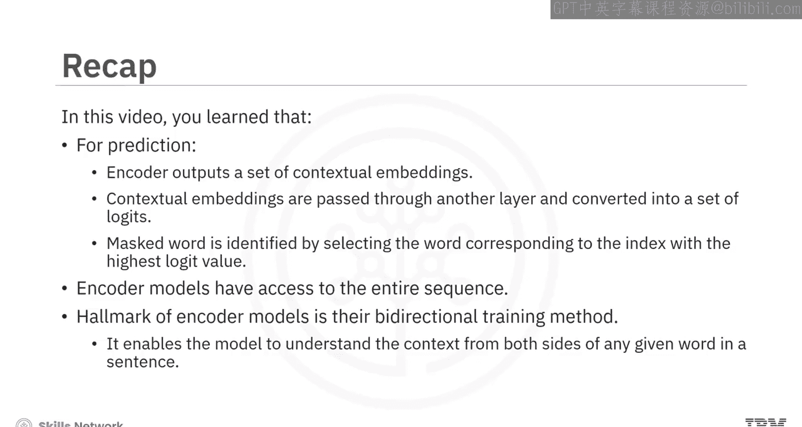

# 126：IBM《生成式人工智能工程｜Falsk、生成式AI应用、数据分析、机器学习、Keras、架构和数据、NLP基础、transformer、微调、高级微调、RAG》 p126 10_使用MLM进行BERT预训练的编码器模型.zh_en -BV1NAq6Y9E7z_p126-

Welcome to Encor Models with BerRT， pretraining using MLM。After watching this video。

 you will be able to explain BRT models and their encoder only architecture。

 you will also learn to train BRT models using masked language modeling or MLM。

Bydirectional encoder representations from transformers or Bt developed by Google revolutionized NLP with its deep understanding of word context and semantics。

 It's pre traineded via self supervised learning on vast text corpora。

Using masked language modeling MLM and next sentence prediction NSP Bt's architecture allows for fine tuning specific tasks like text summarization。

 question answering， and sentiment analysis， adapting its comprehensive knowledge to specialized applications。

Bert utilizes an encoder only architecture that is only the encoder part of the transformer model。

 This design allows Bert to process entire sequences of text simultaneously。

 theoretically enhancing its understanding of the context and nuances within the text。

 Unlike autoregressive models。 Bert is not typically used for text generation tasks。 Instead。

 it excels at a broad range of language comprehension tasks。

 Consider the task of predicting a known word denoted by the token mask within the input。

 CS IBM mask， me Bt Sep， an autoregressive model would only have access to the Cs and IBM tokens to predict the masked word。

 However， Bert can utilize the full context from both sides of the mask token。

 which allows for a more informed prediction。 In this case。

 taught one other difference is that the Bt models contain the segment embeddings used in training。

Let's learn about MLM。 It involves randomly masking some of the input tokens and training Bert to predict the original mask tokens。

 This task helps Bert learn contextual representations and understand the relationships between words。

The prediction method is almost identical to that used in decoder models like G。

 The encoder outputs a set of contextual embeddings depicted in gray。

 which are then passed through another layer and converted into a set of logics shown in red。

 The masked word is identified by selecting the word corresponding to the index with the highest logicit value。

 The main distinction lies in the fact that encoder models have access to the entire sequence。

A hallmark of encoder models like Bert is their bidirectional training method。

 which enables the model to understand the context from both sides of any given word in a sentence。

For example， take the task of predicting the missing word in the sentence。

 farmers cultivate the question mark to grow crops in contrast to models such as G。

 which only consider the preceding text farmers cultivate the due to their causal attention mechanism Bt's architecture allows it to analyze text from both directions。

 and decoder models like G causal attention is visually represented by an X for the masked attention and O's for the active attention units。

 Bert， however， employs a bidirectional mechanism without such masking。

 fully utilizing the context around each word， as depicted by the presence of only O's。

 This bidirectional approach gives Bert a more sophisticated grasp of language nuances and complex word interdependencies。

According to the original Bt paper， you should randomly hide 15% of the input words and try to predict them。

 You can use the hidden vectors of these masked words to make predictions using a vocabulary。

 Instead of reconstructing the entire input， you should only focus on predicting the masked words。

 Although this allows you to obtain a bidirectal pretrained model。

 A downside is that you are creating a mismatch between pretraining and fine tuning。

 since the mask token does not appear during fine tuning。 to address this。

 don't always replace masked words with the mask token。 When generating training data。

15% of the word positions are randomly chosen。 If a word is chosen。

 you can replace it with the mask token 80% of the time。 a random token 10% of the time。

 and leave it unchanged 10% of the time。 This data is used to predict the original word using cross entropy loss。

Let's consider an example to illustrate 85% of the words remain unchanged。

 and from the remaining 15%， 80% are replaced with mask。

 10% with a random token like the and 10% are used for prediction without any changes。

 like cultivate。

Let's now recap what you learn。In this video， you learn that bidirectional encoder representations from transformers or Bt's architecture allow for fine tuning specific tasks like text summarization。

 Que answering and sentiment analysis。 Bert utilizes an encoder only architecture。

 which allows it to process entire sequences of text simultaneously。

 Thely enhancing its understanding of the context and nuances within the text。

 Maed language modeling or M L M involves randomly masking some of the input tokens and training Bt to predict the original masked tokens。

 The prediction method is as follows。 The encoder outputs a set of contextual embeddings。

 which are then passed through another layer and converted into a set of logics。

 The masked word is identified by selecting the word corresponding to the index with the highest logic value。

 The main distinction between decor and encoder models lies in the fact that encoder models have access to the entire sequence。

 A hallmark of encoder models like Bt is their bi direction。

T which enables the model to understand the context from both sides of any given word in a sentence。

。