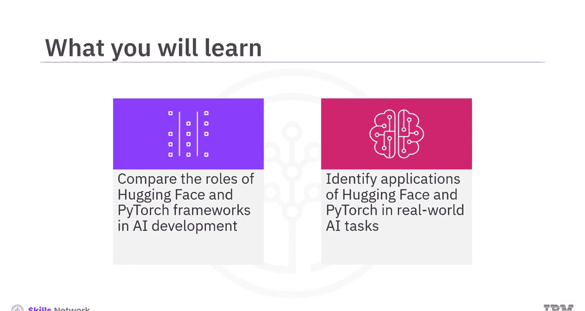
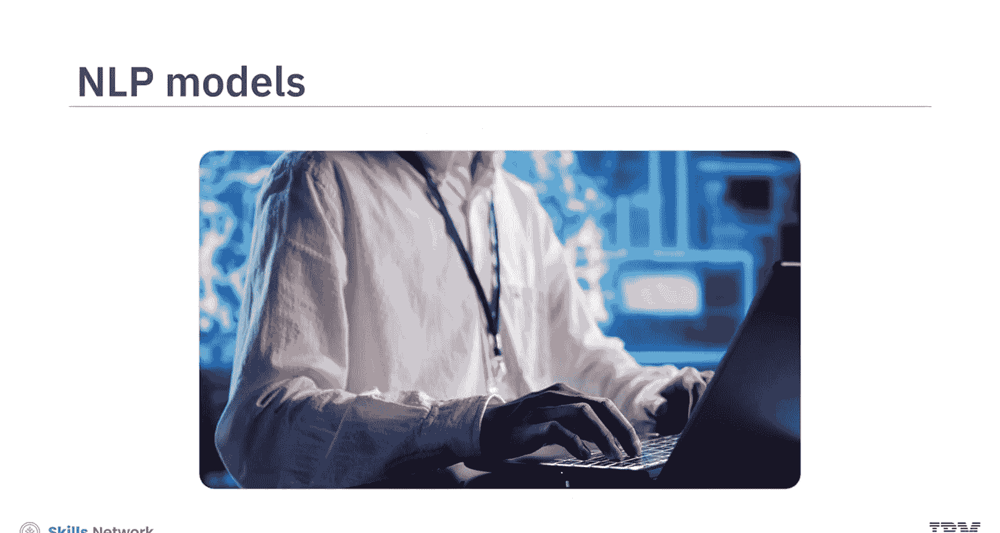
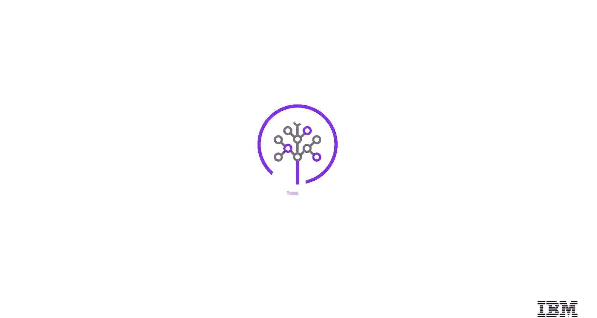

# 133：IBM《生成式人工智能工程｜Falsk、生成式AI应用、数据分析、机器学习、Keras、架构和数据、NLP基础、transformer、微调、高级微调、RAG》 p133 1_Hugging Face vs PyTorch.zh_en -BV1NAq6Y9E7z_p133-

Welcome to Huging Face v Pytorch After watching this video。

 you'll be able to compare the roles of Huging face and Pytororch frameworks in AI development and identify their applications in real world AI tasks。

Consider that you are working on a project where you are researching the implementation of natural language processing or NLP models。

The NLP models such as Huging face and Pytorrch， are used in various industries such as healthcare。

 finance and customer service。 Huging Face is a popular library known for its pretrain models and easy to use interface。

 On the other hand， Pytorrch is a powerful deep learning framework。

 commonly used for building custom NLP models from scratch。

Let's learn about these frameworks one by one Huging F started as a chatbot company， however。

 it quickly became a platform and community dedicated to machine learning， ML and data science。

 it is designed to assist users in developing， deploying and training machine learning models。

It offers the necessary infrastructure for demonstrating， operating。

 and integrating AI into real world applications。Additionally， as a user。

 you can explore models and data sets shared by others。

Due to its role in facilitating open sharing and testing among developers。

 Huging face is frequently called the GitHub of machine learning。

This comparison highlights its importance as a collaborative hub for AI developers。

 Let's look at some of its key features。The most popular feature of Huging Face is its Transformer library。

 which offers several pretrain models such as BERT， GPT。

 and T5 ready to use for various NLP tasks The next feature is its strong emphasis on creating and supporting tools for NLP applications。

Huggging F Frawork has a vast， growing community that contributes to developing and maintaining model repositories and tools。

Let's look at Pytororch now PyTtororch is a software based open source deep learning framework originally developed by Facebook AI Research now meta for building neural networks。

😡，It combines Torch's machine learning library with a Python based high level API。

 It flexibility and ease of use， among other benefits。

 have made it the leading M framework for academic and research communities。

 Pytorrch supports a wide variety of neural network architectures and is built on the widely understood Python programming language。

 It offers extensive libraries a preconfigured and even pre traineded models。

PyTt allows data scientists to run and test portions of code in real time rather than wait for the entire code to be implemented。

 which can take a long time for large deep learning models。

This makes Pytorch an excellent platform for rapid prototyping and greatly expedites the debugging process。

Let's look at its core features。PyTrch's most popular feature is the dynamic computation graph。

 which allows changes to the network architecture on the fly during runtime。

Pytorrch is easy to use due to its intuitive and straightforward syntax， which is Python base。

PyTorch provides a strong graphics processing unit or GPU acceleration。

 it can efficiently handle large scale computations。

 which is particularly beneficial for deep learning。Let's compare the two frameworks。

 Pytorrch is a versatile machine learning library that excels in deep learning。

 It offers essential tools for creating a variety of machine learning models and is appreciated for its adaptability and effectiveness。

 particularly in research and development environments。

 Pytorrch is popular for its ability to manage computation graphs dynamically and is widely employed in both academic studies and real world applications。

 On the other hand， Huging face is best known for its transformers library and specializes in providing ready to use NLP models and tools。

It enhances frameworks like pietorrch and TensorFlow by providing straightforward interfaces for cutting edge NLP models。

Hugging face is especially useful for tasks like text classification， sentiment analysis。

 and text generation。As a developer， you can integrate Pytorrch with hugging faces transformers。

 this allows you to tackle complex NLP tasks more intuitively and efficiently。

Let's look at some applications demonstrating how seamlessly hugging face and Pytorch can be integrated to provide powerful NOP solutions first is sentiment analysis。

 which classifies the sentiment of user reviews or social media posts。

The second application is language translation。You can use models like T5 and Mary and MT to translate text from one language to another。

Next is question answering， you can use these frameworks to build systems that can provide answers based on input。

 questions and context。Another application is T summarization。

 which can help you automatically generate concise summaries from large volumes of text。

 let's now recap what you've learned。In this video， you learned that。

 Huging Face is a platform and community dedicated to machine learning， ML and data science。

 which assists users in developing， deploying and training machine learning models。

Hugging face is frequently called the Github of machine learning。

The most popular feature of Huging Face is its Transformers library。

 which offers several pretrain models such as BerRT， GPT， and T5 ready to use for various NLP tasks。

Pytororch is a software based open source deep learning framework for building neural networks。

 Pytorch supports a wide variety of neural network architectures and is built on the widely understood Python programming language。

 Pytororch's most popular feature is the dynamic computation graph。

 which allows changes to the network architecture on the fly during runtime。

 Some applications demonstrate the seamless integration of hugging face and Pytorch to provide powerful N LP solutions。

 These include scientific analysis， language translation， Que answering and text summarization。

