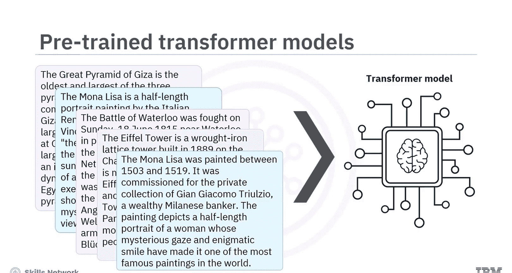
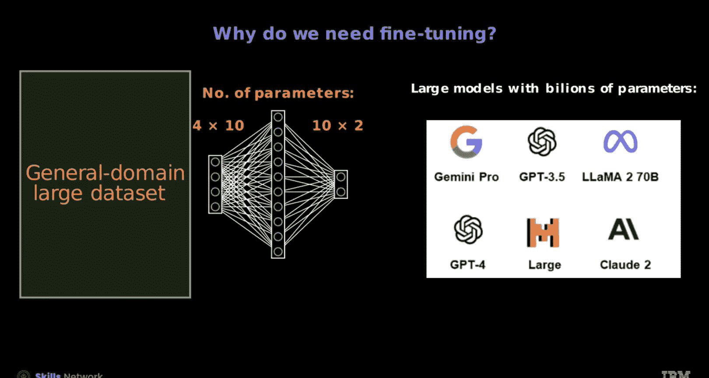
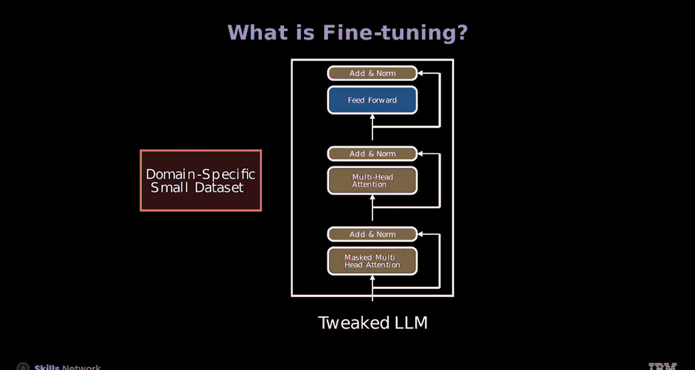
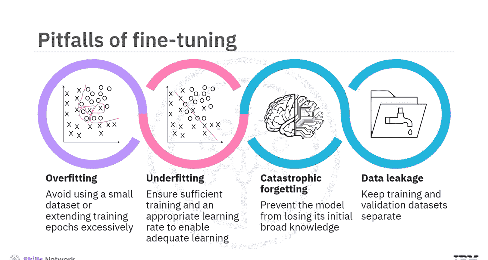
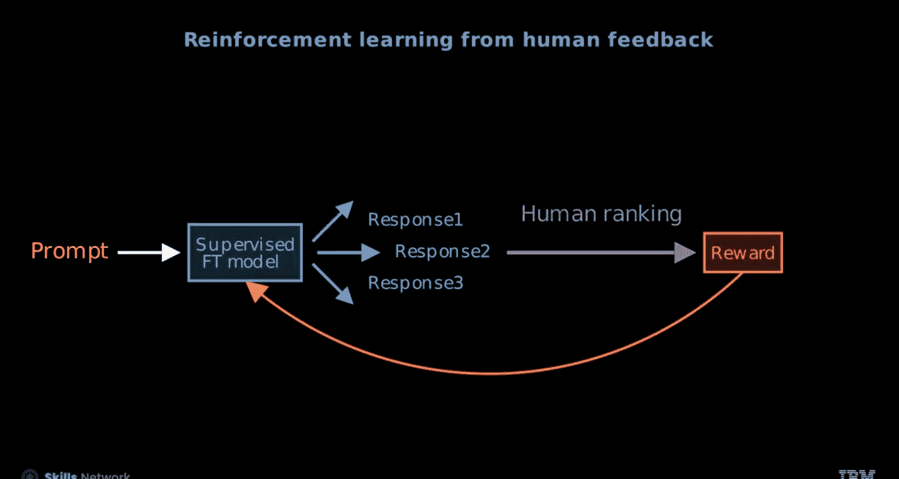
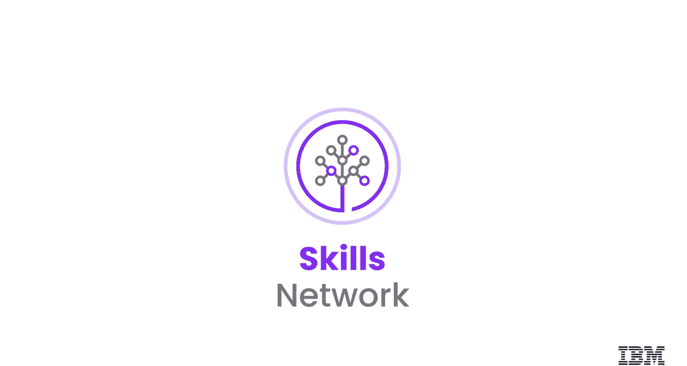

# 134：IBM《生成式人工智能工程｜Falsk、生成式AI应用、数据分析、机器学习、Keras、架构和数据、NLP基础、transformer、微调、高级微调、RAG》 p134 2_使用预训练的Transformer和微调.zh_en -BV1NAq6Y9E7z_p134-

Welcome to using pre-train transformformers and fine tuning After watching this video。

 you'll be able to review the uses of pretrain transformformer models。

 describe fine tuning and why it's necessary and explain the different approaches to fine tuning Transformer models like Bert。

 Lama and G have revolutionized natural language processing or NLP with their attention-based architecture and ability to be pretrained on large unlabeled text dataset sets。

 The pretraining process allows these models to learn rich representations of language that can then be leveraged for a wide range of downstream NLP tasks。

Training large language models or LLMs with billions of parameters is computationally expensive。

 requiring powerful hardware like graphics processing units or GPUs and substantial training data。

The process is time consuming， taking weeks or months and involves complex optimization over multiple epochs。

 setting up and maintaining the necessary infrastructure adds additional costs。 Overall。

 training LLms demand significant computational resources， time and investment。

 fine tuning LLms adapt pretrain models to specific tasks or domains using domain specific data。

 This process adjusts the models's parameters to improve task performance。

 leveraging preexisting language understanding。 fine tuning enhances efficiency and saves time and computational resources compared to training models from scratch。

 Let's look at some benefits of fine tuning fine tuning LLms is valuable and transfer learning。

 especially with limited labeled data availability。

 providing time and resource efficiency by bypassing initial training stages and achieving faster conversiongs。

 fine tuning allows you to tailor the models' responses to align with your specific requirements。

 ensuring that it produces accurate。😊。

Conexual relevant outputsThis task specific adaptation is crucial for applications like sentiment analysis or text generation within diverse domains。

To avoid pitfalls and fine tuning LLMs， you should consider the following。

Overfitting to prevent the model from performing well only on training data。

 you should avoid using a small data set or extending training epochs excessively。😡，Underfitting。

 you must ensure sufficient training and an appropriate learning rate to enable adequate learning。

Catastrophic forgetting prevent the model from losing its initial broad knowledge。

 which can hinder performance on various NLP tasks， data leakage。

 keep training and validation data sets separate to avoid misleading metrics。

 addressing these issues can optimize fine tuning for better performance and generalization on specific tasks or domains。

Fine tuning causal decoder models can appear straightforward by creating a dataset set specific to the task。

 For example， a question answering bot designed to answer questions about cars can be retrained with a data about cars however。

 in practice， these methods require novel cost functions such as reinforcement learning direct preference optimization and training encoder models to evaluate the model scoring large language models that is response evaluation can be challenging Humans excel at comparing two responses but often struggle with assigning absolute scores。

For instance， given two responses to the question， which country owns Antarctica。

 One might say Antarctica is governed by the Antarctic Treaty system。

 which is accurate and informative， while another might quip our penguin overlords run the show down there。

 which is humorous but incorrect。 while it's easy for humans to identify the first response as good and the second is bad。

 quantifyifying these judgments numerically is more complex。

 This can be addressed by fine tuning and LLM such as Bert that understands language to produce a single output analogous more to regression than classification。

 using reward modeling。 As you can see here， the first response scores better than the second。😡。

There are three main approaches to fine tuning language models。

 Number one is self superupvised fine tuning Here， the model learns to predict missing words in a large unlabeled data set。

 such as next words or masked words Numb two is supervised fine tuning where the model is fine tuned using labeled data from the target tasks。

 I its performance on specific tasks like sentiment classification。

 and number3 is reinforcement learning from human feedback or RLHF In this technique。

 the model is adjusted based on explicit feedback from human annotators。

 aligning its outputs with human preferences。 These methods enable language models to adapt to specific tasks or domains leveraging self supervised learning。

 supervised learning or human feedback。 hybrid fine tuning。

 combining multiple techniques can further enhance model performance。

 Chat GT developed by open AI is an example that utilizes such hybrid methods Direct preference optimization or DPO is an emerging popular approach。

That focuses on optimizing language models directly based on human preferences。

Let's look at some of its features。 First is its simplicity。

 DPO can be more straightforward to implement than Rl。 Due to its human centric optimization。

 DPO explicitly focuses on aligning model outputs with human preferences and judgments。

 DPO requires no reward training。 That is， there's no need to train an additional reward model。

 Finally， DPO can achieve faster convergence due to its reliance on direct feedback。

 Let's look at how supervised fine tuning can be done。 There are two different ways。

 First is full fine tuning where all the parameters of the model or tuned for the specific task。

 The second is a more efficient way of fine tuning foundation models called parameter efficient fine tuning or Pft。

 In this methodology， large pretrain models can be fine tuned without modifying most of their original parameters。

Let's now recap what you've learned in this video you learned that training large language models or LLMs with billions of parameters is computationally expensive。

 requiring powerful hardware like graphics processing units。

 or GPOs and substantial training data fine tuning LLMs adapts pretrain models to specific tasks or domains using domainspec data fine tuning enhances efficiency and saves time and computational resources compared to training models from scratch Ben of fine tuning include transfer learning。

 time and resource efficiency， tailored responses and task specific adaptation addressing issues like overfitting。

 underfitting， catastrophic forgetting and data leakage can optimize fine tuning for better performance and generalization on specific domains。

 three main approaches to fine tuning language models include self-supvised fine tuning。

 supervised fine tuning and reinforcement learning from human feedback or RLHF direct preference optimization。

😡，Or DPO is an emerging popular approach that focuses on optimizing language models directly based on human preferences。

 supervised fine tuning can be done in two different ways。

 full fine tuning and parameter efficient fine tuning or Pft。

