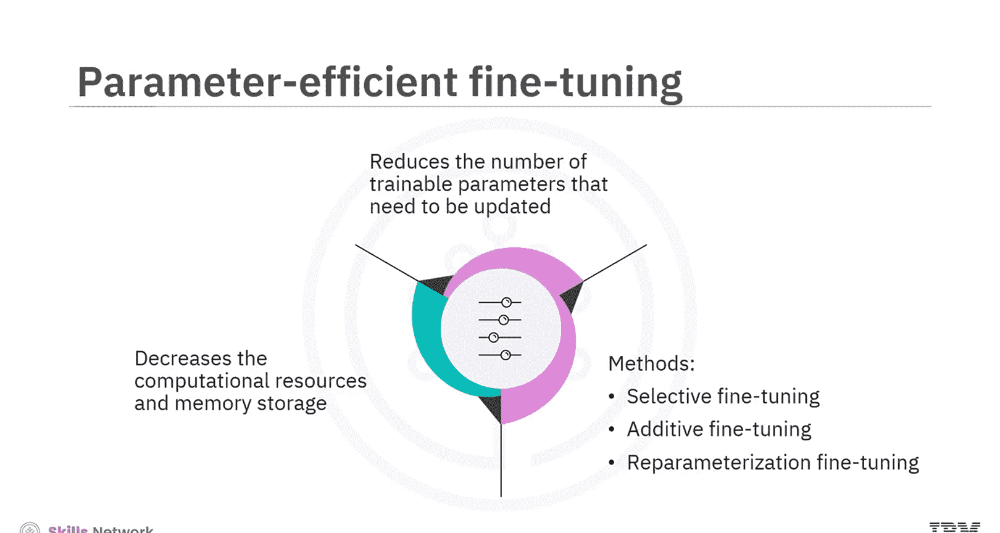
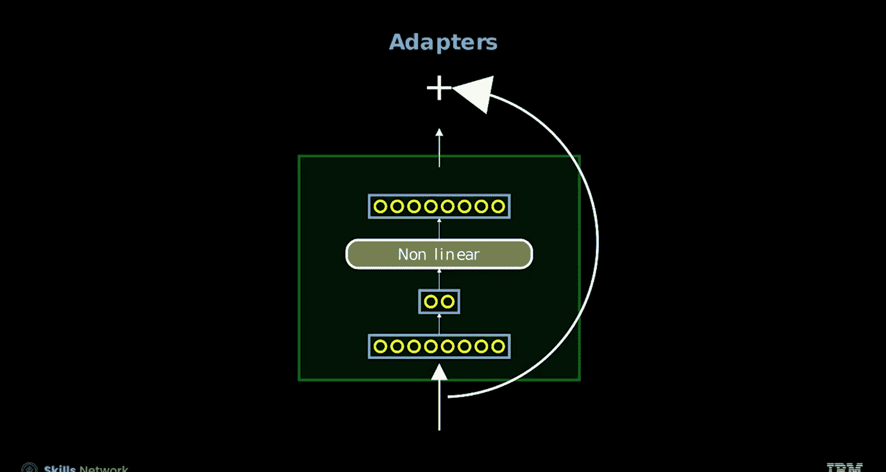
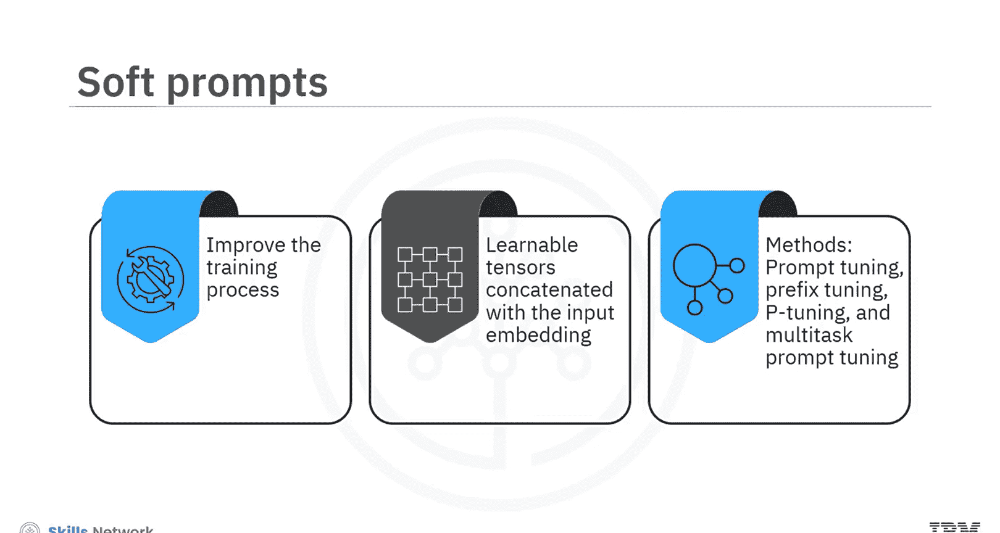
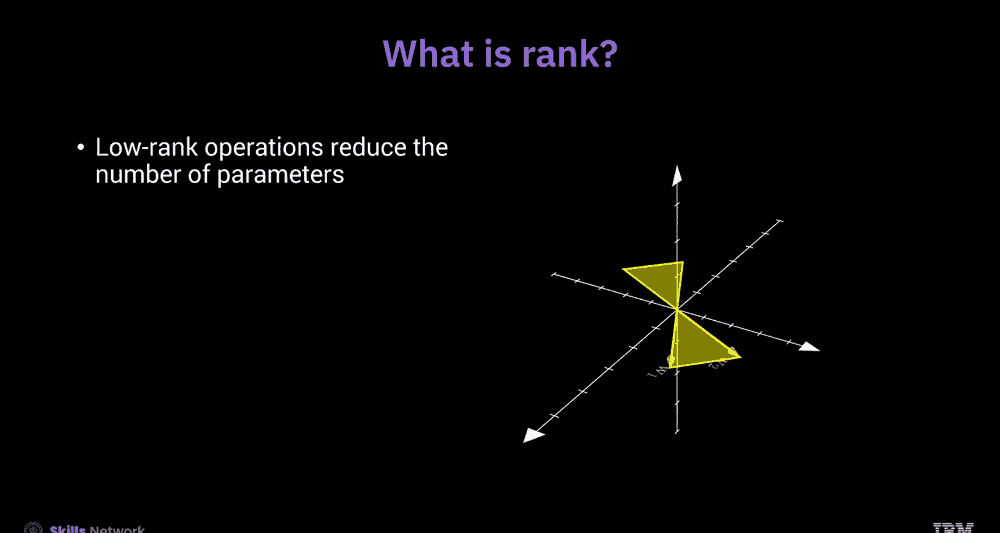
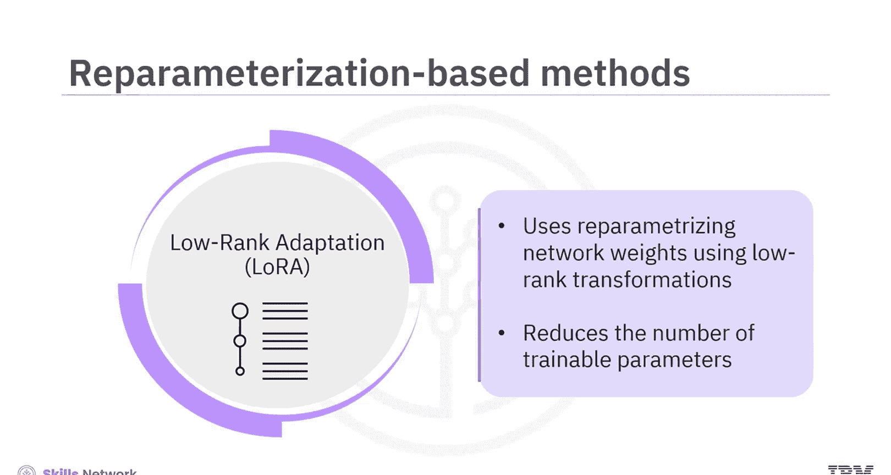
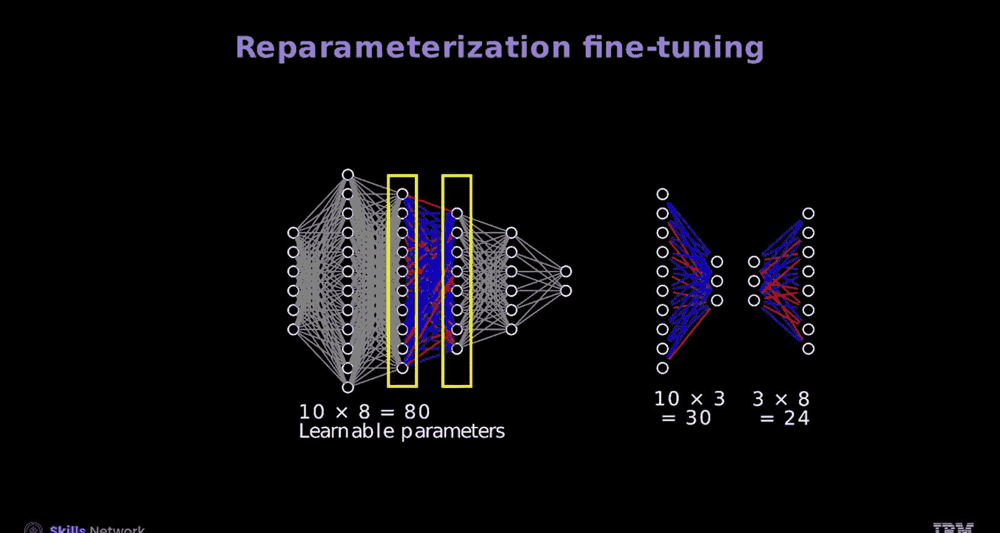
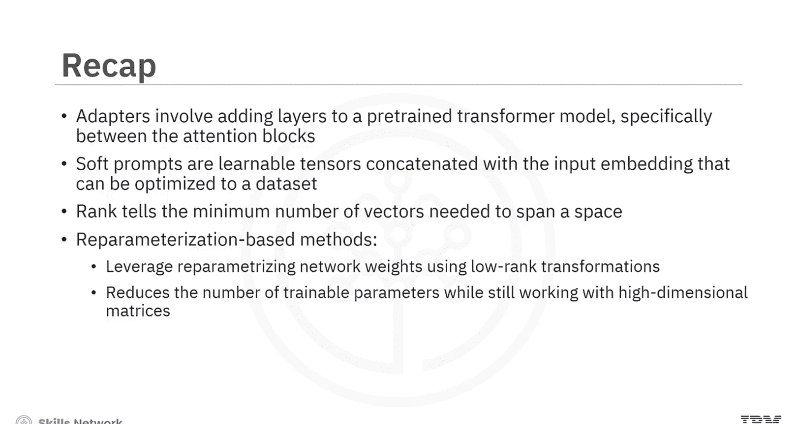

# 137：PEFT.zh_en -BV1NAq6Y9E7z_p137-

Welcome to Inuction to Pft After watching this video。

 you'll be able to explain the concept of parameter efficient fine tuning or PEft。

 and its importance， describe the types and uses of PEft methods。

 and recognize the concept of soft prompts and ranks。SFT。

 or supervised fine tuning is a method commonly used in machine learning。

 especially when working with pretrained models and transfer learning。

 This method involves acquiring the knowledge and understanding a model has gained from previous training and adapting it to a new task。

One of the commonly used methods in supervised fine tuning， full fine tuning。

 involves updating the learning parameters， layers， and neurons of large language models or LLMs。

It demands significant computational resources and memory and substantial task specific labeled data。

It also has a higher risk of overfitting， is time consuming and involves complex implementation。

In addition， one inherent issue with full fine tuning is catastrophic forgetting。

 where the model forgets previously learned information upon being trained with new data。

 leading to a loss of valuable pretrain knowledge。For this reason。

 parameter efficient fine tuning or PEft methods have been developed。

 PEft methods reduce the number of trainable parameters that need to be updated to effectively adapt a large pretrained model to specific downstream applications。

In doing so， PET significantly decreases the computational resources and memory storage needed to yield an effectively fine tune model。

Pefft methods include selective fine tuning， additive fine tuning。

 and reparameterization fine tuning。These methods have often been demonstrated to be more stable and full fine tuning methods。

 particularly for NLP use cases。

Let's learn about these methods one by one。First is selective fine tuning full fine tuning。

 which involves updating the neural parameters， layers and neurons as shown in red and blue。

 demands significant computational resources and memory On the contrary， selective fine tuning。

 which updates only a subset of layers or parameters， works for other networks。

It is less effective for transformer architectures due to their higher number of parameters and the need for more extensive updates。

This limitation has led to the development of alternative methods。

One of those methods is additive fine tuning instead of modifying the existing pretrained parameters。

 this method involves adding new task specific layers or components to the pretrained model you can then train these additional layers on task specific data while keeping the pretrained parameters fixed。

Additive fine tuning allows for task specific customization while preserving the pretrain knowledge。

You can inject additional layers anywhere in the model。In transformers。

 adapters are used for additive fine tuning。They involve adding layers to a pretrain transformer model specifically between the attention blocks shown in green while keeping most of the model's weights frozen。

 If you examine the adapter layers， they start with a down projection layer shown in blue and yellow。

 which reduces the input dimension。 This is followed by a nonlinear transformation and then an up projection layer also shown in blue and yellow。

 which restores the dimension back to that of the transformer。

 This design allows you to use an off the shelf transformer with only the adapters needing to be stored。

 The transformer maintains a general understanding of language while the adapter store information specific to a particular problem。

To train large pretrained language models， you require a significant amount of time and computational resources。

As these models increase in size， you can leverage soft prompts to improve the training process。

 So prompts are learnable tensors concatenated with the input embeddings that can be optimized to a data set。

 Soft prompt methods include prompts tuning， prefix tuning， P tuning and multitask prompts tuning。

Let's take a closer look at prefix tuning。Consider you are training the following decoder model from a general chatbot to a medical chatbot。

Instead of training the entire model on the data set。

 you can simply append parameter embeddings to the existing embeddings as shown here。

The original embeddings are in purple and the new embeddings are in red。

 You'll then train the new model by freezing all the parameters except for the embeddings。Now。

 before learning about the most popular PT method， the re parameterameterorization based method。

 let's review the concept of rank。Rank tells you the minimum number of vectors needed to span a space。

 It is essentially what you commonly think of as a dimension。 Consider two vectors in a 2D space。

 These two vectors can reach any point in that space。 So the rank is 2。 Now。

 let's say you extend these vectors into a 3D space。

 Even though these two vectors now live in a 3D space。

 they can still only span a plane within the space。 Hence their rank remains two。

 as they can only reach points in the 2D plane， not the entire 3D space。In neural networks。

 the input and output layers have fixed dimensions； however。

 you can use low rank operations to reduce the number of parameters。As shown。

 you only need two dimensions to span the space， even in a higher dimensional context。

 this reduction in dimensionality can help in making the model more efficient。

Reparameterorization based methods such as LowRA or low rank adaptation leverage the concept of reparametererizing network weights using low rank transformations。

This reduces the number of trainable parameters while still working with high dimensional matrices。

 like the pretrained parameters of the network。

In a typical network shown here the forward method uses the full network。 However， in Lora。

 additional low rank layers are added to the original layer， as shown。

 reducing the number of parameters needed to represent the weight matrices。

This reparameterization effectively captures the most important directions in the data。

 maintaining the model's performance while significantly reducing computational costs。

 Other popular methods similar to LoRA include quantized low rank adaptation or Q LoRA。

 and weight decomposed low rank adaptation or DoRA。

QORA combines low rank adaptations with quantization。

 reducing the memory footprints and computational requirements of the model。

 while DoRA adjusts the rank of the low rank space based on the magnitude of the components。

 optimizing the model's performance and efficiency。Let's now recap what you learned in this video。

 you learned that parameter efficient fine tuning or pft methods reduce the number of trainable parameters that need to be updated to effectively adapt a large pretrain model to specific downstream applications。

😡，Pft methods include selective fine tuning， additive fine tuning and reparameterization。

 fine tuning Selective fine tuning updates only a subset of layers or parameters that work for other networks。

 It is less effective for transformer architectures due to their higher number of parameters and the need for more extensive updates。

 Additive fine tuning involves adding task specific layers or components to the pretrained model instead of modifying the existing pretrain parameters。

 adaptapers are used for additive fine tuning and involve adding layers to a pre transform transformformer model specifically between the attention blocks while keeping most of the model' weights frozen。

 So prompts are learnable tens concatenated with the input embeddings that can be optimized to a data set。

 ranknk tells you the minimum number of vectors needed to span a space。

Reparameterization based methods leverage the concept of reparameterizing network weights using low rank transformations。

This reduces the number of trainable parameters while still working with high dimensional matrices。

 like the pretrain parameters of the network。

。