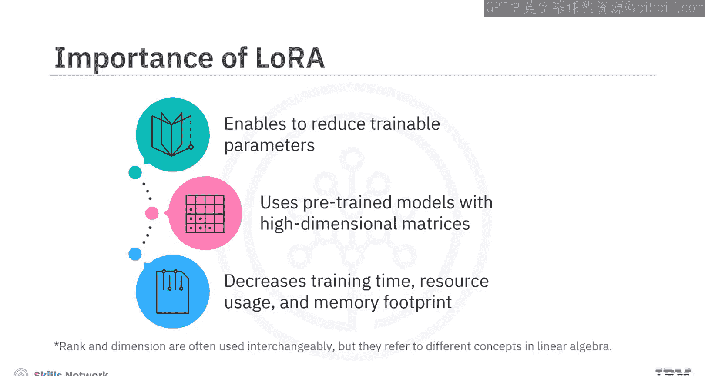
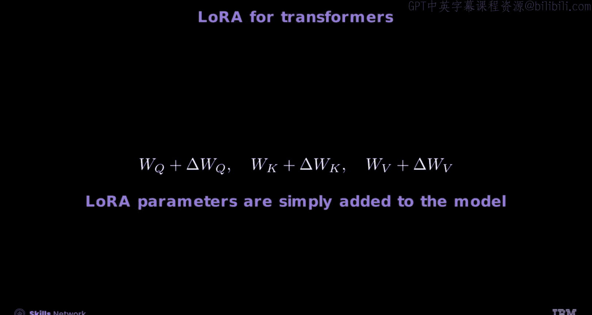
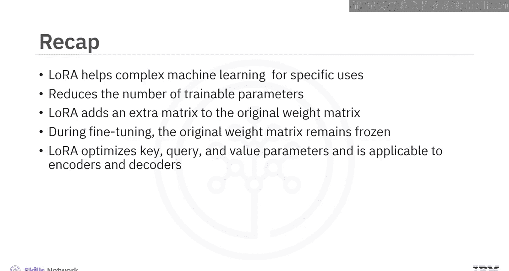

# 138：IBM《生成式人工智能工程｜Falsk、生成式AI应用、数据分析、机器学习、Keras、架构和数据、NLP基础、transformer、微调、高级微调、RAG》 p138 6_低秩适应（LoRA）.zh_en -BV1NAq6Y9E7z_p138-

Welcome to LoR adaptation or LoRA After watching this video you'll be able to define LoRA and explain its working LoRA simplifies the large and complex machine learning model suitable for specific uses LoRA works by adding lightweight plugins to the original model for efficient functioning LoRA enables reduced trainable parameters by leveraging pre-trained models with high dimensionional matrices such as the network's pretrained parameters。

LRA decreases the training time， resource usage and memory footprint。

 let's understand this with an example， consider the third layer of the network displayed on the screen with the input directions of 10 and 8 neurons。

 which equals 80 parameters。

Now consider a layer with an input dimension of 10 and 3 neurons， which leads to 30 parameters。Next。

 map the three dimensional output to eight neurons with three dimensions， each with three parameters。

 leading to 24 parameters。This approach reduces the number of trainable parameters to 54 to maintain the model performance。

 it is interesting to note that Lora operates in the same way。However。

 bias is not included for simplicity。 Let's understand Laura using the matrix algebra。

 The original neural network layer has a weight matrix W0 with dimensions D by K。

 where d is the input size and K is the output size。

The layer's output gets computed as a function of h of x equals w0 times x。

 where x is the input from the last layer。Hence， the resultant parameter is d times k。

In Matri algebra to remain consistent with the original lower layer。

 let's use X and not be confused with the feature。Next， Laura， while predicting the forward step。

 an additional matrix delta W is added to the original weight matrix W0。

 therefore the new weight matrix is w equals W0 plus delta W and the layers output becomes a function。

 H of x， which equals the quantity W0 plus delta w times x。Next， upon decomposing the lowerRA update。

 the matrix delta W decomposes into two low rank matrices， B and A。

 meaning deelta W equals B times a。A and B are the additional layers that map from a simpler to a larger dimension。

 The dimensions of B are D cross R， and that of a is R cross K， where R is the rank。

The value of rank R should be smaller than D and K。 Let's understand this with an example。

 Consider that R is a hyperparameter， and in lowerra， Delta W is a product of B& A matrices。Now。

 upon setting r equal to 1， the resultant matrices B and A have just one dimension。

 but the product size remains fixed。The increase in R increases the number of parameters and keeps higher model capacity。

 keeping the product size constant Next， upon fine tuning with Lora。

 the original weight matrix W underscore0 remains frozen and isn't updated during training This approach significantly reduces the number of learnable parameters。

 and the original neural network， the number of learnable parameters is d times K and with Lora。

 the number of learnable parameters reduces to D times R plus R times K which is much smaller than D times K。

 this reduction occurs because the training updates only the low rank matrices B and a。

 instead of the full weight matrix W。Hence， this method saves computation and memory during the backward pass。

 let's understand how to optimize Lora。In the forward step of Lora。

 apply scaling factor by multiplying alpha divided by the rank R， both being hyperparameters。

 The displayed loss function involves x as the input sequence and Y is the target。

 The loss function depends on matrices， A and B。Meaning only the Delta W is updated using a gradient descent algorithm。

 typically atom， LoRA is a general framework for optimizing parameters and it is useful for transformers having multiple parameters。

 specifically in the attention layers。Moreover， it optimizes the key query in value parameters represented by deelta theta。

 It means the loss function， deelta theta can apply to encoders and decoders。

 It does not necessarily have to be cross entropy loss following the notation from the original lower paper。

😡，The log likelihood acts as a function of the Lora parameters。 Therefore。

 the summation over T is for each prediction in the autoregressive sequence。

 and the second summation is over each sample。 Here。

 omega represents the tokens and x represents the corresponding embeddings。

 Let's recap In this video， you learned about Lora in its working。

 Lora helps complex machine learning for specific uses by adding lightweight plug components to the original model。

It reduces the number of trainable parameters by leveraging pretrain models and matrix algebra to decompose weight updates into low rank matrices。

During the forward pass， LoRA adds an extra matrix Delta W to the original weight matrix。

 enabling computation with fewer parameters by maintaining model performance。

The original weight matrix remains frozen in the fine tuning process and only low rank matrices are updated Lastly。

 Lora is applicable for transformers optimizing key。

 query and value parameters in attention layers and applied to encoders and decors to save computation and memory during the training and storage。

