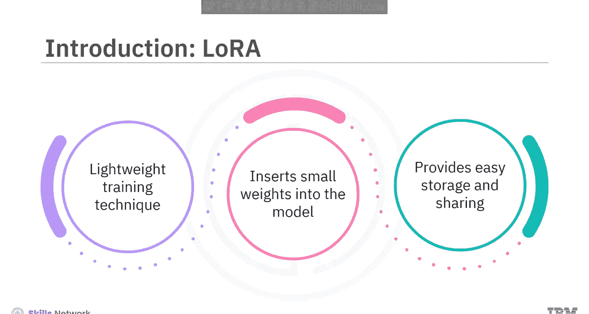
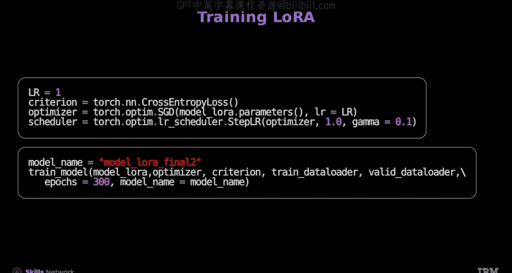
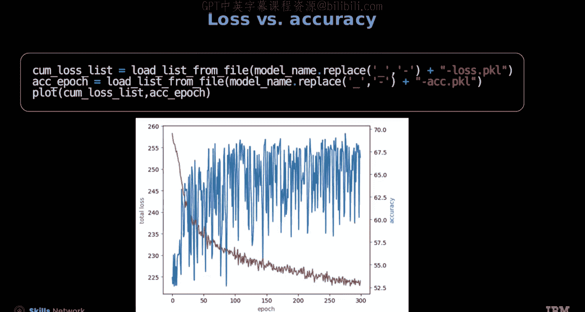
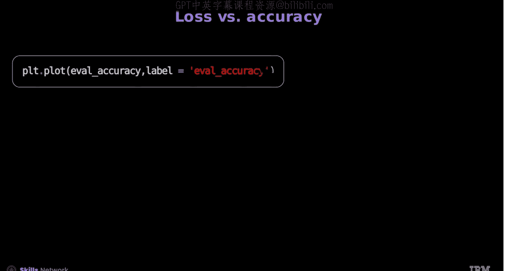
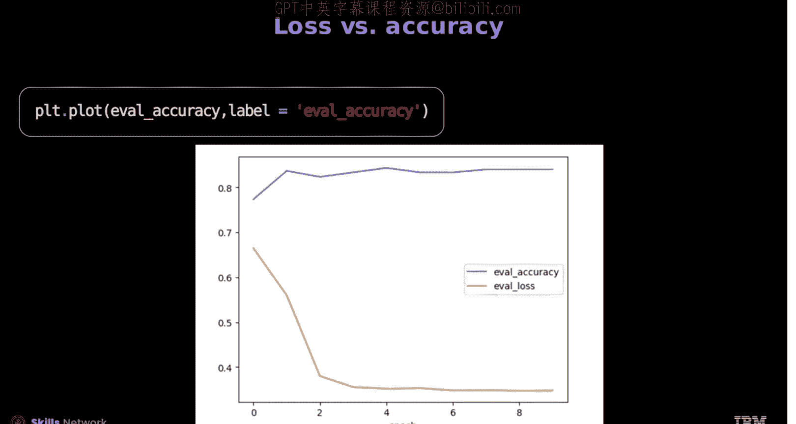

# 139：IBM《生成式人工智能工程｜Falsk、生成式AI应用、数据分析、机器学习、Keras、架构和数据、NLP基础、transformer、微调、高级微调、RAG》 p139 7_使用Hugging Face和PyTorch进行LoRA.zh_en -BV1NAq6Y9E7z_p139-

Welcome to Laura with Pyetorrch and Hugingface After watching this video。

 you'll be able to describe how Laura works with Pyetorch and Huging face in large language models or LLMs you'll also be able to explain various elements that help Laura work with Pyetorrch and Huging F。

Lora is a lightweight training technique that significantly reduces the number of trainable parameters。

 Lo inserts new small weights into the model to train them。

 making the training process faster and memory efficient。

 It also produces smaller model weights for easy storage and sharing。

 The Internet movie database or IMDB data contains movie reviews from the IMDB。

 These reviews are generally useful for binary sentiment classification。

 You can view the class defined to traverse the IMDB data。

Next， let's use the IMDB dataset class to create iterators for training and testing dataset sets。

 this iterator converts the data to Mab style and performs a random split for training and validating them。

😡，At this stage， you can specify the device Now， the collate underscore batch function customizes batches to create them from the individual samples。

 convert the data set objects to data loaders by applying the collate function with the batch size 64。

Further， define a class to represent a simple text classifier， say text classifier。

It uses an embedding layer such as a hidden linear layer with rectified linear unit or relo activation and an output linear layer。

Now， modify the hidden highlighted layer to convert it to a lower model。

 Let's look at the lower layer class。 The lower layer class implements a lower module。

 beginning with two low rank matrices such as A and B。

 it further scales its product by a factor of alpha。

 The forward method performs matrix multiplication A into B X and updates the low rank matrix by adding it to the original output。

 During the training model， you can update only a and B。 However。

 the linear with lower class copies the original linear model and creates a lower layer object。😡。

In the forward method， linear with lower class applies the original linear model and the lower model for the input X and adds the output together。

 Now， let's load a pretrain model on the AG New data set。

 This model has four classes and a thorough language understanding because of its large sample size。

😡，To initiate with this model set none classes to four。

The pre trained A G New model is trained with an unfrozen embedding layer。 Therefore。

 the model has initiated with freeze equals false。 The IM DB data set consists of two classes。

 You can replace the final layer with a new linear layer where the number of outputs equals 2 Next。

 replace the hidden layer with the lower layer ensuring that A and B are updated during training。

 Now， let's fine tune the model defining train model function。First。

 set up the training components for the model and define the learning rate1。😡。

Now use a cross Entropy Los criterion， optimize the stochastic gradient descent or SGD。

 and use the learning rate Schr to decay a factor of 0。1 at each epoC to train the model。

Next， evaluate the model's performance by plotting a graph loss and accuracy for each epoC and monitor the improvements in the model's performance。

 you've evaluated the model's performance， defined the evaluation function and received a model accuracy of 69% on the test data Now from model Laura FC1 Laura obtained the learnable parameters A。

 B and Al and saved them to load the model in the future。

A and B have approximately 450 parameters， storing the entire linear layer would go up to 12。

800 parameters， approximately 28 times more than the original The primary advantage of Lora is that it can fine tune the model using parameters。

 A， B and alpha。 It also uses the output layers to classify examples。Next。

 let's load the model using saved parameters。😡，You can create the model object and pretrain the parameters to load them。

Further， the predicted function is defined using the model to illustrate the model's performance。

Let's look at Lora with Huging face， which makes training the model easy。

Lowra with Huging F first load the IMDB data set to train the model。Here's an example of it。

Now load the distilled Bt tokenizer and apply this tokenizer to create the input ID and attention mask for the given text。

😡，The screen displays the text after tokenization。Further。

 load a bidirectional representation for transformers or a birdlike model from the Hugingface transformformer library with two classes as the fine tuning example。

 next， define the task type to classify the reviews using the sequence classification type from the task type module。

 further define the configuration for Laura， and load the pre-train classification model to define the configuration。

Set rank and lower a scaling factor， including dropout for the larger models。

 The parameter target underscore module specifies the parts of the model that you want to update。

The Lora with hugging face enhances the transformer parameters using parameter target modules。

Then apply Lora to the given model using the specified configuration and initialize via the parameter efficient fine tuning or PEft model。

 Next， let's understand how to set the training arguments in the model。To do so。

 use training arguments， a class for encapsulating all the hyperparameters and configurations required for training the model。

This makes the training process simple and helps to manage various aspects of the training process。

Now let's train the model using a trainer。The trainer class helps simplify the training and evaluation of transformer models。

 It also handles the training loop and saves the model。

 It means that you can train the model using the trainer。Finally。

 Ptographra Los versus accuracy to validate the improvements in the model's performance。

 Let's recap in this video， you learned how Lora works with Pytorrch and Huging face in Lora with Pytororch。

 the model uses the IMDB dataset set and the class to create iterators for training and testing dataset sets。

The collate underscore fN function collateates and customizes batches from various samples。

The text classifier uses embedding layers to classify texts。

The lower layer class implements the lower module in pre transitit。

The model is fine tuned using the train_ model function。

 evaluates the model's performance and provides the model's performance accuracy。

 using the IMDB data set lower with hugging phase simplifies the model training process。

The model uses the tokenizer to create input IDs and Btlike models from the Hugingface transformformer library。

 define the task type using sequence classification type and define the configuration for LoRA。

 training arguments help train the arguments in the model and trainers help the model to train the trainer class。

