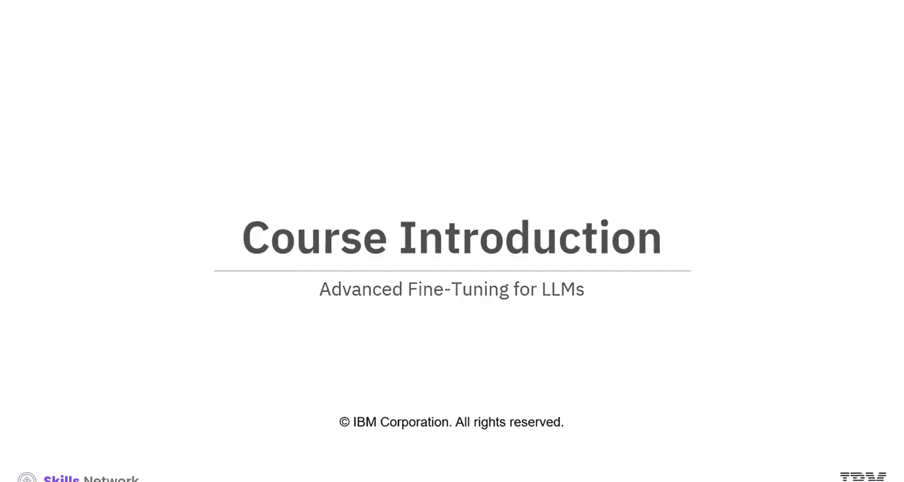
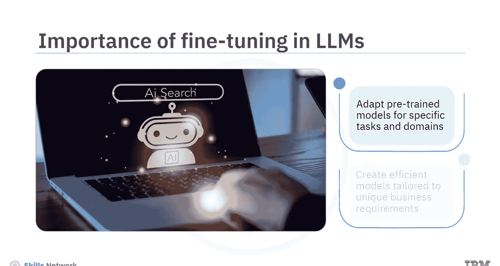
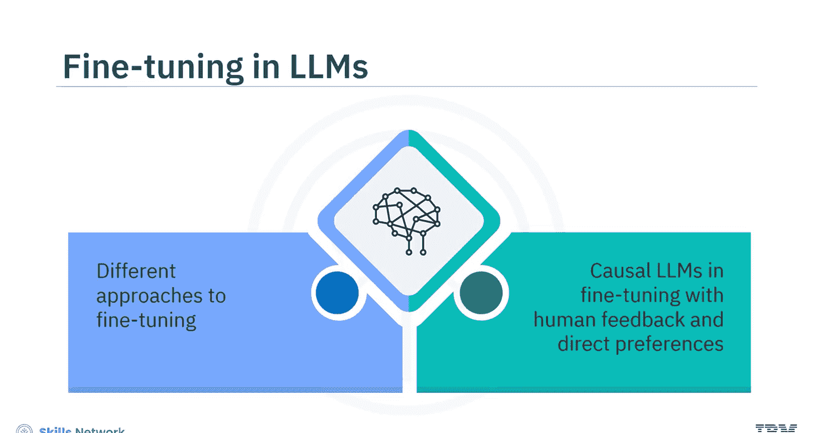
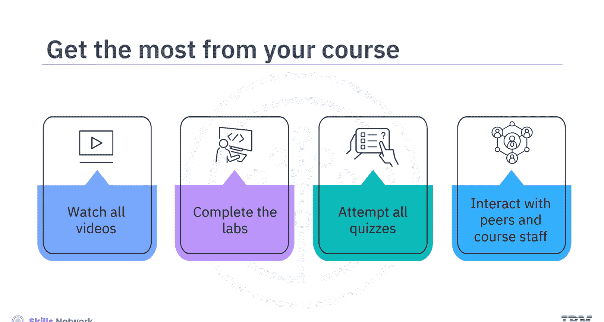

# 141：IBM《生成式人工智能工程｜Falsk、生成式AI应用、数据分析、机器学习、Keras、架构和数据、NLP基础、transformer、微调、高级微调、RAG》 p141 0_课程介绍.zh_en -BV1NAq6Y9E7z_p141-

Welcome to this course about Advd fine tuning for LLMs。

Driven by a powerful technique， fine tuning large language models or LLMs help adapt pretrained models for specific tasks and domains。

 understanding advanced fine tuning techniques and implementing their best practices。

 you can create efficient models tailored to the unique business requirements。

In this course， you will learn about AI engineering concepts by focusing on different approaches to fine tuning and best practices of causal LLMs and fine tuning with human feedback and direct preferences。

This course is suitable for existing and aspiring data scientists， machine learning engineers。

 deep learning engineers， AI engineers and software developers who want to excel in working with LLMs。

 This course requires a basic knowledge of Python， pytorrch and hugging face。

 It's advantageous to have awareness of transformers， instruction tuning， reinforcement learning。

 direct preferences， optimal policies and causal LLMs。 After completing this course。

 you will be able to apply the basics of instruction tuning and its best practices using hugging face。

Using human feedback， you'll learn to train the model using direct preference optimization or GPO and Proximal policy optimization or PPO。

😡，You will begin the course by exploring instruction fine tuning basics with HugingF you'll gain insights into reward modeling。

 response evaluation for preprocessing the data set and apply low rank adaptation or low reconfiguration you'll also learn to reward model training for the language models by following specific instructions to generate relevant responses。

😡，You'll also explore reward modeling with Huging face to evaluate the model's performance。

That's not all。This course will further delve into the concept of LLMs as policies and their relationships as a function of mega to generate possible responses using LLMs as distributions。

Additionally， you'll learn reinforcement learning from human feedback or RLHF to solve PPO problems using technical methods；

 further you'll learn to use PPO and how to configure PPO to receive possible responses for the input queries。

You'll also explore direct preference optimization or DPO and its algorithms using mathematical functions and find the optimal solution for a DPO problem。

In this course， you'll focus on the Huging F library as it's more streamlined than Pytororch。

This course consists of labs that reinforce the learning from the instructional videos。

The hands on exercises are based on the Jupiter labs to practice learned concepts and technology。

The labs reflect the learning of pretraining and fine tuning LLMs using hugging face and pytorch to get the most from your course。

 Watch all videos， complete the labs to practice your new skills and attempt all quizzes。

 You can also interact with peers and get help from the course staff using the course discussion forums。

 Let's get started on this exciting journey。 Good luck。

。