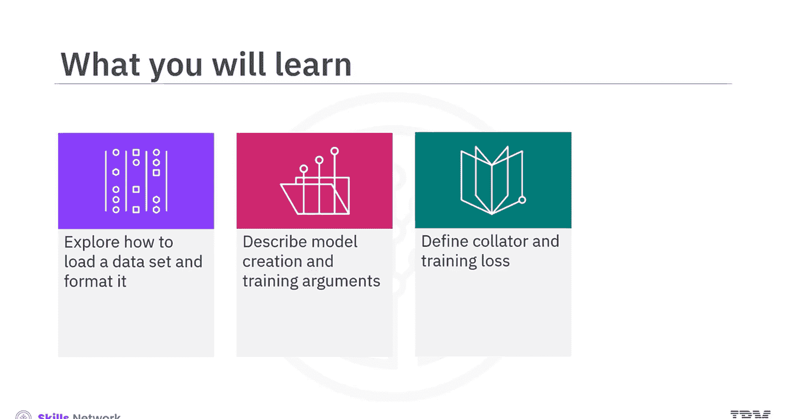
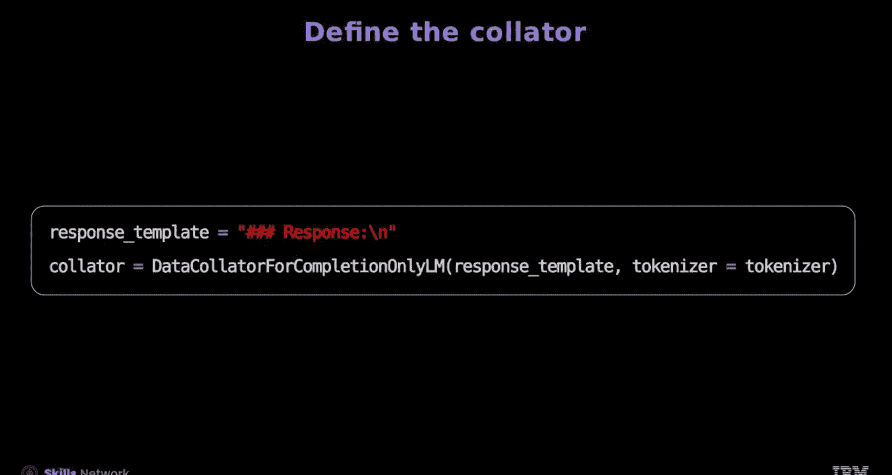
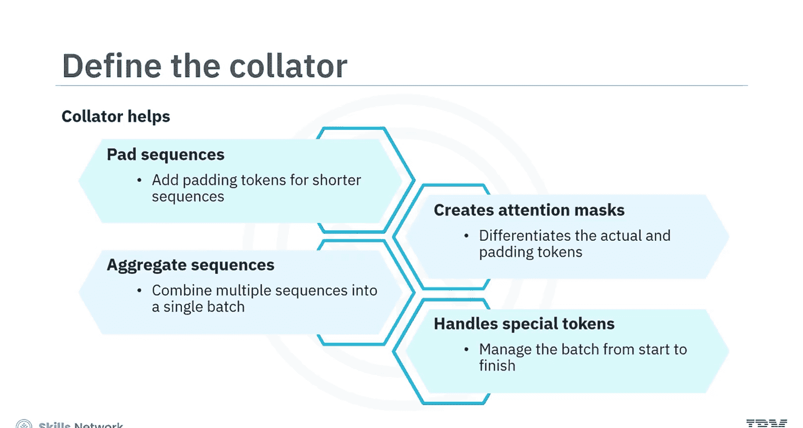
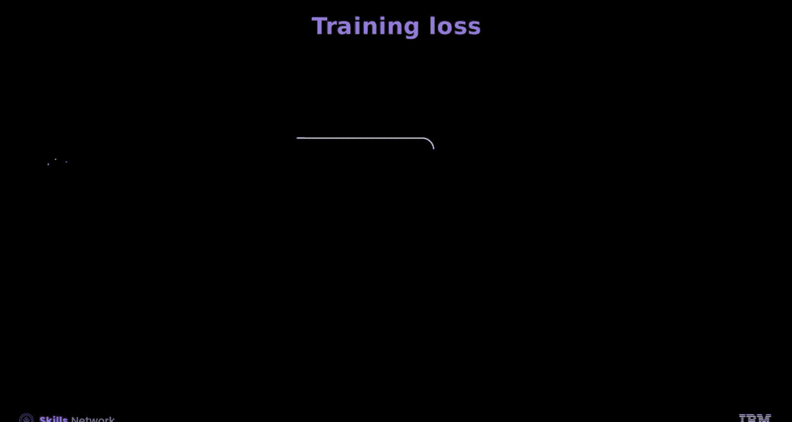
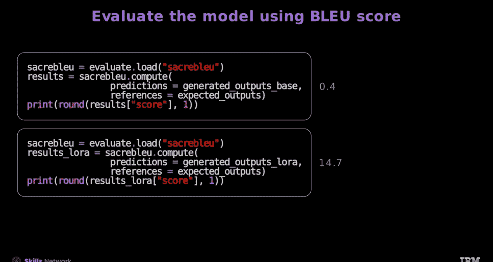

# 143：IBM《生成式人工智能工程｜Falsk、生成式AI应用、数据分析、机器学习、Keras、架构和数据、NLP基础、transformer、微调、高级微调、RAG》 p143 2_使用Hugging Face进行指令调优.zh_en -BV1NAq6Y9E7z_p143-

Welcome to In tuning with Huging Face After watching this video。

 you'll be able to explore how to load a data set and format it。

 describe model creation and training arguments。You'll also be able to define collateder and training loss and describe pipeline for text generation instruction based fine tuning is referred to as instruction GPT。

 It trains the language models by following specific instructions to generate appropriate responses。

Here data set plays an important role by providing structured examples of instructions， contexts。

 and responses。Using this approach， the model handles various tasks effectively。

The context and instructions are linked together to form a single input sequence for the model to understand and use to generate the desired response。

Let's first load the code Alpaca 20K data set。A programming code data set。

This data set includes the components such as instruction， a unique task description for the model。

 The input is an optional context or input for the task present in about 40% of the examples。Lastly。

 the output is an answer to the instruction。Next， split the remaining data set into 80% for training and 20% for validation here。

 let's drop the samples that contain an input value for fine tuning the data。

 it is important to preprocess the data by creating functions that generate the prompt。😡。

For training， the formatting prompts funk function uses the dataset set as input for every element in the dataset。

 it formats the instruction and the output into a template with the format triple hashtag instruction followed by triple hashtag response adding end of the sentence or Eos token at the end of the text indicates that the model should stop generating text at this point。

 Finally， the formatting prompts funk no response function acts similarly to the formatting prompts funk except that it doesn't include responses。

 This function prepares samples for response generation when validating the model for creating a formatted data set。

 a code block generates instructions。 The first code block strips and tokenizes the input。

 It splits and tokenizes the responses for evaluation the second code block defines a list data set class obtained from the data set and creates a torch dataset set from the list。

😡，This class is useful in generating a data set object from the instructions。

Let's finet Facebook's OTP 350M model by loading a base model from Huging Face。

You can use a parameter efficient fine tuning or PEft method。

 low ranking adaptation or LoRA to save time and convert the base model into a PEft method suitable for LoRA。

Next， fine tune Lora by defining the Lora config object from the PAT library with specific parameters such as LoRA rank。

 target modules， and a task type for causal LLM。Apply this configuration to the model using get Paft model。

 converting it into a lower model for training the model， Def supervised fine tuning or SFT config。

The output directory defines the location for the model and training files。

 You can customize the number of training epochs and batch sizes for training and evaluation。

 During training， the evaluation strategy defines the time for evaluation。

Set the evaluation strategy to evaluate after each epoch completes training。

 The max sequence length controls the maximum length of the output responses。

 set F P 16 to true for efficient training to enable 16 bit floating point precision。

 Now define the collateder using the data collateder for completion only Lm from the transformerss reinforcement learning or Trl library that prepares data batches for training language models on text completion tasks and masks the instruction part of the input when calculating the loss。

 Additionally， the collateder helps add padding tokens for shorter sequences to ensure uniform length within a batch and trunnccate longer sequences。

😡。

It creates attention masks for differentiating the actual instruction and padding tokens to prevent them from affecting model learning。

 It also helps aggregate sequences by combining multiple sequences into a single batch for efficient processing。

Lastly， it helps handle special tokens for managing the batch from start to finish。

 including padding tokens。 Next to define the trainer。

 create the SFT trainer object by passing the formatting bunk to the trainer to handle data pre processing。

Then set the packing parameter to false to not pack multiple short examples。 Here。

 the max prompt length parameter controls the prompt length。 Lastly。

 pass a collateder to the SFT trainer。Let's review the data pipeline。 load the training data set。

 Next， the formatting prompt function generates the prompts from the elements in the data set。

 Finally， the data collateder handles tokenization and masking you can plot the training loss saved during training in the trainer state。

 Let's explore the pipeline for text generation and hugging face to simplify the process by automatically handling model loading tokenization。

 padding and text generation parameters to evaluate the model's text generation。

 use a text generation pipeline from the transformerss library。😡。

First， define the pipeline using the pipeline class with a model and tokenizer for this。

 let's set the task to text generation for generating text like a regular chatbot。

 The max length defines the maximum length of the generated text。 Lastly。

 set the return full text to false， only returns the response without the instruction。😡，Next。

 generate text by passing input to the pipeline to get responses using functions such as nubes。

 which generates higher quality text。 The early stopping parameter controls the stopping condition for beam based methods Once the pipeline is created past the input to generate responses。

Here you can see a generated sample response for the fine tuneed model。Finally。

 let's evaluate the model using the bilingual evaluation under study or blue score。

 It is challenging to evaluate language models using quantitative metrics。

 Blue is a useful metric for coding， and Sore blue is a standardized variant of blue。

The results show that the fine tune model achieves a sre blue score of 14。7 by 100。

 significantly better than the0。4 by 100 achieved by the base model。Therefore。

 the instruction fine tune model generates responses that align better with the expected responses in the data set。

 Let's recap in this video， you learn to fine tune the base model using hugging face。

First， load a dataset using code AlPAca 20K data， a programming code dataset。😡。

Format the data set using the formatting prompts Fun function。

 which leverages the dataset set as input to create a format a data set。

 use two code blocks to generate instructions with and without responses。😡，To create a model。

 fine tuneune Facebook's opt 350M model by loading a base model from the hugging face。

Define the collateder using data collateder for completion only LM to prepare data batches for training language models and define the trainer by creating the SFT trainer object。

 finally generate a text pipeline from the Transformer's library and evaluate the model's text generation using the blue score。

