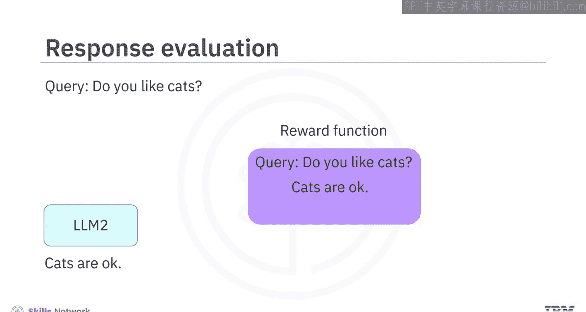
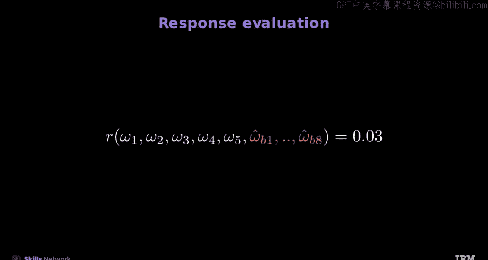
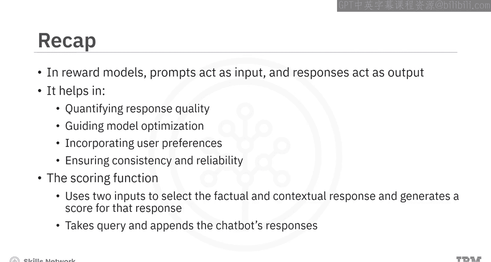

# 144：IBM《生成式人工智能工程｜Falsk、生成式AI应用、数据分析、机器学习、Keras、架构和数据、NLP基础、transformer、微调、高级微调、RAG》 p144 3_奖励建模响应评估.zh_en -BV1NAq6Y9E7z_p144-

Welcome to rewardward Modeling Response Evaluation。After watching this video。

 you'll be able to define reward modeling and describe response evaluation。

The reward evaluates the degree of alignment， meaning a model responds to human preferences。

Reward modeling quantifies the response quality by assigning numerical values to responses for assessing and comparing performance；

 it also guides model optimization by optimizing parameters to maximize the assigned score and improve the model's performance。

Reward modeling incorporates user preferences in the scoring function for customizing model behavior。

It ensures consistency and reliability， providing a consistent and reliable evaluation of the responses。

Let's understand response evaluation to evaluate the responses of causal decoder such as chatbots。

 let's use a reward function based on user preferences shown as a purple box。

Training a reward function assigns high rewards to responses such as cats。For example。

 insert a query for LLM to ensure that the large language model or LLM prefers CAs。

LLM1 likes cats and LLM2 thinks cats are just okay。

The reward function evaluates the query and provides the scores。

 The scores should be high to ensure the response aligns with the LLM's preference。Here。

 the LLM likes cats， therefore， reward function assigns high scores to responses that reflect the preference for cats。

Repeat the process for LLM2 because it thinks that cats are just okay， therefore。

 the response score is 0。5。

Let's consider a scoring function that assigns higher scores to generate precise and contextually accurate answers。

 for example， the query is which country owns Antarctica， To create a response。

 let's input this query into two chatbots A and B。Response A states that Antarctica is governed by the Antarctic Treaty system。

 which is factual and accurate。In contrast， Re B claims that Penguin overlords run the show down there。

 which is an assumption and not factually correct。 Therefore。

 the goal is to select Re A to prioritize the factual accuracy of the response based on the user preferences。

To input the query and response into the scoring function first。

 tokenize the user input query where the omega symbol with a subscript indicating sequence index denoted by each token Next。

 tokenize response A and denote it with the variable omega hat a。

 representing its' an estimation Now tokenize response B and denote it as variable omega hat B。

 representing it as an estimation here， sequences need not be of the same length。😡。

The scoring function takes the query and appends the chatbot's responses。

 It means the tokens are collected and inserted into the scoring function denoted by R。😡。

The screen displays the query in white and the response in blue。Next， use the mega notation。

 denote the query as omega， and the response as mega hat， therefore。

 response A is good with a score of 0。89。This scoring process evaluates the response quality based on the accuracy and relevance of the query。

Similarly， the scoring function displays the query and bad response in red Upon using omega notation。

 the omega represents the query and the response as omega hat underscore B。

 therefore response B is bad with a score of 0。03。 This scoring reflects the user's preferences based on the training data For example。

 response B may receive a higher score by training the scoring function to prioritize assumption。😡。

In this video， you learned about reward modeling and how to create or train the reward model。

The reward model takes prompt as an input and responds as an output regarding rewarder score reward modeling helps in quantifying quality responses。

 guiding model optimization， incorporating reward preferences and ensuring consistency and reliability of the responses you learn to use the scoring function enter two inputs and select the factual and contextual response and the response evaluation process based on the generated response。

 you'll get scores or rewards for the response， the scoring function takes a query and appends the chatbot responses。

😡。

