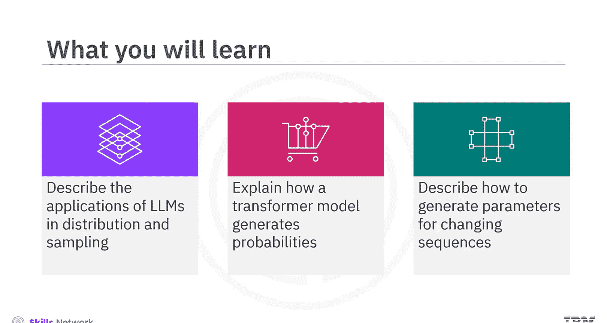
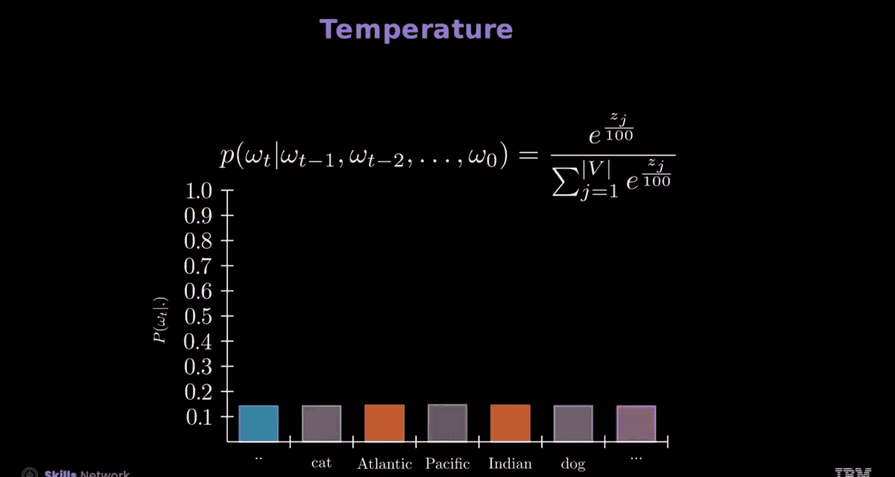
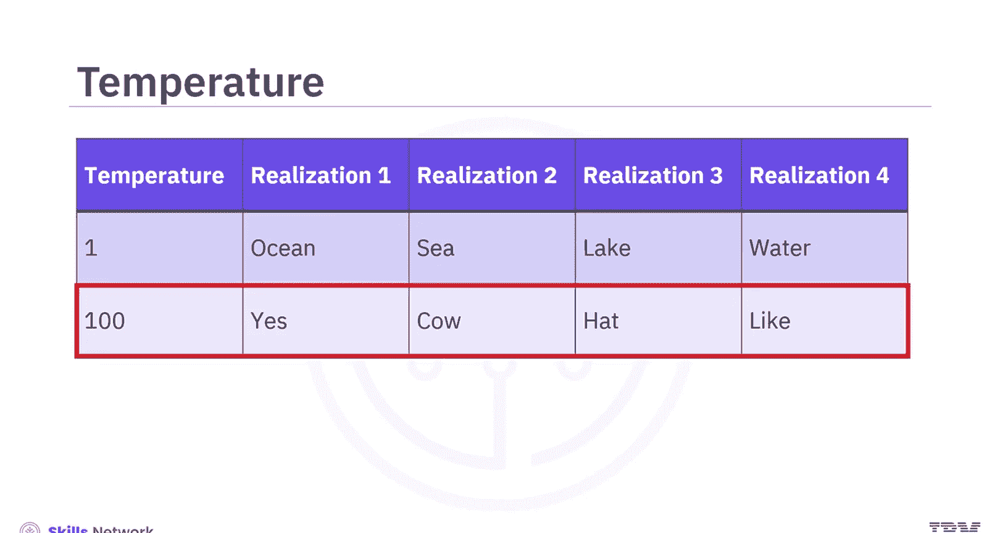
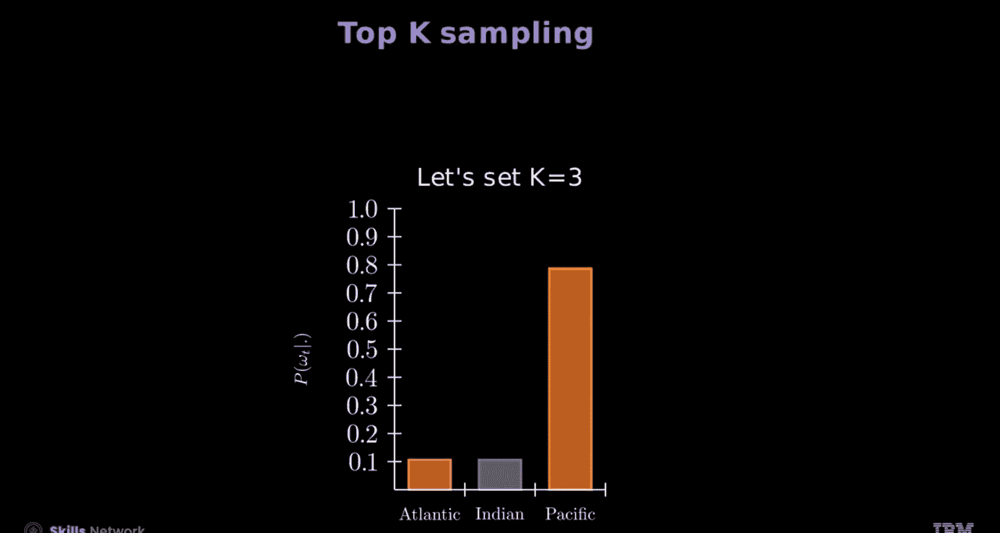

# 147：IBM《生成式人工智能工程｜Falsk、生成式AI应用、数据分析、机器学习、Keras、架构和数据、NLP基础、transformer、微调、高级微调、RAG》 p147 6_大型语言模型（LLM）作为分布.zh_en -BV1NAq6Y9E7z_p147-

Welcome to large language models LLMs as distributions After watching this video。

 you'll be able to describe the application of LLMs in distribution and sampling。

 You will also explain how the transformer model generates probabilities for different words and describe how to generate parameters for changing sequences。

 Let's look at the table representing different queries。 The questions in the table are simple。

 but queries can vary， including programming question answers or summarization。

 assume that you can train the reward function on a similar data set X approximate D represents the distribution。

 process from this data set， meaning the random samples come from the given table to demonstrate how LLMs are recognized as distribution and explore sampling from it。

 a language model takes sample query X and generates a response Y where y is a random variable。

 Consider a query， which is the largest notion For this query。

 the model generates various responses based on the probability distribution such as the Pacific Ocean followed by Pacific。

Ocean is the largest ocean on Earth， Pacific Ocean is 1。

55 million square kilometers and Atlantic Ocean。You can represent this as Y distributed pi Y slash x Y。

 where the policy pi is a distribution。 However， let's focus on generating each token in Y。

 The transformer model generates probabilities for different words using the soft max function applied to the final layer for a query。

 which is the largest ocean。 The bar graph represents the visualization of the possible words。

 the X axis denotes the possible word at the time omega T。

 While the y axis denotes the probabilities for each word。 Next。

 update the bar graph with the actual probabilities for each word。 For example。

 the soft max function calculates the probability for the word Atlantic。

 and you can update the bar graph accordingly。 Similarlyly， for the next words Pacific and Indianian。

 the soft max function calculates the probabilities。 and you can update the bar graph accordingly。

 the ellipsis indicate the rest of the words in the vocabulary for consideration。At the time T。

 you have various realizations for omega t， where words are selected based on their probabilities。

For example， Real1 is specific， Real 2 is specific， and Real 3 is Atlantic and so on。

 Counting realization for each word， you can find that the number of times a word occurs would be proportional to the distribution generated by the soft max function。

 as shown in the table where the first column is the word and the second column is the number of realizations for that word。

Let's understand what happens when the value of the timestamp changes from T to t plus1 As the model generates tokens。

 the distribution at time T plus 1 depends on the previous values for the word Atlantic。

 the soft max function calculates the probability of the next word。 For example。

 if the word at a time T is Pacific， the probability changes accordingly and similarly for the word Indian。

 This probability shows how the probability distribution at a time T plus1 depends on the words and their probability at time T。

 This relationship continues from T equals 0。 as t increases the distribution at time T plus1 is influenced by the value T and earlier timestamps。

 leading to various possible sequences。 For example。

 Pacific leads to a specific distribution at timestamp T plus 2。

 similar to Atlantic Indian Antarctic。 Finally， when T receives larger sequences。

 you can visualize examples generated from the initial query such as the Pacific Ocean is the at。

TC is not Pacific Ocean， E， Indian Ocean ifU and what is your timeline？

Let's summarize the distribution process and focus on the working of the causal transformers here the input model is the largest ocean is converted into tokenized word embeddings and passed through the transformer。

Select a random output instead of applying the AGMax function to select the most likely sequence。

For example， you may select Pacific and other less likely words such as Atlantic or Indian。

Pass these words back to the model and repeat the process by selecting a random word from the probabilities generated by the model。

Here you can see the ocean， sea and lake。Next is generation parameters。

 which can help change the sequences generated using LLMs。

 temperatureemperature tau is a hyperparameter in the soft max function that affects the probability distribution。

 The temperature parameter controls the random distribution。

 meaning the higher tau values make it more uniform and the lower tau values make it less random。

 Let's start with the soft max equation to see how different temperature values influence the probability distribution。

 For example， calculate the probabilities at temperature 1 and observe the distribution。😡，Now。

 increase the temperature to2 and the distribution becomes more uniform。 Additionally。

 increasing the temperature to 5 spreads the distribution extensively， showing higher randomness。

With a temperature of 10， the distribution becomes more flat or uniform。 And finally。

 at temperature of 100， the distribution is almost uniform。

 meaning every token is almost equally probable， indicating maximum randomness。

 Each column in the given table shows several random sequence realizations。

 The first row with a temperature of one shows each word similar meaning。 On the other hand。

 the second row with the higher temperature shows random words。

Next is top K sampling with parameter K。 This method restricts the selection of the next token to the top K highest probability tokens。

 For example， let's set k to3。 First， compute the soft max values with the temperature of one and display the initial probability distribution for different words。

 Next， apply top K sampling。 select the top three highest probability tokens。

 and filter the less preferred options。 identify the top K indices and highlight the corresponding words。

 Lastly， normalize the top K values to ensure the sum is one。 to generate sequences。

 look at other parameters such as beam search， top p sampling repetition penalty and max and min tokens。

 The beam search parameter tracks and expands various top sequences at each step。 The top p sampling。

 limit the sampling pool to the smallest tokens for which the cumulative probability exceeds the threshold P。

 The repetition penalty penalizes the repeated sequences of tokens to encourage。

Dverse output and avoid repeated text generation。 Lastly。

 the max and min tokens set the maximum or minimum number of tokens In this video。

 you've learned how to use LLms as policies for response generation。

 The sample query questions may provide various random responses based on the probability distribution。

The transformer model generates probabilities for different words using the soft Max function。

 selecting words at various timestamps and change the probability for those words。

The generation parameters such as temperature， top K sampling， beam search， topP sampling。

 repetition penalty， and max and men tokens help change the sequences generated using LLMs。

