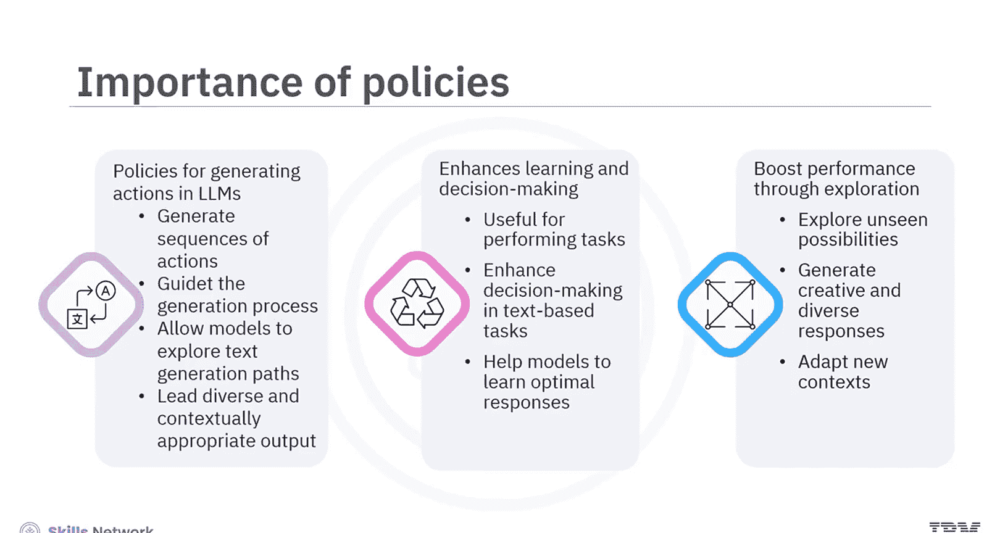
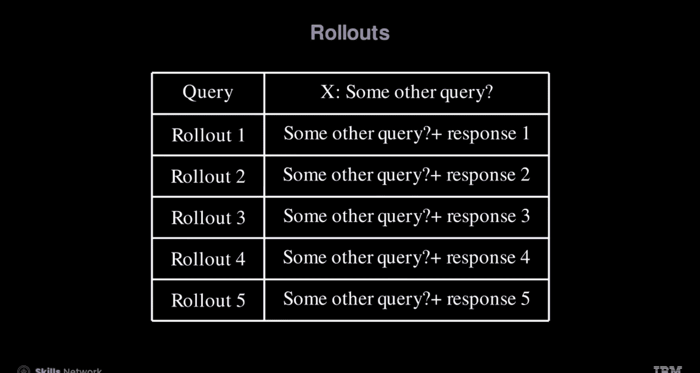

# 148：IBM《生成式人工智能工程｜Falsk、生成式AI应用、数据分析、机器学习、Keras、架构和数据、NLP基础、transformer、微调、高级微调、RAG》 p148 7_从分布到策略.zh_en -BV1NAq6Y9E7z_p148-

Welcome to From distributions to Pol After watching this video。

 you'll be able to describe how to generate policies using a language model for distributing and applying rollouts in the policies in reinforcement learning。

 a policies as a specific strategy or mapping that an agent uses to decide its actions based on the current state of its environment Let's look at the importance of policy policies and reinforcement learning or Rl determine distributions for generating sequences of actions。

 in LLMs policies can guide the generation process。

 allowing models to explore various text generation paths and leading to more diverse and contextually appropriate outputs in RL policies are used to perform tasks such as playing games by guiding actions toward goals for LLMs policies enhance decision making and text-based tasks。

 helping models learn optimal responses， thereby improving accuracy and relevance in language understanding and generation unlike conventional AI methods。

 RL policies used randomness to explore unseen possibilities。

This approach helps LLMs perform better by generating creative diverse responses and adapting the new context。

 making the model more robust and versatile。 Let's delve into policy。

 a language model as a distribution in terms of reinforcement learning。

 The language model generates responses based on the inserted query by following policy distribution。

 This is represented as y follows the policy given x， where x is the input sequence of length M。

 and y is the output sequence of the total sequence of length N。 For example， consider the query。

 which is the largest ocean。 The model generates various possible responses。

 Each possible response is known as rollout。 The first realization is the Pacific ocean。

 The second is that the Pacific ocean is the largest ocean on Earth。

 The third is that the Atlantic ocean is 155 million square kilometers and the fourth is the Atlantic Ocean。

 To clarify the relationship between the policy and language model as a function of mega。

 consider the relationship Y。

low the policy given X。 The detailed policy distribution is represented as a function of mega。

 showing how probabilities of the response are computed based on the previous tokens for the query。

 which is the largest ocean。 The model first calculates the probability distribution for different responses。

 For example， in the probability of Atlantic You can see that the given query followed by the probability of the Atlantic ocean inserted as previous words where K is the response index。

 Finally， let's look at the rollouts。 rollouts refer to how the model generates different responses for each query For this。

 let's look at the initial set of queries。 consider the query。

 which is the largest ocean The model generates several random responses In this example， it is5。

 Each termed as a rollout The process continues with the query。

 can you give me some Python code where the model generates several rollouts。

 It is important to note that the definition of rollout in library such as hugging face differs from that in reinforcement learning or RL。

RL is a reward included in the definition Let's recap In this video。

 you've learned to use distribution as a policy in reinforcement learning。

 a policy is an agent' specific strategy or mapping to decide its actions。

 policies help to generate actions in LLMs， enhanced learning and decision making and boost performance through expiration following the policy distribution。

 the language model generates responses based on the inserted query You can consider the relationship Y follows the policy given eggs to clarify the relationship between the policy and the language model as a function of mega rollouts are how the model generates different responses for each query The rollout libraries such as hugging face differ from the reinforcement learning。

