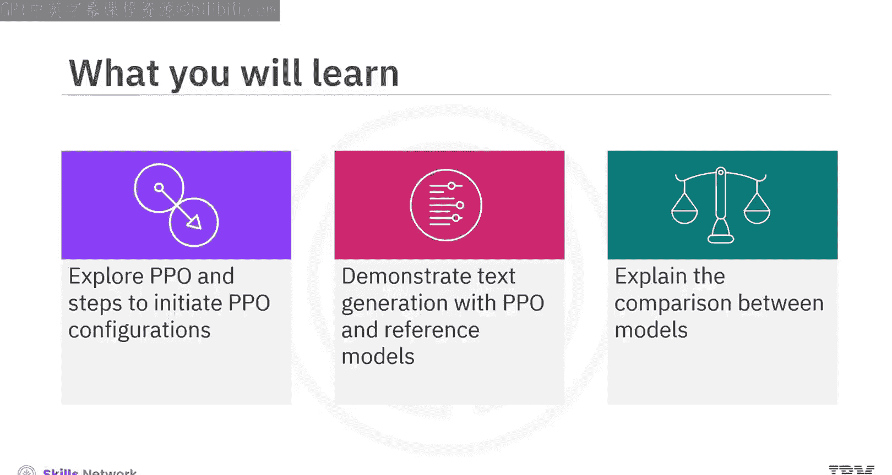
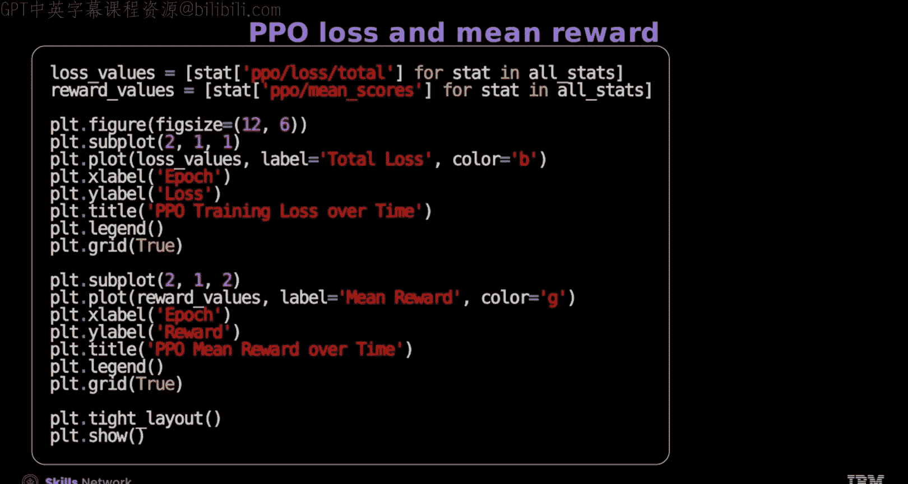
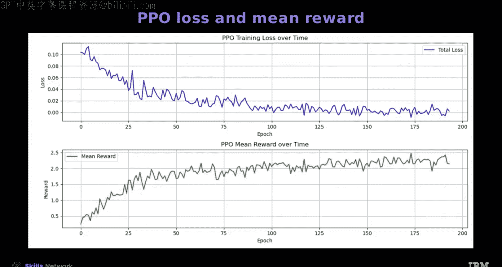
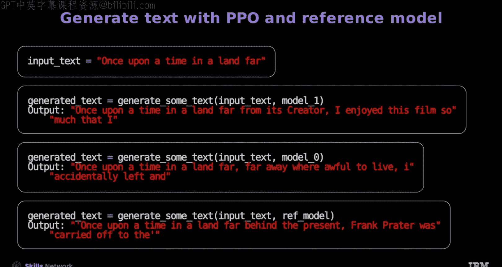
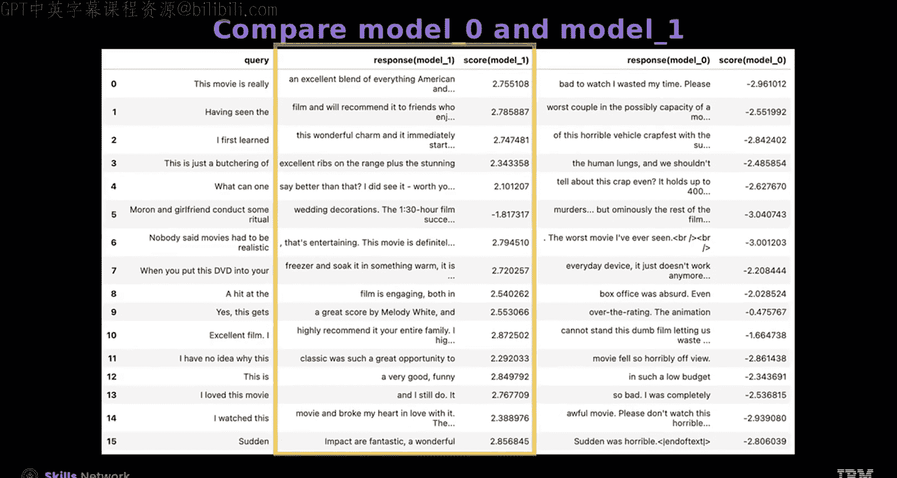
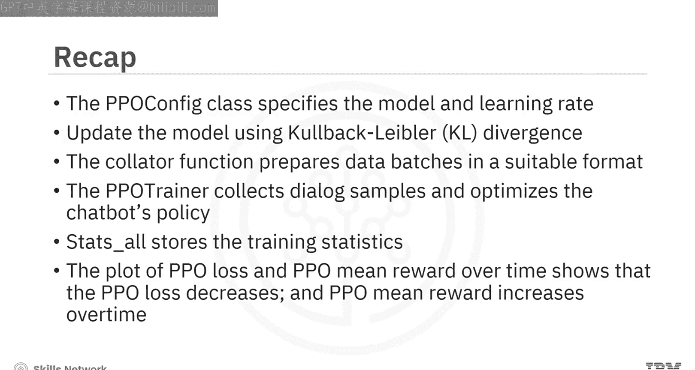

# 152：IBM《生成式人工智能工程｜Falsk、生成式AI应用、数据分析、机器学习、Keras、架构和数据、NLP基础、transformer、微调、高级微调、RAG》 p152 11_PPO训练器.zh_en -BV1NAq6Y9E7z_p152-

Welcome to PPO Trainer。After watching this video you'll be able to explore proximal policy optimization or PPO and the steps to initialize PPO configurations you'll also be able to demonstrate how to generate text with PPO and reference models and explain comparisons between models Let's begin by exploring how to initialize PPO configuration the PPO config classes useful for specifying the model and learning rate for PPO training。

The model name specifies the model that needs to be fine tuned lastly， set the learning rate。

Toload the model in the reference model， use the reference model to stabilize training by Col bag Ladler or KL divergence between the current policy that is the model and the reference policy that is the reference model Auto model for causals LM with value head extends auto model for causals LM class for reinforcement learning。

The collateder function is crucial for preparing data batches in a format suitable for the PPO trainer；

 it ensures that each feature from the data samples is grouped together。

The output is demonstrated with an input toy example。 Now， let's understand the PPO trainer。

The PPBO trainer processes query samples and optimizes the chatbots policy。

 handling complex tasks to ensure high quality responses。

Let's initialize PPO Traer with the specified configuration and components。First。

 configure the settings for PPO training， using configuration settings such as learning rate and model name。

Next， fine tune the primary model using PPO and input the reference model。

Further input the tokenizer for processing the input text Next insert the data set to provide the input data for the model to train it；

 lastly， the data collateder handles the batching and formatting of the input data。😡，In PPO。

 the list stats all stores the training statistics for each batch。

 set the sentiment score change score to one to provide a higher reward for positive sentiment。

 and encourage the chat bot to generate positive responses。On the other hand。

 setting the sentiment scored at zero will increase the chances of generating higher reward for negative sentiment。

 resulting in negative responses。The screen displays the training loop code for the PPO algorithm using sentiment analysis。

The training loop iterates over batches of data for the PPO trainer and data loader now perform the following steps。

For each number， extract input IDs， queries from each batch and query tensors for each query tensor in the batch。

 select a random sample output length and use it to set the maximum number of new tokens to generate a response using PPO Traer and store it。

Next， append the generated response tensor to the response tensors list。

 trimming it to the generated length， Now decode the response tensors to text and add them to the batch。

 concatenate the query and response for each pair to form the text and apply the sentiment analysis pipeline to the text。

Now extract the sentiment score and convert it to a tensor。Lastly。

 collect the statistics by performing a PPO step with the queries， responses and rewards。

 run the training step method to train the model， log the statistics along with the batch and rewards and append the statistics to the All stats list The PPO returns rewards and losses to the dictionary Let's write a function to display these values。

Setting related to objective equals true helps obtain statistics for optimizing the model parameters。

Such as model loss and value loss。On the other hand。

 setting related to objects equals false helps obtain additional metrics relevant to reinforcement learning。

 such as advantage estimates and reward calculations。Now it's time to save the model Next。

 plot the graphs for PPO training loss and PPO mean reward over time。😡。

You can see that the loss decreases over time， however PPO mean reward increases over time。

 train the model0 with negative sentiment by setting the change score value to zero for comparison。

Next， to generate text using PPO and reference model。

 you should allocate the device per CPU and GPU availability。

Now define and decode a function for tokenizing the input text that generates a response using the provided model。

You cannot use the text generation pipeline with the auto modelto for causal LM with value head class。

 You can see the responses from the three models using the input text， such as Model 1。

 which is trained on positive sentiments and generates a positive response。

Model Ze was trained on the negative sentiments and has generated a negative response。However。

 the reference model or the original model provides a neutral response。

Now let's compare Model0 and Model 1。The screen displays examples of the generated responses from the positive and negative sentiment models with their sentiment scores。

You can see that the positive model generates a positive response in scores。 In contrast。

 the negative model generates negative responses and scores。

Let's recap in this video you learned about the PPO configuration and its training using Huging F。

The PPO config class is useful for specifying the model and learning rate for PPO training PPO training updates the model using callback libblar divergence The collader function is vital for preparing data batches in a format suitable for the PPO trainer The PPO trainer collects dialogue samples and optimizes the chatbots policy in PPO the list stats underscore all stores the training statistics for each batchon plotting a graph of PPO loss and PPO mean reward over time shows that the PPO loss decreases in PPO mean reward increases over time。

。